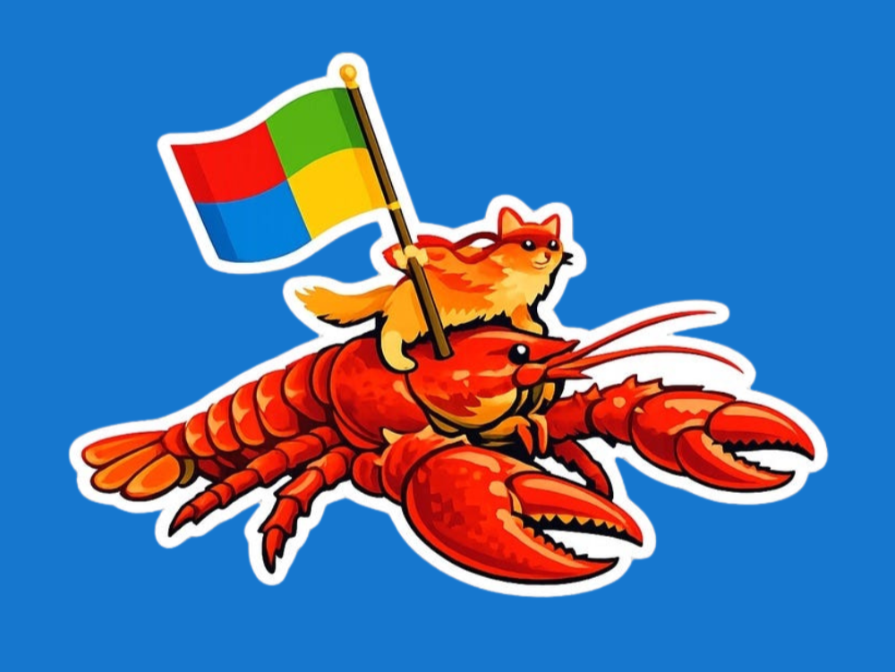



**收录说明**：发布前一个月的报道，作者采访了 Omar Shahine，披露微软内部的 OpenClaw 团队与 ClawPilot 桌面环境。直接下载；删去了栏目横幅、分享按钮和文末「Latest Stories」及订阅区块，图片收入 images/。已翻译。

**内容摘要**：GeekWire 于 2026 年 5 月 4 日报道，由 Omar Shahine 领导的团队已有可运行的智能体原型；截至 5 月 1 日，微软内部每天有超过 3,000 名用户测试其基于 OpenClaw 的桌面环境「ClawPilot」，一周前为 100 人。Shahine 于 2 月 26 日向 AI Accelerator 小组演示 Lobster，3 月 31 日起负责把 OpenClaw 和个人智能体带入 Microsoft 365；其愿景是一个在 Microsoft 365 生态内全天候代用户工作的常驻智能体团队，原型智能体拥有自己的 Entra ID、Exchange 邮箱和 Teams 身份。文中引述微软 Defender 团队的指引：「OpenClaw 应被视为带有持久凭据的不受信任代码执行，不适合在标准个人或企业工作站上运行」，Shahine 则承认企业加固是头号任务。他当时不愿谈时间表，但表示 Build 上会有关于让 Windows 成为 OpenClaw 运行环境的具体信息。

**保留理由**：这是发布前一个月的报道，提供了 Scout 之前的时间线证据（3,000 名日活用户、关键日期）、对 Shahine 的采访，以及微软自身 Defender 对 OpenClaw 风险的指引。

---

微软的 OpenClaw 团队迎战个人助手难题
**作者：[Mary Jo Foley](https://www.geekwire.com/author/maryjofoley/ "Posts by Mary Jo Foley")**，2026 年 5 月 4 日上午 11:52，2026 年 7 月 22 日上午 9:20

微软非官方的 Ninja Cat 吉祥物骑在 OpenClaw 龙虾上。（图片来自 [Omar Shahine 的博客](https://www.omarknows.ai/p/lobster-got-hired)）

Bob。Clippy。Cortana。Copilot。几十年来，Microsoft 一直在试图解开个人助手这道难题。如今，公司内部一支刚起步、一直在试验 OpenClaw 的团队正着手解决这个问题——OpenClaw 是一个开源框架，既是虚拟助手，也是用于构建和管理主动型智能体的平台。

这支[由公司副总裁 Omar Shahine 领导](https://www.geekwire.com/2026/tech-moves-c-suite-exec-leaves-microsoft-for-alaska-airlines-amazon-leaders-depart-hashicorp-cto-resigns/)的团队已经有了可运行的智能体原型；截至 5 月 1 日，Microsoft 内部已有超过 3,000 名每日用户在使用「ClawPilot」——该团队基于 OpenClaw 的桌面环境，属于「Project Lobster」的一部分——而前一周只有 100 人。

对于一项就在几个月前还被 CEO Satya Nadella 斥为[类似「病毒」的安全风险](https://www.perspectives.plus/p/claw-of-unintended-consequences)的技术来说，这成绩不差。包括 OpenAI 和 NVIDIA 在内的多家公司也在争相把这项技术与自己的产品整合。

Omar Shahine。（LinkedIn 照片）

Shahine 团队的愿景是打造「一个常驻的智能体团队（一位幕僚长智能体、一位执行助理智能体，以及一组专家智能体），在 Microsoft 365 生态内全天候代你工作」，他[在一篇博客文章](https://www.omarknows.ai/p/lobster-got-hired)中这样描述。

他解释说，这是一个「持久运行时，持续监控你的各种信号，在你醒来前为你准备好一天，在你开会时分拣收件箱，并在无需被要求的情况下跟进待办事项」。

OpenClaw 由 Peter Steinberger 开发（截至 2026 年 2 月，他在 OpenAI 工作），自 2025 年 11 月起才公开可用，最初名为 Clawdbot。

Shahine 从今年早些时候起就一直在摆弄 OpenClaw，[用来自动处理家里的任务](https://www.omarknows.ai/p/meet-lobster-my-personal-ai-assistant)，比如起草电子邮件或查询音乐会门票价格。他在 2 月 26 日向 Microsoft AI Accelerator 小组的演示中展示了 Lobster 的工作方式。到 3 月 31 日，他在 Microsoft 有了一个新角色：把 OpenClaw 和个人智能体带入 Microsoft 365。

Microsoft 最近凭借 Copilot Tasks 涉足自主智能体领域，这是一个面向消费者的预览版智能体，旨在帮助处理分拣邮件和预订旅行等杂务。在商业侧，Microsoft 正以 Copilot Cowork 的形式把 Anthropic 的 Cowork 技术与 Microsoft 365 Copilot 整合，后者可在各种 Microsoft Office 应用内采取行动。

但 Shahine 坚持认为，这两种方式都没有提供一种全天候代用户工作、能够接触人们完整真实生活的虚拟助手。如果用户连续开会，它们无法做像从 DoorDash 订餐这样的事；如果电话与家庭晚餐冲突，它们也无法重新安排。他说，正是这一空白促使他把目标对准知识工作者。

Shahine 的团队名为 Ocean 11，由少数几人组成，每人运行自己的 Lobster 智能体。团队正在构建让 Lobster 在企业环境中工作所需的运行时和支撑基础设施。

按照 Lobster 目前的设想，它将跨各种应用以及 Microsoft 365 和其他数据源工作。它不需要持续提示，而是会提出可以采取的行动方案，等待用户批准。

这正是 Nadella 和其他注重安全的人士对 OpenClaw 有所顾虑的原因：它自主工作，可以摄入未经测试的输入，持有持久凭据，并可能把提示注入攻击变成行动注入攻击。

Microsoft 自家 [Defender 安全团队当前的指引](https://www.microsoft.com/en-us/security/blog/2026/02/19/running-openclaw-safely-identity-isolation-runtime-risk/)指出：「OpenClaw 应被视为带有持久凭据的不受信任代码执行。它不适合在标准个人或企业工作站上运行。」

在一次采访中，Shahine 承认，对 Microsoft 基于 OpenClaw 的产品进行企业加固必须是头号任务。他的团队正在设计拥有自己 Microsoft 365 身份的原型智能体，意味着它们有自己的 Entra ID 用于治理、自己的 Exchange 邮箱、自己的 Teams 在线状态，并与 Microsoft Graph 集成。

他说：「我的目标是既为让 OpenClaw 变得更好做出贡献，也使用并运行它，使它同时成为一种参考设计、参考模式，让人们可以参照着说：『你看，这很棒。Microsoft 搞明白了怎么让这东西在企业里也很棒。』」

Shahine 还不愿谈时间表或交付物，不过已经有一个由 OpenClaw 开发的 Teams 插件可用。Shahine 的团队已经开发出 ClawPilot 的 Mac 和 Windows 桌面环境（与 [clawpilot.ai](http://clawpilot.ai/) 无关），并在内部用它处理「爪状智能体工作流」。Shahine 说 ClawPilot 正充当他的个人助手，名字叫「Sebastien」（向《小美人鱼》致意）。

Microsoft 副总裁 Scott Hanselman 构建了[一个 OpenClaw 的 Windows 节点](https://github.com/openclaw/openclaw-windows-node/)，它可能会在 Microsoft 于 6 月在旧金山举行的 Build 开发者大会上获得一些展示时间。Shahine 说：「会有一些具体信息，说明我们如何努力让 Windows 成为 OpenClaw 和其他智能体系统运行的绝佳环境。」
