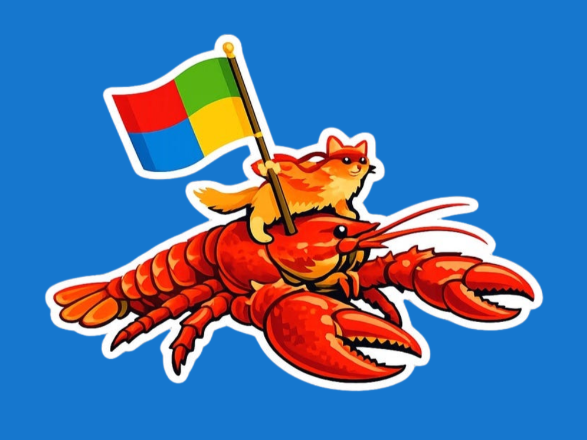

来源：https://www.geekwire.com/2026/microsofts-openclaw-team-takes-on-the-personal-assistant-challenge/
取文：2026-11-10，直接下载

Microsoft’s OpenClaw team takes on the personal assistant challenge
**by [Mary Jo Foley](https://www.geekwire.com/author/maryjofoley/ "Posts by Mary Jo Foley")** on May 4, 2026 at 11:52 amJuly 22, 2026 at 9:20 am

Microsoft’s unofficial Ninja Cat mascot rides the OpenClaw lobster. (Image via [Omar Shahine’s blog](https://www.omarknows.ai/p/lobster-got-hired))

Bob. Clippy. Cortana. Copilot. Microsoft has been trying to unlock the personal-assistant puzzle for decades. Now a fledgling team inside the company that’s been experimenting with OpenClaw — an open-source framework that acts both a virtual assistant and platform for building and managing proactive agents — is taking a stab at the problem.

That team, [headed by Corporate Vice President Omar Shahine](https://www.geekwire.com/2026/tech-moves-c-suite-exec-leaves-microsoft-for-alaska-airlines-amazon-leaders-depart-hashicorp-cto-resigns/), already has a working agent prototype and, as of May 1, more than 3,000 daily users inside Microsoft testing “ClawPilot,” the team’s OpenClaw-based desktop environment that is part of “Project Lobster,” up from 100 the previous week.

Not bad for a technology that CEO Satya Nadella dismissed as [a security risk akin to “a virus”](https://www.perspectives.plus/p/claw-of-unintended-consequences) just a few months ago. A number of other companies, including OpenAI and NVIDIA, are also rushing to integrate the technology with their own.

Omar Shahine. (LinkedIn Photo)

The vision of Shahine’s team is to create “an always-on agent team (a Chief of Staff agent, an Executive Assistant agent, and a roster of specialist agents) that works 24/7 on your behalf within the Microsoft 365 ecosystem,” as he described it [in a blog post.](https://www.omarknows.ai/p/lobster-got-hired)

It’s a “persistent runtime that monitors your signals continuously, prepares your day before you wake up, triages your inbox while you’re in meetings, and follows up on action items without being asked,” he explained.

OpenClaw, developed by Peter Steinberger (who, as of Feb. 2026, works for OpenAI) has only been publicly available since Nov. 2025, originally under the name Clawdbot.

Shahine had been dabbling with OpenClaw since earlier this year [to automate tasks at home](https://www.omarknows.ai/p/meet-lobster-my-personal-ai-assistant), such as drafting an email or investigating concert-ticket prices. He demonstrated how Lobster works during a presentation to Microsoft’s AI Accelerator group on Feb. 26. And by March 31, he had a new role at Microsoft: To bring OpenClaw and personal agents to Microsoft 365.

Microsoft recently has made forays into the autonomous-agent space with Copilot Tasks, an agent in preview for consumers that is designed to help with chores like triaging email and booking travel. On the business side, Microsoft is integrating Anthropic’s Cowork technology with Microsoft 365 Copilot in the form of Copilot Cowork, which takes action inside the various Microsoft Office apps.

But neither of these approaches provides a virtual assistant working on users’ behalf 24/7 with access to people’s full, real lives, Shahine maintains. They can’t do things like order from DoorDash if a user is in back-to-back meetings or reschedule a call if it interferes with a family dinner. That gap is why he decided to target knowledge workers, he says.

Shahine’s team, known as Ocean 11, includes a handful of people, each running his/her own Lobster agent. The team is building out the runtime and supporting infrastructure needed to make Lobster work in an enterprise environment.

As Lobster is currently envisioned, it will work across all kinds of apps and Microsoft 365 and other data sources. It won’t need constant prompting, but instead, will suggest courses of action it can take, pending user approval.

And this is why Nadella and other security-minded professionals have qualms about OpenClaw: It works autonomously, can ingest untested inputs, maintains persistent credentials, and could turn things like prompt-injection attacks into action-injected ones.

Microsoft’s own [Defender security team’s current guidance](https://www.microsoft.com/en-us/security/blog/2026/02/19/running-openclaw-safely-identity-isolation-runtime-risk/) states: “OpenClaw should be treated as untrusted code execution with persistent credentials. It is not appropriate to run on a standard personal or enterprise workstation.”

In an interview, Shahine acknowledged that enterprise-hardening Microsoft’s OpenClaw-based offerings needs to be job No. 1. His team is designing prototype agents to have their own Microsoft 365 identities, meaning their own Entra IDs for governance, their own Exchange mailbox, their own Teams presence, and integration with the Microsoft Graph.

“My goal is to contribute to make OpenClaw better but also consume it and run it so that it’s also a reference design, reference pattern that people can look to and say, ‘Well, you know, it’s great. Microsoft figured out how to make this thing enterprise great,” he said.

Shahine wasn’t ready to talk timetables or deliverables, though there is an OpenClaw-developed Teams plug-in already available. Shahine’s team already has developed the ClawPilot Mac and Windows desktop environment (no relation to [clawpilot.ai](http://clawpilot.ai/)) that it’s using internally to work with “claw-like agentic workflows.” Shahine said ClawPilot is acting as his personal assistant and goes by “Sebastien” (a nod to “The Little Mermaid”).

Microsoft Vice President Scott Hanselman has built a [Windows node for OpenClaw](https://github.com/openclaw/openclaw-windows-node/) which could get some airtime at Microsoft’s upcoming Build developer conference in San Francisco in June. Shahine said “there will be some concrete information about how we’re working to make Windows a fantastic environment for OpenClaw and other agentic systems to operate.”
