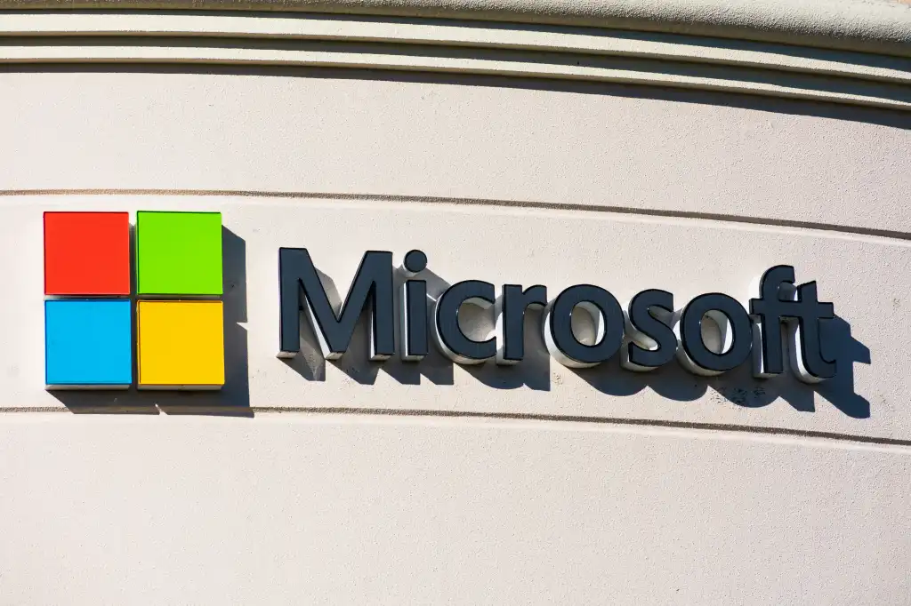



**收录说明**：发布当天的报道，含 Forrester 分析师 Jeff Pollard 的评论。直接下载；删去了页面模板残留代码、文末栏目标签，题图收入 images/。已翻译。

**内容摘要**：Computerworld 报道，Scout 在 Build 大会周二亮相，是基于 OpenClaw 框架的新型常驻智能体，微软称之为「autopilots」；它以实验版提供给 Frontier 客户，需要 Intune 策略配置和「opt-in attestation」。报道称微软未说明 Scout 是否包含在 Microsoft 365 Copilot 订阅中，也未提供定价细节；文中提到 Microsoft 365 Copilot 面向大型企业标价每用户每月 30 美元，1 月时约 3% 的 Microsoft 365 客户付费、有 1,500 万付费用户，随后升至 2,000 万。Forrester 副总裁兼首席分析师 Jeff Pollard 表示，Scout 会「放大已有的数据治理问题」，区别在于它「可能对数据采取行动」，并认为采用将从「高级用户」开始。他还提醒：「LLM 智能体仍然在目标对齐、多步推理漂移和工具误用上吃力。」

**保留理由**：这是发布当天的媒体报道中唯一含分析师观点的一篇，给出了 Forrester 对数据治理放大和智能体可靠性的看法，并补充了 Copilot 付费用户规模与定价空白。

---

## Scout 是 Microsoft 365 中一类新的「autopilot」智能体中的第一个，可以独立执行任务。

图片来源：Michael Vi / Shutterstock

Microsoft 开发了一款新的 AI 智能体，可以全天候自主运行，在 Microsoft 365 各应用中完成任务。

Microsoft Scout 于周二在公司 [Build 大会](https://build.microsoft.com/en-US/home)上亮相，是一种新型的常驻智能体，基于 OpenClaw 智能体框架，Microsoft 称之为「autopilots」。

Microsoft 公司副总裁 [Omar Shahine](https://www.linkedin.com/in/omarshahine) 在一篇博客文章中表示，这些智能体以自己的受治理 Entra 身份代用户行事。

「Autopilots 在后台保持活跃，了解工作如何跨你的应用和系统完成，并无需每次都被提示即可采取行动，」Shahine 说。他是 Microsoft 的资深员工，最近宣布正在领导一个新团队，把基于 OpenClaw 的个人助手引入 Microsoft 365 应用。

Microsoft Scout 连接 Teams、Outlook、OneDrive 和 SharePoint 等应用，并访问聊天、电子邮件、日历和联系人中的数据。通过 Teams 访问时，它还可以与用户的浏览器交互，并通过模型上下文协议（Model Context Protocol，MCP）与外部应用交互。该工具跨云、桌面和网页运行。

Shahine 说，Scout 可以减少办公室工作者面临的琐碎任务，例如与同事协调和安排会议时间，或根据即将到来的工作承诺在用户日历上预留时间。「它还能发现风险，例如停滞不前的决策，让你在它们变成阻碍之前加以处理，」他说。

Microsoft 表示，它以「实验版」向该公司 Frontier 计划的客户提供，并将需要 Intune 策略配置和「opt-in 声明（attestation）」。

Scout 是 Microsoft 365 应用中一系列智能体工具中的最新一个，包括 [Agent Mode](https://www.computerworld.com/article/4163305/agent-mode-is-now-available-in-microsoft-word-excel-and-powerpoint.html)，用户可以在 Word 和 Excel 等应用内与 Microsoft 365 Copilot 交互以创建内容，以及 [Copilot Cowork](https://www.computerworld.com/article/4142551/m365-copilot-gets-its-own-version-of-claude-cowork.html)——Microsoft 版的 Anthropic Claude Cowork 智能体，可以独立完成任务。

尽管公司在 AI 上大力投入，Microsoft 一直难以让企业相信 Microsoft 365 Copilot 值得额外付费；其面向大型企业的标价为每用户每月 30 美元。公司在一月表示，约 [3% 的 Microsoft 365 客户](https://www.computerworld.com/article/4124591/microsoft-touts-m365-copilot-momentum-claims-15m-paid-users.html)为该附加订阅付费，付费用户为 1,500 万。（Microsoft [上个月宣布](https://www.computerworld.com/article/4166676/microsoft-now-has-over-20-million-paying-copilot-users.html)该数字现已升至 2,000 万。）

目前尚不清楚 Scout 会包含在 Microsoft 365 Copilot 订阅中还是单独收费。Microsoft 没有立即提供关于定价的更多细节。

此次发布紧随 Google 最近宣布的 Spark——一款在 Google Workspace 应用套件内运行的自主智能体。Spark 也可被视为对去年 OpenClaw 发布的回应，后者最初名为「Clawdbot」。

OpenClaw 因[明显的安全缺陷](https://www.computerworld.com/article/4125939/by-whatever-name-moltbolt-clawd-openclaw-this-uber-ai-assistant-is-a-security-nightmare.html)而[受到审视](https://www.csoonline.com/article/4134540/six-flaws-found-hiding-in-openclaws-plumbing.html)，但 Microsoft 承诺 Scout 以「企业级安全与控制构建，因此从第一天起就能在你的组织中获得信任」。

Forrester 副总裁兼首席分析师 Jeff Pollard 表示，对于已经部署 Microsoft 365 Copilot 的组织，Scout 不会带来全新的数据风险。但它「会放大已经存在的任何数据治理问题。这次的不同之处在于：它不是向用户暴露敏感数据，而是可能对数据采取行动。

「这使得它在日常运营层面成为一种主动风险，」Pollard 说。

潜在的安全担忧与 AI 智能体相关的担忧类似，而在 Scout 这样的个人智能体上会被加剧：数据暴露面扩大（因为智能体可以自主与数据交互并使用工具）；智能体被操纵或提示注入；意外行为，例如使用工具或以本不应被允许的方式行事；以及与理解用户和智能体意图、行动可解释性相关的可观测性缺口。

「然而，这些工具之所以存在，是因为它们让 AI 对个人更有用，所以安全负责人不能划一条线说『不行』。他们必须适应，并想办法保护它们，」Pollard 说。

与大多数新的工作场所技术一样，Pollard 预计采用会从「高级用户」开始，他们为智能体设计和开发用例，然后可以更广泛地扩展到用户中。

他警告说，Microsoft Scout 这类工具的准确性可能达不到用户预期。「LLM 智能体仍然在目标对齐、多步推理漂移和工具误用上吃力，」他说。「用户并不总是擅长说明他们想要什么，LLM 智能体也不总是擅长提供所请求的东西。这是一个持续存在的问题。」
