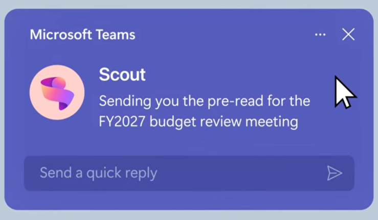



**收录说明**：Semafor Technology 的报道，含对 Omar Shahine 的采访。直接下载；删去了 newsletter 订阅区块与分享按钮，题图收入 images/。已翻译。

**内容摘要**：Semafor 于 2026 年 6 月 3 日报道称，Microsoft Scout 可围绕个人和工作日历安排会议、提醒用户被遗漏的任务、订 Chipotle，并声称还能提交报销，该产品先向少数客户推出再扩大范围。文章指出，企业此前大多等待 OpenClaw 的安全漏洞被修补后才内部集成，Nvidia 也宣布在做更安全的版本。Omar Shahine 对 Semafor 表示，微软已采取措施确保 OpenClaw 不会自行乱来，智能体无法访问未授权的内容，用户可以提前批准操作。成本方面，Shahine 未透露收费计划，但称预览期间 Scout 会消耗客户 GitHub Copilot 商业版和企业版订阅的月度额度，这两档分别为每席位每月 19 美元和 39 美元，且可购买更多额度。

**保留理由**：这篇给出了预览期间计费走向的具体数字（消耗 GitHub Copilot 额度及其席位价格），并转述了 Shahine 对「不会乱删邮件」类担忧的回应，其他材料没有这一信息。

---

微软推出由 OpenClaw 驱动的 AI 助手

2026 年 6 月 3 日下午 2:45（美国东部时间）

由 Microsoft 提供

软件工程师基本上已经享受到 AI 智能体的好处，但其他岗位的工作者采用这项技术的速度较慢。

Microsoft 正在推出一款由 OpenClaw 驱动的新 AI 助手，这可能让企业一窥智能体 AI 在规模化时的样子。

这款智能体名为 Microsoft Scout，可以围绕个人和工作日历安排会议、在任务被遗漏时提醒用户、订 Chipotle，并声称甚至能提交报销——这是我们[期待已久](https://www.semafor.com/article/10/22/2025/openais-brand-power-fuels-its-entry-into-ai-browser-race)但仍持怀疑态度的能力。公司表示，它先向一小群客户推出，之后再扩大范围。

虽然 OpenClaw 背后的开源软件已经存在数月，但企业大多在等待安全漏洞被修补后才在内部整合它。Nvidia 是[宣布](https://www.nvidia.com/en-us/ai/nemoclaw/)正在开发该智能体更安全版本的科技公司之一。Microsoft 公司副总裁 Omar Shahine 告诉 Semafor，公司已采取措施确保 OpenClaw 不会自行乱来或[删除你所有的邮件](https://x.com/summeryue0/status/2025774069124399363)。该智能体无法访问任何未经授权的内容，用户可以选择提前批准操作。

最大的问题是成本，因为包括 [Microsoft 自身在内](https://www.theverge.com/tech/930447/microsoft-claude-code-discontinued-notepad)的公司已经开始削减 AI 支出。Shahine 不愿透露公司计划如何为 Scout 收费。不过在预览期间，他说 Scout 会从客户通过 GitHub Copilot 商业版和企业版订阅获得的月度额度中扣除，这两档订阅分别为每席位每月 19 美元和 39 美元——并且可以购买更多额度。

— [Rachyl Jones](https://www.semafor.com/author/rachyl-jones)
