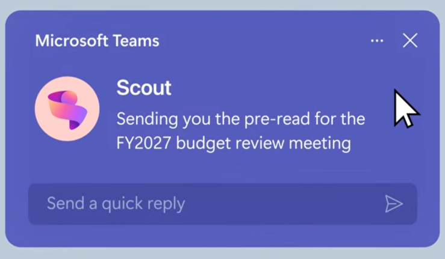

来源：https://www.semafor.com/article/06/03/2026/microsoft-launches-ai-assistant-powered-by-openclaw
取文：2026-11-10，直接下载

Microsoft launches AI assistant powered by OpenClaw

Jun 3, 2026, 2:45pm EDT

Courtesy of Microsoft

Software engineers have largely reaped the benefits of AI agents, but workers in other roles have been slower to adopt the technology.

Microsoft is launching a new AI assistant powered by OpenClaw, which could give businesses a taste of what agentic AI looks like at scale.

Called Microsoft Scout, the agent can schedule meetings around both personal and work calendars, remind users when tasks have fallen through the cracks, order Chipotle, and claims to even file expenses — a capability that we’ve [long been waiting for](https://www.semafor.com/article/10/22/2025/openais-brand-power-fuels-its-entry-into-ai-browser-race) but remain skeptical about. It is rolling out to a small group of customers before expanding more broadly, the company said.

While the open-source software behind OpenClaw has been around for several months, companies have largely waited for security vulnerabilities to be shored up before integrating it internally. Nvidia is among the tech firms that [announced](https://www.nvidia.com/en-us/ai/nemoclaw/) it is working on a more secure version of the agent. Omar Shahine, corporate vice president at Microsoft, told Semafor the company has taken steps to ensure that OpenClaw won’t run off on its own or [delete all your emails](https://x.com/summeryue0/status/2025774069124399363). The agent doesn’t have access to anything that hasn’t been authorized, and users can choose to approve actions ahead of time.

The big question is the cost, as companies [including Microsoft itself](https://www.theverge.com/tech/930447/microsoft-claude-code-discontinued-notepad) have started to roll back their AI spending. Shahine wouldn’t disclose how the company plans to charge for Scout. In the preview, though, he said Scout will pull from customers’ monthly credit allowance through the business and enterprise subscriptions to GitHub Copilot, which respectively cost $19 and $39 per seat per month — with the option to buy more credits.

— [Rachyl Jones](https://www.semafor.com/author/rachyl-jones)
