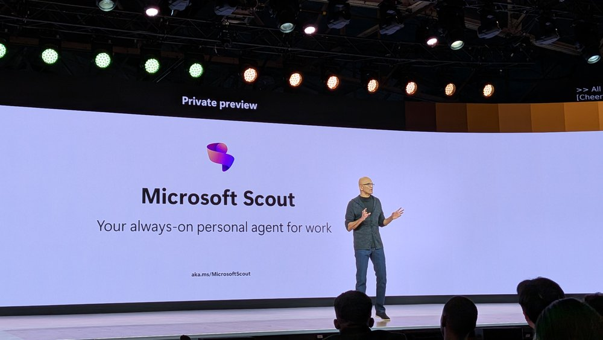



**收录说明**：TechRadar Pro 在 Build 2026 现场的报道，引述 Satya Nadella 主题演讲。直接下载；删去了分享与评论入口、页内视频播放器、「You may like」推荐、newsletter 订阅区块和作者简介，题图收入 images/。已翻译。

**内容摘要**：TechRadar 报道称，CEO Satya Nadella 在 Build 2026 上发布了 Scout，即微软的首个 Autopilot，内置于 Copilot 和 Microsoft 365。Nadella 说：「你可以把 Autopilots 看作企业级的 Claws，它们是自主、长期运行、完全符合企业合规、并运行在你的租户里的智能体。」用户可自定义 Autopilot 的名字和说话风格，并完全掌控其上下文和记忆，还能设置它须遵守的权限与策略。Scout 可留意 Outlook 收件箱和 Teams 消息，提醒日历或特定邮件，并帮助准备会议和任务。Frontier 用户现在即可试用，Nadella 称自己已在使用；微软计划在未来数月扩展平台，增加更多智能体，并让用户自建 Autopilot。

**保留理由**：这篇保留了 Nadella 在 Build 台上的原话和对 Autopilot 的定位，并记录了微软预告的后续路线（更多智能体、用户自建 Autopilot），是 CEO 层面的表述来源。

---

「一类新智能体」：微软发布首个 Autopilot——Scout，想彻底改变你的工作方式

认识 Microsoft 的 Autopilots

（图片提供：Future / Mike Moore）

- **Microsoft 发布 Autopilots，其下一代 AI 智能体**
- **Autopilots 将在后台运行，代你执行任务**
- **Microsoft Scout 是第一个 Autopilot，连接你的 Microsoft 365 应用**

---

[Microsoft](https://www.techradar.com/tag/microsoft) 宣布推出 Autopilots，一种新型 AI 智能体，可以在后台自主运行，让你专注于真正重要的任务。

在 [Microsoft Build 2026](https://www.techradar.com/pro/live/microsoft-build-2026-live-all-the-updates-as-they-happen) 上发言时，CEO Satya Nadella 发布了 Scout——公司的第一个 Autopilot，类似 OpenClaw 的产品，内置于 Copilot 和 Microsoft 365。

Autopilots 将在后台运行，学习你如何工作和运作，并能够无需被提示即可采取行动，独立执行任务。

## Microsoft Scout

「你可以把 Autopilots 看作企业级的 Claws——这些是自主、长期运行的智能体，完全符合企业合规要求，并运行在你的租户中，」Nadella 指出。

「它们是一种全新的方式，用来减少琐碎工作，让你回到你热爱的事情上。」

用户可以根据喜好自定义 Autopilots，包括名称和说话风格，并完全掌控其上下文和记忆。他们还可以为 Autopilots 设定须遵守的特定权限和策略，确保它们不会做不该做的事。

「今天我们推出一类新的智能体，称为 Autopilots，」Microsoft 在[一篇宣布此消息的博客文章](https://click.linksynergy.com/deeplink?id=kXQk6%2AivFEQ&mid=46107&u1=trdpro-us-1983327886905137708&murl=https%3A%2F%2Fwww.microsoft.com%2Fen-us%2Fmicrosoft-365%2Fblog%2F2026%2F06%2F02%2Fintroducing-microsoft-scout-your-always-on-personal-agent%2F)中说。「Autopilots 是常驻运行的智能体，自主工作，拥有自己的身份，并代你行事。」

Scout 将能承担大量任务，包括留意你的 Outlook 收件箱和 Teams 消息，提醒你日历信息或特定电子邮件，监控任何可能需要你注意的事项，例如帮助你为会议和任务做准备。

「Scout 在你工作的地方工作……这就是我们所设想的 Copilot 生态本身的未来，」Nadella 补充道。

Frontier 用户现在可以试用 Scout——Nadella 说他本人已经在用——Microsoft 计划在未来数月构建该平台，增加更多智能体，并让用户能够构建自己的 Autopilots。
