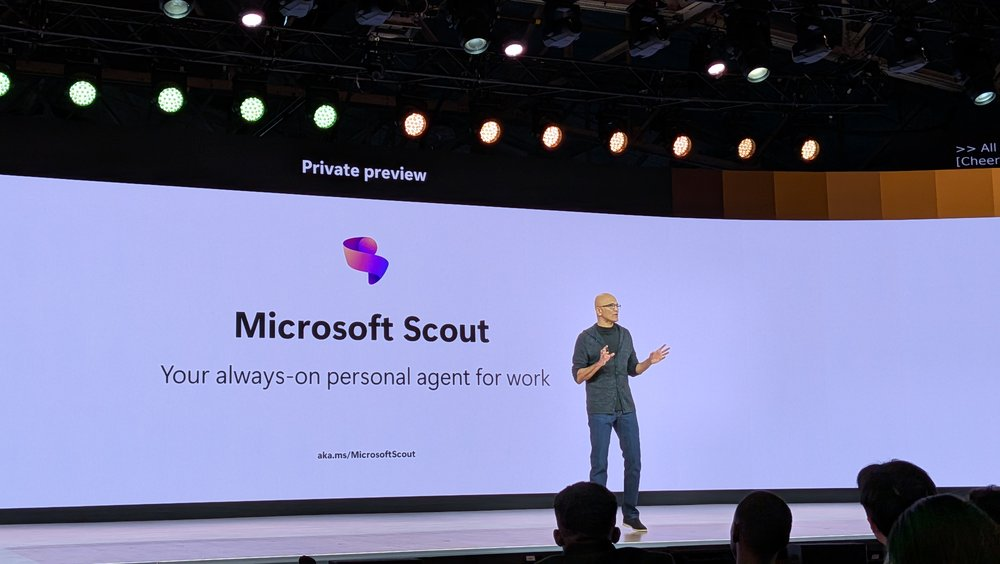

来源：https://www.techradar.com/pro/a-new-category-of-agents-microsoft-reveals-scout-its-first-autopilot-which-wants-to-change-how-you-work-for-good
取文：2026-11-10，直接下载

'A new category of agents': Microsoft reveals Scout, its first "Autopilot", which wants to change how you work for good

Say hello to Autopilots from Microsoft

(Image credit: Future / Mike Moore)

- **Microsoft reveals Autopilots, its next generation of AI agents**
- **Autopilots will operate in the background, carrying out tasks on your behalf**
- **Microsoft Scout is the first Autopilot, linking into your Microsoft 365 apps**

---

[Microsoft](https://www.techradar.com/tag/microsoft) has announced the launch of Autopilots, a new form of AI agents which can run autonomously in the background, letting you focus on the tasks which really matter.

Speaking at [Microsoft Build 2026](https://www.techradar.com/pro/live/microsoft-build-2026-live-all-the-updates-as-they-happen), CEO Satya Nadella unveiled Scout, the company's first Autopilot, similar to OpenClaw offering, built into Copilot and Microsoft 365.

Autopilots will run in the background, learning how you work and operate, with the ability to take action with needing to be prompted, carrying out tasks independently.

## Microsoft Scout

"You can think of Autopilots as enterprise-grade Claws - these are autonomous, long-running agents with full enterprise compliance that run in your tenant," Nadella noted.

"They're a totally new way to reduce toil and get you back to what you love."

Users can customize Autopilots however they like, including names and styles of speaking, as well as full control over their context and memory. They will also be able to set specific permissions and policies for the Autopilots to adhere too, making sure they don't do anything they shouldn't.

"Today we are introducing a new category of agents called Autopilots," Microsoft said in a [blog post](https://click.linksynergy.com/deeplink?id=kXQk6%2AivFEQ&mid=46107&u1=trdpro-us-1983327886905137708&murl=https%3A%2F%2Fwww.microsoft.com%2Fen-us%2Fmicrosoft-365%2Fblog%2F2026%2F06%2F02%2Fintroducing-microsoft-scout-your-always-on-personal-agent%2F) announcing the news. "Autopilots are always-on agents that work autonomously, with their own identity, and act on your behalf."

Scout will be able to take on a wide number of tasks, including keeping an eye on your Outlook inbox and Teams messages, alerting you to calendar information or specific emails, to monitor for anything which may need your attention, such as helping you prepare for meetings and tasks.

"Scout works where you work...that's the future of what we think of, of the Copilot ecosystem itself," Nadella added.

Frontier users can try Scout now - Nadella said he was already using it himself - with Microsoft set to build out the platform over the coming months, adding more agents and also the ability for users to build their own Autopilots.
