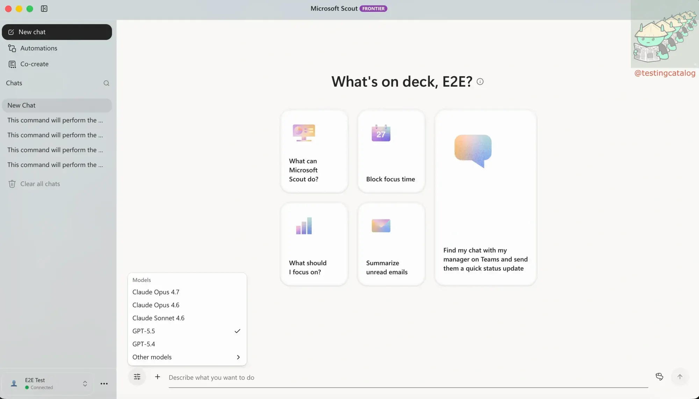
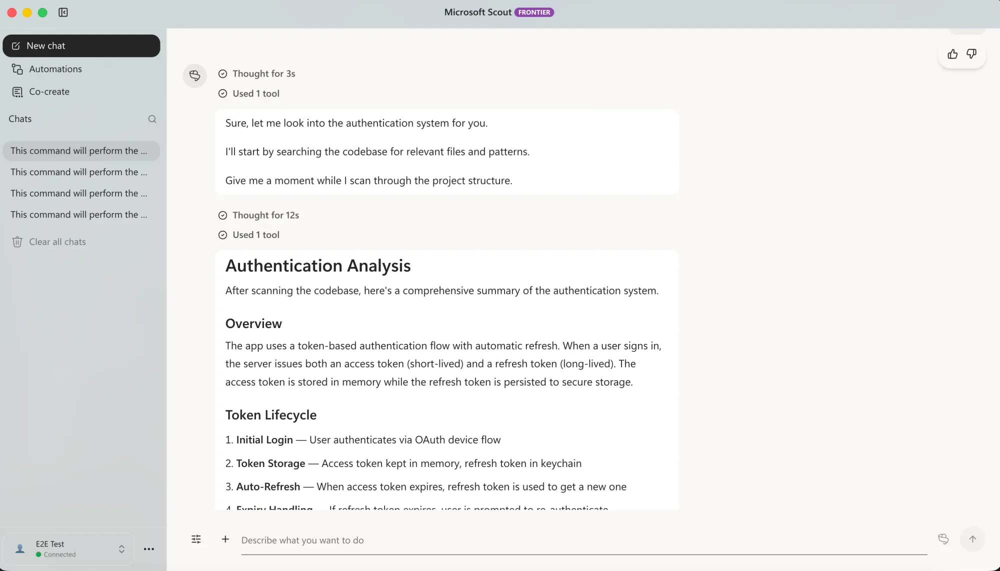
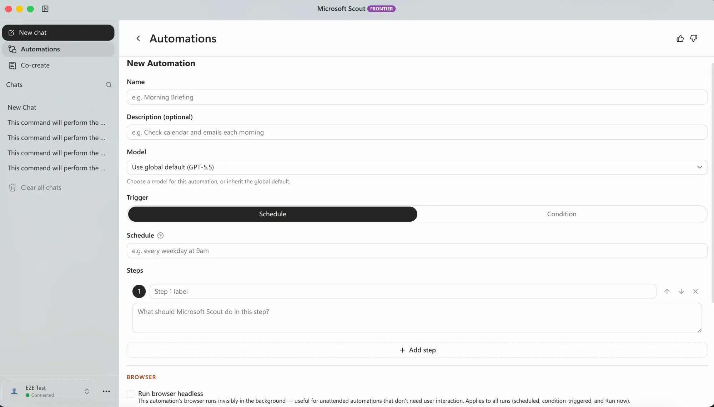
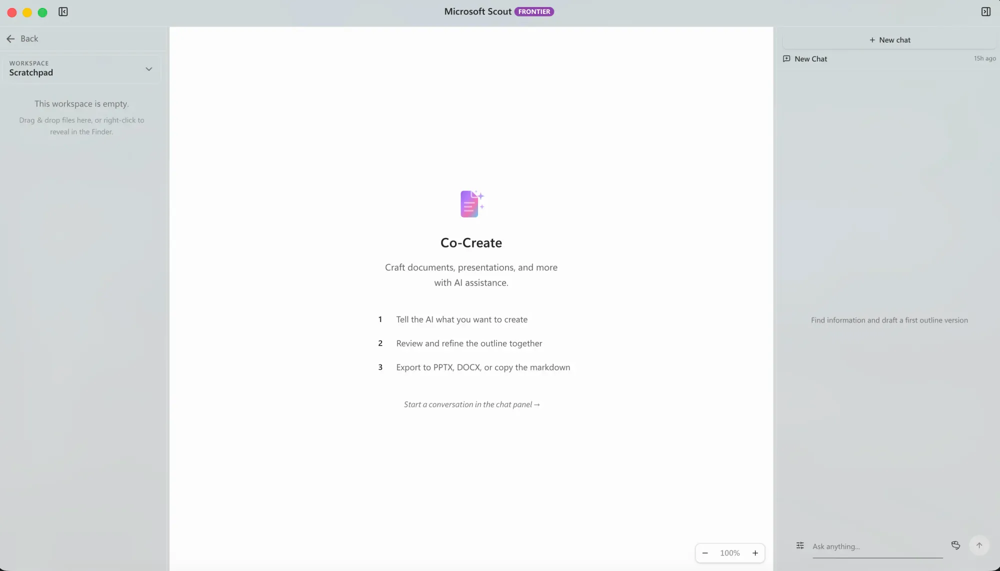
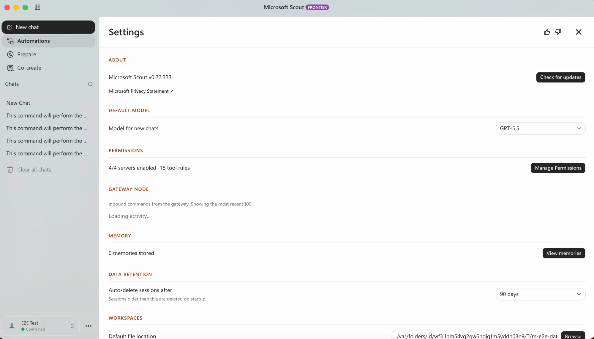
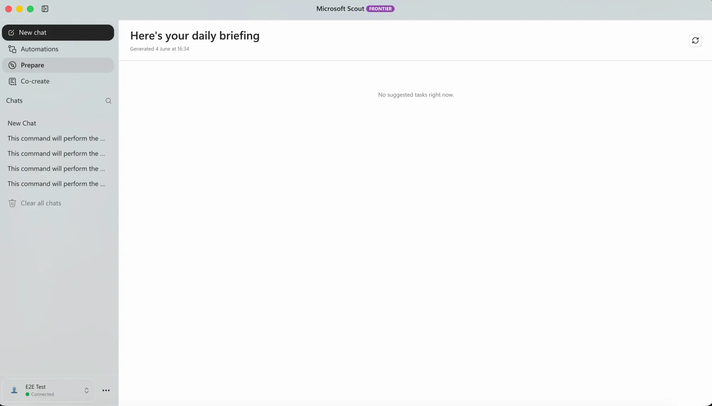
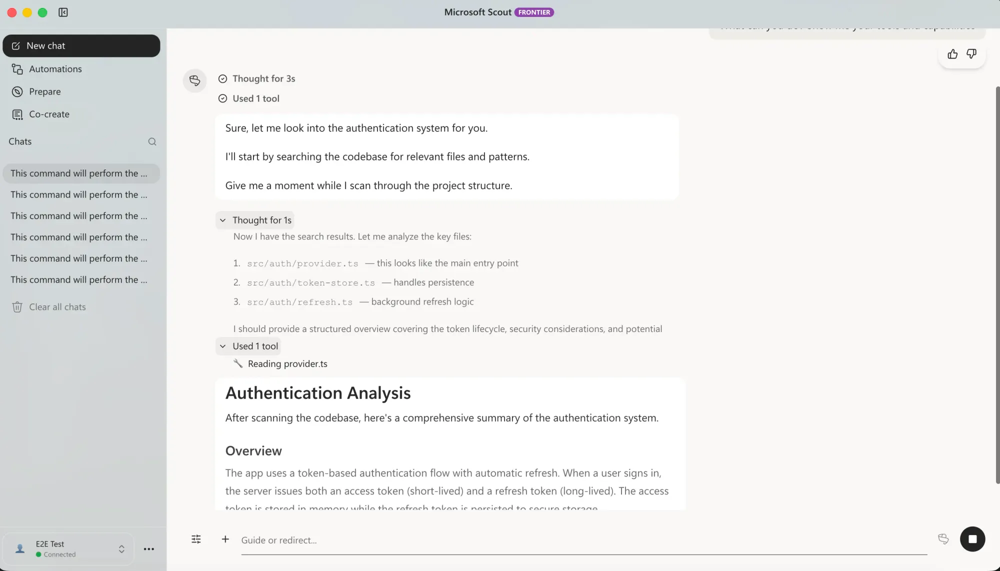



**收录说明**：跟踪产品测试版的科技媒体，文中描述 Scout 桌面客户端的界面观察并配截图。直接下载；删去了作者头像与分享按钮；页面内嵌的演示视频写为占位行（链接到视频文件），截图收入 images/。已翻译。

**内容摘要**：TestingCatalog 报道，Scout 桌面应用已开始向 Frontier 计划的组织推出，可在 macOS 和 Windows 上运行，用工作账号登录后才能进入。界面是常见的聊天形态，带有模型选择器，目前涵盖 OpenAI 和 Anthropic 的选项（包括 GPT 5.5），用户还可给智能体设定个性。文章称其核心在自动化：可构建多步骤例程，内置类似 Zapier 的编排，并提供无头浏览器模式让部分任务在后台更快执行；另有集成和技能层，能处理本地文件、制作演示文稿和协助编程。下载虽然开放，但能否进入取决于组织管理员的批准。

**保留理由**：这篇是发布后第三天的界面与功能观察，附演示视频和截图，描述了模型选择器、例程与无头浏览器等实际可见的功能细节。

---

抢先看：微软向 Frontier 用户推出 Scout AI 智能体

Microsoft Scout 是新的常驻桌面智能体，现正向 Frontier 计划用户推出，带来全新的自动化功能和深度 Microsoft 365 支持。

Microsoft 已开始向注册 Frontier 计划的组织推出其 Scout 桌面应用，让人们首次实际看到这款公司于 6 月 2 日在 [Build 2026](https://www.testingcatalog.com/microsoft-build-2026-recap-from-windows-to-copilot-all-ai/) 上发布的常驻工作智能体。Scout 是作为 Microsoft 称为 Autopilots 的新类别中的首个条目推出的——这类智能体持续运行、自带身份，并跨 Microsoft 365 技术栈行事，而不是等待被提示。

[视频：Microsoft Scout 演示](https://storage.ghost.io/c/2a/1b/2a1b1782-8506-4d7d-bf53-ad3fb52e2a0f/content/media/2026/06/scout1--1-.mp4)

0:00

/0:35

Microsoft Scout

桌面客户端在 macOS 和 Windows 上均可运行，且只有用工作账户登录后才会打开。打开后是熟悉的聊天界面，带有模型选择器，目前涵盖 OpenAI 和 Anthropic 的选项，包括 GPT 5.5。用户还可以给智能体设定个性，不过这一功能看起来更像是轻量点缀，而非核心能力。

> 认识 Microsoft Scout。
>
> 一个常驻智能体，让工作持续推进，无需每次提示即可采取行动。
>
> 作为 Microsoft 的第一个 Autopilot 智能体，Microsoft Scout 跨 Teams、Outlook、OneDrive 等运行——在你组织的控制范围内采取行动…… [pic.twitter.com/YqeDABRHAy](https://t.co/YqeDABRHAy)
>
> — Microsoft 365 (@Microsoft365) [2026 年 6 月 2 日](https://x.com/Microsoft365/status/2061874930547871868?ref_src=twsrc%5Etfw)

Scout 的实质在于其自动化能力。除了简单的日程安排，Scout 还允许用户构建多步骤例程，把类似 Zapier 的编排直接纳入应用内。它还提供无头浏览器模式，让某些任务可以在后台更快运行。集成和技能层增强了它的功能，该智能体被设计为可处理本地文件、制作演示文稿并协助处理代码任务——这些任务利用桌面的文件系统访问能力，而不仅仅依赖基于云的资源。

Microsoft Scout 界面

分发仍然受限。虽然任何人都可以下载客户端，但能否进入取决于组织管理员的批准，这与 Microsoft 围绕受治理的 Entra 身份和租户控制对 Scout 的定位一致，公司表示这些将在 2026 年晚些时候进一步落实。

这一方向与更广泛的趋势一致。随着 Google 推动 [Gemini Spark](https://www.testingcatalog.com/google-unveils-24-7-gemini-spark-ai-agent-for-advanced-tasks/) 以及竞争对手竞相开发常驻智能体，[Microsoft](https://www.testingcatalog.com/tag/microsoft-copilot/) 的优势在于它同时拥有操作系统和围绕它的生产力套件。Scout 以及预计今年夏天推出的统一 Copilot 应用表明，公司打算让常驻智能体成为其生态内管理工作方式的默认选择。
