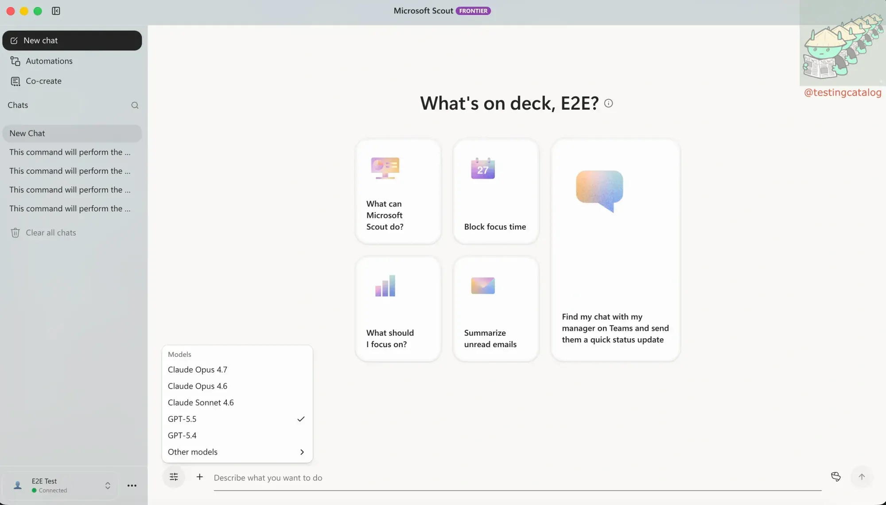
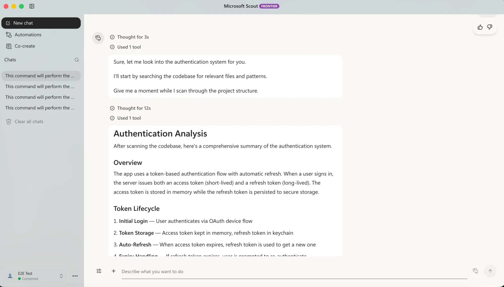
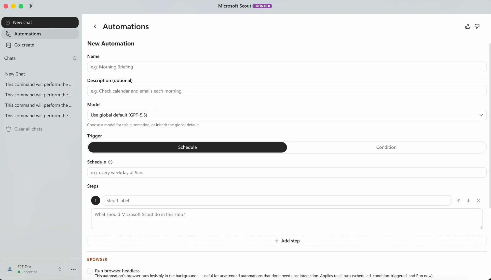
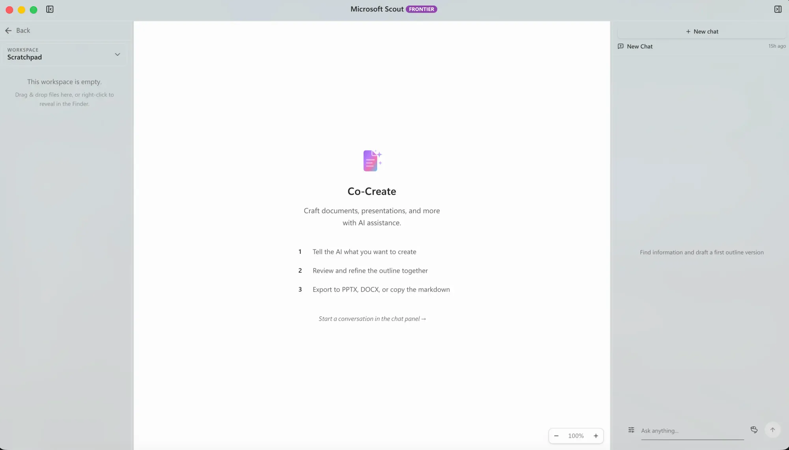
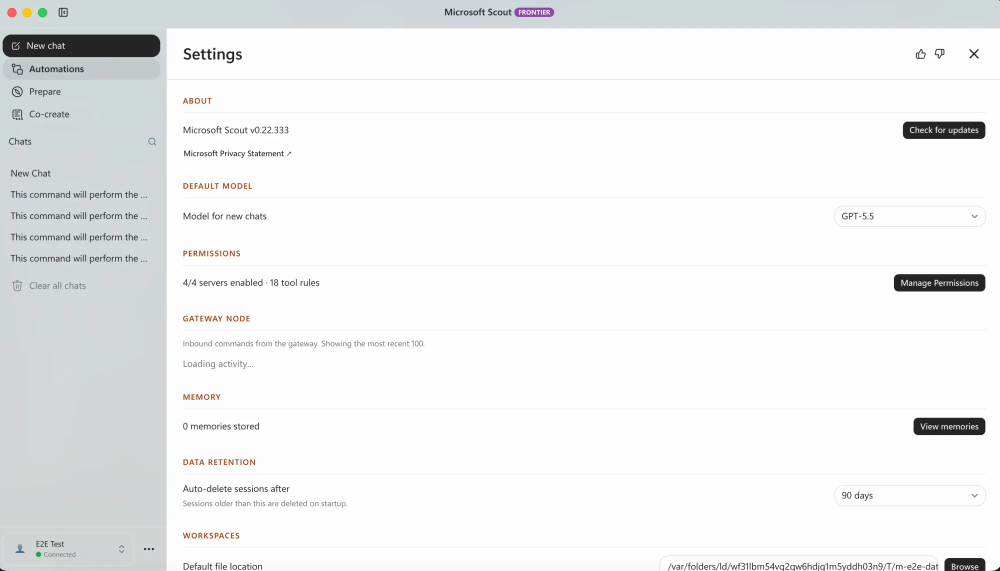
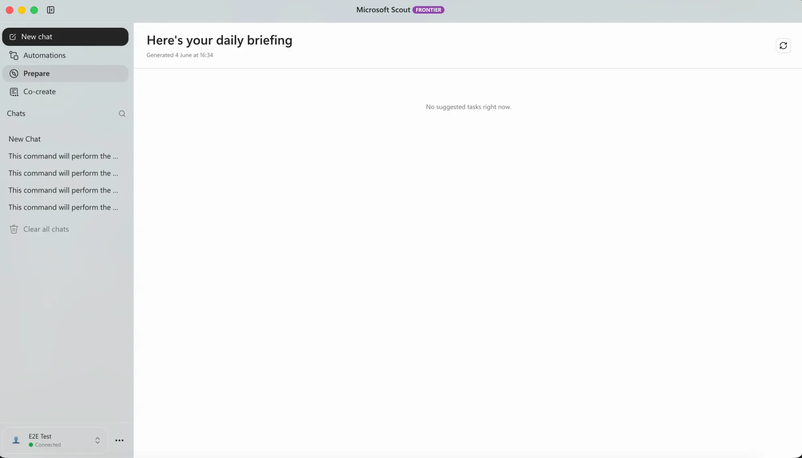
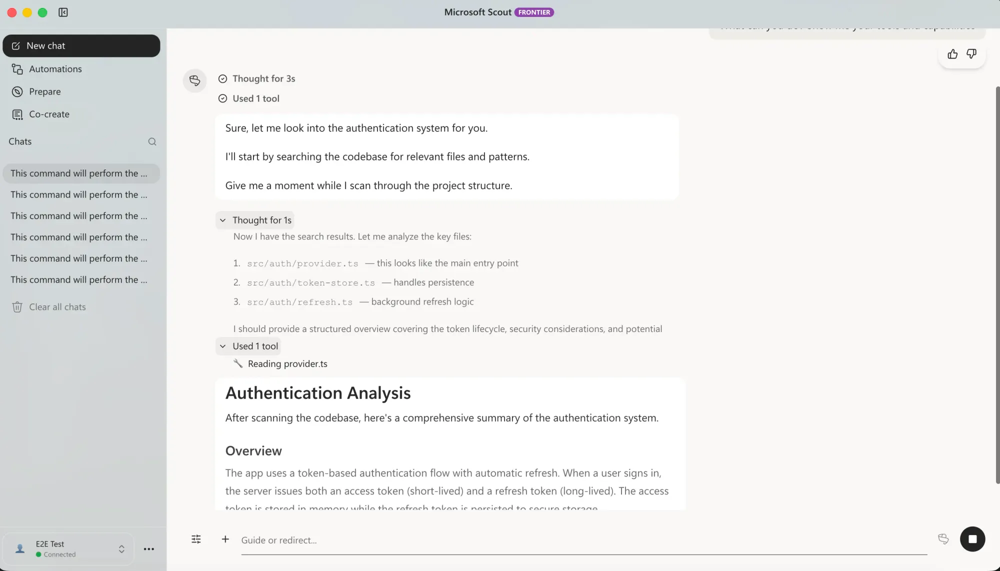

来源：https://www.testingcatalog.com/early-look-microsoft-rolls-out-scout-ai-agent-to-frontier-users/
取文：2026-11-10，直接下载

Early Look: Microsoft rolls out Scout AI agent to Frontier users

Microsoft Scout, the new always-on desktop agent, is now rolling out to Frontier program users with fresh automation features and deep Microsoft 365 support.

Microsoft has begun rolling out its Scout desktop application to organizations enrolled in the Frontier program, providing a first practical look at the always-on work agent the company unveiled at [Build 2026](https://www.testingcatalog.com/microsoft-build-2026-recap-from-windows-to-copilot-all-ai/) on June 2. Scout was introduced as the opening entry in a new category Microsoft calls Autopilots, agents that run continuously, carry their own identity, and act across the Microsoft 365 stack rather than waiting to be prompted.

[视频：Microsoft Scout 演示](https://storage.ghost.io/c/2a/1b/2a1b1782-8506-4d7d-bf53-ad3fb52e2a0f/content/media/2026/06/scout1--1-.mp4)

0:00

/0:35

Microsoft Scout

The desktop client runs on both macOS and Windows and opens only after a work account sign-in. What follows is a familiar chat surface with a model picker that currently spans OpenAI and Anthropic options, including GPT 5.5. Users can also assign their agent a personality, though this feature appears to be more of a lighter touch than a core capability.

> Meet Microsoft Scout.  
>   
> An always-on agent that keeps work moving, taking action without needing to be prompted each time.  
>   
> As Microsoft’s first Autopilot agent, Microsoft Scout works across Teams, Outlook, OneDrive, and more—taking action within the controls your organization… [pic.twitter.com/YqeDABRHAy](https://t.co/YqeDABRHAy)
>
> — Microsoft 365 (@Microsoft365) [June 2, 2026](https://x.com/Microsoft365/status/2061874930547871868?ref_src=twsrc%5Etfw)

The substance of Scout lies in its automation capabilities. Beyond simple scheduling, Scout allows users to build multi-step routines that incorporate Zapier-style orchestration directly into the app. It also offers a headless browser mode so certain jobs can run faster in the background. Integrations and a skills layer enhance its functionality, with the agent designed to work with local files, produce presentations, and assist with code, tasks that leverage the desktop's file-system access rather than relying solely on cloud-based resources.

Microsoft Scout UI

Distribution remains gated. While anyone can download the client, entry depends on approval from an organization's admin, consistent with Microsoft's framing of Scout around governed Entra identities and tenant controls, which the company has indicated will be solidified later in 2026.

This direction aligns with a broader trend. With Google pushing [Gemini Spark](https://www.testingcatalog.com/google-unveils-24-7-gemini-spark-ai-agent-for-advanced-tasks/) and competitors racing toward persistent agents, [Microsoft's](https://www.testingcatalog.com/tag/microsoft-copilot/) advantage lies in its ownership of both the operating system and the productivity suite surrounding it. Scout, along with the unified Copilot app expected this summer, suggests that the company intends to make the always-on agent the default method for managing work within its ecosystem.
