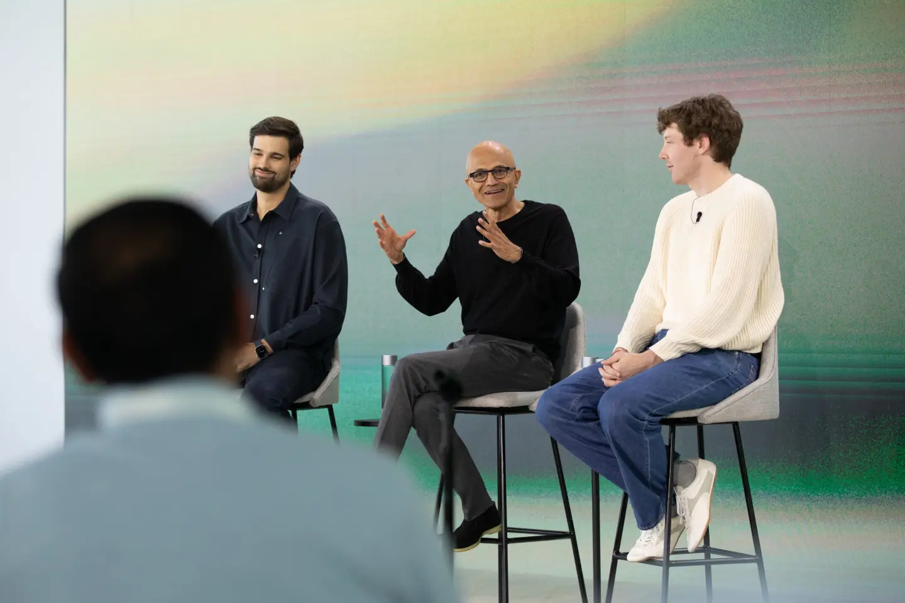
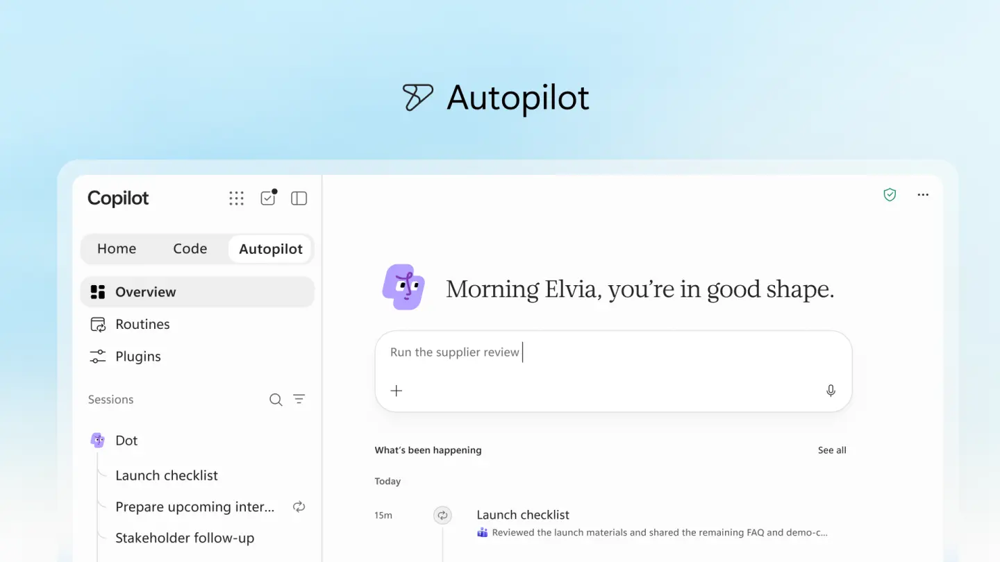



**收录说明**：直接下载。删去了页首推荐视频与文末 Fortune Daily 推广；两张配图（发布会照片、Autopilot 界面截图）下载到 images/。已翻译。

**内容摘要**：Fortune 报道微软 2026-09-25 发布的 Copilot「超级应用」，整合聊天、AI 工具、写代码和新的 Autopilot；Autopilot 让用户给 agent 命名、分配角色与目标，处理项目更新、跟踪决策与截止日期、提醒同事、收集准备材料、联系合作伙伴等。多数新功能通过早期测试计划推出，没有正式发布时间，Autopilot 将进入「更受限的用户测试阶段」，能否广泛推出取决于测试者的评价。Annie Pearl 称 Copilot 主要用 Anthropic 与 OpenAI 的模型，也使用 xAI 的 Grok；微软称 Autopilot agent 须有明确权限、完整审计日志和追踪，由人决定自主程度。计费方面，席位覆盖 Chat、Office 集成和标准路由等「everyday AI」，用量计费可用于 Code、Autopilot 和最新模型；文中称 7 月 Microsoft 365 Copilot 付费席位超过 3,000 万。

**保留理由**：这是 dSebastien 综述所转述的 Fortune 报道原文，有 Annie Pearl 的采访说法：Autopilot 的受限测试、模型来源（含 Grok）、安全护栏与计费边界，以及 3,000 万席位的出处。

---

AI 热潮约四年前兴起之后，[Microsoft](https://fortune.com/company/microsoft/) 投入大量资源，力图同时在 AI 的消费者和企业两端取胜。周五，这家软件巨头发布了 Copilot AI 超级应用（super app），回归基本盘，把其最强的技术对准企业客户。

Microsoft 推出的这款超级应用是一个中心界面，客户可以通过它与 AI 机器人聊天、调用 AI 工具协助完成任务、编写代码，并使用新的 Autopilot 功能，把 agentic 能力（即 AI 可自行执行任务的能力）带到公司的旗舰 AI 应用中。这款超级应用是对 Microsoft 现有 Copilot 应用的大幅重新设计，汇集了多种功能和能力，意在打造一把用于 AI 生产力的瑞士军刀。此次发布之前，Microsoft 一直在推动合并已经变得庞杂的 Copilot 产品线，批评者称这让客户感到困惑。

对首席执行官 Satya Nadella 来说，新的 Copilot 是在这个对软件制造商日益重要的业务中赢得订阅的方式，同时也能确保 Microsoft 利润丰厚的生产力产品不被新一代 AI 对手边缘化。

这款超级应用的研发[由 *Fortune* 在 5 月首次报道](https://fortune.com/2026/05/29/microsoft-working-on-super-app/)，它还接入 Microsoft 的 Office 工具，用户可以让机器人处理 Excel 电子表格上的任务，或修改 Word 文档的版式。超级应用虽有免费版本，但客户需要 Microsoft 订阅或工作场所许可证才能解锁其全部功能。企业客户和个人用户都要根据其最自主的那部分功能的使用量额外付费。

「我们确实希望它成为一个一体化的生产力套件，」Copilot 公司副总裁 Annie Pearl 对 *Fortune* 说。这包括让它成为这样一个平台：「你可以提问；可以委派复杂的多步骤工作；可以构建供内部和外部场景使用的软件；还可以通过你的……数字员工（digital worker）或个人 agent（personal agent）来自动化任务。」

Autopilot 功能让用户为自己的 agent 命名，给它分配角色和目标，然后放手让它去处理项目更新、跟踪工作决策和截止日期、在承诺到期时提醒同事、收集准备材料、联系合作伙伴等任务。

Pearl 说，编码功能面向想要构建应用、仪表盘或其他工具和平台的非软件工程师，不过她补充说，它会随时间变得更强大。

应用的大部分新功能通过一个早期测试计划推出，Microsoft 没有设定正式发布（general availability）的时间表。编码工具与 Microsoft 的 GitHub Copilot 共用底层技术栈，将在今年晚些时候通过测试计划提供给 Microsoft 365 Premium 和 Pro 订阅者。Autopilot 将进入一个限制更多的用户测试阶段，能否广泛推出取决于测试者如何评价这些新工具。

Microsoft CEO Satya Nadella（中）与 Copilot 执行副总裁 Jacob Andreou（左）和 Copilot、agents 与平台执行副总裁 Charles Lamanna 一同在西雅图展示 Copilot 超级应用，2026 年 9 月 23 日。

图片由 Microsoft 提供

## 竞争压力

Microsoft 押注这款超级应用将借助与其本已利润丰厚的商业工具直接相连的 AI，大幅提升 Copilot 品牌。随着 OpenAI 和 Anthropic 向企业产品推进，Microsoft 正在竞相保卫自己的地盘，并跟上客户的期望。它推出这款应用的时机，也正值 agentic 能力进入主流。OpenAI 在 7 月发布了自己的超级应用。[Meta](https://fortune.com/company/facebook/) Platforms 面向普通消费者的新应用 Muse 已经取得早期成功，让用户创建个人 agent 来处理订餐、银行对账单和其他任务。

Microsoft 这次超级应用的发布，也紧随 Copilot 经历的一段阵痛期。Nadella 调整了高管班子，让公司在与顶尖 AI 实验室和企业级对手的竞争中处于有利位置，今年早些时候组建了统一的 Copilot 团队，把消费者和企业两端合并到 Jacob Andreou 之下，他是[这位快速崛起的高管](https://fortune.com/2026/06/27/microsoft-copilot-boss-jacob-andreou-tapped-by-satya-nadella-to-save-ai-strategy/)，现在负责 Copilot。

Copilot 起步不顺，受品牌问题、能力有限以及 Microsoft 推出多个版本的 AI 令客户困惑所拖累。其消费者版 Copilot 没有取得主流成功。最近，随着 Microsoft 重新聚焦企业并精简运营，它找到了一些势头。7 月，该公司称其 Microsoft 365 Copilot 的付费席位已超过 3,000 万，净增席位环比翻倍。在 AI 需求和 Copilot 增长推动的云计算业务带动下，其股价在过去六个月出现反弹。

Microsoft 改版后的 Copilot 应用中 Autopilot 功能的截图。

图片由 Microsoft 提供

## 安全担忧

Pearl 说，Copilot 主要依赖 Anthropic 和 OpenAI 的模型，但也使用 xAI 的 Grok 模型。不过，安全一直是首要关切，尤其是近几个月 OpenAI 和 Anthropic 的模型被用来入侵其他公司，引发了全球对 AI 能力的不安。周三，澳大利亚总理 Anthony Albanese 说，[一个 OpenAI agent 在 6 月侵入了澳大利亚政府](https://fortune.com/2026/09/23/openai-agent-hacks-australia-medicare-sam-altman-anthony-albanese/)的网站，这是此类事件中的最新一起。

Microsoft 说，它在应用中内置了若干安全护栏。其中包括要求 Autopilot agent 带有明确权限、完整审计日志和追踪的规则。该公司称，由人来决定 agent 获得多大程度的自主权。当非开发者使用 Code 工具构建应用时，软件在隔离的本地或云托管环境中运行任务，并设有旨在保护客户数据和系统的控制措施。

「你观察到的一切都应当可以通过策略来治理，」Nadella 本周在西雅图的一场演示中对客户说。「这是我们几十年来在 IT 管理上一直做的经典事情，现在我需要对外面的每一个 agent 都这样做。

「我们对 Copilot 的构想，是不把它仅仅看作某一个产品或某一种形态，而是看作一个把形式与功能结合在一起的系统。」

Microsoft 还计划通过对最好的功能额外收费来将这些新功能变现。企业客户或个人用户付费的席位涵盖「日常 AI（everyday AI）」，如 Chat、Office 集成和标准路由，而 Code、Autopilot 以及最新、最强 AI 模型的访问则可能适用按用量计费。

Microsoft 还计划推出后续的附加功能，把其生态系统中更多的部分连接起来。其中包括一项名为 Today 的功能，Microsoft 称它将整合电子邮件、日历、Teams 和任务，以组织工作负载并确定优先级。该公司称，它会主动完成任务，例如生成草稿、提出日程更新建议，以及设置后续跟进，供用户快速处理。
