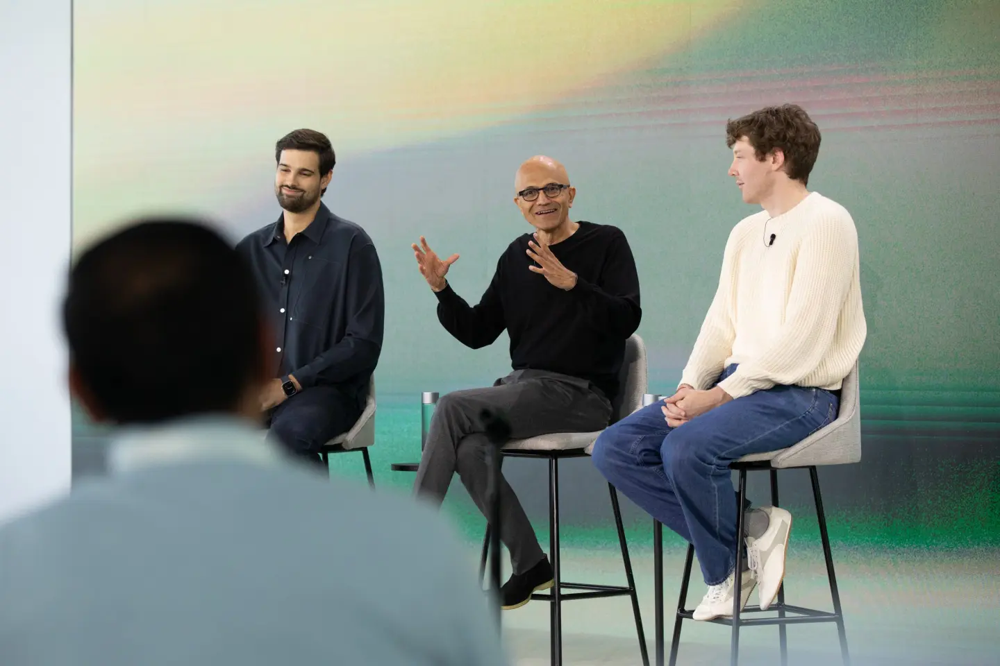
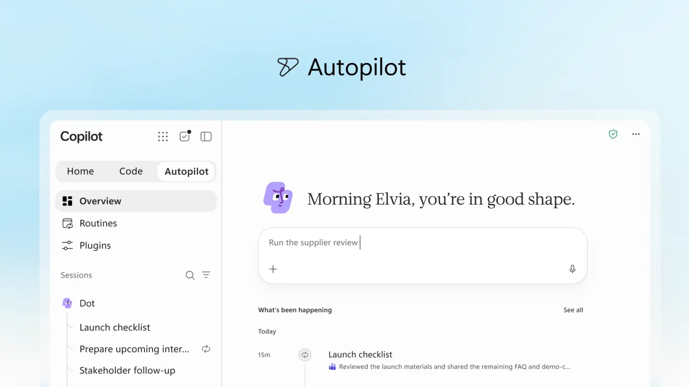

来源：https://fortune.com/2026/09/25/microsoft-unveils-copilot-super-app-targeting-business-users-with-ai-agents/
取文：2026-11-14，直接下载

After the AI boom took off about four years ago, [Microsoft](https://fortune.com/company/microsoft/) poured resources into winning both the consumer and enterprise sides of AI. With the unveiling of its Copilot AI super app Friday, the software giant has returned to basics, aiming its most capable technology at business customers.

Microsoft is launching its super app as a central interface through which customers can chat with AI bots, tap AI tools to help accomplish tasks, write code, and access a new Autopilot feature that brings agentic capabilities—AI that can perform tasks on its own—to the company’s flagship AI app. The super app is a major redesign of Microsoft’s existing Copilot app, bringing together a variety of features and capabilities intended to create a Swiss Army knife for AI productivity. The launch follows a push by Microsoft to merge what had become a sprawling collection of Copilot products that critics said left customers confused.

For chief executive Satya Nadella, the new Copilot is a way to win subscriptions in a business that’s become increasingly important to the software maker, while also ensuring that Microsoft’s lucrative productivity offerings don’t get sidelined by a new generation of AI rivals.

The super app—[whose development was first reported by *Fortune* in May](https://fortune.com/2026/05/29/microsoft-working-on-super-app/)—also plugs into Microsoft’s Office tools, letting users ask a bot to handle a task on an Excel spreadsheet or change a layout in a Word document. Though there is a free version of the super app, customers will need Microsoft subscriptions or workplace licenses to unlock its full range of offerings. Both enterprise customers and individual users will have to pay extra based on usage of its most autonomous capabilities.

“We do want this to become an all-in-one productivity suite,” Annie Pearl, corporate vice president of Copilot, told *Fortune*. That includes being a platform “where you can ask questions; you could delegate complex multistep work; you can build software for internal and external use cases; and you can automate tasks through your … digital worker or personal agent.”

The Autopilot feature lets users name their agent, assign it a role and a goal, then set it loose on tasks such as project updates, tracking work decisions and deadlines, reminding colleagues when commitments are due, gathering prep materials, and reaching out to partners.

The coding feature targets non–software engineers who want to build apps, a dashboard, or other tools and platforms, Pearl said, though she added that it will grow more powerful over time.

Most of the app’s new features are rolling out through an early test program, and Microsoft has not set a timeline for general availability. The coding tool, which shares its underlying tech stack with Microsoft’s GitHub Copilot, will reach Microsoft 365 Premium and Pro subscribers through the test program later this year. Autopilot will undergo a more restricted phase of user testing, and broad rollout will hinge on how testers rate the new tools.

Microsoft CEO Satya Nadella (center) presents the Copilot super app alongside Copilot executive VP Jacob Andreou (left) and Charles Lamanna, executive VP of Copilot, agents, and platform, in Seattle, Sept. 23, 2026.

Courtesy of Microsoft

## Competitive pressure

Microsoft is betting the super app will supercharge its Copilot brand by using AI directly connected to its already lucrative business tools. As OpenAI and Anthropic push into enterprise offerings, Microsoft is racing to protect its turf and keep pace with customer expectations. It’s also launching the app just as agentic capabilities break into the mainstream. OpenAI unveiled its own super app in July. [Meta](https://fortune.com/company/facebook/) Platforms has already seen early success with its new Muse app, which targets general consumers, letting them create a personal agent to handle food orders, bank statements, and other tasks.

Microsoft’s super app reveal also follows a stretch of growing pains for Copilot. Nadella has shaken up executive ranks to position the company competitively against the top AI labs and enterprise rivals, forging a unified Copilot team earlier this year that merged the consumer and enterprise sides under Jacob Andreou, [the fast-rising executive](https://fortune.com/2026/06/27/microsoft-copilot-boss-jacob-andreou-tapped-by-satya-nadella-to-save-ai-strategy/) now in charge of Copilot.

Copilot stumbled early, plagued by branding issues, limited capabilities, and Microsoft’s decision to launch several versions of the AI that confused customers. Its consumer Copilot failed to reach mainstream success. More recently, as Microsoft has refocused on enterprise and streamlined its operations, it’s found some traction. In July, the company said its Microsoft 365 Copilot had surpassed 30 million paid seats, with net seats added doubling quarter over quarter. Its shares have rebounded over the past six months on the strength of its cloud computing business, fueled by AI demand and Copilot growth.

A screenshot of the Autopilot function in Microsoft’s revamped Copilot app.

Courtesy of Microsoft

## Security concerns

Copilot relies mostly on models from Anthropic and OpenAI, though it also accesses xAI’s Grok models, Pearl said. But security has been a top concern, especially as models from OpenAI and Anthropic have been used to hack into other companies in recent months, stoking worldwide unease about AI capabilities. On Wednesday, Australian Prime Minister Anthony Albanese said [an OpenAI agent infiltrated an Australian government](https://fortune.com/2026/09/23/openai-agent-hacks-australia-medicare-sam-altman-anthony-albanese/) website in June, marking the latest such incident.

Microsoft said it has built several safety guards into its app. Those include rules requiring its Autopilot agents to carry explicit permissions, full audit logs, and tracking. Humans decide how much autonomy an agent receives, the company said. When non-developers build apps using the Code tool, the software runs tasks in isolated local or cloud-hosted environments, with controls intended to protect customer data and systems.

“Everything that you observe should be governable by policy,” Nadella told customers this week at a presentation in Seattle. “That’s the classic thing we have done for decades when it comes to IT management, and now I need to do that with every agent out there.

“The way we have conceptualized Copilot is to think of this not as just any one product or one form factor, but as a system that brings form and function together.”

Microsoft also plans to monetize the new features by charging extra for its best capabilities. Seats paid for by enterprise customers or individual users cover “everyday AI” such as Chat, Office integration, and standard routing, while usage-based billing can apply to Code, Autopilot, and access to the newest, most capable AI models.

Microsoft also plans future add-ons that would tie in even more of its ecosystem. That includes a function called Today, which Microsoft says will integrate emails, calendar, Teams, and tasks to organize and prioritize workloads. It will actively complete tasks, such as generating drafts, proposing schedule updates, and setting up follow-ups for quick user action, the company said.
