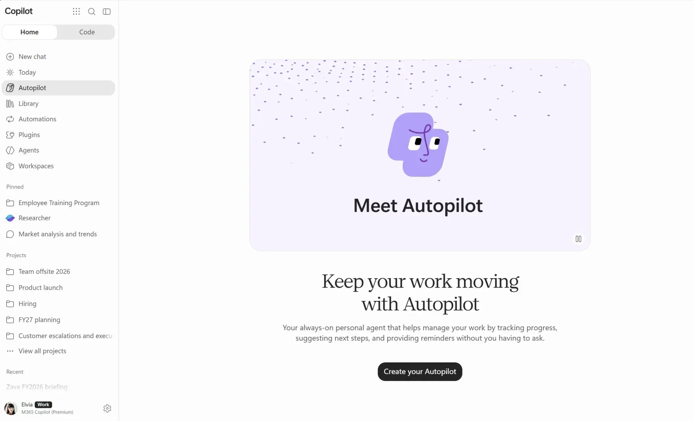



**收录说明**：直接下载，取正文；删去了作者信息、分享按钮与文末的「Source」链接行；文中嵌入的 X 帖子按引用块保留，题图下载到 images/。已翻译。

**内容摘要**：文章报道 Microsoft 开始推出 Autopilot，它在 Teams 和 Outlook 中代表个人用户工作，在 Frontier 计划中面向合格客户预览，需要 Copilot 许可、usage-based billing 和所需的管理与安全能力。用户给 Autopilot 名字、角色和目标；每个实例有自己的身份、持久记忆、工作区和远程计算机，在云端运行，笔记本合上后工作也继续。示例包括为出差锁定日历时间、移除选定会议的某次出现而保留系列、为未回复的 Teams 对话准备 40 份草稿并按优先级放入私有队列。文章还引用了 Omar Shahine 的推文，称团队 7 个月 11 天前还是零人零代码；微软还将 Autopilot 背后的能力提供给 Sales Development Agent 和 Copilot Studio 等其他智能体。

**保留理由**：转载了 Omar Shahine 的三条一手推文，提供团队成立时间线（7 个月 11 天前零人零代码）、Microsoft Mechanics 视频发布与 iPhone Action Button 语音笔记的个人用法。这些是官方博文之外的补充细节。

---

Autopilot 在 Teams 和 Outlook 中工作，起草回复、安排会议并运行例行程序，向符合条件的 Frontier 客户推出。

微软已开始推出 Autopilot，这是一款面向 Microsoft 365 的个人 AI 队友，代表个人用户在 Teams 和 Outlook 中工作。该智能体在 Ignite 上发布，目前面向 Frontier 计划中符合条件的客户预览，这些客户需要具备 Copilot 许可证、按使用量计费（usage-based billing），以及所需的管理与安全能力。微软表示将利用这次预览来完善这些要求，为更广泛的可用性做准备。

> 每个人都应该在工作中有一个助手！很快你就可以有了！
>   
> Sebastian（我的 Autopilot）已经在追踪我所有 [#MSIgnite](https://x.com/hashtag/MSIgnite?src=hash&ref_src=twsrc%5Etfw) 出差的费用了。
>   
> 我把 iPhone 上的 Action Button 设为录制语音备忘、转写并发给 Teams 里的 Sebastian，然后他把它写下来…… [pic.twitter.com/mL4ZbcFDh4](https://t.co/mL4ZbcFDh4)
>
> —— Omar Shahine（@OmarShahine）[2026 年 11 月 16 日](https://x.com/OmarShahine/status/2122194182978879699?ref_src=twsrc%5Etfw)

用户给 Autopilot 一个名字、一个角色和一个目标。每个实例都有自己的身份、持久记忆、工作区和远程计算机，并且运行在云端，所以即使用户合上笔记本，工作也会继续。Autopilot 构建在 Microsoft IQ 之上，后者让它无需手动设置连接就能以 Outlook、会议、文件、聊天以及用户周围的人为基础。由于拥有自己的身份，Autopilot 可以发送用户直接回复的邮件，使用所有者的偏好在 Teams 中接受同事的日程请求，并在被加入群聊和频道时接手任务。它既处理一次性请求，也处理重复性例行程序，例如每周日发送的周报邮件。

> Adam Sheppard 是我为构建 Autopilot 雇的第一个人，他刚在 Microsoft Mechanics 上发布了一段关于 Microsoft Autopilot 的精彩视频——今天以公开预览版发布 [https://t.co/hrYgFJJ3jv](https://t.co/hrYgFJJ3jv)
>
> —— Omar Shahine（@OmarShahine）[2026 年 11 月 17 日](https://x.com/OmarShahine/status/2122756342964523117?ref_src=twsrc%5Etfw)

微软的示例包括为出差锁定日历时间、移除选定的会议场次而保持重复系列完整，以及为未回复的 Teams 对话准备 40 份草稿回复，按优先级分组放入一个私有队列供审阅。这些回复在用户决定发送什么之前一直保持草稿状态。帖子中描述的长期目标是全面委托更大的工作，例如为一次会议出差处理航班、酒店、注册、会议、跟进和费用报告。Autopilot 在用户设定的审批规则和边界内工作，组织可以通过 Microsoft Agent 365 和微软的安全能力增加治理。

> 我为 Microsoft Autopilot 团队感到无比自豪。7 个月零 11 天前，我们团队还是零人、零行代码。在很短的时间里，我们集结了微软一些了不起的 AI 构建者，去构建新东西。
>   
> 今天我们带来了首个企业级自主……
>
> —— Omar Shahine（@OmarShahine）[2026 年 11 月 17 日](https://x.com/OmarShahine/status/2122768705008599310?ref_src=twsrc%5Etfw)

微软还将 Autopilot 背后的能力带给其产品组合中的其他智能体。诸如 Sales Development Agent 等微软智能体，以及来自 Copilot Studio 等受支持平台的智能体，都可以获得自己的电子邮箱地址和受保护的 Microsoft 365 资源，用于持续的独立工作。

我认为通过这一举措，微软终于进入了个人化智能体领域，并把这种能力带给了 Copilot 用户。看到微软在追赶 OpenAI、Anthropic 和 SpaceX 所需的大多数交付物上赶上，令人印象深刻，而凭借今天的公告，我认为它也通过这一举措超过了 Google。对整个微软生态和 Windows 用户来说，Autopilot 智能体是一场巨大的胜利，它们应该有助于 AI 在公众中的普及。
