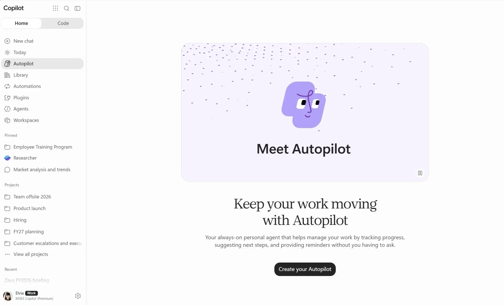

来源：https://www.testingcatalog.com/microsoft-launches-autopilot-a-personal-agent-for-copilot/
取文：2026-11-28，直接下载

Autopilot works across Teams and Outlook, drafts replies, schedules meetings and runs routines, rolling out to eligible Frontier customers.

Microsoft has started rolling out Autopilot, a personal AI teammate for Microsoft 365 that works across Teams and Outlook on behalf of individual users. Introduced at Ignite, the agent is in preview for eligible customers in the Frontier program, who need a Copilot license, usage-based billing and the required management and security capabilities in place. Microsoft says it will use the preview to refine those requirements ahead of broader availability.

> Everyone should have an assistant at work! Soon you can!  
>   
> Sebastian (my Autopilot) is already tracking all my expenses for [#MSIgnite](https://x.com/hashtag/MSIgnite?src=hash&ref_src=twsrc%5Etfw) travel.  
>   
> I have set up the Action Button on my iPhone to record a voice note, transcribe it and send it to Sebastian in Teams and he writes it… [pic.twitter.com/mL4ZbcFDh4](https://t.co/mL4ZbcFDh4)
>
> — Omar Shahine (@OmarShahine) [November 16, 2026](https://x.com/OmarShahine/status/2122194182978879699?ref_src=twsrc%5Etfw)

Users give Autopilot a name, a role and a goal. Each instance gets its own identity, persistent memory, workspace and remote computer, and it runs in the cloud, so work continues when the user's laptop is closed. Autopilot is built on Microsoft IQ, which grounds it in Outlook, meetings, files, chats and the people around the user without any manual setup of connections. Because it has its own identity, Autopilot can send emails that the user replies to directly, take scheduling requests from colleagues in Teams using the owner's preferences, and pick up tasks when it is added to group chats and channels. It handles one-off requests as well as recurring routines, such as a weekly summary email delivered on Sunday.

> Adam Sheppard was the first person I hired to build Autopilot and he just dropped an awesome Microsoft Mechanics video on Microsoft Autopilot - launching today in Public Preview [https://t.co/hrYgFJJ3jv](https://t.co/hrYgFJJ3jv)
>
> — Omar Shahine (@OmarShahine) [November 17, 2026](https://x.com/OmarShahine/status/2122756342964523117?ref_src=twsrc%5Etfw)

Microsoft's examples include blocking calendar time for travel and removing selected meeting occurrences while keeping the recurring series intact, and preparing 40 draft replies to unanswered Teams conversations, grouped by priority in a private queue for review. Those replies stay as drafts until the user decides what gets sent. The longer-term goal described in the post is full delegation of larger jobs, such as handling flights, hotels, registration, meetings, follow-ups and the expense report for a conference trip. Autopilot works within approval rules and boundaries the user sets, and organizations can add governance through Microsoft Agent 365 and Microsoft's security capabilities.

> I’m incredibly proud of the Microsoft Autopilot Team. 7 months and 11 days ago our team had zero people and zero lines of code. In a short time we assembled some amazing AI builders in Microsoft to build something new.   
>   
> Today we are bringing the first enterprise-grade autonomous…
>
> — Omar Shahine (@OmarShahine) [November 17, 2026](https://x.com/OmarShahine/status/2122768705008599310?ref_src=twsrc%5Etfw)

Microsoft is also bringing the capabilities behind Autopilot to other agents across its portfolio. Microsoft agents such as Sales Development Agent, along with agents from supported platforms like Copilot Studio, can be given their own email address and secured Microsoft 365 resources for ongoing, independent work.

I think with this move Microsoft is finally entering the personalized agent space and bringing that capability to Copilot users. It is impressive to see Microsoft catch up on most of the deliverables needed to compete with OpenAI, Anthropic, and SpaceX, and with today's announcements, I think it has also outperformed Google with this move. For the whole Microsoft ecosystem and Windows users, Autopilot agents are a huge win, and they should help AI adoption across the general public.
