

**收录说明**：Microsoft Learn 文档（Microsoft Scout 文档集，页面标为预发布文档），直接下载，取页面正文；删去了页首的「Read in English」「Edit」与登录提示、页尾的反馈与「Additional resources」区块，站内相对链接改为绝对地址。原文中多处图片位于 images/。已翻译。

**内容摘要**：文档面向 Frontier 客户的 Intune 管理员，说明如何为受管用户启用 Microsoft Scout。关键设置是 Windows ADMX 策略中的 Allow Microsoft Scout Frontier access（对应 AllowScoutFrontierAccess），未启用或未配置时，用户可能看到 waitlist 画面而无法登录。流程分三部分：导入 microsoft-scout.admx 和 microsoft-scout.adml、创建 Windows 配置策略并分配，以及用 microsoft-scout.mobileconfig 创建 macOS 自定义配置文件（Device channel）。文档给出验证步骤和排障表，并提示部分预发布模板与截图仍显示内部名称 Clawpilot。

**保留理由**：这是 Intune 逐步部署流程与所需模板文件的官方来源，并含 macOS 配置文件做法及内部名称 Clawpilot 的说明。

---

使用 Intune 设置 Microsoft Scout

[本文为预发布文档，可能发生变更。]

重要

- 你需要加入 **[Frontier 预览计划](https://adoption.microsoft.com/en-us/copilot/frontier-program/)** 并注册接受参与条款，才能**提前访问** Microsoft Scout。Frontier 让你直接接触微软最新的 AI 创新。Frontier 预览受你客户协议中现有预览条款的约束。由于这些功能仍在开发中，其可用性和能力可能随时间变化。
- 这是一项预览功能。
- 预览功能可能功能受限，也可能不会正式发布。这些功能在正式发布前提供，以便客户提前访问并提供反馈。
- 更多信息，请参阅我们的 [Microsoft 产品条款](https://www.microsoft.com/licensing/terms/product/ForOnlineServices/MCA)。

本指南面向需要为受管用户启用 Microsoft Scout 的 Frontier 客户 Intune 管理员。最重要的设置是 Frontier 访问能力，它在 Windows ADMX 策略 UI 中显示为 **允许 Microsoft Scout Frontier 访问**，对应 `AllowScoutFrontierAccess` 能力。关于 Frontier 访问如何与其他管理员关卡配合的背景，请参阅 [Microsoft Scout 的管理员访问概述](https://learn.microsoft.com/en-us/microsoft-scout/admin-access-overview)。

注意

部分预发布 Intune 策略模板和屏幕截图仍显示内部产品名 **Clawpilot**。

## 先决条件

开始之前，请确保你拥有：

- 与你的组织关联的 Microsoft 365 工作或学校账户。不支持个人 Microsoft 账户。
- Intune 租户管理员凭据。
- 访问 <https://intune.microsoft.com> 上的 Microsoft Intune 管理中心。
- 最新的 [Microsoft Visual C++ Redistributable](https://learn.microsoft.com/en-us/cpp/windows/latest-supported-vc-redist)（仅 Windows）。
- Microsoft Scout Windows 策略模板文件：
  - `microsoft-scout.admx`
  - `microsoft-scout.adml`
- Microsoft Scout macOS 配置文件：
  - `microsoft-scout.mobileconfig`

你可以[从 GitHub 下载这些模板和配置文件](https://github.com/microsoft/scout-resources/tree/main/admins)。

## 概述

要为用户启用 Microsoft Scout Frontier 访问，请在 Intune 中配置以下内容：

- 导入 Microsoft Scout Windows ADMX/ADML 模板。
- 从导入的管理模板创建 Windows 配置策略。
- 启用 **允许 Microsoft Scout Frontier 访问**。
- 将 Windows 策略分配给目标受管设备。
- 创建并分配 macOS 自定义配置文件。

## 第 1 部分：导入 Microsoft Scout ADMX 模板

本部分导入 Microsoft Scout 管理模板文件，以便在创建 Windows 配置策略时可用。

### 打开 Microsoft Intune 管理中心

前往 <https://intune.microsoft.com> 并用租户管理员凭据登录。确认 Microsoft Intune 管理中心为正确的租户加载。

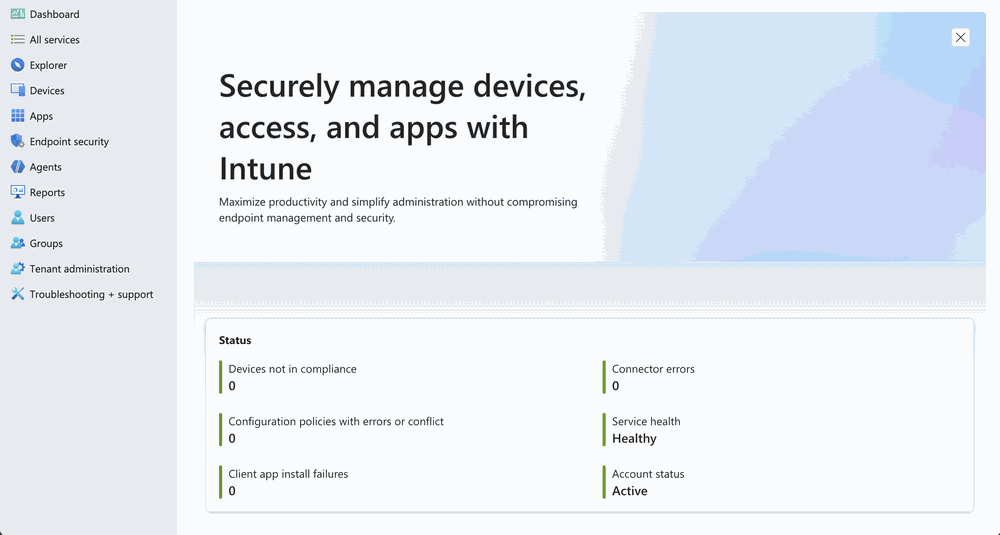

### 打开设备配置并导入 ADMX

在左侧导航中，选择 **设备（Devices）**。在 **管理设备** 下，选择 **配置（Configuration）**，然后打开 **导入 ADMX（Import ADMX）** 选项卡。

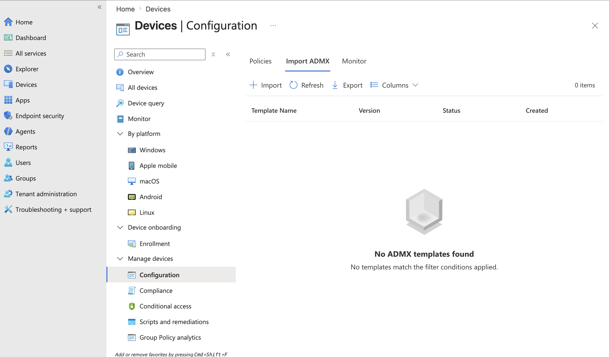

### 开始 ADMX 导入

选择 **导入（Import）**，然后用文件选择器图标上传两个 Microsoft Scout 模板文件：

- **ADMX 文件**：`microsoft-scout.admx`
- **ADML 文件**：`microsoft-scout.adml`

两个文件都选定后，选择 **下一步（Next）**。

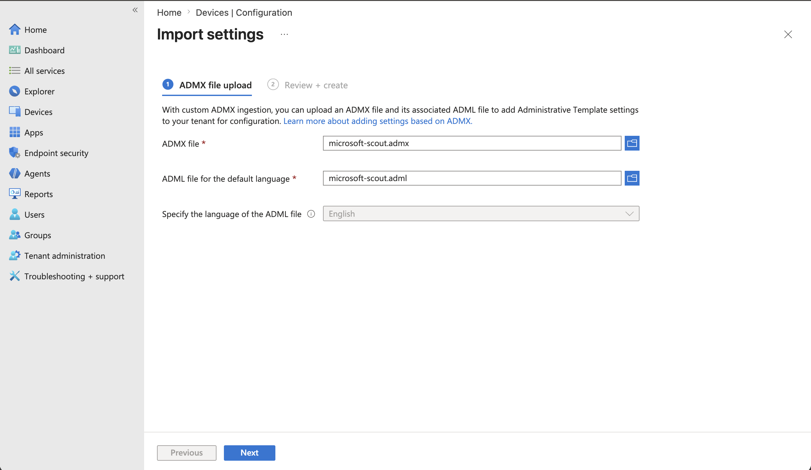

### 查看并创建导入的模板

在 **查看 + 创建（Review + create）** 上，确认两个模板文件都正确列出，然后选择 **创建（Create）**。

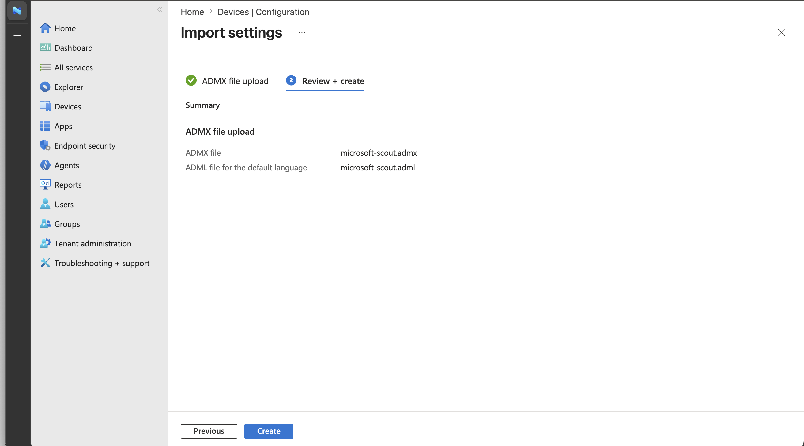

### 等待上传完成

等待 Intune 上传并处理 Microsoft Scout ADMX 模板。在导入状态完成之前不要继续。

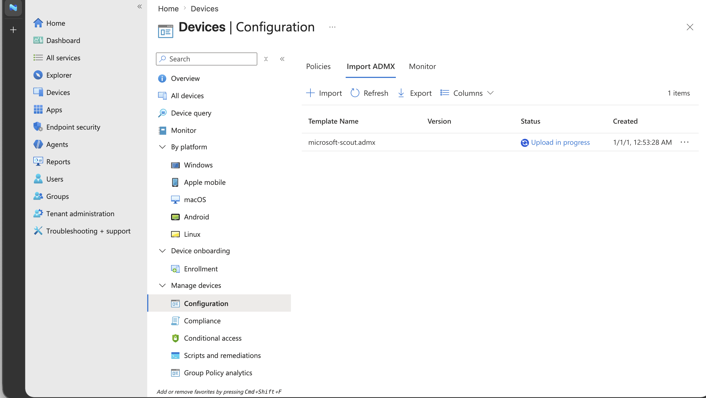

### 确认模板可用

上传完成后，确认 Microsoft Scout 模板状态为 **可用（Available）**。你现在可以使用导入的管理模板创建 Windows 配置策略。

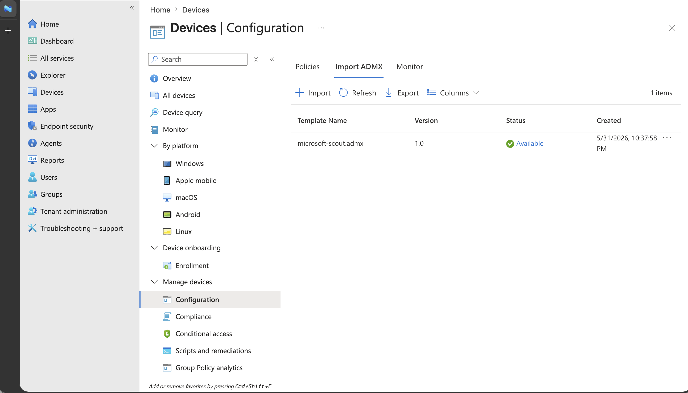

## 第 2 部分：创建 Windows Microsoft Scout 策略

本部分创建一条 Windows 配置策略，为已分配设备启用 Frontier 访问。

### 创建新的配置策略

返回 **设备**，然后选择 **配置**。打开 **策略（Policies）** 选项卡，选择 **新建策略（New policy）**。

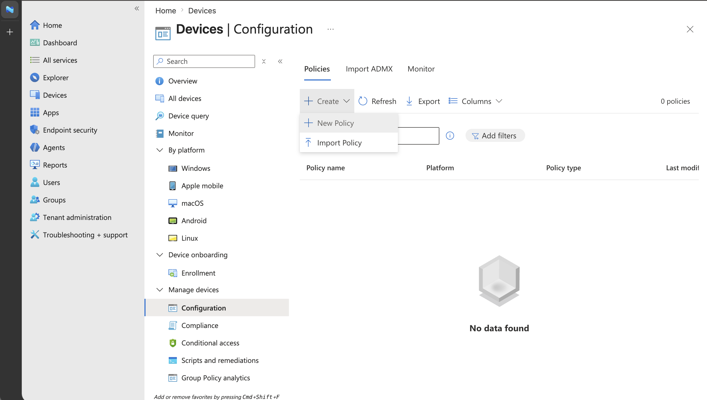

### 选择 Windows 模板配置文件类型

对于新配置文件，选择：

- **平台（Platform）**：Windows 10 及更高版本
- **配置文件类型（Profile type）**：模板（Templates）

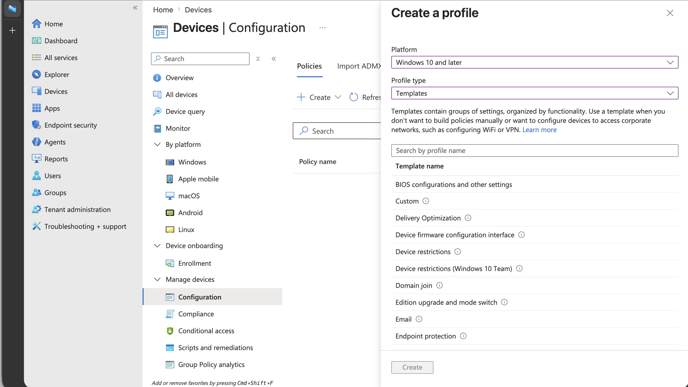

### 选择导入的管理模板

在模板列表中，选择 **导入的管理模板（Imported Administrative Templates）**。这会使用上一节导入的 Microsoft Scout ADMX 模板。

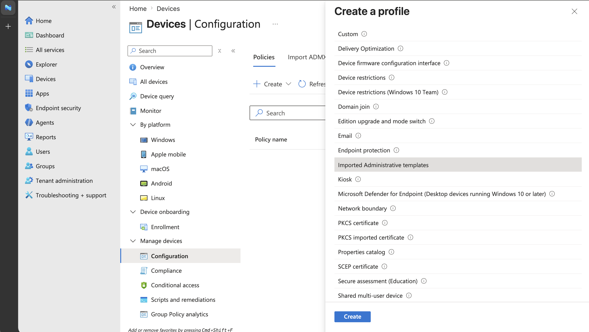

然后选择 **创建**。

### 为 Windows 策略命名

输入清晰的策略名称，例如 **Microsoft Scout - Frontier access**。可选地添加描述，说明该策略为已分配设备启用 Microsoft Scout Frontier 访问。选择 **下一步**。

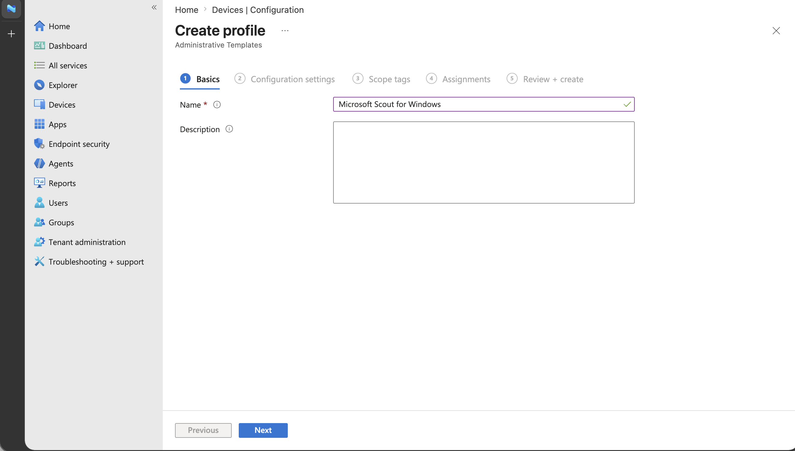

### 选择 Microsoft Scout 配置

在 **配置设置（Configuration settings）** 中，选择导入的 Microsoft Scout 配置模板。

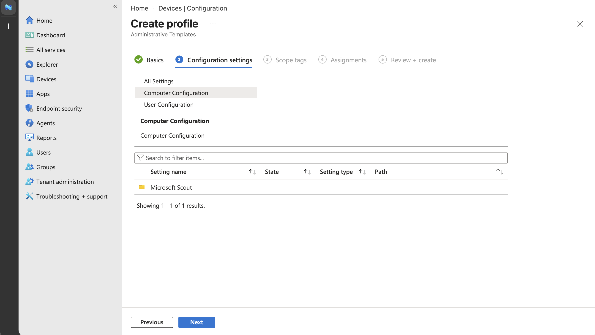

### 选择 Microsoft Scout 策略版本

从导入的管理模板选项中，选择 Microsoft Scout 策略版本，然后继续到可用设置。

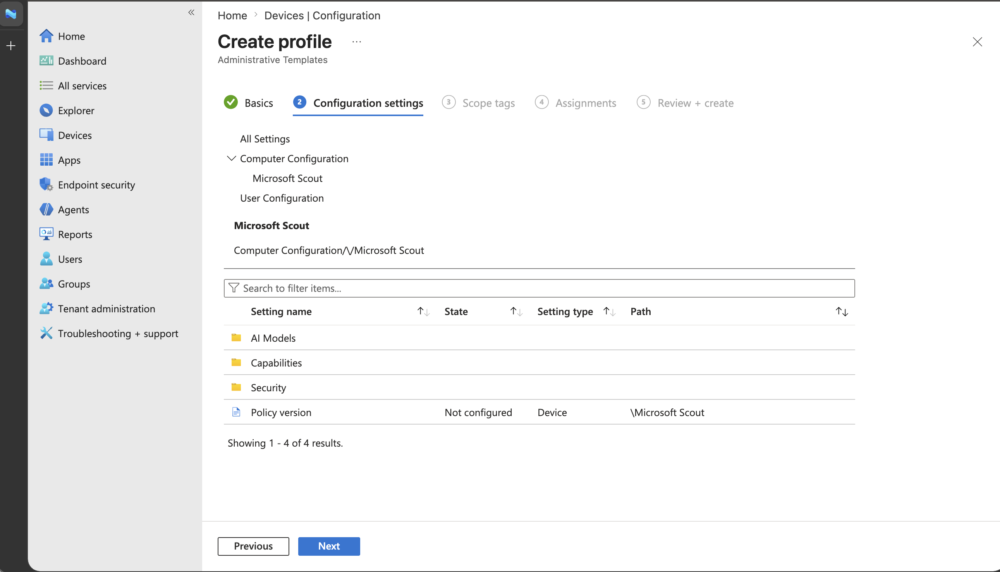

### 打开 Frontier 访问设置

在 **Microsoft Scout** 下的 **功能（Capabilities）** 中，打开名为 **允许 Microsoft Scout Frontier 访问** 的设置。

### 启用 Frontier 访问

将 **允许 Microsoft Scout Frontier 访问** 设为 **已启用（Enabled）**，然后选择 **确定（OK）**。

重要

这是用于 Frontier 访问的关键 Windows 策略设置。它在接收此策略的设备上启用 `AllowScoutFrontierAccess` 能力。启用后，租户中的用户可以正常登录并使用 Microsoft Scout Frontier 版本。如果该设置被禁用或未配置，Frontier 用户可能看到 waitlist 画面并被阻止登录。

### 继续处理作用域标记

在 **作用域标记（Scope tags）** 上，保留默认作用域标记，除非你的组织需要特定的 Intune RBAC 作用域标记，然后选择 **下一步**。

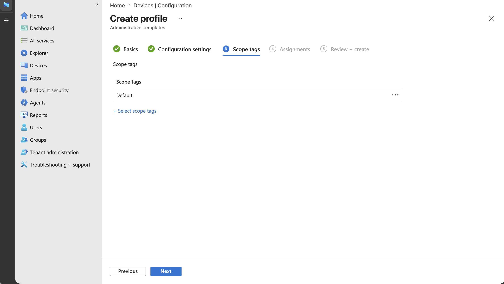

### 配置分配

在 **分配（Assignments）** 上，选择应接收 Microsoft Scout Windows 策略的组或设备。

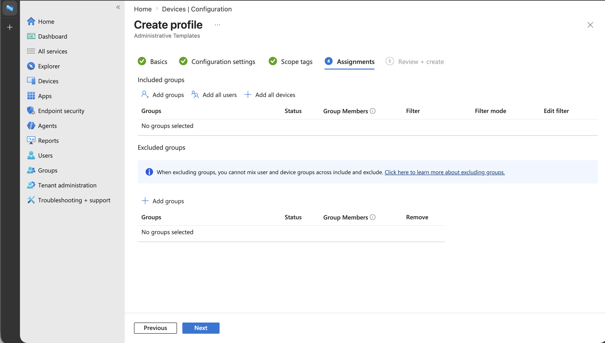

### 酌情分配给所有设备

对于广泛的 Frontier 租户推广，把策略分配给 **所有设备（All devices）**。如果你只在较小的设备群体中试点 Microsoft Scout，则只分配目标试点组。

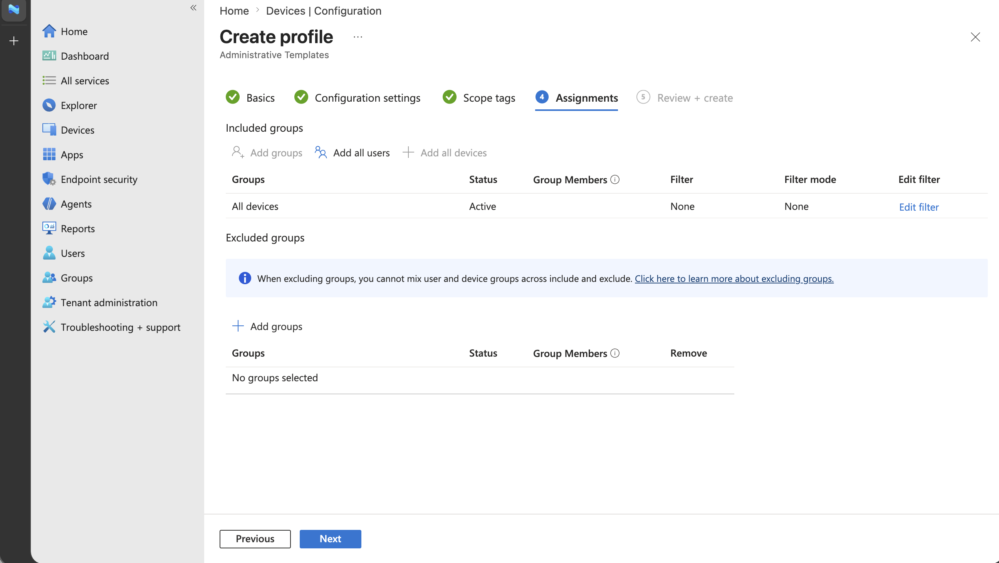

### 查看并创建 Windows 策略

查看 Windows 配置策略摘要。确认策略包含已启用的 Frontier 访问设置，然后选择 **创建**。

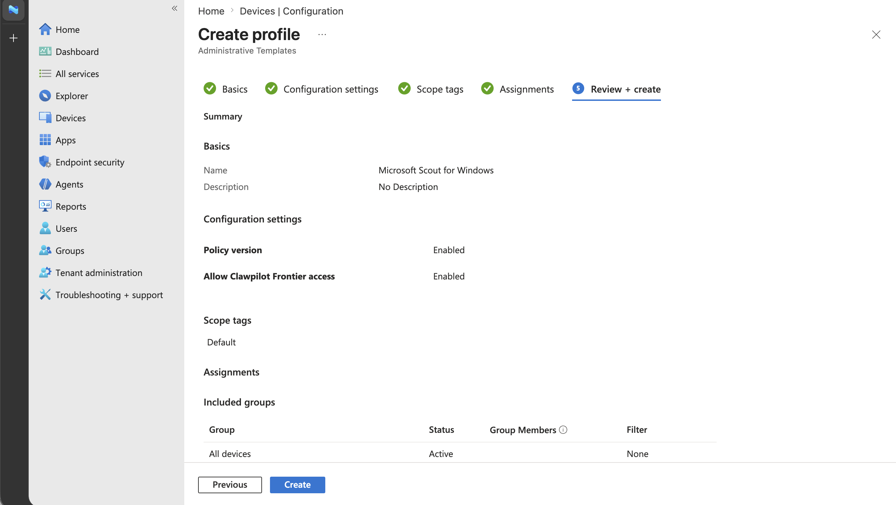

### 确认 Windows 策略已创建

创建后，确认 Windows 策略出现在配置策略列表中。

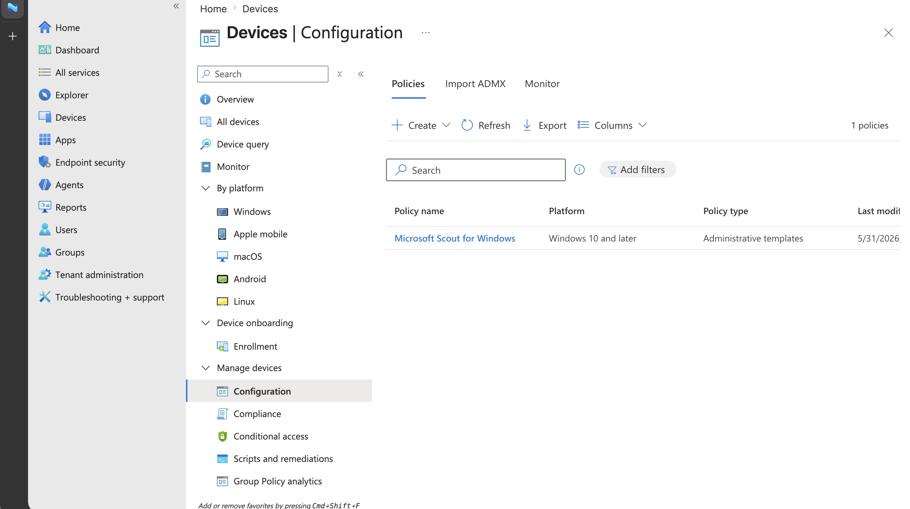

## 第 3 部分：创建 macOS Microsoft Scout 策略

本部分创建一个 macOS 自定义配置文件，把相同的租户设置投递到受管 Mac。

### 为 macOS 创建策略

返回 **设备**，然后选择 **配置**。选择 **新建策略**，开始创建 macOS 策略。

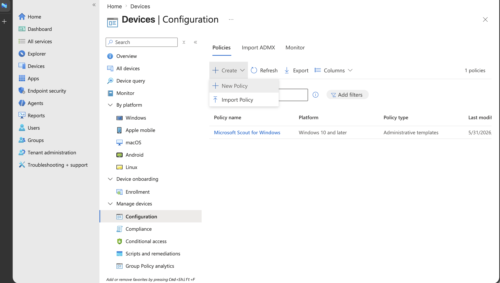

### 选择 macOS 自定义配置文件类型

选择：

- **平台**：macOS
- **配置文件类型**：模板
- **模板名称（Template name）**：自定义（Custom）

然后选择 **创建**。

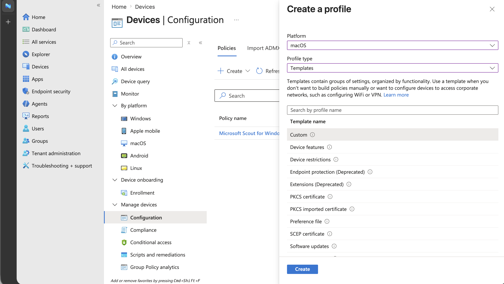

### 为 macOS 配置文件命名

输入清晰的配置文件名称，例如 **Microsoft Scout - macOS Frontier access**。可选地添加描述，说明该配置文件为受管 Mac 配置 Microsoft Scout 租户策略。选择 **下一步**。

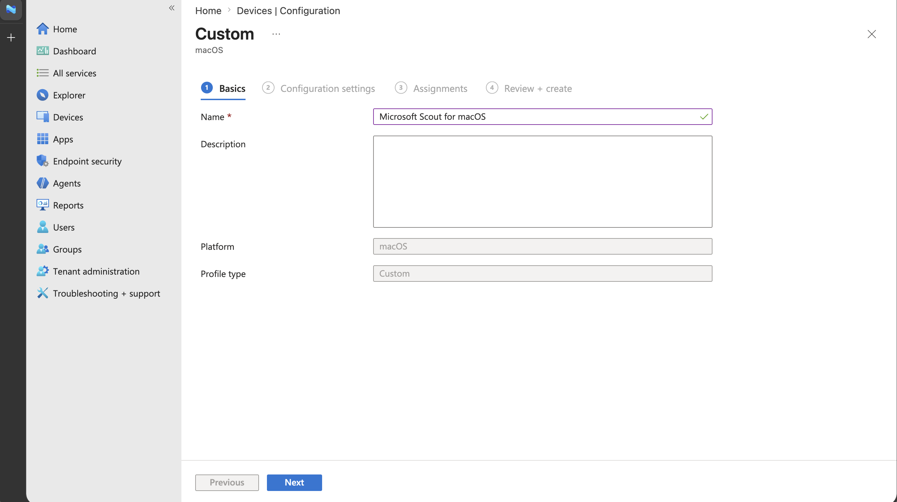

### 上传 Microsoft Scout mobileconfig 配置文件

在 **配置设置** 上，上传 `microsoft-scout.mobileconfig` 并使用以下值：

| 设置 | 值 |
| --- | --- |
| 自定义配置文件名称 | `macOS` |
| 部署通道 | 设备通道（Device channel） |
| 配置文件 | `microsoft-scout.mobileconfig` |

文件上传且配置文件内容出现后，选择 **下一步**。

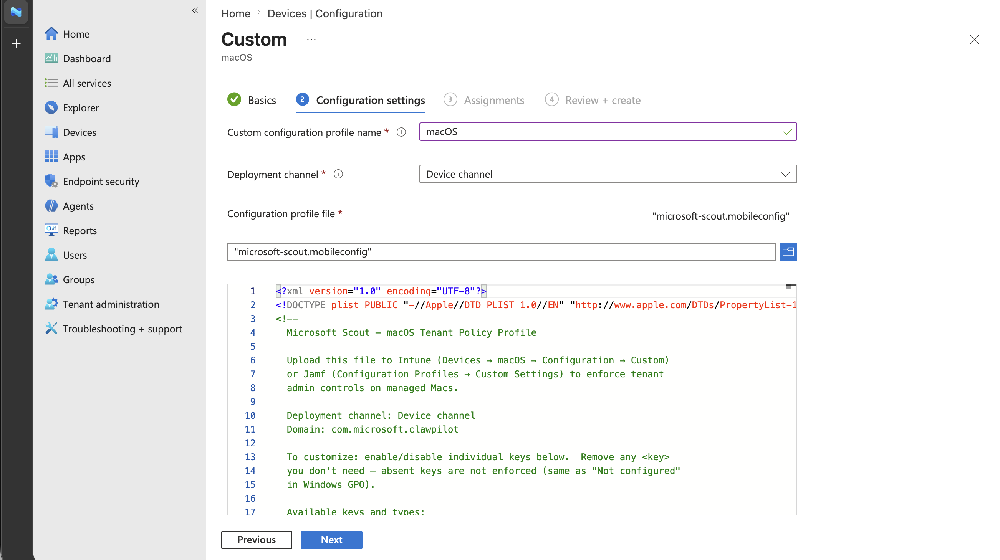

### 配置 macOS 分配

在 **分配** 上，选择应接收 Microsoft Scout macOS 配置文件的设备或组。

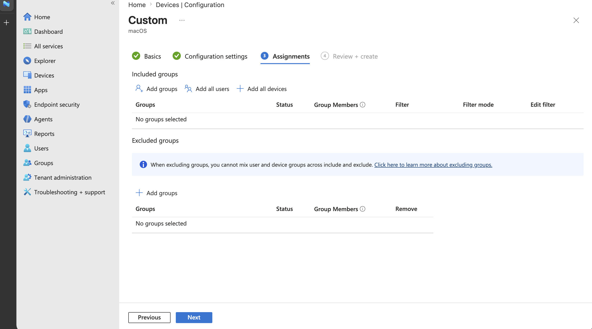

### 酌情分配给所有设备

对于广泛的 Frontier 租户推广，把 macOS 配置文件分配给 **所有设备**。对于试点推广，只分配目标 macOS 试点组。

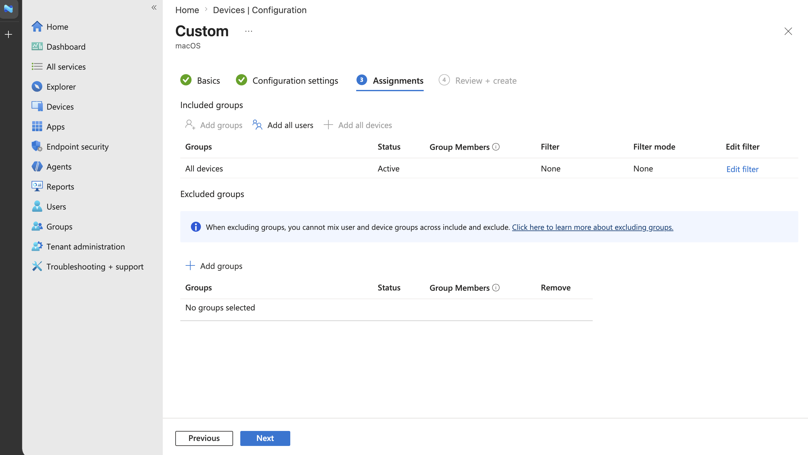

### 查看并创建 macOS 策略

查看 macOS 自定义配置文件摘要，确认已上传的 `microsoft-scout.mobileconfig` 文件被列出，然后选择 **创建**。

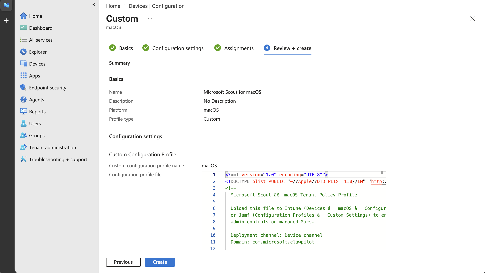

### 确认 macOS 策略已创建

创建后，确认 macOS 配置文件出现在配置策略列表中。

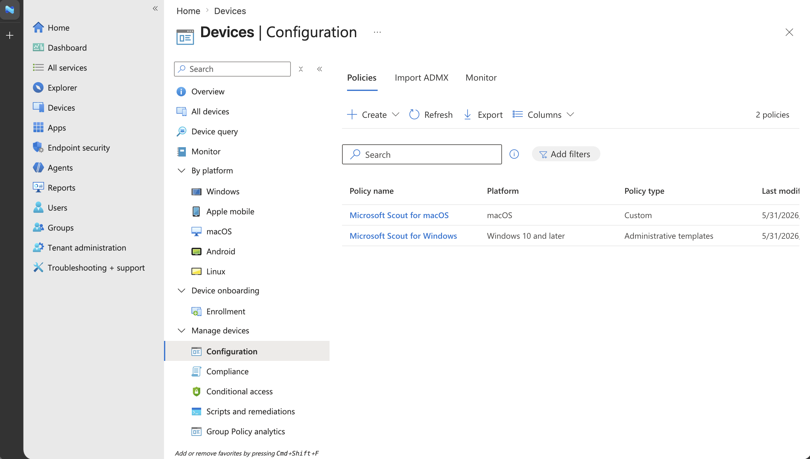

## 验证部署

在 Windows 和 macOS 策略创建并分配后：

- 确认 Windows 策略通过 **允许 Microsoft Scout Frontier 访问** 设置显示 `AllowScoutFrontierAccess` 能力为已启用。
- 确认已分配设备包含在目标组中。
- 等待 Intune 策略同步在目标设备上完成。
- 在受管 Frontier 设备上打开 Microsoft Scout，验证用户能在不看到 waitlist 画面的情况下登录。

## 排障

| 症状 | 需要检查什么 |
| --- | --- |
| Microsoft Scout 的 Windows 设置不出现。 | 确认 `microsoft-scout.admx` 和 `microsoft-scout.adml` 已成功导入并显示 **可用**。 |
| 用户仍看到 waitlist 画面。 | 确认 **允许 Microsoft Scout Frontier 访问** 设为 **已启用**，策略已分配给该设备，且设备已与 Intune 同步。 |
| macOS 设备收不到该设置。 | 确认 `microsoft-scout.mobileconfig` 已上传到使用 **设备通道（Device channel）** 的 macOS **自定义** 配置文件，并已分配给目标设备。 |
| 策略应用到了错误的对象。 | 检查 Windows 和 macOS 配置文件的分配组。 |

## 相关内容

- [Microsoft Scout 的管理员访问概述](https://learn.microsoft.com/en-us/microsoft-scout/admin-access-overview)
- [管理管理员控制](https://learn.microsoft.com/en-us/microsoft-scout/manage-group-policy)
- [Microsoft Scout 入门](https://learn.microsoft.com/en-us/microsoft-scout/get-started)
- [Microsoft Scout 概述](https://learn.microsoft.com/en-us/microsoft-scout/overview)
- [Microsoft Scout 常见问题](https://learn.microsoft.com/en-us/microsoft-scout/faq)
