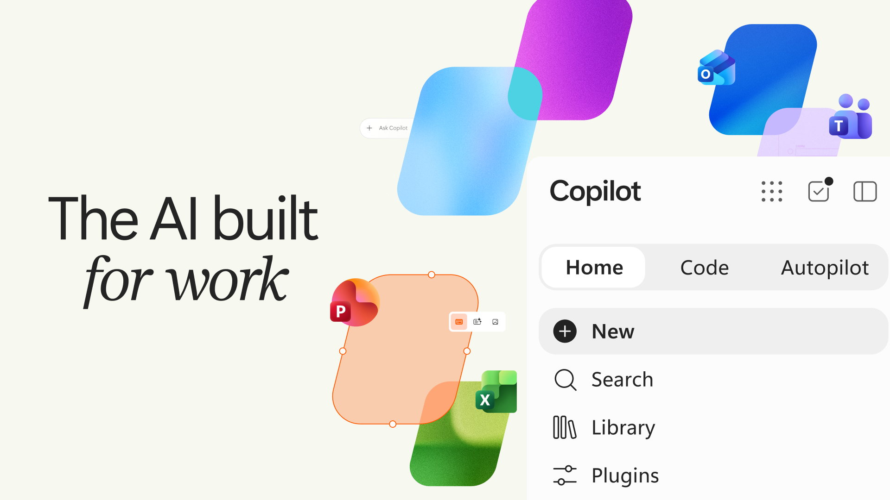
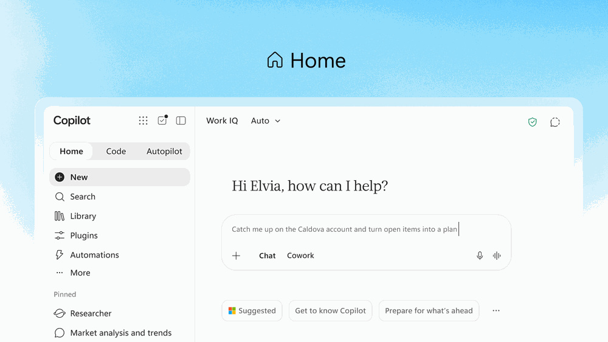
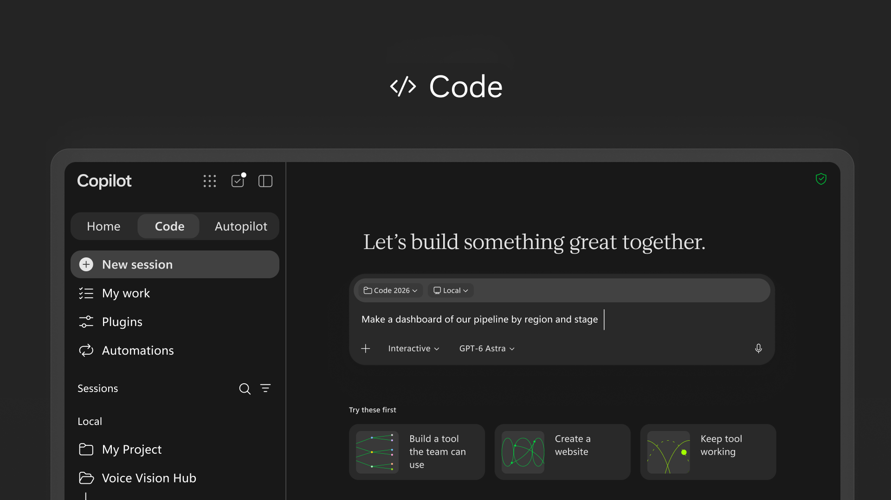
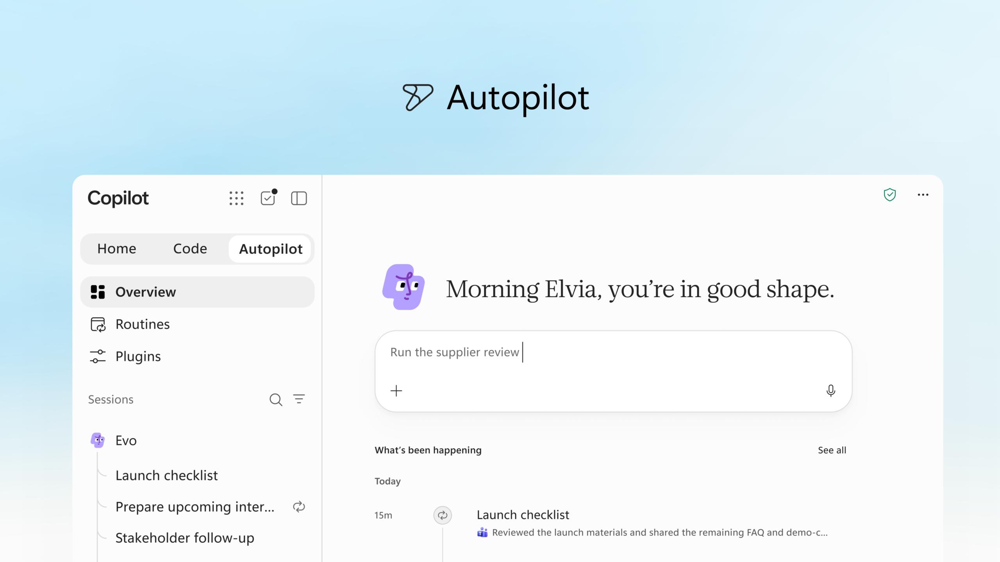



**收录说明**：微软官方博客，介绍新版 Copilot 的 Home、Code 与 Autopilot，Scout 在此改名为 Autopilot。按产品 skill 的约定全文存档，摘要只写 Autopilot 相关部分。直接下载；删去了文末标签；三个内嵌 YouTube 视频写为占位行，图片收入 images/。微软亚洲新闻中心 2026-09-29 的简体中文版是同文译本，记入 altUrls，不另收。已翻译。

**内容摘要**：本文是 2026 年 9 月 25 日 Jared Spataro 的官方博文，同时介绍新 Copilot 的 Home 和 Code 以及 Autopilot；此处仅概括 Autopilot 部分。文中称 Autopilot（此前名为 Scout）是持久、主动、个人化的智能体，即使用户不在也会继续工作，并将在当月底扩展到私有预览。用户给它一个名字、一个角色和一个目标，它就会监视频道、跟进线程、运行周期性工作，并在数天后接续项目，例如搭建并管理完整的供应商评审流程。Autopilot 由云端托管，在租户内拥有自己的身份、记忆、计算机和工作区，基于 Microsoft IQ，可在 Teams、Outlook 等处像同事一样被 @提及。计费方面，Cowork、Code 和 Autopilot 以及 Astra 和 Fable 等前沿模型均采用 usage-based billing（UBB）。

**保留理由**：这是 Scout 更名为 Autopilot 并转向云端托管的官方说明，给出了新的产品定位、身份与工作区描述和计费方式，是理解 06-02 之后变化的主要官方依据。

---

推出带有 Home、Code 和 Autopilot 的新 Copilot

2026 年 9 月 25 日
| [Jared Spataro - 工作场景 AI 首席营销官](https://blogs.microsoft.com/blog/author/jaredspataro/)

我们正在重新构想 Microsoft Copilot，让它在工作方式不断演进时仍能提供支持，并帮助每个人和每个组织在人类抱负的流动中扩展所能完成的事情。今天我们推出**新版 Copilot**，把人们依赖的工具与他们构建、定制和扩展工作中 AI 所需的下一代能力连接起来。

Copilot 应用现在有三项新能力：**Home** 是你新的起点，Chat 与 [Cowork](https://www.microsoft.com/en-us/copilot/blog/2026/06/16/copilot-cowork-is-now-generally-available/) 在这里汇合——而借助 [**Office in Copilot**](https://techcommunity.microsoft.com/blog/microsoft-copilot-blog/introducing-office-in-the-new-microsoft-copilot-app/4561230)，Word、Excel 和 PowerPoint 的全部能力现已内置于这一体验中。**Code** 让每个人都能构建自己的解决方案，并配有安全运行这些方案的工具，它由与 GitHub Copilot 相同的底层技术驱动。而 **Autopilot** 是一个持续在线、主动且个人化的智能体，即使你不在也会继续工作。Home 和 Code 将在未来几周内开始在 Frontier 计划中推出，Autopilot 则将在本月底扩展到私有预览。

我们也很高兴分享新的 **FinOps for AI** 能力，帮助你管理支出并从 Copilot 和智能体中获得最大价值。

[视频：YouTube 嵌入视频](https://www.youtube.com/watch?v=mgSFs9rkqJs)

观看[音频描述版](https://youtu.be/lL_Qz8o2IuI)。

### **为每种工作方式带来新体验**

**Home** 是 Copilot 中你新的起点，**Chat 和 Cowork 在这里汇合**于一处。由于工作不断在会议、聊天、文档、电子邮件、应用和智能体之间流转，Home 是你找到方向的地方，让你脚踏实地、继续前进。你可以查看最近活动、获得 Copilot 能帮上什么的建议，并在上次离开的地方接着做。Chat 即时且对话化——适合快速提问、查找、起草，并让你了解每一步进展。Cowork 用于你委派出去的工作。你定义任务，它端到端运行并交回完成的结果：一份 RFP 回复、一套发布材料、一份客户简报、一个财务关账包，或任何其他值得反复打磨的复杂工作。而在不久的将来，你无需选择模式：只需说明你要完成什么，Copilot 就会把工作路由到 Chat、Cowork 或 Code——哪个能力适合就交给哪个。

我们还通过 [**Office in Copilot**](https://techcommunity.microsoft.com/blog/microsoft-copilot-blog/introducing-office-in-the-new-microsoft-copilot-app/4561230) 把 Word、Excel 和 PowerPoint 的全部能力带入 Copilot。现在你能快速进入真正的工作：没有错乱的格式，没有多余的版本，也不必在另一个应用里重建上下文。在 Home 中，你可以让 Copilot 起草发布简报、做预算模型、制作演示文稿，或接手团队正在处理的文件，它会创建或更新一份真实的、可编辑的文档、工作簿或演示文稿——对你整个团队实时可见，而不只是你。你可以一边对话一边与之并肩打磨，也可以 @提及一位队友，他们的编辑会在进行时显示出来——Copilot 与 Office 应用之间保持同步，因此无论你在哪里工作，进展都跟着你走。

如果你最近没用过 Office 应用中的 Copilot，不妨再看看。PowerPoint 现在能自动让演示文稿符合品牌规范，并让你微调幻灯片和图片，或快速应用自定义模板。当 Copilot 或其他协作者在 Excel 中做了编辑，你能确切看到改了什么以及为什么，从而快速跟上，Copilot 还会推荐最适合呈现数据的图表。在 Microsoft 365 各处，Skills 帮助把专业知识直接带入应用，例如 Excel 中的财务技能和 Word 中的法律技能，并让组织通过可复用的、按角色定制的工作流来推广最佳实践。

**Code** 把解决方案构建带出开发者的专属领域。迄今为止，知识工作的单位一直是文件：文档、电子表格、演示文稿。这些不会消失，但 Code 增加了第四种：任何人都可以为完成某项工作而创建的小型专用解决方案。学习构建它们，正在变得像写备忘录或做预算模型一样基础。

用自然语言描述一个应用、跟踪器、仪表板、自动化或工作流，Copilot 会选择一种方式并构建它——从用于快速查阅的常驻桌面小组件、用于探索数据和测试结果的交互式仪表板，到可与团队共享的云端托管内部应用。

Code 由与 GitHub Copilot 相同的底层技术驱动，在沙箱环境中运行，并可安全地托管在你的租户内。借助 Microsoft IQ，你创建的一切都以你的工作上下文为基础，插件会自动同步。你的软件开发人员继续使用 GitHub Copilot 处理日常工作，同时与 Copilot 平台有更多连接。Code 将在本月底向 Frontier 推出，并在未来几周内广泛可用。今年晚些时候，它将面向 Microsoft 365 Premium 和 Pro 订阅者提供预览。

随着在 Copilot 中构建变得前所未有地容易和快速，我们推出 **[Microsoft Copilot Managed Runtime](https://aka.ms/CopilotManagedRuntime-Blog)**：让代码在你公司的 Microsoft 365 环境内安全运行的托管基础设施。它由 IT 治理，但对其他人来说很容易：与队友共享应用、连接实时数据，并从任何地方访问。同一套基础也支撑着在 Cowork、Code 和 Copilot Studio 中构建的应用，我们还将把它开放给第三方和专业代码开发者。Copilot Managed Runtime 现已进入预览，也将在 Code 中提供。

**Autopilot**，此前名为 Scout，是你的数字队友。它为你工作：给它一个名字、一个角色和一个目标，它就开始工作——监视频道、跟进线程、运行周期性工作，并在数天后重新拾起一个项目，无需等待提示。它可以做诸如搭建并管理完整供应商评审流程这样的事情：构建日程和工作倒推计划，然后自行处理准备、会议和跟进，直至联系利益相关者获取更新。而且 Autopilot 由云端托管，所以在你睡觉或注意力在别处时它仍在工作——无需持续盯守。

Autopilot 住在你的租户里，拥有自己的身份、记忆、计算机和工作区，并且构建在 Microsoft IQ 之上，因此它理解你的组织实际如何运作。它出现在人们已经在工作的地方——Teams、Outlook、聊天、频道和文档——所以你可以像同事一样 @提及它，背后有权限、审计和治理。你设定目标和边界；Autopilot 处理其余的事，同时让你知情并保持掌控。

### **扩展你的业务上下文**

Copilot 以 Microsoft IQ 为基础，这是面向企业 AI 的统一智能平台，横跨你的 Microsoft 技术栈，把业务的运作方式与它所掌握的知识连接成一个实时视图，供 Copilot 和你的智能体使用，并且受到治理和保护。

今天我们正在扩展 Copilot 可用的业务上下文。Fabric IQ 把来自你数据的可信上下文带入 Copilot，包括 Power BI 中 2,000 万多个语义模型。它为 Chat 和 Cowork 提供基础，今天已在两者中正式可用，与 Code 的集成也将很快通过 Frontier 计划提供。Copilot 现在[以 Dynamics 365 和 Power Platform 的数据与工作流为基础](https://aka.ms/BizAppsInWorkIQ/Blog)，并将在下个月以公开预览形式逐步推出。因此，当销售人员撰写提案时，Copilot 可以把交易历史和支持工单等数据直接融入文档，无需切换应用或做让人分心的查找。

你还需要一种可信的方式，把 Copilot 连接到推动业务前进的行动和数据。插件扩展 Copilot 能做的事，把技能、连接器和其他能力汇集在一起，让用户无需离开日常使用的应用就能完成更多工作流。**新的[插件注册表](https://techcommunity.microsoft.com/blog/microsoft-copilot-blog/introducing-the-plugin-registry---one-place-to-discover-and-govern-plugins-for-m/4559682)**正在逐步推出，并将在未来几周内于各界面正式可用，它把微软、合作伙伴和自定义构建的插件汇集到一个统一目录中。IT 可以集中批准和管理插件，开发者和合作伙伴则可以发布一次，就把 Copilot 扩展到受支持的体验中。结果是更简单的方式，能够大规模引入可信能力，同时具备组织所需的控制力。

### **管理 AI 支出**

对于日常 AI——快速回答、初稿、摘要和分析——你希望以固定成本获得尽可能好的质量。用户订阅许可证（USL）正好提供这些：Chat 中的 Copilot，以及 Word、Excel、PowerPoint、Outlook 和 Teams 中的 Copilot；模型选择；以及新能力和新模型。**Auto** 是 USL 的核心。Auto 会对每个请求权衡准确性、速度和成本，将其路由到最适合该工作的模型。智能体式工作则需要另一类支出，要让你以最先进的模型获得尽可能好的质量。usage-based billing（UBB，按用量计费）让你完全掌控模型选择，并使成本与价值匹配。Cowork、Code 和 Autopilot 这些新的长时间运行智能体能力，以及 Astra 和 Fable 等前沿模型，都运行在 UBB 上。随着 AI 能力及人们使用它们的方式不断演进，我们也在同步演进 Copilot 的定价。更多信息见[此处](https://aka.ms/Sept25/EvolvingModel)。

FinOps for AI 是一项共同准则，用于管理 AI 支出并针对业务价值进行优化。我们致力于让组织充分利用其 AI 支出，今天我们正在 Agent 365、Insights 和 Microsoft Copilot 中推出新能力来帮助做到这一点。Agent 365 中的成本管理正从 Cowork 和 Work IQ API 扩展到包括 Code 和 Copilot Managed Runtime，并计划在 10 月支持在 Microsoft Copilot Studio 中构建的智能体。管理员可以通过 API 访问大规模管理支出策略；把最终用户的额度请求导入现有的审批和自动化工作流；并设定哪些模型系列可供不同用户组使用——这些设置也决定了 Auto 可以从哪些模型中选择。业务领导和管理员可以了解哪些 Cowork 任务产生了最好的结果，并确定在哪些地方维持、扩展或优化用量。最后，最终用户可以直接在 Microsoft Copilot 中查看额度使用、剩余余额和使用历史，从而在组织护栏内更好地管理自己的 AI 用量。我们[致力于投资](https://aka.ms/finopsforai/optimization) FinOps for AI，帮助组织掌控支出、理解价值，并优化 AI 投入以产生实际影响。

### **抢先一睹接下来的内容**

这些发布只是开始。我们很高兴分享未来的 Copilot 体验，让 Copilot 更个人化、更主动，并帮助团队一起前进。

Home 中即将推出的 **Today** 是一个主动的、个人化的指挥中心，覆盖邮件、日历、Teams 线程、会议和任务。它告诉你错过了什么、什么现在需要关注、什么可以等。Today 不只是呈现工作，它会把工作做掉。草稿已经写好，等你编辑；日程变更已经提出；被遗忘的跟进事项正等你发送，并附带上下文，让你快速跟上。Today 将在 10 月于 Copilot 中进入私有预览，之后也将登陆 Outlook 和 Teams。

[视频：YouTube 嵌入视频](https://www.youtube.com/watch?v=Jv-iQSZ3YVY)

观看[音频描述版](https://www.youtube.com/watch?v=Jv-iQSZ3YVY)。

而现在，当你在 **Teams 中调用 @Copilot** 时，你整个团队都会获得该频道、群聊或会议的共享上下文和权限。问一个产品决策为什么做出，Copilot 会从各个对话中拉出背景——无需翻找，无需重新解释。当这个决策波及制造、包装和发布时间时，Copilot 会走得更远：它主动提出准备一次跨职能评审，包含依赖关系、负责人、未决问题和决策，让每个人都能看到自己的工作如何连接，以及还有什么需要解决。团队保持一致，项目继续推进。@Copilot 能力将在本月底于 Teams 中进入私有预览。

[视频：YouTube 嵌入视频](https://www.youtube.com/watch?v=KVDlhOI7WGo)

观看[音频描述版](https://www.youtube.com/watch?v=r4E2v_7BfX8)。

### **开始使用**

有了新版 Copilot，你现在有一个地方可以提问、委派、构建、自动化等等。它正通过 [Frontier 计划](https://www.microsoft.com/en-us/microsoft-365-copilot/frontier-program)逐步推出，新能力会持续到来。请回到这里查看最新内容。

*Copilot 还有更多内容即将到来。欢迎参加 [Microsoft Ignite](https://nam06.safelinks.protection.outlook.com/?url=https%3A%2F%2Fignite.microsoft.com%2Fhome%3Fwt.mc_ID%3Dmsignite26_ciarmar_corp_np_oo_Copilot_BlogCTACopilot_0352&data=05%7C02%7CJessica.Voelker%40microsoft.com%7C022d43bbf01b4bc667e108df15b1c45b%7C72f988bf86f141af91ab2d7cd011db47%7C1%7C0%7C639253525377252688%7CUnknown%7CTWFpbGZsb3d8eyJFbXB0eU1hcGkiOnRydWUsIlYiOiIwLjAuMDAwMCIsIlAiOiJXaW4zMiIsIkFOIjoiTWFpbCIsIldUIjoyfQ%3D%3D%7C0%7C%7C%7C&sdata=Mbv%2BFZixxUSvdipgawzLAZ8YPh6JKAIlDh5MJbj4Q4s%3D&reserved=0)——11 月 17 日至 20 日在旧金山及线上举行——了解最新的 Copilot 创新，以及它如何帮助人们和组织重新构想工作并从 AI 中获得价值。*

*Jared Spataro 负责微软「AI at Work」相关工作，帮助每个组织利用 AI 和智能体解决其独特的业务问题、降低成本并推动净新增价值创造。他的团队开展研究，帮助预测和塑造各行各业工作与商业的未来形态，同时在 Copilot、Copilot Studio、Microsoft 365、Dynamics 365 和 Power Platform 中交付新产品和新功能。*
