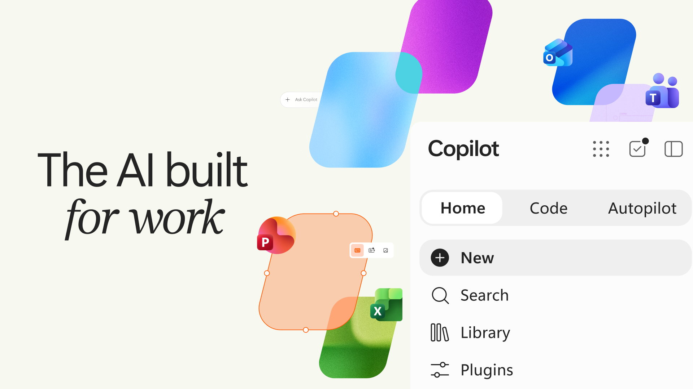
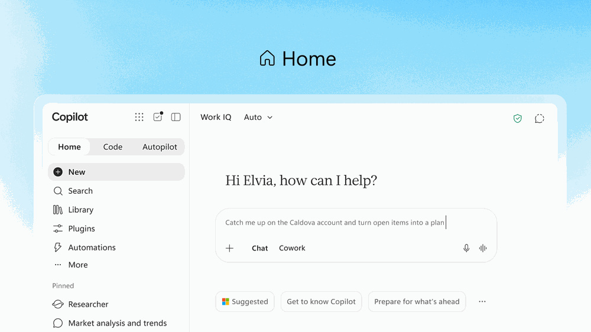
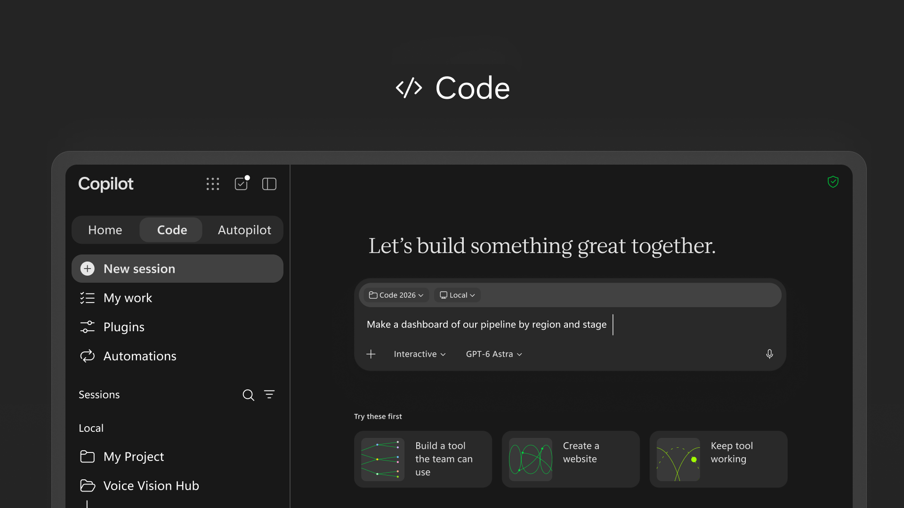
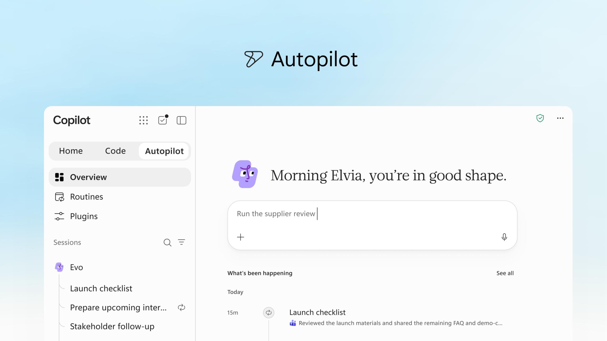

来源：https://blogs.microsoft.com/blog/2026/09/25/introducing-the-new-copilot-with-home-code-and-autopilot/
取文：2026-11-10，直接下载

Introducing the new Copilot with Home, Code and Autopilot

Sep 25, 2026
| [Jared Spataro - Chief Marketing Officer, AI at Work](https://blogs.microsoft.com/blog/author/jaredspataro/)

We’re reimagining Microsoft Copilot to enable work as it evolves and to help expand what every individual and every organization can accomplish in the flow of human ambition. Today we’re introducing the **new Copilot** to connect the tools people rely on with the next generation of capabilities they’ll need to build, customize and scale AI across work.

The Copilot app now has three new capabilities: **Home** is your new starting point, where Chat and [Cowork](https://www.microsoft.com/en-us/copilot/blog/2026/06/16/copilot-cowork-is-now-generally-available/) come together — and with [**Office in Copilot**](https://techcommunity.microsoft.com/blog/microsoft-copilot-blog/introducing-office-in-the-new-microsoft-copilot-app/4561230), the full power of Word, Excel and PowerPoint is now built into the experience. **Code** lets everyone build their own solutions with the tools to run them safely, and it’s powered by the same underlying technology as GitHub Copilot. And **Autopilot** is a persistent, proactive and personal agent that keeps working even when you’re not. Home and Code will start rolling out in our Frontier program in the coming weeks and Autopilot is expanding to private preview at the end of the month.

We’re also excited to share new **FinOps for AI** capabilities to help you manage spend and get the most value from Copilot and agents.

[视频：YouTube 嵌入视频](https://www.youtube.com/watch?v=mgSFs9rkqJs)

Watch the [audio-described version](https://youtu.be/lL_Qz8o2IuI).

### **A new experience for every mode of work**

**Home** is your new starting point in Copilot, **where Chat and Cowork come together** in one place. As work moves constantly between meetings, chats, documents, emails, apps and agents, Home is where you get your bearings, keeping you grounded and moving forward. You can review recent activity, get suggestions on what Copilot can help with, and pick up work right where you left off. Chat is instant and conversational — ready for quick questions, lookups, draft-creation and keeping you in the loop on every turn. Cowork is for work you delegate. You define the task and it runs end-to-end to return a completed result: an RFP response, a launch kit, a customer briefing, a financial close package or any other complex work worth iterating on. And coming soon, you won’t need to choose a mode: simply state what you need to accomplish, and Copilot will route the work to Chat, Cowork or Code — whichever capability is right for the job.

We’re also bringing the full power of Word, Excel and PowerPoint to Copilot with [**Office in Copilot**](https://techcommunity.microsoft.com/blog/microsoft-copilot-blog/introducing-office-in-the-new-microsoft-copilot-app/4561230). Now you can get to real work fast: no broken formatting, no stray versions, no rebuilding the context in another app. From Home you can ask Copilot to draft a launch brief, model a budget, build a deck, or pick up a file your team is already working on, and it creates or updates a real, editable document, workbook or presentation — live for your whole team, not just you. Refine it side by side with your conversation, or @mention a teammate and their edits show up as they make them — things stay in sync between Copilot and the Office apps, so progress travels with you wherever you work.

If you haven’t used Copilot in the Office apps lately, take another look. PowerPoint now keeps decks on-brand automatically and enables you to fine-tune slides and images or quickly apply a custom template. When Copilot or another collaborator makes edits in Excel, you can see exactly what changed and why, so you’re up to speed quickly, and Copilot recommends the best chart to visualize your data. And across Microsoft 365, Skills help bring specialized expertise directly into the apps, like financial skills in Excel and legal skills in Word, and enable organizations to scale best practices through reusable, role-specific workflows.

**Code** moves solution-building outside the realm of developers alone. To date, the unit of knowledge work has been the file: the document, the spreadsheet, the deck. Those aren’t going anywhere, but Code adds a fourth: small, purpose-built solutions anyone can create to get a job done. Learning to build them is becoming as basic a skill as writing a memo or modeling a budget.

Describe an app, tracker, dashboard, automation or workflow in natural language, and Copilot chooses an approach and builds it — from persistent desktop widgets for quick reference and interactive dashboards for exploring data and testing outcomes to cloud-hosted internal apps you can share with your team.

Powered by the same underlying technology as GitHub Copilot, Code runs in a sandboxed environment and can be hosted securely within your tenant. With Microsoft IQ, everything you create is grounded in the context of your work, and plugins sync automatically. Your software developers continue to use GitHub Copilot for their day-to-day work with more connectivity into the Copilot platform. Code is rolling out to Frontier at the end of the month, with broad availability in the coming weeks. It will be in preview for Microsoft 365 Premium and Pro subscribers later this year.

As it gets easier and faster than ever to build in Copilot, we’re introducing **[Microsoft Copilot Managed Runtime](https://aka.ms/CopilotManagedRuntime-Blog)**: hosting infrastructure that lets code run safely right inside your company’s Microsoft 365 environment. It’s governed by IT but easy for everyone else: share an app with teammates, connect it to live data and access it from anywhere. This same foundation enables apps built in Cowork, Code and Copilot Studio, and we’re opening it up to third-party and pro-code developers, too. Copilot Managed Runtime is now in preview and will also be accessible inside Code.

**Autopilot**, previously called Scout, is your digital teammate. And it works for you: Give it a name, a role and a goal, and it goes to work — watching channels, following up on threads, running recurring work and picking a project back up days later, without waiting for a prompt. It can do things like set up and manage a full supplier review process: building the schedule and workback plan, then handling prep, meetings and follow-ups on its own, right down to reaching out to stakeholders for updates. And Autopilot is cloud-hosted, so it keeps working while you sleep or your attention is elsewhere — no constant monitoring required.

Autopilot lives in your tenant with its own identity, memory, computer and workspace, and it’s built on Microsoft IQ so it understands how your organization actually works. It shows up where people already work — Teams, Outlook, chats, channels and documents — so you can @mention it like a colleague, with permissions, audit and governance behind it. You set the objective and boundaries; Autopilot handles the rest while keeping you informed and in control.

### **Expanding your business context**

Copilot is grounded in Microsoft IQ, the unified intelligence platform for enterprise AI across your Microsoft stack, connecting how the business operates with the knowledge it holds into one real-time view for Copilot and your agents, governed and secure.

Today we are expanding the business context available to Copilot. Fabric IQ brings trusted context from your data, including the 20+ million semantic models in Power BI into Copilot. It grounds Chat and Cowork, and is generally available in both today, with Code integration coming through the Frontier program soon. Rolling out over the next month in public preview, Copilot is [now grounded](https://aka.ms/BizAppsInWorkIQ/Blog) in data and workflows from Dynamics 365 and Power Platform. So, when a salesperson is working on a proposal, for instance, Copilot can incorporate data like deal history and support tickets right into the document, with no app-switching or distracting lookups required.

You also need a trusted way to connect Copilot to the actions and data that move your business forward. Plugins extend what Copilot can do, bringing together skills, connectors and other capabilities so users can complete more workflows without leaving the apps they use every day. Rolling out now and generally available across surfaces in the coming weeks, a **new [plugin registry](https://techcommunity.microsoft.com/blog/microsoft-copilot-blog/introducing-the-plugin-registry---one-place-to-discover-and-govern-plugins-for-m/4559682)** will bring Microsoft, partner and custom-built plugins together in one unified catalog. IT can approve and manage plugins centrally, while developers and partners can publish once to extend Copilot across supported experiences. The result is a simpler way to introduce trusted capabilities at scale, with the control your organization needs.

### **Managing AI spend**

For everyday AI — quick answers, first drafts, summaries and analysis — you want the best possible quality at a fixed cost. A user subscription license (USL) gives you exactly that: Copilot in Chat and across Word, Excel, PowerPoint, Outlook and Teams; model selection; and new capabilities and models. **Auto** is at the heart of the USL. Auto weighs accuracy, speed and cost on each request to route to the model best suited for the job. Agentic work requires a different type of spend, one that gives you the best quality possible with the most advanced models. Usage-based billing (UBB) lets you have full control to choose models and match cost to value. Cowork, Code, and Autopilot, new long-running agentic capabilities, and frontier models like Astra and Fable all run on UBB. As AI capabilities and the ways people use them continue to evolve, we’re evolving Copilot pricing alongside them. Read more [here](https://aka.ms/Sept25/EvolvingModel).

FinOps for AI is a shared discipline for managing AI spend and optimizing it for business value. We are committed to enabling organizations to make the most of their AI spend, and, today, we are introducing new capabilities across Agent 365, Insights and Microsoft Copilot to help do that. Cost management in Agent 365 is expanding beyond Cowork and Work IQ APIs to include Code and Copilot Managed Runtime, with support for agents built in Microsoft Copilot Studio planned for October. Admins can manage spending policies at scale with API access; route credit requests from end users into existing approval and automation workflows; and set which model families are available to different groups of users — those settings also shape which models Auto can select from. Business leaders and admins can understand which Cowork tasks are generating the strongest outcomes and determine where to sustain, expand or optimize usage. And finally, end users can view credit usage, remaining balances and usage history directly in Microsoft Copilot, so they can better manage their own AI usage within organizational guardrails. We are [committed to investing](https://aka.ms/finopsforai/optimization) in FinOps for AI to help organizations stay in control of spend, understand value and optimize their AI investments for impact.

### **A sneak peek at what’s next**

These announcements are just the beginning. We’re excited to share future Copilot experiences that make Copilot more personalized and proactive, and help the team move forward together.

Coming soon in Home, **Today** is a proactive, personalized command center across mail, calendar, Teams threads, meetings and tasks. It shows you what you missed, what needs attention now and what can wait. Today doesn’t just surface the work, it gets work done. The draft is written and ready for you to edit; the schedule change is already proposed; and the forgotten follow-up is waiting for you to send it, complete with context so you can catch up quickly. Today enters private preview in October in Copilot, and will be coming to Outlook and Teams as well.

[视频：YouTube 嵌入视频](https://www.youtube.com/watch?v=Jv-iQSZ3YVY)

Watch the [audio-described version](https://www.youtube.com/watch?v=Jv-iQSZ3YVY).

And now when you invoke **@Copilot in Teams**, your entire team gets the shared context and permissions of the channel, group chat or meeting. Ask why a product decision was made, and Copilot pulls the background from across conversations — no digging, no re-explaining. When that decision ripples into manufacturing, packaging and launch timing, Copilot goes further: it offers to prepare a cross-functional review with dependencies, owners, open questions and decisions, so everyone can see how their work connects and what still needs resolving. The team stays aligned and the project keeps moving forward. The @Copilot capability will be in private preview in Teams by the end of the month.

[视频：YouTube 嵌入视频](https://www.youtube.com/watch?v=KVDlhOI7WGo)

Watch the [audio-described version](https://www.youtube.com/watch?v=r4E2v_7BfX8).

### **Get started**

With the new Copilot, you now have one place to ask, delegate, build, automate and more. It’s rolling out now through the [Frontier program](https://www.microsoft.com/en-us/microsoft-365-copilot/frontier-program), with new capabilities arriving continuously. Check back here for the latest.

*There is so much more coming to Copilot. Join us at [Microsoft Ignite](https://nam06.safelinks.protection.outlook.com/?url=https%3A%2F%2Fignite.microsoft.com%2Fhome%3Fwt.mc_ID%3Dmsignite26_ciarmar_corp_np_oo_Copilot_BlogCTACopilot_0352&data=05%7C02%7CJessica.Voelker%40microsoft.com%7C022d43bbf01b4bc667e108df15b1c45b%7C72f988bf86f141af91ab2d7cd011db47%7C1%7C0%7C639253525377252688%7CUnknown%7CTWFpbGZsb3d8eyJFbXB0eU1hcGkiOnRydWUsIlYiOiIwLjAuMDAwMCIsIlAiOiJXaW4zMiIsIkFOIjoiTWFpbCIsIldUIjoyfQ%3D%3D%7C0%7C%7C%7C&sdata=Mbv%2BFZixxUSvdipgawzLAZ8YPh6JKAIlDh5MJbj4Q4s%3D&reserved=0) — November 17–20 in San Francisco and online — to learn about the latest Copilot innovation and how it’s empowering people and organizations to reimagine work and get value from AI.*

*Jared Spataro leads Microsoft’s AI at Work efforts, helping every organization leverage AI and agents to solve their unique business problems, reduce costs and drive net-new value creation. His team conducts research to help predict and shape what the future of work and business will look like across industries, while also delivering new products and features within Copilot, Copilot Studio, Microsoft 365, Dynamics 365 and Power Platform.*
