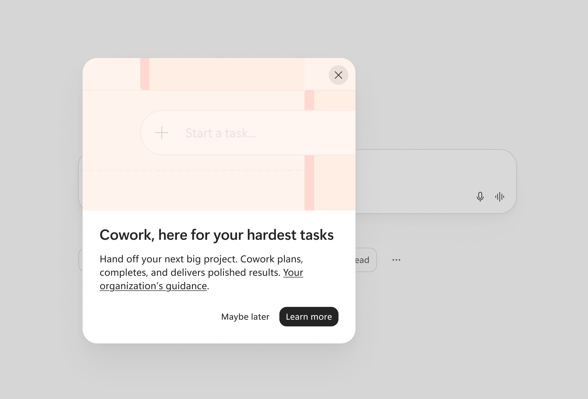
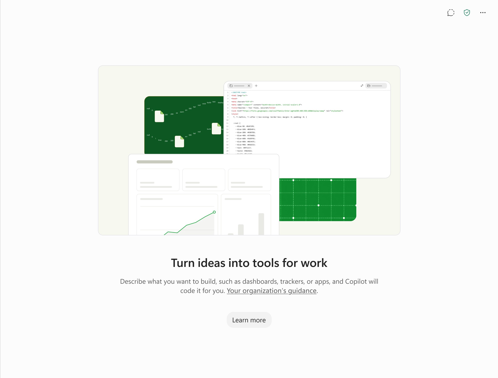



**收录说明**：Microsoft 365 管理中心的消息中心公告，原文需管理员登录，依据第三方存档站 mc.merill.net 的完整转录存档。删去了存档站的导航、讨论区与相关帖；公告中的两张界面示意图下载到 images/。已翻译。

**内容摘要**：这条消息中心公告 2026-11-09 发布，称 Cowork、Code、Autopilot 等用量计费（UBB）体验将对有 Microsoft 365 Copilot 许可证的用户默认可见；没有适用支出策略的用户会看到「Request access」或「Learn more」。根据客户反馈，微软延长了推出时间并新增一项管理控制：2026 年 11 月中旬提供「Access requests to usage-based billing experiences」设置，12 月中旬加入自定义指引 URL，2027 年 1 月底强制执行并退役旧设置，延期发布的客户为 2027 年 2 月底。公告强调这一变化不会自动启用 UBB 体验或开始计费，用户仍须有适用的支出策略和可用的 Copilot Credits。

**保留理由**：给出 Autopilot 等 UBB 入口对授权用户默认可见的官方时间表和访问请求的管理控制，是 MC1479277 之后的更新，其他资料没有。

---

MC1546354 - 发现 Cowork、Code 和 Autopilot 等用量计费（UBB）体验

Message Center

### 摘要

自 2027 年 1 月起，Cowork、Code 和 Autopilot 等用量计费体验将对拥有 Microsoft 365 Copilot 许可证的用户默认可见。新的管理控制将允许组织管理访问请求并提供自定义指引 URL。现有的支出策略仍然管辖实际使用与计费。

[讨论](#discussion)powered by zap.ms

[### 消息 ID

MC1546354

在 Message Center 中查看](https://admin.microsoft.com/#/MessageCenter/:/messages/MC1546354)

### 发布时间

Nov 9, 2026

### 服务

Microsoft Copilot (Microsoft 365)

### 标签

Major change

New feature

User impact

Admin impact

### 更多信息

****背景与原因：****

如 [MC1479277](https://mc.merill.net/message/MC1479277) 中先前所宣布，我们正在让 Microsoft Copilot app 中的用量计费体验更易于发现。Cowork、Code 和 Autopilot 等用量计费体验将对拥有 Microsoft 365 Copilot 许可证的用户默认可见，即使其组织尚未启用访问。没有适用支出策略的用户，将根据其组织的设置看到请求访问或了解更多的选项。

**根据客户反馈，我们正在延长推出时间表，并引入一项额外的管理控制，使组织能够向用户提供自定义指引。**这些变更让管理员有更多时间做准备，并在管理用户如何发现和请求访问用量计费体验方面拥有更大的灵活性。

****推出时间表：****

更新后的推出时间表如下：

- **2026 年 11 月中旬：**新的管理设置 「Access requests to usage-based billing experiences」 将开放给管理员配置。
- **2026 年 12 月中旬：**该管理设置将新增一个选项，允许管理员在 Learn more 信息体验中提供自定义 URL，把用户引导至其所在组织自己的指引。如果在该设置中选择 「Specific users」 或 「No users」，此选项即可使用。
- **2027 年 1 月底：**新的可发现性行为和管理设置将强制执行。旧设置 「Allow users to discover and use AI experiences enabled by usage-based billing」 将退役。对于延期发布（deferred release）的客户，这将在 2027 年 2 月底适用。

****对你的组织的影响：****

**受影响的对象：**

- 有用户已获得 Microsoft 365 Copilot 许可证的组织。

**平台/服务：**

- Microsoft Copilot app 和 Microsoft 365 管理中心。

**将发生什么：**

- 自 2027 年 1 月底起，Cowork、Code 和 Autopilot 的入口将对有许可证的用户默认可见。
- 没有适用支出策略来授予其该功能访问权限的用户，将看到一个信息体验，其中有 「Request access」 或 「Learn more」 选项，具体取决于其组织如何配置新的 「Access requests to usage-based billing experiences」 管理设置。
- 管理员可以配置哪些用户有资格请求访问，包括阻止访问请求的选项。
- 管理员将能够提供一个自定义 URL，把用户引导至组织指引。只有无法请求访问的用户，才会在 Learn more 信息体验中看到次级 URL 「Your organization’s guidance」。
- 现有设置 「Allow users to discover and use AI experiences enabled by usage-based billing」 将继续适用，直到它在 2027 年 1 月底退役。

*信息体验中可自定义的 「Your organization’s guidance」 链接在 Cowork 和 Code 上的示例。UI 可能变更。*

**这一变更不会自动启用用量计费体验，也不会启动计费。**用户必须拥有适用的支出策略和可用的 Copilot Credits，才能使用这些体验。

****所需操作/建议：****

我们建议管理员：

1. **查看新设置**：在 Microsoft 365 管理中心的 Copilot > Settings > Access requests to usage-based billing experiences 下，于 11 月中旬开放时查看。从 12 月中旬起，你将能够在此设置中为你决定不能请求访问的用户配置自定义 URL。
2. **配置访问请求偏好**，以确定哪些用户可以请求访问用量计费体验。
3. **准备组织指引**，并自 12 月中旬起，如果你希望把用户引导至你所在组织特有的信息，则配置自定义 URL。
4. **查看支出策略**，确保对用量计费体验的访问符合你所在组织的要求。

我们建议在 2027 年 1 月底新的可发现性行为强制执行之前，查看并配置这些设置。

了解更多：[Access requests to usage-based billing experiences](https://learn.microsoft.com/copilot/implement/request-access-usage-based-billing-experiences)（将在 12 月中旬更新，以反映该设置中自定义 URL 可用后的操作说明）

****合规考虑：****

此更新引入了用于管理访问请求和组织指引的额外管理控制。它不会自动授予用户对用量计费体验的访问权限，也不会改变现有的支出策略要求。
