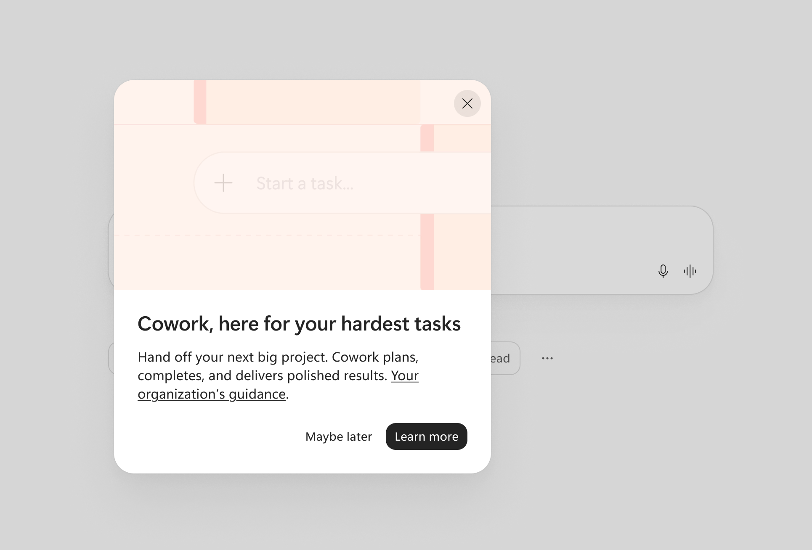
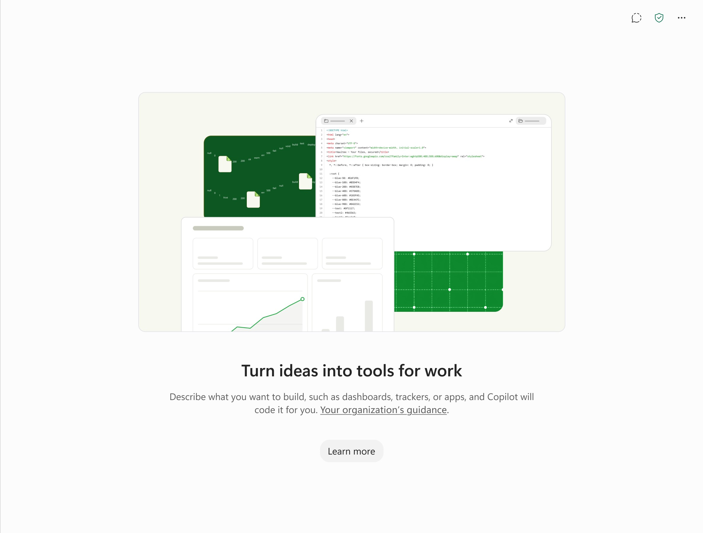

来源：https://mc.merill.net/message/MC1546354
取文：2026-11-14，直接下载（第三方存档站 mc.merill.net；消息中心原文需管理员登录）

MC1546354 - Discover usage-based billing (UBB) experiences like Cowork, Code, and Autopilot

Message Center

### Summary

Usage-based billing experiences like Cowork, Code, and Autopilot will be visible by default to Microsoft 365 Copilot licensed users starting January 2027. New admin controls will allow organizations to manage access requests and provide custom guidance URLs. Existing spending policies still govern actual usage and billing.

[Discussion](#discussion)powered by zap.ms

[### Message ID

MC1546354

View in Message Center](https://admin.microsoft.com/#/MessageCenter/:/messages/MC1546354)

### Published

Nov 9, 2026

### Service

Microsoft Copilot (Microsoft 365)

### Tag

Major change

New feature

User impact

Admin impact

### More information

****What and why:****

As previously announced in [MC1479277](/message/MC1479277), we are making usage-based experiences in the Microsoft Copilot app easier to discover. Usage-based billing experiences like Cowork, Code, and Autopilot, will be visible by default to users with a Microsoft 365 Copilot license, even if their organization has not enabled access. Users without an applicable spending policy will see an option to request access or learn more, based on their organization's settings.

**Based on customer feedback, we are extending the rollout timeline and introducing an additional admin control that will allow organizations to provide custom guidance to users.** These changes give administrators more time to prepare and greater flexibility to manage how users discover and request access to usage-based experiences.

****Rollout schedule:****

The updated rollout schedule is as follows:

- **Mid-November 2026:** The new admin setting, "Access requests to usage-based billing experiences," will become available for administrators to configure.
- **Mid-December 2026:** An additional option will be introduced to the admin setting, allowing administrators to provide a custom URL as part of the Learn more informational experience that directs users to their own organization’s guidance. The option will be available if you select "Specific users" or “No users” in the setting.
- **End of January 2027:** The new discoverability behavior and admin setting will be enforced. The old setting "Allow users to discover and use AI experiences enabled by usage-based billing" will be retired. This will apply to customers on deferred release at the end of February 2027.

****Impact on your organization:****

**Who is affected:**

- Organizations with users licensed for Microsoft 365 Copilot.

**Platforms/services:**

- Microsoft Copilot app and Microsoft 365 admin center.

**What will happen:**

- Entry points for Cowork, Code, and Autopilot will be visible by default to licensed users starting at the end of January 2027.
- Users without an applicable spending policy giving them access to the feature will see an informational experience with an option to "Request access" or "Learn more," depending on their how their organization has configured the new "Access requests to usage-based billing experiences" admin setting.
- Administrators can configure which users are eligible to request access, including the option to prevent access requests.
- Administrators will be able to provide a custom URL directing users to organizational guidance. Only users who cannot request access will see the secondary URL, "Your organization’s guidance", as part of the Learn more informational experience.
- The existing setting, "Allow users to discover and use AI experiences enabled by usage-based billing," will continue to apply until it is retired at the end of January 2027.

*Examples of the customizable “Your organization’s guidance” link on the informational experience for Cowork and Code. UI subject to change.*

**This change does not automatically enable usage-based experiences or initiate billing.** Users must have an applicable spending policy and available Copilot Credits before they can use these experiences.

****Action required / recommendations:****

We recommend that administrators:

1. **Review the new setting** in the Microsoft 365 admin center under Copilot > Settings > Access requests to usage-based billing experiences when it becomes available in mid-November. Starting mid-December, you will be able to configure a custom URL in this setting for users who you decide cannot request access.
2. **Configure access request preferences** to determine which users can request access to usage-based experiences.
3. **Prepare organizational guidance** and, beginning in mid-December, configure a custom URL if you want to direct users to information specific to your organization.
4. **Review spending policies** to ensure that access to usage-based experiences aligns with your organization's requirements.

We recommend reviewing and configuring these settings before the new discoverability behavior is enforced at the end of January 2027.

Learn more: [Access requests to usage-based billing experiences](https://learn.microsoft.com/copilot/implement/request-access-usage-based-billing-experiences) (This will be updated in mid-Dec to reflect instructions for the custom URL once available in the setting)

****Compliance considerations:****

This update introduces additional administrative controls for managing access requests and organizational guidance. It does not automatically grant users access to usage-based experiences or change existing spending policy requirements.
