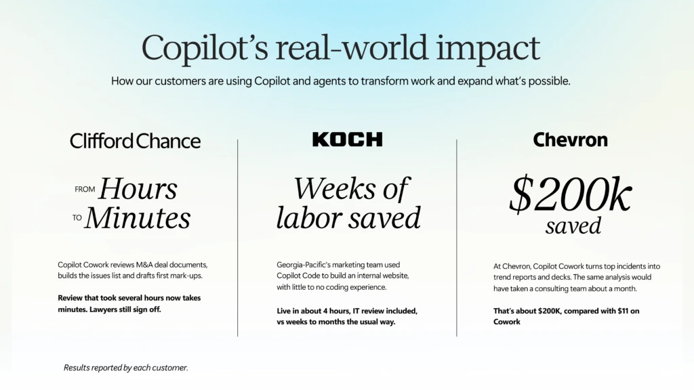



**收录说明**：Microsoft Copilot 博客的 Ignite 2026 主稿，作者 Jared Spataro（Copilot 首席营销官）。直接下载，取正文；删去了页首题图、作者简介与文末分类标签；正文中的一张信息图对 curl 默认请求返回 403，带浏览器标识后下载到 images/。全文介绍 Ignite 上的 Copilot 整体发布，Autopilot 只是其中一部分。已翻译。

**内容摘要**：这篇博客总览 Ignite 2026 上 Copilot 的发布，其中 Autopilot 从当天开始向 Frontier 客户推出。Autopilot 被描述为个人专属、常驻、代你工作的自主智能体，生活在租户内，有自己的身份、记忆和工具，在 Teams、Outlook、聊天、频道和文档中可被 @mention，能监视 Teams 频道、跟进邮件、运行周期性工作和管理项目，示例是搭建并推进完整的 supplier review。每个 Autopilot 有自己的 Microsoft Entra Agent ID 和 named manager，IT 可限定其访问并随时阻止，登录和操作以自己的名字记录；它由 Work IQ 驱动并在现有权限内工作，关键操作前可征求用户意见。Workspaces 中 Autopilot 可领取任务并在定稿前征求用户意见；Agent 365 Cost Management 覆盖消耗与预算。

**保留理由**：微软官方对 Autopilot 的发布日定义，是 UC Today 等媒体引用的出处，其中「own Microsoft Entra Agent ID and a named manager」的原话和 Workspaces 中的 Autopilot 用法是新信息。

---

今天上午，在 Microsoft Ignite 2026 上，我们分享了[我们对 Copilot 的愿景](https://blogs.microsoft.com/blog/2026/09/25/introducing-the-new-copilot-with-home-code-and-autopilot/)如何正在为客户变为现实。**Home**（**Chat** 与 **Cowork** 在此合而为一）和 **Office in Copilot** 现已正式可用。**Code** 将在未来几周内正式可用，而用于安全托管和管理应用的 **Copilot Managed Runtime** 现已正式可用。**Autopilot** 则从今天起开始向 Frontier 客户推出。此外，为销售、服务、财务和法律团队构建的新插件与技能已经可用，扩展后的 **Agent 365** 平台也已推出，让你能更明智地管理智能投入。

我们正在打造 [Copilot](https://www.microsoft.com/en-us/copilot)，让它运用纯粹的智能，为真实的人完成真实的工作。没有哪一家实验室在所有方面都是最好的，你也不应该只能选一家。Copilot 汇集了业界领先的模型。借助 **Auto** 路由，你的员工无需为每项工作操心挑选正确的模型。在底层，Auto 会为任务动态选择正确的模型和投入程度，在质量、速度与成本之间取得平衡。它为需要更多投入的时刻留出更多算力，在任务不需要时少花算力。员工也可以手动选择 OpenAI 或 Anthropic 的模型，模型访问由组织策略治理。

而 **[Work IQ](https://www.microsoft.com/en-us/copilot/features/work-iq)** 让 Copilot 与众不同。知识工作本质上是碎片化且杂乱的。它发生在电子邮件、Teams 会议和聊天、Word 备忘录、PowerPoint 幻灯片评论等之中。Microsoft 365 保存着超过 19.5 EB 的数据，每周新增 900 亿封电子邮件、150 亿条 Teams 消息和 100 亿个新文件。仅仅让模型访问这些信息是不够的。挑战在于识别并推理出与当前任务相关的部分。[Work IQ 解决了这个问题](https://aka.ms/WorkIQIgnite2026)。它理解你在找什么，并识别出你可以忽略什么。其结果是准确、高效的答案，这是传统 API 无法企及的。

## 工作的新基础

一份工作从来不只是单一类型的工作。你会提问，会把事情交办出去，会构建东西，会持续跟进直到完成。多年来，这些各自存在于不同的工具中，而你是把它们维系在一起的那层黏合剂。因此，我们为这一切打造了一个统一的地方。

现已正式可用的 [**Home**](https://aka.ms/Copilotapp_home_blog) 是你在 Copilot 中的新起点，**Chat** 与 **Cowork** 在此合而为一。当工作在会议、聊天、文档、电子邮件、应用和代理之间流转时，Home 让你保持稳定并持续向前。你可以查看最近的活动，获取 Copilot 能在哪些方面提供帮助的建议，并从上次停下的地方继续工作。在 Chat 中快速提问，或将整个工作流交给 Cowork。

Copilot 变得更强大，却不要求你做得更多。Home 只有一个撰写框（composer），由 **Auto** 驱动，你可以在其中开始所有工作：告诉 Copilot 你想完成什么，它会智能地把工作路由到适合该任务的模型和投入程度。对于更复杂的工作，Auto 可能建议从 Chat 转到 Cowork。如果你同意，Copilot 会无缝转移任务，帮助以恰当的投入水平交付结果。

Home 中有一个名为 **Today** 的新体验。它是横跨邮件、日历、Teams 会话、会议和任务的指挥中心。它会主动向你显示你错过了什么、现在需要关注什么，以及什么可以等待。Today 不只是把工作呈现出来，它还帮助你完成工作。草稿已经写好，等你编辑；日程变更已经拟好；被遗忘的后续跟进正等你发送，并附有上下文，让你能快速跟上。Today 目前正在 Copilot 应用和 Outlook 中私密预览。

越来越多的 AI 公司正在构建自己的文档、幻灯片或电子表格。这证明我们一直以来的认知：知识工作运行在 Word、Excel 和 PowerPoint 之上。Copilot 已在 Office 应用中存在多年，而且已经变得非常出色。今天，我们把 **Office** 的全部能力直接带入 Copilot 应用。你可以从想法走向完成的文档，与队友一起编辑和共同创作。而且，由于每个文件从一开始就继承 Microsoft 365 权限、敏感度标签和合规控制，你的工作在协作过程中始终受到保护。这是唯一一款让你无需启动用量计量就能创建 PowerPoint 演示文稿或 Excel 电子表格的 AI 工具——所有这些价值都已包含在你的 Copilot 订阅许可证中。

我们正在通过 **[Autopilot](https://www.microsoft.com/en-us/copilot/features/autopilot)** 扩展 Copilot 的能力，它是一个值得信赖的自主代理，专属于你、始终在线、为你工作。Autopilot 生活在你的租户中，拥有自己的身份、记忆和工具。它出现在人们已经工作的地方，例如 Teams、Outlook、聊天、频道和文档，因此你可以像提及同事一样 @ 它。它可以监视 Teams 频道、跟进电子邮件、运行周期性工作并管理项目——无需等待提示。它还能做诸如建立并管理完整供应商评审流程这样的事：构建日程和倒排计划（workback plan），然后自行处理准备工作、会议和后续跟进，直至联系相关方获取最新进展。

把真实工作交给一个自主行动的代理需要信任。因此，Autopilot 运行在 IT 已经在使用的身份、安全和合规基础之上。每个 Autopilot 都有自己的 Microsoft Entra Agent ID 和一个具名管理者。IT 可以限定其访问范围并随时阻止它。它的登录和操作都以自己的名义记录，因此安全团队拥有清晰的审计轨迹。它由 Work IQ 驱动，能在现有权限范围内理解你的组织如何运作。你决定 Autopilot 承担哪些工作，并可要求它在关键操作前与你确认。Autopilot 从今天起开始向 Frontier 客户推出。

工作的未来是人与代理的协作。到目前为止，AI 交互大多是单人模式。**Workspaces** 让它成为真正的多人体验：人与代理带着共享上下文，朝着共同目标推进。作为 Copilot Notebooks 的演进，它是人与代理在彼此工作成果之上继续构建的地方。代理起草文档的某一节，你来审阅。你留下评论，代理会接手处理。你的 Autopilot 领取一项任务，并在任何内容定稿前与你确认。它就在 Copilot 应用中，你的文件、对话、人员和代理都触手可及。协作还会在 Microsoft Teams 中继续。Workspaces 现已在 Frontier 中可用。

应用是知识工作者的新产物。借助 **[Copilot Code](https://www.microsoft.com/en-us/copilot/features/code)**（将在未来几周内正式可用），最接近问题的人现在可以构建解决方案。用你自己的话描述想创建什么——例如一个应用、一个交互式仪表板或一个常驻桌面小组件。Copilot 会选择最佳方案并构建它。像共享 Word 文档一样共享它们。应用通过 **[Copilot Managed Runtime](https://www.microsoft.com/en-us/copilot/products/copilot-managed-runtime)**（今天正式可用）在你的租户中安全托管和管理。IT 始终掌控局面，每个应用都可以在 Microsoft 365 管理中心中查看和管理。

这就是新的 Copilot：一个地方，涵盖你工作的所有方式。而 Copilot 在 **Windows** 上表现更佳：混合智能（Hybrid Intelligence）让 Copilot 能够以你本地 PC 上的全部上下文为依据、完成本地操作，甚至把合适的工作卸载到在本地 PC 上运行的模型，为你节省时间和金钱。

但除非 Copilot 在你的业务内部创造真正的价值，否则这一切都无关紧要。如今，近 80% 的《财富》500 强公司使用 Cowork。

在制药公司 Lilly，团队正使用 Copilot 进行多步骤研究与分析，以缩短通往真正突破的路径。这个团队数十年来推动科学进步，让今天无法治愈的疾病明天可以治疗。Lilly 有超过 5,000 人每月使用 [Copilot Cowork](http://aka.ms/cowork-ignite2026)，其中包括科学家团队，他们现在把多步骤研究任务交给 Cowork，在实验室工作开始之前找出最有希望的路径。这种协作方式让 Lilly 的科学家能把更多时间花在可能成为某人下一款药物的科学上。

而 Bayer、Honda、Mastercard 和 Michelin 都在使用 Copilot 转变其工作方式。

（译注：原文此处为 "approximately 0,000"，金额数字似乎缺失。）

## 重新设计业务的运作方式

Copilot 是一个可扩展的平台。Work IQ 提供上下文，而 Microsoft 与合作伙伴构建的插件把你的独特知识、业务数据和流程带入 Copilot 体验。新的[插件目录](https://aka.ms/plugins)让这些插件易于发现，[统一插件注册表](https://techcommunity.microsoft.com/blog/microsoft-copilot-blog/introducing-the-plugin-registry---one-place-to-discover-and-govern-plugins-for-m/4559682)则提供集中管理和控制。

今天，我们宣布推出 **[Dynamics 365 in Copilot](https://aka.ms/D365Ignite2026)**，为 Dynamics 365 Sales、Dynamics 365 Customer Service 和 Dynamics 365 Finance and Operations 提供更新后的插件。这些插件把 100 多项预构建技能带入 Copilot，让你能在工作流中制定客户计划、在 PowerPoint 中创建销售演示、为客户会议做准备、排定销售管道优先级、管理供应商以及处理账户对账。Dynamics 365 这一代理式记录系统（agentic system of record）已与 Work IQ 和 [Agent 365](https://www.microsoft.com/en-us/microsoft-agent-365) 集成。

对于**[销售](https://aka.ms/copilotsolutions-sales)**，Copilot 与你的 CRM 平台协作，排定销售管道优先级、汇总预测、检查交易就绪度、制定竞争策略，并为销售人员准备会议，同时起草后续跟进和 CRM 更新供审阅。借助 44 项精心设计的销售技能，代理可以进一步承担可重复的部分：筛选潜在客户、研究潜在客户并管理外联，让销售人员获得已完成前期功课的合格商机，把更多时间花在客户身上。

对于**[客户服务](https://aka.ms/copilotsolutions-service)**，Copilot 借助 13 项技能与你的案例管理系统协作，对案例进行分类、汇总案例历史、从知识库中研究答案、起草客户回复并构建升级摘要，案例更新在任何内容提交前都等待审阅。代理可以更进一步：创建和更新案例、跟进并关闭案例、把已解决的案例转化为知识，以及评估交互质量。

对于销售和服务，我们知道连接每一个记录系统至关重要。因此，我们很高兴宣布推出 **[Salesforce in Copilot](https://aka.ms/AA1457n5)**，这是一个包含 38 项以上预构建销售技能的新插件，把 Salesforce 的上下文带入人们已经在工作的系统。Copilot 将客户、商机和销售管道数据与对话、承诺和决策汇集在一起，并通过交互式小组件让业务更易于理解，而不仅仅是检索。

对于**[财务](https://aka.ms/copilotsolutions-finance)**，你的团队可以直接在 Copilot 应用中工作，管理更广泛的工作流，借助 30 项预构建财务技能，引入 Excel 和你 ERP 平台的全部能力。你可以从 Chat 中分析、编辑和共同创作工作簿，或把多步骤工作交给 Cowork，将 Excel 模型和分析与投资委员会备忘录等丰富交付物结合起来。从月末结账到收购评估，Copilot 支持你财务团队的真正工作。

对于**[法律](https://aka.ms/copilotsolutions-legal)**，专业人士可以使用 20 多项专为法律工作构建的技能起草和谈判协议、管理义务和截止日期、把研究转化为指导，并在工作已经发生的系统中推进法律事务。Copilot 把 Word 和 Cowork 中的法律技能（与法律工程师围绕真实法律工作流共同开发）以及把 Copilot 连接到可信法律系统的合作伙伴插件汇集在一起。法律专业人士始终掌控局面，工作受到现有安全、合规和治理控制的保护。

「通过实时呈现账户洞察、服务更新和重要的客户动态，我们的团队能够保持步调一致、做出明智决策，并在不切换应用的情况下采取行动，」BNY 董事总经理、商业中心联席主管 Christian Lewis 分享道。「这种互联体验帮助我们的组织基于共享的客户上下文开展工作，提高生产力，并专注于为客户交付更大的价值。」

## 有信心地扩展

每位 IT 领导者都需要通过管理、治理和安全来保持控制。每位业务领导者都需要理解业务价值并管理支出。我们构建 Copilot 时已加入你所需的各项功能，让你能有信心地扩展。

今天，我们正在扩展 **Agent 365**，让你对这一资产组合拥有更多控制。我们通过新的互联平台扩大可见性，包括 Anthropic、Databricks、OpenAI、Salesforce 等，并帮助你跨多个租户管理代理。我们还在通过 Entra Agent ID 扩展身份与访问治理，为代理工具（包括模型上下文协议（MCP）服务器、插件和技能）增加新的控制，并通过与 Intune、Defender 以及 Windows 的 Microsoft 执行容器（Microsoft Execution Containers，MXC）更深入的集成，加强对设备上运行的本地代理的安全与隔离。

Agent 365 现在还通过面向 AI 的 FinOps 延伸到业务价值。它帮助组织不仅管理和控制 AI 支出，还理解这些投资创造的价值。随着 AI 支出增长，这一点更加重要。企业 AI 支出在一年内翻了一番，其中超过 80% 现在位于企业 IT 预算之外。1 这意味着 IT 领导者需要通过管理、治理和安全来保持控制，而业务领导者需要了解支出、采用情况和价值。

为了正面应对这一问题，我们推出 **[Agent 365 Business Analytics](https://aka.ms/a365businessanalytics/blog)**，这一新体验把支出、护栏、采用情况和 ROI 联系起来。它从今天起在 Frontier Public 中推出，首先提供一种衡量投资的新方式：以完成的工作而非单纯的 token 来衡量。它会分析任务、这些工作通常需要一个人花多长时间，以及 Cowork 完成的比例，从而提供一种精细视角，展示你的智能所支撑的工时以及这些工作的价值。这些洞察共同帮助领导者理解并控制支出，看到智能正在创造的业务价值，并就下一步投资方向做出更好的决策。

此外，**Agent 365 Cost Management** 为 IT 提供一个集中位置，通过跟踪用户、服务、代理和模型的消耗，查看并控制是什么在推动支出。领导者可以设置支出策略、限额和主动提醒，并控制哪些模型可用。在 Cowork 中，你的团队可以设置支出限额，从而避免支出失控，账单到来时也不会意外。

我们还独特地设计了我们的**商业模型**，从两方面帮助你控制 AI 支出。第一，我们可预测的按用户订阅让强大的 Copilot 能力得到广泛使用。第二，基于用量的消耗模型让你能为最困难的任务使用最强大的 AI。两者结合，你可以放心地把合适的 AI 交给每个人，同时赋能你最进阶的 AI 用户。随着 Frontier 不断推进，我们会继续把越来越多的能力移入订阅许可证。我们的用户订阅许可证，加上 Auto 和 Work IQ 的能力，这一组合让 Copilot 比其他 AI 工具更便宜、更高效。根据最近的 GigaOm 报告，在质量相当的情况下，[Copilot 比 Claude 便宜 84%](https://www.microsoft.com/en-us/copilot/blog/2026/11/16/what-ai-at-work-really-costs/)，比 ChatGPT 便宜 63%（针对日常用户）。对于进阶用户，Copilot 比 Claude 便宜 68%，比 ChatGPT 便宜 35%。

归根结底，问题不只是哪些公司拥有最强大的 AI，而是谁能让这项创新足够实用、足够经济，从而交付真实的业务成果。我们设计 Copilot，正是为了赋能所有客户做到这一点。

## 开始使用

今天我们向你展示了我们对 [Copilot](https://www.microsoft.com/en-us/copilot) 的愿景如何正在为客户变为现实。一个人在一个地方提问、委派、构建和自动化。一群人与代理在 Teams 中共同推进工作。一个围绕智能当下所能做的事情重新设计的财务职能。以及帮助组织理解和管理其 AI 支出的工具。

正是人凭借想法、判断力和专业知识驱动着公司。Copilot 和 Windows 扩展了他们能做的事，帮助组织把新的可能性转化为可重复的价值。我们致力于帮助你让 AI 触达所有员工，赋能他们完成更多工作，同时加速你的业务。我们迫不及待想看到你和你的员工用这些新能力做出什么。

---

1 Boston Consulting Group，《The Formula for Agentic AI Value: The Applied AI Index 2026》，2026 年 9 月 30 日。[www.bcg.com/publications/2026/the-formula-for-agentic-ai-value](https://www.bcg.com/publications/2026/the-formula-for-agentic-ai-value)
