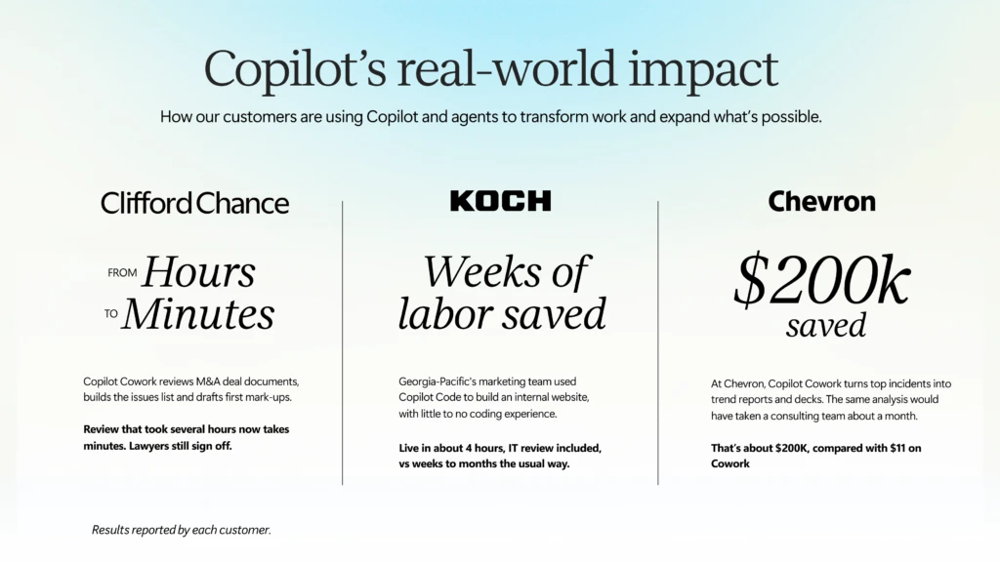

来源：https://www.microsoft.com/en-us/copilot/blog/2026/11/17/copilot-at-microsoft-ignite-expanding-whats-possible-with-intelligence-built-for-work/
取文：2026-11-28，直接下载

This morning, at Microsoft Ignite 2026, we shared how [our vision for Copilot](https://blogs.microsoft.com/blog/2026/09/25/introducing-the-new-copilot-with-home-code-and-autopilot/) is becoming real for customers. **Home**, where **Chat** and **Cowork** come together, and **Office in Copilot** are now generally available. **Code** will become generally available in the coming weeks, while **Copilot Managed Runtime** for securely hosting and managing apps is now generally available. And **Autopilot** is beginning to roll out to Frontier customers today. Plus, new plugins and skills built for sales, service, finance, and legal teams are available, as is an expanded **Agent 365** platform so you can get even smarter about your intelligence spend.

We’re building [Copilot](https://www.microsoft.com/en-us/copilot) to use raw intelligence to do real work for real people. No single lab is the best at everything, and you shouldn’t have to pick just one. Copilot brings together leading models from across the industry. And with **Auto** routing, your employees don’t need to worry about picking the right model for every job. Under the hood, Auto dynamically selects the right models and effort for the task, balancing quality, speed, and cost. It saves more power for the moments that need it and spends less when the task doesn’t. Employees can also manually select models from OpenAI or Anthropic, with model access governed by organizational policies.

And **[Work IQ](https://www.microsoft.com/en-us/copilot/features/work-iq)** sets Copilot apart. Knowledge work is fundamentally fragmented and messy. It happens over emails, Teams meetings and chats, Word memos, PowerPoint slide comments, and more. Microsoft 365 holds more than 19.5 exabytes of data, with 90 billion emails, 15 billion Teams messages, and 10 billion new files added every week. Giving a model access to that information isn’t enough. The challenge is identifying and reasoning over what matters for the task at hand. [Work IQ solves this problem](https://aka.ms/WorkIQIgnite2026). It understands what you’re looking for and identifies what you can ignore. The result is accurate, efficient answers that traditional APIs can’t match.

## The new foundation of work

A job is never just one kind of work. You ask questions. You hand things off. You build things. You follow through until they’re done. For years, each of those lived in a different tool. And you were the glue holding it all together. So, we built one place for all of it.

Now generally available, [**Home**](https://aka.ms/Copilotapp_home_blog) is your new starting point in Copilot, where **Chat** and **Cowork** come together. As work travels between meetings, chats, documents, emails, apps, and agents, Home keeps you grounded and moving forward. You can review recent activity, get suggestions on what Copilot can help with, and pick up work right where you left off. Ask a quick question in Chat or hand off a whole workflow to Cowork.

Copilot is more powerful without asking you to do more. Home has one composer, powered by **Auto**, where you can start all your work: tell Copilot what you want to accomplish, and it intelligently routes the work to the right models and effort for the task. For more complex work, Auto may recommend moving from Chat to Cowork. If you agree, Copilot transfers the task seamlessly, helping deliver the outcome with the right level of investment.

Inside Home is a new experience called **Today**. It’s a command center across mail, calendar, Teams threads, meetings, and tasks. It proactively shows you what you missed, what needs attention now, and what can wait. Today doesn’t just surface the work; it helps you get it done. The draft is written and ready for you to edit; the schedule change is already proposed; and the forgotten follow-up is waiting for you to send it, complete with context so you can catch up quickly. Today is currently in private preview in the Copilot app and Outlook.

More and more, AI companies are building their own documents, slides, or spreadsheets. It proves what we’ve known all along: knowledge work runs on Word, Excel, and PowerPoint. Copilot has existed in the Office apps for years, and it’s gotten really good. Today, we’re bringing the full power of **Office** directly into the Copilot app. You can move from idea to a finished document, editing and coauthoring with your teammates. And because every file inherits Microsoft 365 permissions, sensitivity labels, and compliance controls from the start, your work stays protected as you collaborate. This is the only AI tool where you can create a PowerPoint deck or Excel spreadsheet without spinning a meter—all this value is already included in your Copilot subscription license.

We’re expanding what Copilot can do with **[Autopilot](https://www.microsoft.com/en-us/copilot/features/autopilot)**, a trusted autonomous agent that is personal to you, always on, and working for you. Autopilot lives in your tenant and has its own identity, memory, and tools. It shows up where people already work, like Teams, Outlook, chats, channels, and documents, so you can @mention it like a colleague. It can watch Teams channels, follow up on emails, run recurring work, and manage a project—without waiting for a prompt. And it can do things like set up and manage a full supplier review process: building the schedule and workback plan, then handling prep, meetings, and follow-ups on its own, right down to reaching out to stakeholders for updates.

Handing off real work to an agent that acts on its own takes trust. So, Autopilot runs on the identity, security, and compliance foundation IT already uses. Each Autopilot has its own Microsoft Entra Agent ID and a named manager. IT can scope its access and block it anytime. Its sign-ins and actions are logged under its own name, so security teams have a clear audit trail. Powered by Work IQ, it understands how your organization works within existing permissions. You decide what work Autopilot takes on and can check with you before key actions. Autopilot is starting to rollout to customers in Frontier today.

The future of work is people and agent collaboration. Until now, AI interactions have mostly been single player. **Workspaces** makes it a truly multiplayer experience, where people and agents drive towards a common goal, with shared context. As the evolution of Copilot Notebooks, it’s where people and agents build on each other’s work. An agent drafts a section of a document, and you review. You leave a comment, and an agent picks it up. Your Autopilot takes a task and checks with you before anything is final. It’s right in the Copilot app, where your files, conversations, people, and agents are all easily accessible. And the collaboration continues in Microsoft Teams. Workspaces is now available in Frontier.

Apps are the new knowledge worker artifact. With **[Copilot Code](https://www.microsoft.com/en-us/copilot/features/code)**, generally available in the coming weeks, the people closest to the problems can now build the solutions. Describe what you want to create in your own words—like an app, an interactive dashboard, or a persistent desktop widget. Copilot picks the best approach and builds it. Share them just as you would a Word document. Apps are securely hosted and managed in your tenant with the **[Copilot Managed Runtime](https://www.microsoft.com/en-us/copilot/products/copilot-managed-runtime)**, generally available today. IT stays in control, with every app visible and managed in the Microsoft 365 admin center.

This is the new Copilot: one place for all the ways you work. And Copilot works even better on **Windows**, where Hybrid Intelligence allows Copilot to ground itself in all the context on your local PC, complete local actions, and even offload the right work to models running locally on your PC, saving you time and money.

But none of it matters until Copilot creates real value inside your business. Today nearly 80% of the Fortune 500 companies use Cowork.

At medicine company Lilly, the team is using Copilot for multi-step research and analysis to shorten the path to real breakthroughs. The team has spent decades pushing science to make conditions that are incurable today, treatable tomorrow. More than 5,000 people at Lilly are using [Copilot Cowork](http://aka.ms/cowork-ignite2026) every month, including the team of scientists, who now hand Cowork multistep research tasks that identify the most promising paths before the lab work begins. This collaborative approach has allowed Lilly’s scientists to spend more time on science that could become someone’s next medicine.

And Bayer, Honda, Mastercard, and Michelin are all using Copilot to transform the way they work.

## Redesigning how the business works

Copilot is an extensible platform. Work IQ provides the context, while Microsoft and partner-built plugins bring your unique knowledge, business data, and processes into the Copilot experience. A new [plugin catalog](https://aka.ms/plugins) makes these plugins easy to discover, with the [unified plugin registry](https://techcommunity.microsoft.com/blog/microsoft-copilot-blog/introducing-the-plugin-registry---one-place-to-discover-and-govern-plugins-for-m/4559682) providing centralized management and control.

Today, we’re announcing **[Dynamics 365 in Copilot](https://aka.ms/D365Ignite2026)** with updated plugins for Dynamics 365 Sales, Dynamics 365 Customer Service, and Dynamics 365 Finance and Operations. These plugins bring more than 100 prebuilt skills into Copilot, enabling you to build account plans, create sales presentations in PowerPoint, prep for customer meetings, prioritize pipeline, manage suppliers, and handle account reconciliation all in the flow of work. Dynamics 365, our agentic system of record, is integrated with Work IQ and [Agent 365](https://www.microsoft.com/en-us/microsoft-agent-365).

For **[sales](https://aka.ms/copilotsolutions-sales)**, Copilot works with your CRM platform to prioritize pipeline, roll up the forecast, check deal readiness, build competitive strategy, and prep sellers for meetings, with follow-ups and CRM updates drafted for review. Using 44 thoughtfully designed sales skills, agents can take the repeatable parts further: qualifying leads, researching prospects, and managing outreach, so sellers get qualified opportunities with the homework already done and spend more time with customers.

For **[customer service](https://aka.ms/copilotsolutions-service)**, Copilot draws on 13 skills to work with your case management system to triage cases, pull together case history, research answers from knowledge, draft customer replies, and build escalation summaries, with case updates held for review before anything is committed. Agents take things even further: creating and updating cases, following up and closing them, turning resolved cases into knowledge, and evaluating interaction quality.

For sales and service, we know connecting to every system of record is crucial. So, we’re excited to announce **[Salesforce in Copilot](https://aka.ms/AA1457n5)**, a new plugin with more than 38 prebuilt sales skills, bringing Salesforce context into the systems where people already work. Copilot brings together account, opportunity, and pipeline data with conversations, commitment, and decisions, with interactive widgets to make the business easier to understand, not just retrieve.

For **[finance](https://aka.ms/copilotsolutions-finance)**, your team can work directly in the Copilot app to manage broader workflows, bringing in the full power of Excel and your ERP platform, using 30 prebuilt finance skills. You can analyze, edit, and co-author workbooks from Chat or delegate multistep work to Cowork that combines Excel models and analyses with rich deliverables like an investment committee memo. From month-end close to acquisition evaluation, Copilot supports the real work of your finance team.

For **[legal](https://aka.ms/copilotsolutions-legal)**, professionals can use more than 20 purpose-built legal skills draft and negotiate agreements, manage obligations and deadlines, turn research into guidance, and advance legal matters in the systems where work already happens. Copilot brings together legal skills in Word and Cowork, developed with legal engineers around real-world legal workflows, and partner-built plugins that connect Copilot to trusted legal systems. Legal professionals stay in control, with work protected by existing security, compliance, and governance controls.

“By surfacing account insights, service updates, and important client developments in real-time, our teams can stay aligned, make informed decisions, and take action without switching applications,” shared Christian Lewis, Managing Director, Commercial Hub Co-Lead, BNY. “This connected experience helps our organization work from shared customer context, improve productivity, and stay focused on delivering greater value to clients.”

## Scale with confidence

Every IT leader needs control through management, governance, and security. And every business leader needs to understand business value and manage spend. We’ve built Copilot with the features you need to scale with confidence.

Today, we’re expanding **Agent 365** to give you even more control over that estate. We’re broadening visibility through new connected platforms, including Anthropic, Databricks, OpenAI, Salesforce and more, as well as helping you manage agents across multiple tenants. We are also expanding identity and access governance through Entra Agent ID, adding new controls for agent tools, including model context protocol (MCP) servers, plugins, and skills, and strengthening security and containment for local agents running on devices through deeper integration with Intune, Defender, and Windows with Microsoft Execution Containers (MXC).

Agent 365 also now extends into business value with FinOps for AI. It helps organizations not only manage and control AI spend, but also understand the value those investments create. That matters more as AI spending grows. Corporate AI spending doubled in a year, and more than 80% of it now sits outside the enterprise IT budget.1 This means IT leaders need control through management, governance, and security, and business leaders need visibility into spend, adoption, and value.

To tackle this head on, we’re introducing **[Agent 365 Business Analytics](https://aka.ms/a365businessanalytics/blog)**, a new experience that connects spend, guardrails, adoption, and ROI. Rolling out today in Frontier Public, it starts with a new way to measure your investment: in work completed, not simply tokens. It analyzes the tasks, how long that work typically takes a person, and the share Cowork performed, providing a sophisticated view of the hours your intelligence supports and what the work is worth. Together, these insights help leaders understand and control what they’re spending, see the business value intelligence is creating, and make better decisions about where to invest next.

Plus, **Agent 365 Cost Management** gives IT a central place to see and control what’s driving spend by tracking consumption across users, services, agents, and models. Leaders can set spending policies, limits, and proactive alerts and control which models are available. In Cowork, your team sets a spending limit, so there’s no runaway spend and no surprises when the bill arrives.

And we’ve uniquely designed our **commercial model** to help you control your AI spend in two ways. First, our predictable, per-user subscription makes powerful Copilot capabilities broadly accessible. Second: a usage-based consumption model that gives you access to the most powerful AI for the very hardest tasks. With both, you can feel comfortable giving the right AI to everyone, while still empowering your most advanced AI users. And as the Frontier advances, we’ll continue to move more and more capability into the subscription license. This combination of our user subscription license, plus the power of Auto and Work IQ, makes Copilot cheaper and more efficient than other AI tools. Based on a recent GigaOm report, for comparable quality, [Copilot is 84% cheaper](https://www.microsoft.com/en-us/copilot/blog/2026/11/16/what-ai-at-work-really-costs/) than Claude and 63% cheaper than ChatGPT for an everyday user. For an advanced user, Copilot is 68% cheaper than Claude and 35% cheaper than ChatGPT.

Ultimately, the question isn’t just which companies have the most powerful AI. It’s who can make that innovation practical and economical enough to deliver real business results. We’ve designed Copilot to empower all our customers to do just that.

## Get started

Today we showed you how our vision for [Copilot](https://www.microsoft.com/en-us/copilot) is becoming real for customers. One person asking, delegating, building, and automating, in one place. A team of people and agents moving work forward together in Teams. A finance function redesigned around what intelligence can do now. And with the tools to help organizations understand and manage their AI spending.

It’s people who power companies with ideas, judgment, and expertise. Copilot and Windows expand what they can do and help organizations turn new possibilities into repeatable value. We are committed to helping you put AI in the hands of all your employees, empowering them to accomplish more while accelerating your business. We can’t wait to see what you and your people do with all this new power.

---

1Boston Consulting Group, “The Formula for Agentic AI Value: The Applied AI Index 2026,” September 30, 2026. [www.bcg.com/publications/2026/the-formula-for-agentic-ai-value](https://www.bcg.com/publications/2026/the-formula-for-agentic-ai-value)
