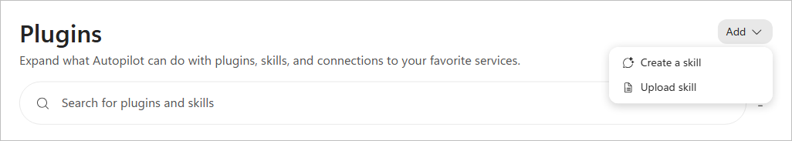



**收录说明**：Microsoft Learn 文档（新的 Autopilot（Frontier）文档集，页面标为预览功能），直接下载，取页面正文；删去了页首的「Read in English」「Edit」与登录提示、页尾的反馈与「Additional resources」区块，站内相对链接改为绝对地址；页内一张界面截图下载到 images/。已翻译。

**内容摘要**：文档区分 skills（任务指令）与 plugins（连接工具和服务，可包含 skills），可从目录添加插件，在对话中创建或上传带 SKILL.md 的 ZIP/文件夹作为自己的 skill，并分享给组织内指定同事。添加 skill 或插件本身不授予数据访问或操作权限，分享 skill 也不共享登录、连接或权限。插件详情页显示创建者、版本、隐私政策和服务条款；被策略屏蔽的项显示 Blocked by policy，管理员托管的插件由管理员处理连接，部分无法移除。插件可含 skills、connectors 或两者，可在 Microsoft 365 plugin marketplace 找到，管理员也可自动部署。

**保留理由**：已收资料只有 Scout 的权限与部署，没有 skill/plugin 的创建、上传、分享机制；这篇补上了 Autopilot 的扩展方式和管控边界。

---

自定义 Autopilot 能做什么

[本文为预发布文档，内容可能变更。]

重要

- 访问 Autopilot（Frontier）需要加入适用的 **[Frontier 预览计划](https://adoption.microsoft.com/copilot/frontier-program/)**，并获得预览分配及接受参与条款。仅加入 Frontier 并不会启用所有预览功能。Frontier 预览受你客户协议中适用的预览条款约束，其可用性与能力可能变化。
- 此功能处于预览阶段。
- 预览功能可能功能受限，且可能不会正式发布。这些功能在正式发布前提供，以便客户提前访问并提供反馈。
- 有关详细信息，请访问我们的 [Microsoft 产品条款](https://www.microsoft.com/licensing/terms/product/ForOnlineServices/MCA)。

技能（skill）提供任务指令。插件（plugin）连接工具与服务，并且可以包含技能。你可以从目录添加插件、创建或上传自己的技能，并与同事分享技能。向你开放哪些能力取决于你组织的设置。关于插件的更多信息，包括它们如何构建与管理，见[插件文档](https://learn.microsoft.com/en-us/plugins)。

| 能力 | 它能帮你做什么 |
| --- | --- |
| 文档与演示文稿技能 | 准备可供审阅的可编辑交付物。 |
| Microsoft 365 工具 | 使用已获授权的邮件、日历、对话与文件。 |
| 插件 | 把 Autopilot 连接到其他服务，并添加它们的技能。 |
| 你自己的技能 | 教 Autopilot 以可重复的方式完成一项任务，例如把会议笔记变成跟踪表。 |

不要把凭据或不必要的敏感信息放进技能里。添加技能或插件不会授予数据访问权限或操作权限。

### 添加并连接插件

1. 打开**插件**（Plugins）。
2. 使用**搜索插件与技能**（Search plugins and skills）、**筛选能力**（Filter capabilities），或浏览**发现**（Discover）。标有**被策略阻止**（Blocked by policy）的项在你的组织中不可用。
3. 选择一个插件，查看其详情，包括创建者、版本、隐私政策与服务条款。
4. 选择**添加**（Add）。该插件会出现在**已添加**（Added）下。
5. 如果插件需要登录，Autopilot 会在首次使用该插件时在对话中显示连接请求。请求会说明该插件、它需要的访问权限以及原因。连接后，Autopilot 会继续执行任务。

由管理员管理的插件会显示它由你的组织管理。其连接由管理员处理，因此你不需要登录或输入密钥。

要停止使用某个插件，从**已添加**中打开它并禁用或移除。Autopilot 不会使用已禁用或已移除的插件。你组织管理的某些插件无法移除。

### 在对话中创建技能

1. 在**插件**中，选择**添加** > **创建技能**（Create a skill），或在对话中描述你想要的技能。例如：「创建一个技能，把会议笔记变成含负责人与截止日期的跟进跟踪表。」
2. 检查草稿指令，并要求修改，直到它们正确。
3. 批准该技能以保存它。在你批准之前，Autopilot 不会保存该技能。

保存的技能会出现在**已添加**下，以及你在输入框中输入 `/` 时的技能列表里。

### 上传技能

1. 准备一个 ZIP 文件或文件夹，其中包含带有技能指令的 `SKILL.md` 文件。它还可以包含支持文件，例如脚本或 CSV、JSON 数据。
2. 在**插件**中，选择**添加** > **上传技能**（Upload skill），然后选择或拖入该文件或文件夹。
3. 检查该技能并添加。
4. 打开该技能的详情，检查其用途、来源与已保存的指令。

如果包无效，上传会失败，什么也不会添加。

### 使用技能

在输入框中输入 `/`，选择技能，然后添加你的请求。你也可以不点名技能而直接描述任务；适用时，Autopilot 会选择一个相关技能。

### 分享技能

你可以把已保存的技能分享给组织中的特定人员。每位接收者打开共享链接、添加该技能，然后就能在自己的 Autopilot 中使用它。与你分享的技能会出现在**插件**下的**与我共享**（Shared with me）中。

只有你选定的人才能添加该技能。分享技能不会分享你的登录、连接或权限；接收者使用自己的访问权限。

## 扩展 Autopilot

Autopilot（Frontier）支持通过插件添加新技能与连接器，以扩展 Autopilot 能做的事。可在 [Microsoft 365 插件市场](https://www.microsoft.com/copilot/features/plugins/explore)中查找插件。你组织的管理员也可以自动为你部署插件。

一个插件可以包含技能、连接器或两者。技能是专门能力，教 Autopilot 新的领域专业知识，例如财务分析、法律研究或 HR 工作流。连接器把 Autopilot 连接到外部数据源与服务，使它能够检索或操作 Microsoft 365 之外的信息。

关于构建插件的更多信息，见[为 Customers 构建并发布 Microsoft 365 Copilot 插件](https://learn.microsoft.com/en-us/microsoft-365/copilot/extensibility/isv-publisher-guide)。
