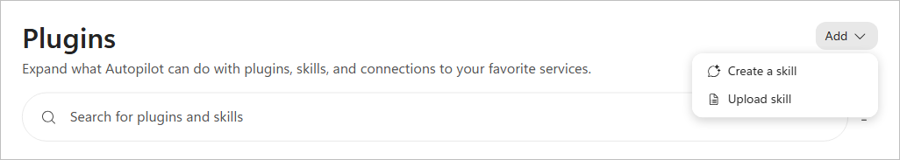

来源：https://learn.microsoft.com/en-us/copilot/autopilot/plugins
取文：2026-11-28，直接下载

Customize what Autopilot can do

[This article is prerelease documentation and is subject to change.]

Important

- Access to Autopilot (Frontier) requires the applicable **[Frontier preview program](https://adoption.microsoft.com/copilot/frontier-program/)** enrollment, preview assignment, and participation terms. Frontier enrollment alone doesn't enable every preview feature. Frontier previews are subject to the applicable preview terms of your customer agreements, and their availability and capabilities may change.
- This feature is in preview.
- Preview features may have restricted functionality and may not be released for general availability. These features are available before an official release so that customers can get early access and provide feedback.
- For more information, go to our [Microsoft Product Terms](https://www.microsoft.com/licensing/terms/product/ForOnlineServices/MCA).

Skills provide task instructions. Plugins connect tools and services and can include skills. You can add plugins from the catalog, create or upload your own skills, and share skills with coworkers. The
capabilities exposed to you depend on your organization's settings. To learn more about plugins, including how they're built and managed, see the [plugins documentation](https://learn.microsoft.com/en-us/plugins).

| Capability | What it helps you do |
| --- | --- |
| Document and presentation skills | Prepare editable deliverables for review. |
| Microsoft 365 tools | Work with authorized mail, calendars, conversations, and files. |
| Plugins | Connect Autopilot to other services and add their skills. |
| Your own skills | Teach Autopilot a repeatable way to do a task, such as turning meeting notes into a tracker. |

Don't put credentials or unnecessary sensitive information in a skill. Adding a skill or plugin doesn't grant access to data or permission to act.

### Add and connect a plugin

1. Open **Plugins**.
2. Use **Search plugins and skills**, **Filter capabilities**, or browse **Discover**. An item marked **Blocked by policy** isn't available in your organization.
3. Select a plugin to review its details, including who created it, its version, its privacy policy, and its terms of service.
4. Select **Add**. The plugin appears under **Added**.
5. If the plugin needs a sign-in, Autopilot shows a connection request in the conversation the first time it uses the plugin. The request explains the plugin, the access it needs, and why. After you connect, Autopilot continues the task.

A plugin that your administrator manages shows that it's managed by your organization. Your administrator handles its connection, so you don't sign in or enter keys for it.

To stop using a plugin, open it from **Added** and disable or remove it. Autopilot doesn't use a disabled or removed plugin. Some plugins that your organization manages can't be removed.

### Create a skill in a conversation

1. On **Plugins**, select **Add** > **Create a skill**, or describe the skill you want in a conversation. For example, "Create a skill that turns meeting notes into a follow-up tracker with owners and due dates."
2. Review the draft instructions and ask for changes until they're right.
3. Approve the skill to save it. Autopilot doesn't save the skill before you approve it.

The saved skill appears under **Added** and in the skill list when you type `/` in the composer.

### Upload a skill

1. Prepare a ZIP file or folder that contains a `SKILL.md` file with the skill's instructions. It can also include supporting files, such as scripts or CSV or JSON data.
2. On **Plugins**, select **Add** > **Upload skill**, and then select or drag the file or folder.
3. Review the skill and add it.
4. Open the skill's details to check its purpose, source, and saved instructions.

If the package isn't valid, the upload fails and nothing is added.

### Use a skill

Type `/` in the composer, select the skill, and then add your request. You can also describe the task without naming a skill; Autopilot selects a relevant skill when one applies.

### Share a skill

You can share a saved skill with specific people in your organization. Each recipient opens the shared link, adds the skill, and can then use it in their own Autopilot. Skills shared with you appear under **Shared with me** on **Plugins**.

Only the people you select can add the skill. Sharing a skill doesn't share your sign-ins, connections, or permissions; recipients use their own access.

## Extend Autopilot

Autopilot (Frontier) supports plugins that add new skills and connectors to extend what Autopilot can do. Find plugins in the [Microsoft 365 plugin marketplace](https://www.microsoft.com/copilot/features/plugins/explore). Your organization's admin can also deploy plugins for you automatically.

A plugin can contain skills, connectors, or both. Skills are specialized capabilities that teach Autopilot new domain expertise, such as financial analysis, legal research, or HR workflows. Connectors link
Autopilot to external data sources and services so it can retrieve or act on information outside of Microsoft 365.

For more information about building plugins, see [Build and publish Microsoft 365 Copilot plugins for Customers](https://learn.microsoft.com/en-us/microsoft-365/copilot/extensibility/isv-publisher-guide).

---
