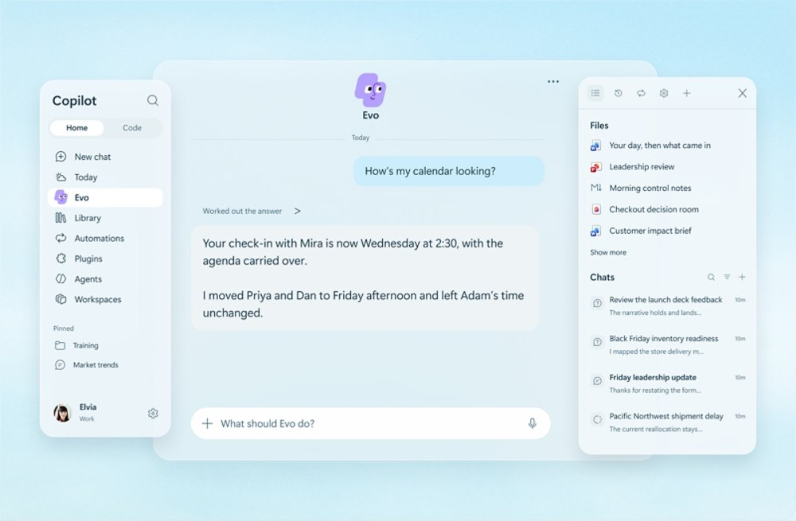
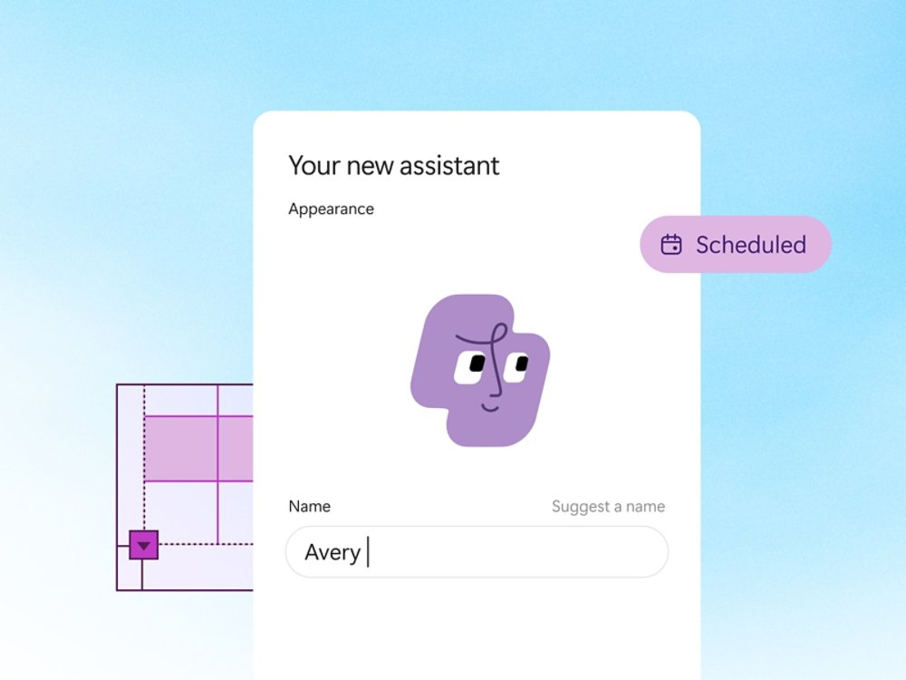



**收录说明**：微软官网的 Autopilot 产品页，直接下载，取正文；删去了页首的 Ignite 横幅、重复的移动版首屏、背景装饰图与页尾的社交媒体链接。页面图片是 AVIF 格式，其中两张超过 600 KB，改取站点提供的 1000 像素宽 JPEG；「How it works」六个标签页在静态页面中都引用同一张图，照录。已翻译。

**内容摘要**：产品页把 Autopilot 称为 always-on、基于云的个人智能体，在无需用户指挥每一步的情况下持续推进工作。页面列出六项卖点：接受目标与结果、预判下一步、学习用户的优先级与工作方式、在 Copilot app、Teams 和 Outlook 中协作、内置访问控制与审批护栏，以及通过 Agent 365 了解、治理、评估并衡量价值。FAQ 称 Autopilot 通过 Copilot Credits 的 usage-based billing 提供，最终定价与打包将在 GA 前公布；Chat 用于快速回答，Cowork 用于端到端完成特定多步任务，Autopilot 用于持续数天或数周的目标与承诺。入门条件为 Frontier 中拥有 Microsoft Copilot、Agent 365 和 usage-based billing policy 的客户，初始会了解过去 30 天的邮件、会议、聊天和文件且不发送或更改任何内容。

**保留理由**：Autopilot 的官方对外产品定位与三者（Chat、Cowork、Autopilot）的选用说明，是 11-28 取文时的产品页状态，可与此前的 Scout 时期描述对照。

---

AUTOPILOT

你值得*信赖*的个人智能体

一个常驻在线的云端个人智能体，替你卸下工作，并在你无需指挥每一步的情况下让它持续推进。

　　[看看它如何工作](#how-it-works)　　

工作原理　　资源　　开始使用　　常见问题

承担目标与结果

给 Autopilot 一个目标，比如让一次发布保持在正轨上。把准备工作、协调和跟进交给它，而你来定方向。

让你领先一步

Autopilot 预判下一步，监控相关更新、跟踪未了的承诺，并在你开口之前准备好你需要的东西。

学会你的方式

Autopilot 了解你的优先级、偏好和工作风格，把上下文贯穿到对话、项目和例行任务中，因此它的帮助会随时间变得更个人化。

在你工作的地方工作

在 Copilot 应用中配置你的 Autopilot，然后在应用内以及跨 Teams 和 Outlook 与它协作，把它带进你已经在做的工作里。

设计上安全

内置的访问控制与审批护栏帮助保护你的数据，而运行时安全与调查工具让有后果的操作始终处于人的掌控之下。

看见、理解与治理

借助 Agent 365，组织可以了解 Autopilot 的使用情况、管理和治理其访问权限、评估风险，并衡量业务价值以指导采用。

工作原理

## 把工作从你手上卸下来

给你的 Autopilot 一个名字和一个目标，然后看它开始干活。

## 

## 

资源

## 进一步了解 Autopilot

浏览指南、详细信息与最新消息。

产品新闻

### 了解我们的最新公告

跟进 Autopilot 的最新消息。

[阅读博客](https://go.microsoft.com/fwlink/?LinkId=2389310&clcid=0x409&culture=en-us&country=us)　　

学习

### Autopilot 入门

浏览支持文章，以设置和配置 Autopilot。

[了解更多](https://go.microsoft.com/fwlink/?LinkId=2388703&clcid=0x409&culture=en-us&country=us)　　

产品新闻

### 了解新版 Copilot

进一步了解我们如何重新构想 Microsoft Copilot，以支持不断演进的工作。

[阅读博客](https://go.microsoft.com/fwlink/?LinkId=2387657&clcid=0x409&culture=en-us&country=us)　　　开始使用

## 了解作为我们 Frontier 计划一部分的 Autopilot

了解如何为你的组织获取 Autopilot。

　　[面向 IT 管理员的更多内容](https://www.microsoft.com/en-us/copilot/resources/frontier-it-admins)　　[面向用户的更多内容](https://www.microsoft.com/en-us/copilot/resources/frontier-business-users)

## 常见问题

　全部折叠　　全部展开

01/

Autopilot 是什么？

Autopilot 是你常驻在线的个人智能体：一个不等被要求就持续推动工作的数字队友。给它一个名字和一个目标，它就会了解你的角色、你的优先级以及你如何工作。它在后台跨你的电子邮件、会议、聊天和文件工作。它发现需要注意的事、准备好下一步，并在你设定的护栏内跟进到底。

02/

Autopilot 如何计费？

Autopilot 通过 Copilot Credits 按用量计费，因此成本会随你的 Autopilot 承担的工作而扩展。管理员可以查看用量并设定预算以控制支出。最终定价与打包方案将在正式发布（GA）前公布。

03/

何时该用 Autopilot，而不是 Copilot Chat 或 Cowork？

用 Copilot Chat 在工作流中获得快速回答和草稿。当你想端到端完成某项特定的多步任务时，用 Cowork：你提要求，它交付。用 Autopilot 处理不会以单个任务结束的工作：跨越数天、数周展开的目标、决策和承诺。它无需被要求就在后台持续推进，并带给你决策，而不是通知。

04/

我该如何开始使用 Autopilot？

Autopilot 正通过 Frontier 计划，向拥有 Microsoft Copilot、Agent 365 和按用量计费策略的客户推出。获得访问权限后，管理员可以在 Microsoft 365 管理中心启用 Autopilot。之后用户可以用 Copilot 应用设置、命名并给他们的 Autopilot 一个目标。它会针对你已有访问权限的过去 30 天的邮件、会议、聊天和文件进行熟悉，不会发送或更改任何内容。从那里开始，像队友一样与它协作：给它发消息、@提及它，或把它带进 Teams 中的聊天和会议。
