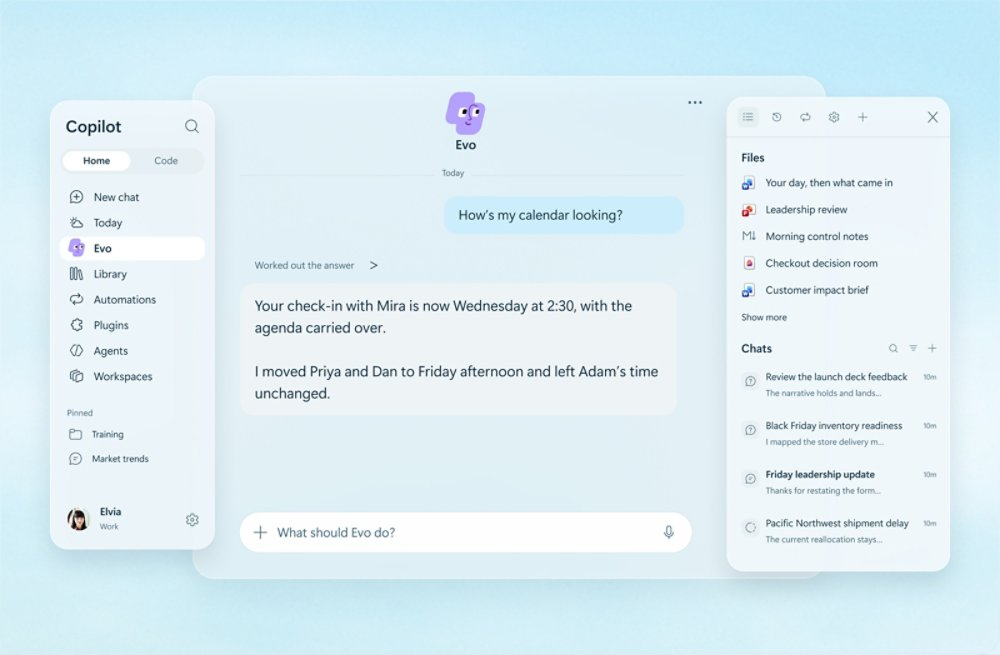
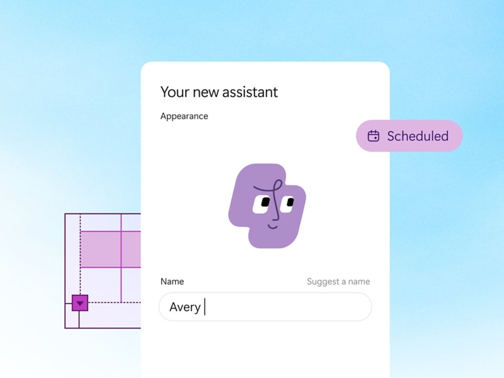

来源：https://www.microsoft.com/en-us/copilot/features/autopilot
取文：2026-11-28，直接下载

AUTOPILOT

Your *trusted* personal agent

An always-on, cloud-based personal agent that takes work off your plate and keeps it moving without you having to direct every step.

   [See how it works](#how-it-works)        

How it works    Resources    Get started    FAQ          

Takes on goals and outcomes

Give Autopilot a goal, like keeping a launch on track. Hand off the prep, coordination, and follow-through while you set the direction.

    

Keeps you a step ahead

Autopilot anticipates what's next, monitoring relevant updates, tracking open commitments, and preparing what you need before you have to ask.

    

Learns your way

Autopilot learns your priorities, preferences, and working style, carrying context across conversations, projects, and routines so its help becomes more personal over time.

    

Works where you work

Configure your Autopilot in the Copilot app, then collaborate with it in the app and across Teams and Outlook, bringing it into the work you're already doing.

    

Secure by design

Built-in access controls and approval guardrails help protect your data, while runtime security and investigation tools keep consequential actions under human control.

    

See, understand, and govern

With Agent 365, organizations can understand Autopilot's use, manage and govern its access, assess risks, and measure business value to guide adoption.

      

HOW IT WORKS

## Get work off your plate

Give your Autopilot a name and a goal, and watch as it goes to work.

    

## 

  

## 

           

RESOURCES

## Learn more about Autopilot

Explore guides, detailed information, and the latest news.

       

Product news

### Read about our latest announcements

Keep up with the latest Autopilot news.

   [Read the blog](https://go.microsoft.com/fwlink/?LinkId=2389310&clcid=0x409&culture=en-us&country=us)           

Learning

### Get started with Autopilot

Browse support articles to set up and configure Autopilot.

   [Learn more](https://go.microsoft.com/fwlink/?LinkId=2388703&clcid=0x409&culture=en-us&country=us)          

Product news

### Read about the new Copilot

Learn more about how we’ve reimagined Microsoft Copilot to enable work as it evolves.

   [Read the blog](https://go.microsoft.com/fwlink/?LinkId=2387657&clcid=0x409&culture=en-us&country=us)              Get started 

## Discover more about Autopilot as part of our Frontier program

Find out how to access Autopilot for your organization.

    [Explore more for IT admins](https://www.microsoft.com/en-us/copilot/resources/frontier-it-admins)     [Learn more for users](https://www.microsoft.com/en-us/copilot/resources/frontier-business-users)           

## Frequently asked questions

  Collapse All    Expand All   

01/

What is Autopilot?

Autopilot is your always-on personal agent: a digital teammate that keeps work moving without waiting to be asked. Give it a name and a goal, and it learns your role, your priorities, and how you work. It works in the background across your email, meetings, chats, and files. It spots what needs attention, prepares what's next, and follows through within the guardrails you set.

 

02/

How does pricing work for Autopilot?

Autopilot is available through usage-based billing with Copilot Credits, so cost scales with the work your Autopilot takes on. Admins can see usage and set budgets to keep spending in check. Final pricing and packaging will be shared before general availability.

 

03/

When should I use Autopilot instead of Copilot Chat or Cowork?

Use Copilot Chat for quick answers and drafts in the flow of work. Use Cowork when you want a specific multi-step task done end to end: you ask, it delivers. Use Autopilot for work that doesn't end with one task: goals, decisions, and commitments that play out over days and weeks. It keeps going in the background without being asked and brings you decisions, not notifications.

 

04/

How do I get started with Autopilot?

Autopilot is rolling out in the Frontier program for customers with Microsoft Copilot, Agent 365, and a usage-based billing policy. When granted access, admins can enable Autopilot in the Microsoft 365 admin center. Users can then use the Copilot app to set up, name, and give their Autopilot a goal. It gets oriented on the last 30 days of email, meetings, chats, and files you already have access to, without sending or changing anything. From there, work with it like a teammate: message it, @mention it, or bring it into chats and meetings in Teams.
