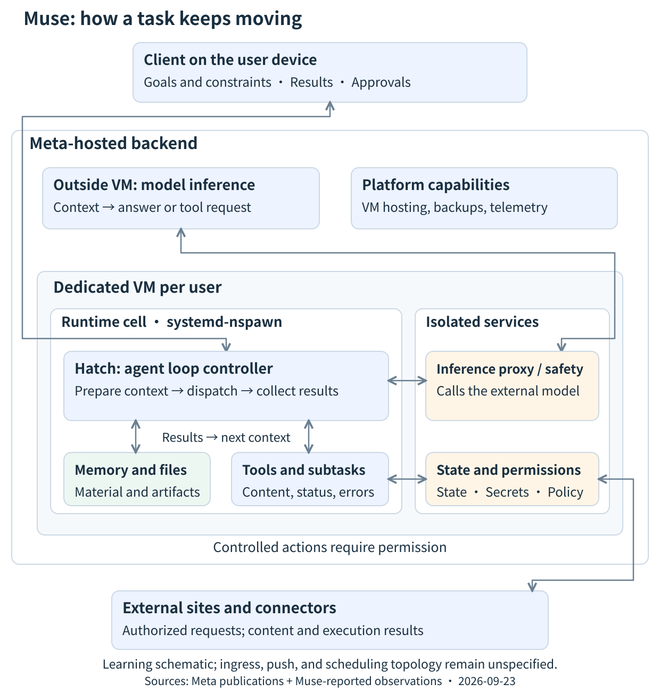



（译注：原文开头的标签行，以及文末的「继续阅读」推荐和优惠信息未译出。）

追踪一项任务在 Meta Muse 中的流转：Hatch 在一台专用 VM 内推进智能体循环，推理在 VM 之外运行，而上下文、记忆、子智能体和权限让工作持续推进。附架构图和证据边界。

发布于 2026-09-24

## 理解 Muse 的一个心智模型

**Muse 把任务材料交给模型，得到一个决策，通过 Hatch 执行下一步，再把实际结果返回给模型。记忆、持久状态和后台工作让这个过程能够跨越多次对话持续进行。**

本文讨论的是 Meta 的个人智能体，**muse.ai 上的 Muse**。Muse Spark 是模型；而个人产品还包括 harness、专用计算环境、工具、状态和权限。公开的 Model API 示例说明了有用的模式，但它们不是个人产品内部协议的文档。

请记住三个问题：

1. **谁在推进任务？** 模型产生决策；Hatch 协调执行和下一次输入。
2. **什么会持久保存？** 文件、记忆和运行状态可以比一次推理请求存在得更久。当前上下文只包含其中被挑选出来的一部分材料。
3. **一个操作什么时候才真正发生？** 一个工具请求仍然需要执行，在适用的情况下还需要许可。

> 范围：研究观察的日期为 2026 年 9 月 23 日。本文于 9 月 24 日撰写，并再次核对了主要的官方页面。关于部署的说法以 Meta 对发布时架构的描述为准。内部文档、工具 schema 和运行元数据，是在主聊天中提出经授权的问题后由 Muse 报告的。本研究没有直接登录 VM，也没有获取完整的执行日志。

## 架构：专用 VM 是 Meta 后端的一部分



打开示意图可放大查看。组件按职责分组；箭头是学习辅助，并不是精确的 RPC 时序或完整的基础设施图。

Meta 把 **Hatch 放在专用 VM 内的一个 systemd-nspawn 运行时单元中**，推理则通过 VM 外的一个代理访问。Meta 还提供了一条外部遥测路径和持续的 VM 备份。公开的说明没有详细介绍入口、用户路由、推送投递或 VM 调度拓扑。[官方架构](https://research.meta.ai/blog/security-and-safety-for-ai-agents-our-approach-with-muse)

这里有两层嵌套的边界：**VM** 和**运行时单元**。容器内的进程列表只显示它可见的环境。在那里看不到某个服务，并不能证明该服务运行在另一台机器上。

出于学习目的，可以按以下职责来理解：

| 组件 | 需要关注什么 |
| --- | --- |
| 客户端 | 目标、纠正、结果和批准答复 |
| 模型 | 基于可见材料给出的回答或提议的工具调用 |
| Hatch / harness | 准备好的输入、分派的调用、收集到的结果，以及下一次迭代 |
| 工具和工作文件 | 参数变成执行结果、artifacts 和可复用的材料 |
| 状态和权限服务 | 记录下来的进度，以及关于受控操作能否继续的决定 |

这种划分与 Meta 的 [Agent frameworks 文档](https://dev.meta.ai/docs/agent-frameworks)一致。它是一种教学性的抽象，并不是对 Hatch 每个内部模块的断言。

## 跟着一项任务走完智能体循环

假设一位用户提出：「比较三款开发者工具的部署方式，并写一份报告。」以下是一个示意性的演练，并不是捕获到的生产环境轨迹。

### 1. 准备当前输入

运行时需要为这次推理请求准备一个**上下文**：用户的目标、相关历史、可用的证据、约束条件和工具定义。

模型能考虑什么，取决于这份输入。一份文档存在于工作目录中，并不意味着模型读过它。

### 2. 取得一个决策

模型可能会请求另一个来源，或者得出结论说它已经有足够的信息来回答。

一次工具调用描述的是一个预期的操作及其参数。调用本身并不能证明某个页面已被获取，或者某份报告已经写好。

### 3. 执行并观察

运行时把请求分派给一个工具或受控的执行服务。返回值可能包含页面内容、一个 artifact 路径或一个状态。它也可能报告拒绝、超时或错误。

下一个决策必须考虑这个**实际的返回值**：尝试另一个来源、改变方法、询问缺失的信息，或者完成报告。

### 4. 把结果送入下一次迭代

```
Goal and constraints
        ↓
Hatch: context (inside VM)
        ↓
Model inference (outside VM)
        ├─ Answer → deliver / wait
        └─ Tool request
                ↓
       Execution → result / error
                └→ next context
```

（译注：图中文字意为：目标和约束 → Hatch：上下文（在 VM 内）→ 模型推理（在 VM 外），分为「回答 → 交付或等待」与「工具请求 → 执行 → 结果或错误 → 下一次上下文」两路。）

Meta 的[工具调用文档](https://dev.meta.ai/docs/tool-calling)展示了请求、执行和结果返回的模式。这个演练借用了这种逻辑关系，但并不假定个人产品使用相同的 SDK 或内部字段。

一项任务可能需要多次迭代或并行的子任务。**这个循环描述的是反馈，并不要求把每项任务都串行化到一个队列里。**

## 记忆、历史与上下文各有职责

区分三种表示：

- **历史：** 以往的交互和执行记录。
- **持久记忆：** 被挑选出来、旨在帮助未来任务的信息。
- **当前上下文：** 这一次模型请求实际包含的内容。

Meta 的[产品设计说明](https://introducing.muse.ai/)描述了用户可以查看和编辑的记忆文件。本研究中由 Muse 报告的文档和工具描述，揭示了几种不同的转换：

| 操作 | 转换 | 目的与信息损失 |
| --- | --- | --- |
| 历史压缩 | 长历史 → 摘要加保留的近期条目 | 继续当前任务；部分细节被省略 |
| 记忆整合 | 对话和经验 → 更持久的事实和笔记 | 支持未来任务；笔记不是逐字的聊天存档 |
| 按需读取技能 | 简短描述 → 详细说明 | 在需要时补充方法和约束；读取一个技能并不授予任何权限 |
| 延迟加载工具 | 命名空间概览 → 完整 schema | 描述如何调用一个工具；schema 不是可执行的工具代码 |

例如，用户可能希望报告优先使用官方来源。原始的表述可以留在历史中，而一条被挑选出来的偏好会成为记忆。对于下一份报告，相关材料仍然需要进入当前上下文，才能影响那一次请求。

**被存储、可被搜索和被加载是不同的状态。**「记忆中包含这个事实」和「模型在这一轮看到了它」需要不同的证据。

### 这些观察确立了什么

Muse 报告了七条 `compaction_checkpoint` 记录，其中包含触发信息以及压缩前后的令牌数。这些记录确立了样本中存在压缩检查点。它们不包含模型字段，所以无法确定是否有专门的压缩模型或固定的阈值算法。

所报告的接口还区分了用于搜索记忆的 `memory_search` 和用于读取指定聊天的 `chat.read_messages`。客户端有一个聊天搜索界面。不能把某一个智能体工具的局限推广为整个产品缺少聊天搜索的说法。

这些是 9 月 23 日的环境观察，不是公开的稳定接口约定。它们无法确定具体的向量数据库、远程索引或检索算法。

## 后台工作有不止一个完成点

在应用关闭后继续工作，需要服务端执行、记录下来的进度，以及一种返回有用结果的方式。Meta 的[设计说明](https://introducing.muse.ai/)描述了按计划和由事件驱动的工作，随后判断结果是否值得通知用户。

调查一项后台任务时，要分别提出四个问题：

| 阶段 | 问题 |
| --- | --- |
| 触发 | 预定时间或相关事件是否发生了？ |
| 执行 | 是否创建了一次运行，它报告了什么状态？ |
| 交接 | 主智能体是否收到了它可以据以行动的结果？ |
| 用户接收 | 是否选择了发送通知，通知是否送达？ |

这是一个调查框架，并不是说每项任务都要穿过四个完全相同的物理服务。

本研究收到了三条标记为 `succeeded` 的定时任务（cron）记录、一次成功的记忆整合运行，以及五次与 worker 标识符相关联的子任务完成交接。它们展示了执行和交接的样本。**它们并不是一条**从定时触发到用户送达**连起来的轨迹**。

在一张交接去重表中查询不到匹配的行，也不能证明其他消息路径中没有记录。没有连接键，这个缺口就仍然存在。

### 子智能体从哪里开始

所报告的 `subagent.spawn` schema 说明，一个通用子任务以父任务的对话记录作为起点。之后父任务和子任务各自推进，结果由运行时返回。确切的快照边界和裁剪规则仍不清楚；这并不是持续共享可变上下文的证据。

有用的区分是：**背景可以继承；后续进展必须通过通信传递。** 子任务知道父任务的初始材料，并不意味着父任务会自动知道子任务后来做的一切。

## 权限是执行中单独的一部分

Meta 把 PostgreSQL、`hatch-authd`、Sentinel、受控的连接器 worker 和浏览器代理（broker）放在运行时单元之外。Sentinel 决定权限，并在需要时直接与客户端交换批准请求。[官方安全架构](https://research.meta.ai/blog/security-and-safety-for-ai-agents-our-approach-with-muse)

回到报告的例子：准备一份报告和把它发送给某人是两个不同的操作。即使已经生成了一个发送请求，执行也可能处于等待批准、被拒绝或失败的状态。之后的记录需要保留这些区别。

从工程角度看，三种表示承载着不同的权威：

- **模型输出**表达的是提议的操作。
- **权限状态**决定一个受控操作是否获得授权。
- **执行结果**描述实际发生了什么。

把它们混成对话式的文字，很容易把意图、授权和完成混为一谈。这是从这个架构中得出的一条设计经验。

## 自我改进如何影响以后的任务

所报告的材料支持这样一条路径：

```
Task experience
    ↓
Memory / skill revision
    ↓
Later context
    ↓
Changed action
```

（译注：图中文字意为：任务经验 → 记忆或技能修订 → 之后的上下文 → 改变后的行动。）

一个写进技能的成功流程，可以成为将来类似任务的有用说明。可观察到的变化最初出现在智能体能够读取的材料中。

一次成功的整合运行确立的是它所报告的运行状态；要核实文件发生了变化，仍然需要对应的产物。本次调查没有获得任何证据，表明用户 VM 内的自我改进任务会在线更新基础模型的权重。

## 哪些仍未确认

| 观察或说法 | 有依据的解读 |
| --- | --- |
| 某个服务不在容器的进程列表中 | 容器的可见性有限；不能据此推出它位于 VM 之外 |
| 存在压缩记录或相关的二进制字符串 | 这些是实现上的线索，但实际使用的模型、阈值和路由仍然未知 |
| 记忆检索返回了相关内容 | 检索是存在的；索引的位置和算法没有确立 |
| 清理记录平均约 90 分钟出现一次 | 这衡量的是记录间隔，在没有跨越多次启动的匹配证据时，并不是 VM 重启间隔 |
| 一次后台运行成功了 | 运行报告了成功；记忆的变化或向用户的送达并不会自动随之发生 |
| 存在 VM 备份 | 这并不能确立任意正在运行的工作可以无损恢复，或者恰好执行一次 |

入口、推送投递和 VM 调度拓扑；完整的重试、去重和恢复语义；以及记忆索引和压缩策略，仍然在这里获得的证据范围之外。

## 做智能体的人可以带走什么

用四个问题来审视你自己的系统：

1. **你能追踪一次迭代吗？** 找到它的模型输入、提议的调用、实际的返回，以及继续下去的理由。
2. **各种表示是否区分开了？** 原始记录、摘要、记忆和当前输入服务于不同的目的。
3. **异步结果是否区分开了？** 执行成功、结果被消费和向用户送达，应当可以分别观察。
4. **授权是否有独立的状态？** 模型的一句话不应该同时充当请求、批准和完成证明。

有了这些问题，Muse 就可以被理解为一个持续工作的系统：模型做出当前的决策，运行时把行动与反馈连接起来，信息管理跨越时间，而权限约束执行。

## 来源与范围

- [我们如何将安全构建进 Muse](https://research.meta.ai/blog/security-and-safety-for-ai-agents-our-approach-with-muse)：发布时的部署和权限边界。
- [我们如何设计 Muse](https://introducing.muse.ai/)：对话、后台工作、通知决策和可编辑的记忆。
- [Meta Model API：Agent frameworks](https://dev.meta.ai/docs/agent-frameworks)：模型和框架的职责。
- [Meta Model API：Tool calling](https://dev.meta.ai/docs/tool-calling)：通用的工具请求和结果返回模式。
- 日期为 2026 年 9 月 23 日的研究材料：一份用户提供的 Muse 实现摘要，以及在 Muse 主聊天中提出的经授权的问题，随后是 Muse 报告的文档、工具 schema 和只读元数据。本文总结了机制和证据边界，没有公开私人聊天、账户信息或原始运行标识符。这些环境观察无法仅凭公开链接独立复现。

继续阅读：[Agent Runtime 的职责与选型](https://codepick.dev/en/guides/agent-runtime-ax-agyn-dapr/)和 [AI 编程智能体安全](https://codepick.dev/en/guides/ai-coding-agent-security-2026/)。

## 常见问题

Muse 的智能体循环运行在 VM 内吗？

循环控制器 Hatch 运行在专用 VM 的 systemd-nspawn 运行时单元中。每一次模型推理请求都通过一个代理发往 VM 之外的基础设施。因此，完整的任务循环跨越了这条边界。

模型在每一轮都能看到所有保存的记忆吗？

只有包含在当前上下文中的材料，对那一次推理请求才是可见的。被存储、可被搜索和被加载进上下文是不同的状态。我们不能假定每一轮都会把所有记忆文件完整注入。

一次成功的后台运行，能证明用户收到了它的结果吗？

不能。执行完成、交接、通知生成和送达，各自需要单独的证据。这里描述的观察并不能确立一个普遍的送达或恢复约定。
