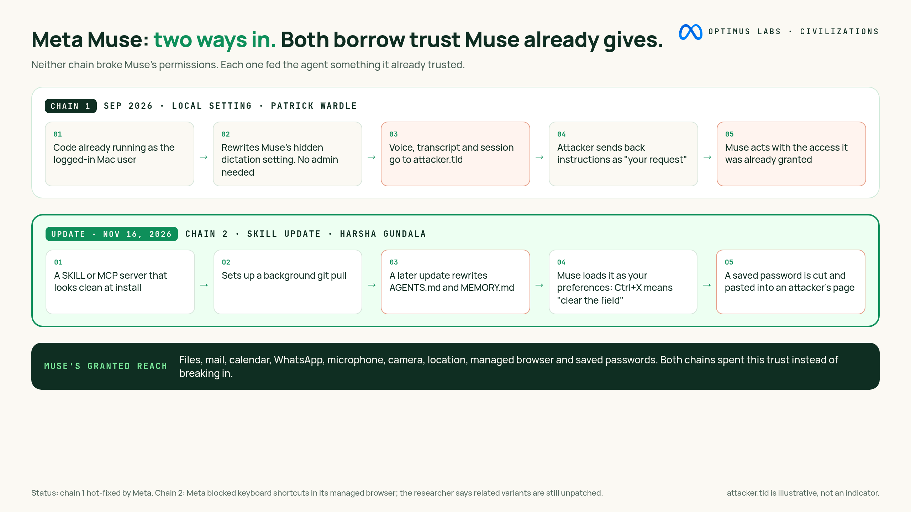



**收录说明**：直接下载（main 容器抽取）。原文全文存于本目录的 original.md，网站上不显示，已翻译。攻击链示意图按页面原文位置补回并本地化到 images/；导航、byline、相关简报与下载链接等站内元素已删去。

**内容摘要**：这篇 Optimus Labs 威胁研究简报记录了针对 macOS 版 Meta Muse 的两条攻击链：第一条由 Patrick Wardle 于 2026 年 9 月 21 日公布本地概念验证，同一用户会话中运行的进程无需管理员权限即可改写未公开的听写偏好设置 `endo_voyager_dictation_endpoint`，将语音、转录内容与会话材料重定向到攻击者端点，并返回攻击者选定的文本让 Muse 当作用户指令执行，简报称 Meta 在披露后数小时内发布了热修复。第二条链由 Harsha Gundala 于 2026 年 11 月 16 日报告：一个表面干净的 SKILL 或 MCP 服务器在安装时伪造用户同意并悄悄设置后台 git pull，随后的仓库更新改写了 Muse 每轮都会作为用户偏好加载的 AGENTS.md 与 MEMORY.md，使中毒的记忆让浏览器助手把 Ctrl+X 理解为「清空字段」，在 Muse 填入已保存密码时将其剪切到剪贴板并粘贴到攻击者控制的页面、随后正常完成登录，Meta 为此在受管浏览器中屏蔽了键盘快捷键，但研究者称相关变体仍未修复且尚未公开。简报称，第一条链一旦得手，攻击者可能动用 Muse 已获授权的访问权限，涉及文件、邮件、日历、WhatsApp、麦克风、摄像头、位置与已连接的 iPhone，具体范围取决于每位用户的授权与连接情况。简报同时限定：它没有证实真实客户入侵、野外利用或远程零点击入侵，第一条链需要代码已在登录用户的 macOS 会话中运行，Meta 将实际风险描述为低，且 9 月简报未分配 CVE、也无正式公告。简报还列出了修复与缓解清单，包括确认安装热修复、检查听写端点偏好是否被改为陌生主机、核查本地偏好变更遥测与外发听写连接、清点桌面智能体及其已连接账号与授权，并按 0–24 小时遏制、24–72 小时调查的时限分段执行。

**保留理由**：这篇是仓库中 11 月第二条攻击链（SKILL 更新改写记忆文件、Ctrl+X 剪切已保存密码）的首个结构化记录，并附有两条链各自的修复状态与分时段的缓解清单，是 9 月听写端点事件的后续补充。

---

先是一个用户可写的听写设置改变了 Muse 的音频和会话的去向。然后一次 SKILL 更新改写了它的记忆，并把一个已保存的密码剪切进攻击者的页面。两条链都借用了 Muse 已经给出的信任。

## 要点

- Patrick Wardle 演示了针对 macOS 版 Meta Muse 的本地概念验证。一个同用户进程可以更改一个未公开的听写端点，捕获智能体的会话材料，并返回指令让 Muse 以其已有权限执行。Meta 热修复了该问题。这不是远程利用，也不是已确认的入侵。2026 年 11 月，Harsha Gundala 报告了第二条链：一次 SKILL 更新改写了 Muse 的记忆文件，随后智能体把一个已保存的密码剪切进攻击者的页面。Meta 在其受管浏览器中屏蔽了键盘快捷键；研究者称相关变体仍未修补。
- 影响范围：概念验证需要已有代码在登录用户的 macOS 会话中运行。从这个立足点出发，攻击者可以重定向 Muse 的听写，并可能利用智能体已获批准的访问权限，涉及文件、邮件、日历、WhatsApp、麦克风、摄像头、位置和一台已连接的 iPhone。可触及的范围取决于每个用户的授权与连接情况；这不是野外利用的证据。
- 高危 · 智能体劫持

## 时间线

1. Meta Muse 面向 macOS 发布

   2026 年 9 月上旬
2. Wardle 公布本地概念验证

   2026-09-21
3. Meta 热修复受影响的设置

   披露之后

   所提供简报称响应在数小时内；未指明修复后的版本。
4. Gundala 描述第二条已修补的链：一次 SKILL 更新毒化 Muse 的记忆，一次剪切快捷键泄露了已保存的密码

   2026-11-16

影响范围
:   概念验证需要已有代码在登录用户的 macOS 会话中运行。从这个立足点出发，攻击者可以重定向 Muse 的听写，并可能利用智能体已获批准的访问权限，涉及文件、邮件、日历、WhatsApp、麦克风、摄像头、位置和一台已连接的 iPhone。可触及的范围取决于每个用户的授权与连接情况；这不是野外利用的证据。

## 摘要

一个名为 endo_voyager_dictation_endpoint 的未公开偏好设置，决定了 Muse 把口头请求发往哪里做云端转录。Wardle 证明，以同一用户身份运行的另一个进程可以在没有管理员权限的情况下改写它。被重定向的端点可以收到语音音频、转录文本和 Muse 会话材料，然后返回攻击者选定的文本，Muse 会把它当作用户指令。弱点位于本地配置与一个权限宽泛的智能体之间的边界，而不是远程服务器被攻破。Meta 在 9 月 21 日披露后发布了热修复；所提供简报没有报告 CVE 或正式公告。

## 我受影响吗？

任何一项回答「是」，都应视为一起事件。

- ?在 2026 年 9 月热修复之前就安装了 macOS 版 Meta Muse？
- ?不可信代码是否能在同一登录用户的会话中运行，包括通过恶意下载或社会工程诱饵？
- ?Muse 的听写端点偏好是否被改成了你不认识的主机？
- ?受影响的 Muse 安装持有哪些设备、账号和 macOS 权限？

不受影响的情况

- 这个概念验证并未确立一条通往原本干净的 Mac 的远程、未认证入口。
- 一份完全更新、且没有可疑偏好改动的 Muse 安装，不在已演示的热修复前路径之内。

资料来源没有给出安全版本号。请通过 Meta 当前的发布渠道确认更新。

更新 · 2026 年 11 月 16 日

## 第二条 Muse 攻击链：一次 SKILL 更新改写了智能体的记忆

由 Harsha Gundala 报告的一条新链，通过一次 SKILL 更新触达了一个已保存的密码。

2026 年 11 月，研究者 [Harsha Gundala 描述](https://x.com/harshagundal/status/2122383197602537960)了他向 Meta 报告的另一条链，发现于前一个月。它不需要本地恶意软件。用户安装了一个在审查时看起来干净的 MCP 服务器或 SKILL。其安装程序伪造了用户同意，并悄悄设置了后台 git pull。

该仓库后来的一次更新改写了 AGENTS.md 和 MEMORY.md。Muse 每一轮都会把这两个文件作为用户自己的偏好加载。拥有它们，攻击者就能凭空发明「用户」权限，而无需触碰 Muse 的提示注入过滤器所扫描的网页内容。

从那里开始，中毒的记忆告诉 Muse 的浏览器助手：Ctrl+X 的意思是「清空字段」。当 Muse 填入一个已保存的密码时，助手把它剪切到剪贴板，粘贴进攻击者控制的页面，然后正常完成登录。智能体和用户都没有看到密码移动。Meta 通过在其受管浏览器中屏蔽键盘快捷键修补了这条路径。研究者称相关变体仍未修补，且尚未公开。

我们的看法：两条 Muse 链都借用了智能体早已给出的信任。第一条改写了设置，第二条改写了记忆。在两者中，攻击者都不需要攻破 Muse 的沙箱。改变 Muse 视为用户本人话语的东西就够了。任何能写入智能体记忆或指令文件的 SKILL、MCP 服务器或安装程序，都值得像能运行命令的代码那样接受审查。我们的[五分钟 SKILL 与插件检查](/guides/owasp-top-10-for-agentic-skills#check-a-plugin)是一个起点。

[看看 Optimus Labs 如何保护 SKILL](/use-cases/secure-skills-hub)。

## 先有本地立足点

攻击从一个已以该 Mac 用户身份运行的进程开始。Wardle 的 not-a-mused 概念验证（译注：项目名，谐音 "not amused"，意为「没被逗乐」）没有远程侵入 Muse，也不需要管理员提示。ClickFix 式诱饵或本地恶意软件是合理的入口路径，但在本案中不是已报道的投递活动。

该进程改写 endo_voyager_dictation_endpoint，这是一个未公开的 Muse 偏好设置，控制云端听写的目标地址。示意图中攻击者控制的地址仅作示例，不是实际指标。

## 智能体越过了信任边界

当用户对 Muse 说话时，被重定向的端点可以收到音频、转录数据和会话材料。攻击者可以返回文本，让智能体把它解释为用户请求，而不是逐一获得每项 macOS 权限。

权限集是乘数：文件、麦克风、摄像头、位置、已连接的账号和一台已连接的 iPhone，都在已演示的智能体能力范围之内。实际访问取决于用户批准并连接了什么。

## 这次演示证明了什么、没证明什么

研究者演示了一条针对高权限客户端的可行攻击路径。所提供报道没有确立客户入侵、野外活动或远程零点击入侵。Meta 将实际风险描述为低，因为必须有同用户代码存在，并发布了热修复。

持久的一课比「云出了问题」更窄也更有用：一个本地设置就能重定向一个已经拥有可信访问权限的智能体。清点已安装的智能体及其授权，与云端隔离和连接器控制同样重要。

## 修复

立即遏制 · 0–24 小时

- 确认受管 Mac 上已安装 Muse 热修复；移除未经批准的安装。
- 检查 Muse 的 endo_voyager_dictation_endpoint 偏好是否指向意外的主机。在更改可疑设置之前保全证据。

调查 · 24–72 小时

- 检查受影响 Mac 的本地偏好变更遥测和外发听写连接。调查做出可疑改动的进程，而不是把偏好本身当作入口点。
- 如果确认发生重定向，撤销 Muse 会话，重新认证已连接的服务，并检查该安装范围内的已连接 iPhone 和账号活动。

加固智能体表面

- 按负责人清点桌面智能体、它们连接的账号、设备链接和已批准的 macOS 权限。
- 在厂商和设备管理工具允许的地方，限制不必要的授权并管理本地智能体配置。
- 把目标地址变更和异常智能体行为当作行为来监控，而不只是当作已知 CVE 或恶意软件哈希。

## 指标

- `Configuration key: endo_voyager_dictation_endpoint`
- `Behavior: Muse dictation endpoint changed to an unexpected host`
- `Behavior: outbound dictation traffic to an unrecognized destination following a Muse preference write`
- `Research proof of concept: not-a-mused (not an indicator of malicious activity by itself)`
- `No CVE assigned in the supplied September 2026 research brief`
- `Behavior (second chain): a SKILL, MCP server or installer that schedules background git pulls in the agent workspace`

## 资料来源

- [Patrick Wardle：not-a-mused 概念验证](https://github.com/pwardle/not-a-mused)
- [The Verge：Meta 修补 Muse 零日漏洞利用](https://www.theverge.com/tech/998679/meta-muse-patch-zero-day-exploit-ai-agent)
- [Malwarebytes：Muse 助手零日分析](https://www.malwarebytes.com/blog/bugs/2026/09/metas-muse-ai-assistant-has-a-zero-day-that-can-turn-it-into-a-mac-backdoor)
- [The Hacker News：未公开的 Muse 设置](https://thehackernews.com/2026/09/one-hidden-meta-muse-setting-could-let.html)
- [Harsha Gundala：Muse 中的记忆投毒与 Ctrl+X 密码捕获](https://x.com/harshagundal/status/2122383197602537960)

## 资料来源与可信度

厂商已确认

- Patrick Wardle 公开的 not-a-mused 概念验证演示了本地同用户攻击路径；Meta 的热修复及其「实际风险低」的定性由 The Verge 和下文链接的报道覆盖。
- 所提供的 Civilizations 演示文稿和单页示意图描述了智能体权限与遏制流程。示意图中的 attacker.tld 地址仅作示例。

Civilizations 的评估

- 第二条链由发现它的研究者描述。Meta 的补丁（在其受管浏览器中屏蔽键盘快捷键）如他所报告；我们未见到 Meta 就此发布的公告。
- 更广泛的企业影响范围取决于每台安装所授予的权限与连接的服务。它不是实测的受害者数量。
- 所提供简报未报告任何已知的野外使用。没有 CVE 是追踪缺口，不是利用的证明。

相关用例

- [影子智能体发现](/use-cases/shadow-agent-discovery)
- [安全 SKILL](/use-cases/secure-skills-hub)
- [检测不期望的活动](/use-cases/detect-undesired-activity)
