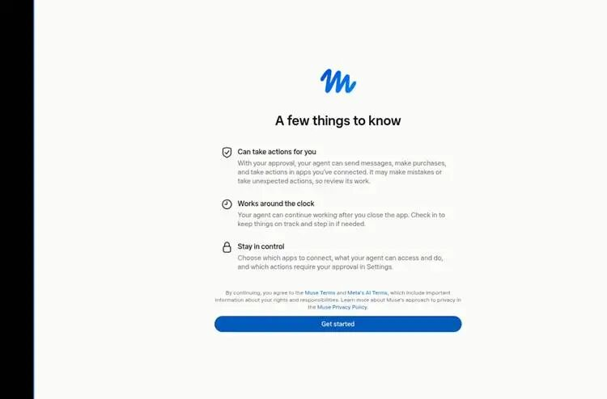
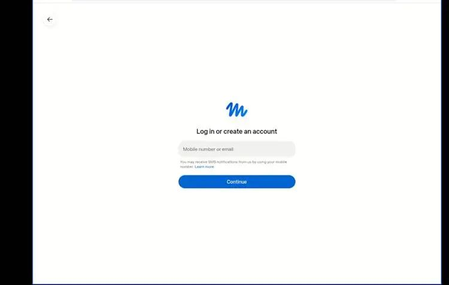
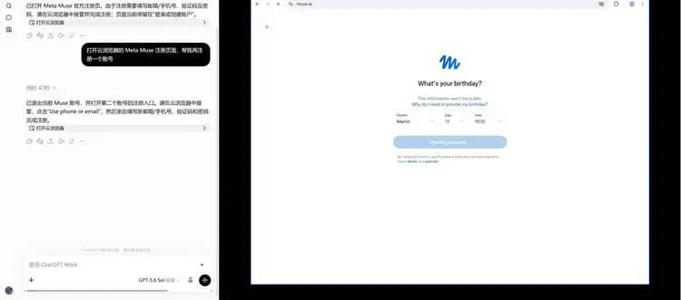
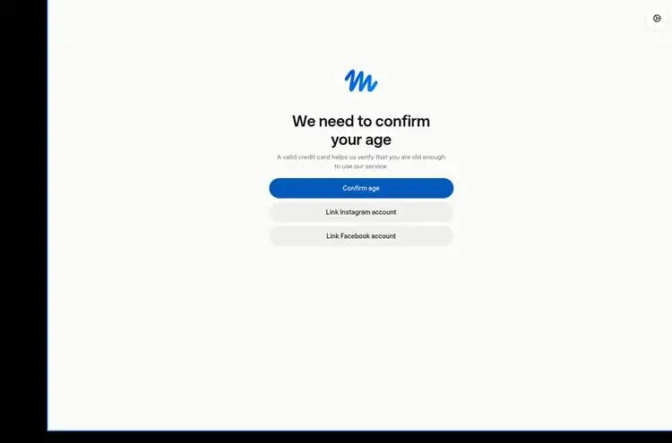
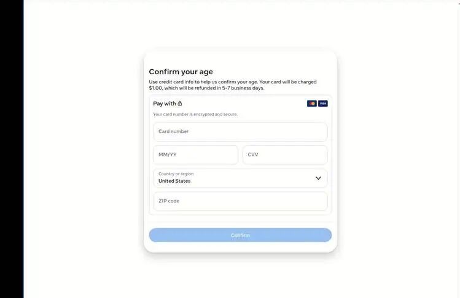
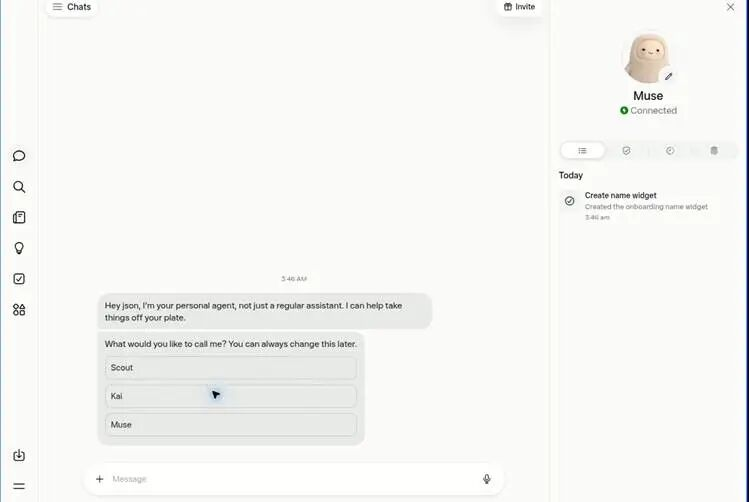
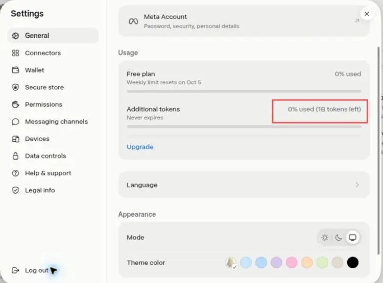



（收集说明：本页依据 53AI 的转载页面。转载页开头的「推荐语」和 53AI 站点作者卡片不属于原文，未收入；原文中位于引用框内的提示文字保留为表格形式。）

过去一年，我们习惯了让 AI 写文案、做总结、查资料。到了 2026 年，真正的热点已经变了：AI 不再只给答案，而是开始替你把事情做完。Meta 推出的 Muse，就是这一波“个人 AI Agent（智能体）”浪潮里最值得关注的新产品之一。

|  |
| --- |
| **一句话认识   Muse**它不是一个更会聊天的机器人，而是一个拥有专属电脑、能使用浏览器和已连接应用、可以持续替你执行任务的个人智能体。 |

# 01  Muse 的关键，不是更会答，而是能真正动手

Muse 由 Meta 推出，2026 年 9 月 8 日上线，目前官方开放范围为美国和加拿大。每位用户都有一个持续存在的专属代理和专用电脑：你说目标，它可以打开网页、整理文件、调用你授权的连接服务，并在长任务中持续推进。

**产品首次进入时**，会明确说明三件事：它能替你采取行动；关掉应用后仍可继续工作；你可以选择连接哪些应用，并控制哪些操作需要批准。

Muse 首次使用说明：能行动、可持续工作、权限由用户控制。

这和普通聊天机器人最大的区别，是交付物从“一段回答”变成了“一个完成的结果”。例如，不只是告诉你怎么找发票，而是从邮箱里把发票找出来、按月份归类并生成表格；不只是给旅行建议，而是按预算比较选项、整理行程，并在需要付款时停下来等你确认。

# 02  国内怎么注册？这是一次完整实测

|  |
| --- |
| **先说明**Muse 官方当前面向美国和加拿大开放。下面记录的是用户在国内通过 ChatGPT Work 云浏览器完成注册的个人实测，不代表官方长期支持；页面、资格和地区策略随时可能变化。请遵守服务条款，并使用真实、属于自己的资料。 |

## 第一步：在云浏览器打开 Muse，进入注册页面

在 ChatGPT Work 中调用云浏览器，打开 Muse 官网。页面出现“Log in or create an account”后，输入可接收验证码的手机号或邮箱并继续。建议全程保持同一个浏览器会话，不要中途频繁切换环境。

注册入口：输入手机号或邮箱。

## 第二步：填写生日并创建 Meta 账号

根据页面提示填写生日。年龄信息不会公开，但会用于判断是否符合服务使用条件。请按真实信息填写；注册过程中可能需要接收验证码并设置账号信息。

填写生日后，系统开始创建账号。

## 第三步：阅读功能与权限说明

创建账号后，页面会介绍 Muse 能做什么以及你如何保持控制。点“Get started”继续即可。后续连接 Gmail、日历等服务时，要认真查看授权范围，不需要的权限可以先不开放。

## 第四步：完成年龄验证

页面提供银行卡、Instagram 或 Facebook 等验证方式。此次实测选择银行卡验证；界面明确写明：信用卡用于确认年龄。

年龄验证页面：可选择银行卡或关联 Meta 旗下账号。

## 第五步：国内银行卡实测可用，会有 1 美元预授权

用户实测中，国内发行的银行卡可以完成验证。页面会先进行 1 美元预授权，并注明会在 5—7 个工作日内退回。由于银行入账节奏不同，实际恢复可用额度或退款显示时间以发卡行记录为准。

用户此次实测将国家或地区选择为“United States”，邮编栏可手动填写并完成验证。由于这不是官方面向中国大陆用户发布的操作说明，建议优先使用与持卡人账单信息一致的 ZIP code，并遵守平台条款。任何银行卡验证都只应使用本人有权使用的卡。

验证页明确显示：预授权 1 美元，5—7 个工作日退回。

|  |
| --- |
| **银行卡安全提醒**1 美元是年龄验证预授权，不是订阅费。若超过页面标注时间仍未退回，可先查看银行的“待入账/预授权”记录，再联系发卡行或   Muse 支持。切勿向他人发送卡号、有效期或安全码。 |

## 第六步：注册完成，进入 Muse

完成验证后会进入 Muse 主界面。第一次对话通常会让你给个人 Agent 取一个名字。到这里，账号注册就完成了。

进入 Muse 主界面后，可给个人 Agent 命名并开始对话。

# 03  别急着开聊：邀请奖励只有 48 小时窗口

Muse 的“分享邀请”和“兑换邀请码”是两件事。点开朋友的邀请链接，不等于邀请码已经兑换成功；新用户需要在加入 Muse 后的前 48 小时内，手动输入邀请码并确认。

·        手机端：Muse App → Settings → Redeem token。

·        网页版：muse.ai → Settings → General → Usage → Redeem invite code。

·        输入邀请码**SNOUBP**并确认；只有页面显示兑换成功，奖励才算到账。

·        奖励数量、剩余邀请次数和资格条件，以当前账户页面展示为准，不要把其他人的奖励数当成固定承诺。

兑换成功后，可在 Settings → General → Usage 查看 Additional tokens。

|  |
| --- |
| **最常见的坑**加入了不等于兑换了；超过 48 小时，兑换入口会消失。邀请码也可能出现已用完、撤销、失效或不符合资格等情况，以页面结果为准。 |

# 04  注册之后怎么用？8 个场景直接照抄

真正让 Muse 发挥价值的方式，是把任务说成“目标 + 边界 + 交付标准”，而不是一步一步教它点哪里。下面这些指令可以直接改成你的情况。

**案例 1：清空邮箱里的报销债**

*“**搜索过去三个月带有发票或收据附件的邮件，按日期、商家、金额整理成表格；先给我预览，不要删除或转发任何邮件。”*

**案例 2：把会议从聊天变成安排**

*“**找出我和产品团队都空闲的三个 45 分钟时段，优先周二到周四上午；先给选项，我确认后再创建日历事件。”*

**案例 3：出差方案一次成形**

*“**下月去上海三天，预算 5000 元。比较交通和酒店，把总价、通勤时间、取消政策放在同一张表里；任何预订前都要让我确认。”*

**案例 4：长邮件变成行动清单**

*“**总结这个项目邮件串，只保留决定、负责人、截止时间和未解决问题；把截止时间按紧急程度排序。”*

**案例 5：求职材料按岗位改**

*“**根据这份岗位描述改写我的简历，保留真实经历，不夸大；先列关键词缺口，再给一版一页中文简历和五个面试问题。”*

**案例 6：做一个公众号选题助理**

*“**整理最近一周 AI Agent 的三个高讨论度话题，注明信息日期和来源；按传播性、争议性、实用性打分，再为第一名写 1200 字提纲。”*

**案例 7：比较购物选项但不擅自下单**

*“**找三款适合通勤降噪的耳机，预算 1500 元以内，比较重量、续航、保修和当前价格；不要登录账户，不要加入购物车。”*

**案例 8：把生活琐事变成固定流程**

*“**每周日晚整理下周日历，找出冲突、过早的会议和连续三小时没有休息的安排；只生成建议，不自动改动。**”*

# 05  三条原则，让 Muse 真正像助理而不是聊天框

1.      先说结果：告诉它你最终想拿到什么，而不是只说“帮我看看”。

2.      再说边界：预算、日期、不能做的动作、是否允许登录，都写清楚。

3.      最后说验收：要表格还是清单，要几个备选，哪些步骤必须先征得你确认。

一个好指令可以是：“帮我安排周五晚上的四人聚餐，地点在陆家嘴附近，人均 300 元以内，要安静、可在线订位。先给三个选项和取消规则，我确认后再订。”目标、约束和确认点都清楚，Agent 才更容易一次做到位。

# AI Agent 的分水岭，是从“告诉你”走向“替你完成”

Muse 还处在快速变化阶段，国内用户的注册路径也不是官方长期承诺。但这次实测已经说明了一件事：个人 AI 的竞争，正在从模型回答得多聪明，转向谁能更安全、更稳定地把现实世界里的事情办完。

如果你已经完成注册，别从“你好，你会什么”开始。直接把一件拖了很久的小事交给它：整理邮件、核对行程、做比价表、生成会议清单。第一次真正拿回一个可用结果，你就会理解 Agent 和聊天机器人的差别。

（以下内容无法获取：转载页面需登录才能查看剩余约 30% 的内容。）

