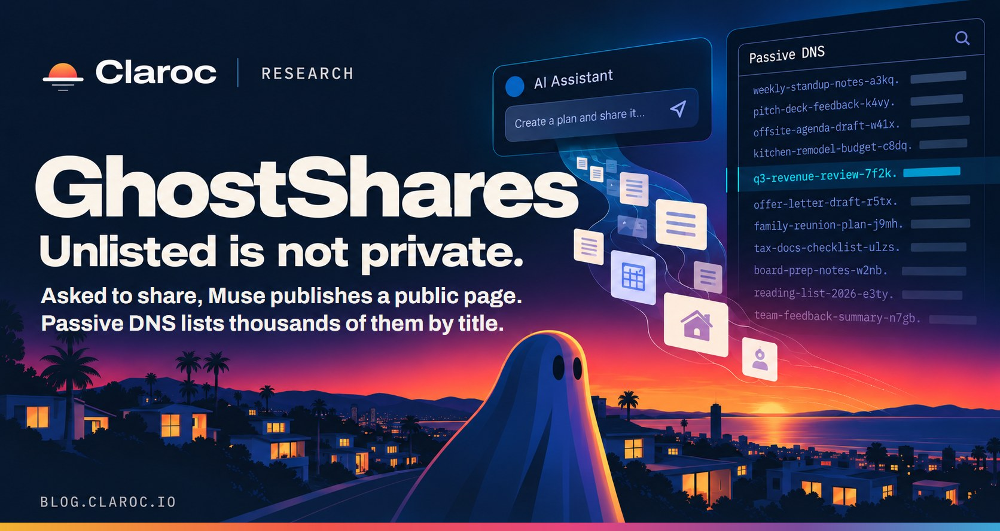
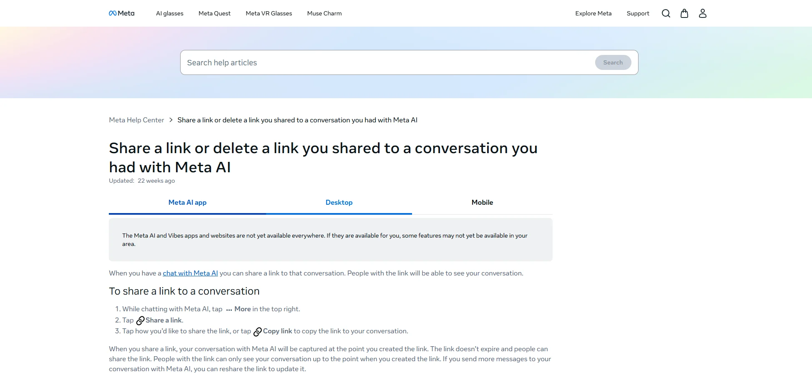
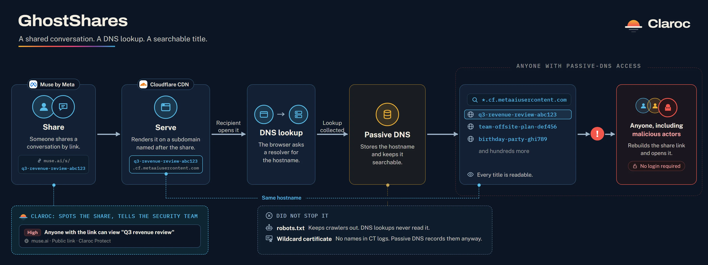
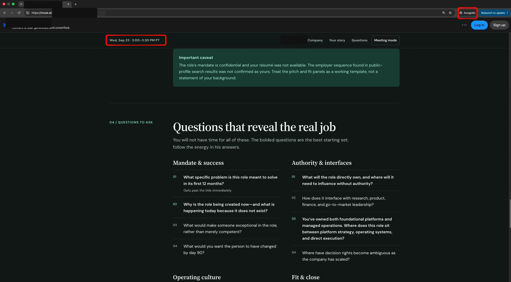
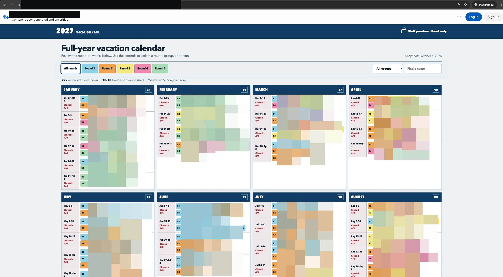



**收录说明**：安全公司 Claroc 的研究团队发布的博客，发布于 2026 年 10 月 18 日，页面标注 10 月 20 日更新。全文翻译，原文末尾的预约演示和销售联系方式，以及重复出现的图片放大视图未译出。文末有该公司对自家产品的介绍。研究只使用商业被动 DNS 服务和公共 URL 扫描服务，没有联系涉及的个人或公司，文中隐去了主机名、标题、数字和链接等标识信息。早期收集时直接翻译，原文未单独存档。

**内容摘要**：Muse 把分享的对话发布为持链接即可打开的页面，网址由对话标题加随机 ID 构成。打开分享时主机名会被被动 DNS 记录，研究者在 cf.metaaiusercontent.com 下找到 6,800 多个分享主机名，另有公共 URL 扫描服务保存了 75 次以上扫描。打开的样本中多数无关紧要，少数包含高管招聘通话准备笔记、营收审查、贷款申请和员工休假日历等敏感内容。研究者于 10 月 8 日向 Meta 的漏洞赏金计划报告；10 月 20 日更新写明 Ars Technica 报道后，Meta 告诉 Ars 正在暂停该功能。文末给出企业侧的建议。

**保留理由**：这是 Muse 分享链接暴露问题的一手研究，包含规模数字、成因（标题进入网址和 DNS）、披露日期和 Meta 暂停功能的时间点。

---

2026 年 10 月 18 日 · 12 分钟阅读

当有人让 Meta 的 Muse AI 助手分享一段对话时，Muse 会把它发布为一个持有链接的任何人都能打开的页面。这是有意为之：公开链接是接收它的队友能够打开它的唯一方式。Claroc 的研究团队发现，即使从未被给过这些链接，也很容易找到它们，因为被动 DNS 和子域名发现工具会直接列出这些主机名。在无痕模式下、不登录打开一批样本，就看到了人们的个人文件和公司的内部文档：一份房屋出售预算、一条标记了银行欺诈警报并附有部分账号的待办笔记、一份小企业贷款申请、一份只给首席执行官看的营收审查，以及一位候选人为与一家前沿 AI 实验室进行的高管招聘通话所做的机密准备。2026 年 10 月 20 日，在 Ars Technica 就这些发现提问后，Meta 表示将暂停该功能。

Claroc 研究团队 · 更新于 2026 年 10 月 20 日

> **2026 年 10 月 20 日更新：** Ars Technica 今天[报道了这项研究](https://arstechnica.com/security/2026/10/meta-muse-exposes-users-personal-and-business-secrets-when-they-share-conversations/)。在 Ars 向 Meta 询问之后，Meta 告诉 Ars 它正在暂停这项功能，我们很高兴看到它这么快就被关闭了。10 月 20 日，我们重新检查了本月早些时候无需账户就能打开的 40 个分享，没有一个能为我们打开，提供其内容的主机名返回了错误。这些主机名本身，包括其中的标题，仍然留在被动 DNS 历史记录中。本文其余部分描述的是我们在这次变更之前发现的 Muse 分享情况。

Meta 的个人 AI 智能体 Muse 会在你要求时分享一段对话。它把对话发布为一个页面，并给你一个链接让你发出去。这个页面对任何持有该链接的人都能打开，无需登录或申请访问，这是有意为之：Muse 只通过链接分享，所以公开页面是你发送对象的那位队友能够打开它的唯一方式。

一旦页面存在，你甚至不需要被人发送链接就能访问它。Muse 用对话本身的标题来命名每个分享的网址，而这个地址会被写进公共 DNS。一次被动 DNS 搜索就能取回成千上万个这样的地址，按名称列出，就像一份目录。

我们在一个这样的数据集中搜索了 Muse 的内容域名，并打开了一批样本。几乎所有仍然在线的分享都能直接打开。大多数无关紧要。少数则不然：几十份个人记录和企业内部文档，其中包括一位候选人为与一家前沿 AI 实验室进行的高管招聘通话所做的机密准备，详细到该实验室的内部联系人和会议的确切时间。对任何想要造成伤害的人来说，这样一份清单就是一条捷径，可以直接用于欺诈、冒充或社会工程。

本文中的每一个页面之所以公开，都是因为有人让 Muse 分享它，而 Muse 照做了。很多 AI 助手都通过公开链接分享。让 Muse 的分享容易被找到的，是标题就放在网址里，而公共 DNS 会把它记录下来，供任何人搜索。我们把这些称为 GhostShares：那些会为从未拿到过链接的人打开、并且这些人能够自己找到的页面。

## 规模

Muse 于 2026 年 9 月 8 日上线。一个月后，我们在一个商业被动 DNS 服务（它索引自己的解析器所观察到的域名）中搜索了 `cf.metaaiusercontent.com` 之下的主机名，这是 Muse 提供分享内容所用的内容域名。每个主机名对应一个分享，而且由于 Muse 用分享的标题来构建地址，返回的列表是可读的：按名称列出的分享。

在过滤掉任何此类域名都会收集到的通配符 DNS 扫描噪声之后，剩下超过 6,800 个分享主机名。我们只打开了其中几百个，其余的没有动。标题在我们打开之前就告诉了我们大多数页面里装着什么，而页面本身一访问就能打开，不需要账户，也没有登录界面。如果你事先问我们，我们会猜收集这些需要花真功夫。结果只用了一次查询。

被动 DNS 甚至不是它们出现的唯一地方。一个任何人都能查询的公共 URL 扫描服务，已经保存了 75 次以上对 Muse 分享页面的扫描。同样的暴露就躺在一个普通的搜索框里。

## 标题是怎样进入 DNS 的

这类泄露并不新鲜。2025 年，被分享的 ChatGPT 对话出现在 Google 搜索结果中，[OpenAI 撤下了让它们可被索引的选项](https://www.searchenginejournal.com/openai-is-pulling-shared-chatgpt-chats-from-google-search/552671/)；几周后，Google 已经[索引了超过 370,000 个 Grok 对话](https://9to5mac.com/2025/08/20/370k-grok-ai-chats-made-public-without-user-consent/)。让 AI 分享页面远离搜索引擎成了显而易见的预防措施，Muse 也采取了这一措施：它的 `robots.txt` 要求搜索和 AI 爬虫不要访问分享路径。但 `robots.txt` 管的是爬取，不是访问，而我们的发现过程根本没有经过搜索引擎。

Meta 自己的帮助页面写明了这个模型：你点击「分享链接」（Share a link），然后「people with the link will be able to see your conversation」（译注：意为「持有链接的人将能看到你的对话」），链接「doesn’t expire」（译注：意为「不会过期」），而且人们「can share the link」（译注：意为「可以分享这个链接」）。它记录的是 Meta AI 而不是专门针对 Muse，但这是 Meta 公开给出的、关于其某个 AI 分享链接如何运作（包括转分享）的最接近的描述。

Meta 自己关于分享 Meta AI 对话的帮助页面（并非专门针对 Muse），于 2026 年 10 月 18 日从 meta.com 截取。

让页面可被找到的，在更下面一层，在地址本身。Muse 用分享的标题（一个描述对话的短语）加上一个随机 ID 来构建每个分享的网址。主机名通常在我们打开页面之前就透露了其中的内容，而且由于链接带有同样的标题和 ID，从 DNS 中取出的一个主机名就能重建出链接。

示意图，并非捕获到的检测记录；图中的标题和 ID 都是虚构的。

剩下的事 DNS 免费代劳。当有人打开一个分享时，他们的浏览器会解析这个主机名，而一个其解析器看到了这次查询的被动 DNS 提供商会把它记录下来，并保持可搜索。没有人需要爬取、猜测或突破任何东西。用户输入的标题就落进了一个公开的域名索引里。

每个地址里都有一个随机 ID，长到没人能猜出来。猜测从来都不是重点。任何人第一次打开这个分享时，DNS 就会记下整个主机名，连同随机 ID 一起，所以本应无法猜到的那部分，会和其他所有东西一起被公开。一个 ID 只有在保持秘密时才能起到秘密的作用，而主机名不是秘密。查询主机名正是网络运作的方式。

一个 GhostShare 主机名

home-sale-budget-9f21c8a3.cf.metaaiusercontent.com

- ■  对话本身的标题：在你打开之前就知道里面是什么
- ■  一个随机 ID，用来让地址无法被猜到
- ■  每个 Muse 分享都由其提供的内容域名

一次被动 DNS 查询就能把它们全部返回，随机 ID 和标题都是明文：

home-sale-budget-9f21c8a3.cf.metaaiusercontent.com
q3-revenue-review-7b1e42f0.cf.metaaiusercontent.com
loan-application-draft-a4c9e2.cf.metaaiusercontent.com
staff-vacation-calendar-5d8b7a.cf.metaaiusercontent.com
…  另外 6,800 多个，每个都以其对话命名

示意；标题和 ID 都是虚构的。

## 被暴露的页面里装着什么

我们打开的大多数内容都平平无奇：小企业网站、房源列表、活动日历，那种页面所有者很可能就是希望别人看到的页面。让我们担忧的页面是少数。以下是其中六个，只列类别，不列名字或链接：

- 一位候选人为与一家前沿 AI 实验室进行的机密高管招聘通话所做的准备笔记，其中写明了该实验室的内部联系人和会议时间
- 一家全国性营销公司的内部营收审查，标注给其首席执行官
- 一位小企业主的贷款申请，附有申请金额
- 一份待办清单，其中包括一条银行欺诈警报，附有部分账号以及一笔交易的金额和时间
- 一位房地产投资者的内部业绩报告，附有两处房产地址以及确切的回报、收入和抵押贷款数字
- 一个工作场所全年的员工休假日历，列出了几十名员工各自休假的那一周

一个真实的 Muse 分享，即上面列表中那位候选人为与该实验室进行的机密高管招聘通话所做的准备，在未登录的无痕窗口中打开：请注意无痕标记、muse.ai 分享网址，以及登录和注册按钮。muse.ai/s 后面的路径、分享标题（浏览器标签页和页面标题两处），以及那个带有实验室一方人员姓名的导航标签都已涂黑；会议日期保留可见。所显示的文字，即这份简报自己的提醒和要问的问题列表，没有提到任何人。

一个真实的 Muse 分享，一个工作场所的员工休假日历，在没有 Meta 账户的无痕窗口中打开（页面提供登录和注册）。网址和标题已被抹去，每个名字都打了马赛克。

我们在没有被给过链接的情况下，从一个域名查询数据集中、不使用任何账户访问到了上面每一个页面。我们没有联系涉及的个人或公司，所以无法说明他们的本意；我们可以说的是，这些内容显然是敏感的，而且那两家公司是真实存在的，已对照公开来源核实。

内容并不是唯一的风险。像那份通话准备这样的页面里，人物履历也许可以从公开来源拼凑出来，但这次会面不是公开的：谁在悄悄地和谁谈，什么时候谈。这样一个页面用公开的部件拼出一个私密的事实，并把它交给任何能搜索 DNS 的人。

## 方法与局限

这里的一切都来自同一个渠道：一个商业被动 DNS 服务，搜索对象是 Muse 的内容域名。我们没有猜测或暴力破解任何东西；每个主机名都来自该提供商，并各自对应一个分享。Muse 在首次响应中只发送分享的标题，然后用 JavaScript 把对话内容渲染出来，所以一次普通的抓取只会看到一个几乎为空的页面；我们在普通浏览器中加载每个页面，这就是全部所需。我们只查看那些无需账户就能自行加载的页面，本文中的每一个严重程度判断都来自一个人阅读页面，而不是关键词匹配。我们没有登录、填写表单或上传任何东西；有一个页面要求输入密码，我们就放弃了它。然后我们就停止了，只有下面提到的一次例外。

这是一个发现渠道、一种主机名模式、一个产品，在一个很短的时间窗口内的情况。它并不衡量 Muse 的整体暴露程度，我们也无法判断任何一个分享可被访问了多久，或者是否有其他人先发现了它。

## 披露与时间线

我们于 2026 年 10 月 8 日向 Meta 的漏洞赏金计划报告了这一问题，附上了复现步骤和示例分享。我们没有证据表明有人滥用了这些分享。我们的内容检查是在 10 月 7 日和 8 日收集数据时进行的；此后我们没有再打开过这些分享，只有一次例外：10 月 18 日，为了截取上面那张经过涂黑的截图，我们重新打开了那份通话准备一次，没有打开其他任何分享。我们仍在仅通过被动 DNS 观察的是，分享这一层仍在不断生成新的主机名，我们最后一次查看的那天有 27 个。这是持续的发现，而不是经过重新验证的访问。

我们描述的这些页面之所以公开，是因为其所有者分享了它们，而同样的页面已经躺在一个任何人都能搜索的扫描数据库里。我们隐去了所有标识信息（主机名、标题、数字和链接），所以本文中没有任何内容会把读者引向受影响的内容。一旦 Meta 确认已拿到所需的信息，我们就会删除存储的发现数据。

## 为什么设置审查可能会漏掉这一点

一项基于应用文档化设置开展的安全审查可能会完全漏掉这一点。每一次分享都是员工发出的一个请求，一次一段对话，而 Muse 按文档所述执行它。让一个分享可被找到的东西，也就是它的 URL 和主机名的构建方式以及 DNS 记录它们的方式，不出现在任何分享控制项中。一次批准只是它被签署那一刻的快照，而分享发生在那之后。

## 该怎么办

Muse 做的是它的用户要求的事，无论是这一点，还是它构建分享 URL 的方式，都不是你的团队可以更改的设置。你能控制的是你的员工是否使用 Muse，以及他们让它分享什么。

- **弄清楚谁已经在用它。** Muse 几周前才上线，不需要管理员部署，所以员工今天就可能在创建和分享对话，而没有任何人批准过这个工具。像对待任何其他影子 AI 应用一样对待它：弄清楚公司内部谁在访问 muse.ai，以及他们是否在生成携带公司数据的公开分享。
- **告诉大家分享链接意味着什么。** 让一个 AI 助手分享一段对话，就是把它发布为一个持有链接的任何人都能打开的页面，而在 Muse 中，对话的标题还会变成一个公开的 DNS 名称。把这一点写进你的 AI 使用指南，放在「什么可以粘贴进助手」旁边，并对你发现正在分享的人再说一遍。
- **关注大家分享了什么。** 风险始于有人让助手分享、一段对话变成一个公开的、可被发现的页面的那一刻。如果你运行着能够看到 SaaS 和 AI 活动的安全产品，就把它对准这一点：在用户创建公开分享时发出标记，并把 AI 的「分享链接」视为把那段对话中的任何内容向外传输。
- **如果你检测不到，就屏蔽它。** 如果你的技术栈中没有任何东西能看到或管控 Muse 的分享，就在网络层屏蔽这个应用：在受管设备的代理或 DNS 过滤器上拒绝 `muse.ai` 及其内容域名 `metaaiusercontent.com`，这样就无法从公司内部创建对话，也无法从公司内部把它们提供出去。这是一项粗糙的控制，但在你部署更好的控制之前，它能堵住这个暴露。

再用我们找到 Muse 分享的方法检查一下你自己的暴露情况：在被动 DNS 数据和公共 URL 扫描服务中搜索你的员工所用 SaaS 和 AI 工具的内容域名，并亲自创建一个分享，看看主机名和 URL 中会出现什么。你能取回的东西，任何拥有同样访问权限的人也能取回。

## Claroc 的定位

Claroc 让安全团队能够看到员工购买、构建和采用的 SaaS 和 AI 应用，以及这些应用在审批期间和审批之后实际是如何被分享和配置的。它会标记员工在 ChatGPT 或 Claude 等 AI 助手中创建的公开分享链接，包括安全团队尚未审查过的助手，并把它连同分享了什么、谁能打开一起加入团队在 Claroc 中的发现列表。团队在分享被创建时就会知道，因此不会先从一篇博客文章中得知这样的暴露。

这延续了我们早先关于泄露后仍能打开的链接的研究：[LinkDrift](https://blog.claroc.io/public-box-links-fortune-500)，研究的是财富 500 强公司中无需登录即可访问的内部文件。两者的线索是一样的。没有人闯进去。工具就是这样工作的，人们就是这样使用它们的。

AI 助手只会变得越来越有能力，越来越深地融入我们的工作方式，所以务实的做法是睁大眼睛使用它们：在你核实之前，假定你分享的任何东西都是公开的，并确保有人能看到流出去的是什么。这些工具是有用的，它们做的是被要求的事，包括把一段对话公开。分享什么，仍然由提出要求的那个人决定。
