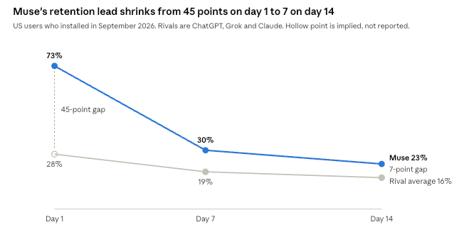



**收录说明**：Medium 对直接下载返回 403，2026-11-06 改用 AIVO Journal 的全文转载（reprintUrl）；去掉了作者头像、发布日期、阅读时长、分享按钮与站内推荐。判断依据为通读全文后的记录：作者为 AIVO 联合创始人，文末约 15% 篇幅推广自家产品（Meridian、Assist、AI Win-Rate），摘要中已略去其产品功效宣称；Evercore 的每用户成本数字系作者转引、未核实原文。原文全文存于本目录的 original.md，网站上不显示，已翻译。

**内容摘要**：作者以自创的 Three Gates（准入、选择、执行）框架分析 Muse 对智能体商务的影响。上线约六周，美加超 1000 万人开通，日活约 25%；Sensor Tower 估计截至 10 月 17 日全球下载 1090 万、美国 1020 万，10 月 16 日美国日活 250 万。Citi 预测 Muse 2030 年收入超 270 亿美元（交易约 230 亿、订阅约 45 亿），作者验算称按 5% 抽成计需约 4600 亿美元 GMV。Personal Agent Protocol 由 Sierra 与 Meta 共同开发，伙伴包括 Shopify、Stripe、Walmart 等；Amazon 及多家银行目前封堵第三方 agent 访问，支付功能尚属后续扩展。作者指出，目前没有任何已公布的 agent 购物转化率。

**保留理由**：独立分析长文，有原创框架、第三方数据交叉验证与对投行预测的验算，是已收资料中少有的商业模式分析；后半部分推广作者自家产品，已在收录说明中注明。

---

Muse 101：Meta 的个人智能体与智能体商务的未来

Muse 已让智能体商务成为品牌必须实时应对的运营问题

---

### 主要发现

Muse 已让智能体商务成为品牌必须实时应对的运营问题。在美国和加拿大，[超过 1000 万人](https://www.fool.com/earnings/call-transcripts/2026/10/21/meta-meta-q3-2026-earnings-call-transcript/?ref=aivojournal.org)在大约六周内完成了设置，约 25% 的人在任何一天都会使用它，而 Meta 表示购物是其最常见的用途。

Citi 和 Evercore 从相反的两端描述同一个赌注。按 AIVO 的算术，Citi 对 2030 年 230 亿美元交易额的预测，意味着在 5% 抽成率下约有 4600 亿美元的 Muse 促成消费。Evercore 提出的、要匹配一名 Meta 用户现有贡献的门槛，则意味着每用户每年约 1 万美元的消费。

个人智能体把商业结果拆成三个彼此独立的决策。准入（Access）决定资格，选择（Choice）分配需求，执行（Execution）产生收入。如今 Amazon 和多家银行限制准入，一条以价格为先的指令塑造着选择，而我们没有发现任何已公布执行环节的转化率。

选择是三者中最少被衡量的，也是对品牌最重要的。智能体在权衡多个符合条件的产品时，可能对不同客户得出不同答案，因此单一的品牌排名无法描述其位置。随着 Meta 朝着让智能体直接与企业智能体打交道的方向建设，品牌可能也需要某种能在这种交互中代表自己的东西。

### Muse 101

Muse 是一款个人智能体，即一种跨连接服务为用户执行任务的软件。Meta [于 2026 年 9 月 8 日在美国推出它](https://thenextweb.com/news/meta-muse-personal-ai-agent-launch?ref=aivojournal.org)，随后[于 9 月 18 日在 iPhone 和网页端登陆加拿大](https://ppc.land/metas-muse-gains-10-million-us-downloads-in-40-days-sensor-tower-finds/?ref=aivojournal.org)。人们通过应用、网页或 WhatsApp 使用它。

搜索争夺的是注意力，答案引擎争夺的是被纳入回答。个人智能体争夺的是交易：答案引擎告诉用户该买什么，而 Muse 可以去把它买下来。它[在应用关闭后继续工作、记住偏好并主动给出建议](https://thenextweb.com/news/meta-muse-personal-ai-agent-launch?ref=aivojournal.org)。它还能利用[已连接的电子邮件、购物历史和过往对话](https://www.retailgentic.com/p/5-muse-optimization-best-practices?ref=aivojournal.org)，这使它获得的上下文远超一次搜索查询。

安全设计是这款产品的核心。每名用户都会获得[一台隔离的虚拟机，以及一个名为 Sentinel 的独立系统](https://thenextweb.com/news/meta-muse-personal-ai-agent-launch?ref=aivojournal.org)，后者将读权限与写权限分开，并在有重大后果的操作前停下来等待批准。Meta 表示 Muse 看不到密码或银行卡详情。一个[连 Meta 也无法看到用户内容](https://www.fool.com/earnings/call-transcripts/2026/10/21/meta-meta-q3-2026-earnings-call-transcript/?ref=aivojournal.org)的保密版本仍有待推出。

Muse [提供免费档，以及每月 20 美元和 100 美元的付费方案](https://thenextweb.com/news/meta-muse-personal-ai-agent-launch?ref=aivojournal.org)。免费档运行在 Muse Spark 上，而 [Muse Wonder——Meta 的首个前沿模型——在付费方案中提供](https://www.fool.com/earnings/call-transcripts/2026/10/21/meta-meta-q3-2026-earnings-call-transcript/?ref=aivojournal.org)。Meta 表示该产品不包含广告，且[对话和虚拟机数据不会进入其广告系统](https://ppc.land/metas-muse-can-skip-ads-yet-still-shape-instagram-ads-mbi-argues/?ref=aivojournal.org)。

一个购物请求遵循既定路径。Muse [将请求与它对用户的了解结合，并行搜索多个来源，然后对一份短名单排序](https://www.retailgentic.com/p/5-muse-optimization-best-practices?ref=aivojournal.org)。这些来源是 Meta 的产品目录、一个实时浏览器，以及某些品类下的 Facebook Marketplace。Retailgentic 报道称，该智能体的购物指令[明确倾向于在用户约束条件内选择低价](https://www.retailgentic.com/p/5-muse-optimization-best-practices?ref=aivojournal.org)。

结账按商家区分。Shopify 的产品走 Universal Commerce Protocol，其他商家则通过[使用 Stripe Link 的访客结账](https://www.retailgentic.com/p/5-muse-optimization-best-practices?ref=aivojournal.org)，后者会签发一次性卡号。据 Shopify 称，Shopify 商家[默认在 Muse 中可被发现和购买](https://www.americanbanker.com/payments/news/shopify-adds-meta-muse-to-agentic-AI-strategy?ref=aivojournal.org)。

### Muse 目前的处境

需求是真实的，而 Meta 正投入巨资来培育它。Sensor Tower 估计，截至 10 月 17 日[全球下载量为 1090 万次，美国为 1020 万次](https://ppc.land/metas-muse-gains-10-million-us-downloads-in-40-days-sensor-tower-finds/?ref=aivojournal.org)，10 月 16 日美国日活用户为 250 万。Meta 报告称[超过 1000 万人完成设置，其中约 25% 在任何一天处于活跃状态](https://www.fool.com/earnings/call-transcripts/2026/10/21/meta-meta-q3-2026-earnings-call-transcript/?ref=aivojournal.org)。两个来源暗示的日活受众规模相近，这使该规模具有一定可信度。

分发在很大程度上解释了这一速度。Sensor Tower 估计，Meta 将 10 月广告支出的 [39% 给了 Muse，高于 9 月的 23%](https://ppc.land/metas-muse-gains-10-million-us-downloads-in-40-days-sensor-tower-finds/?ref=aivojournal.org)；Apptopia 数据显示[95% 的 Muse 用户同时也是 Facebook 用户](https://ppc.land/metas-muse-accounts-for-72-of-ai-agent-requests-human-finds/?ref=aivojournal.org)。

留存曲线是这些头条数字之上的主要疑问。它符合「大量试用、随后流失」的模式，Sensor Tower 自己也表示广告可能正在抬高这些增长数字。扎克伯格在第三季度财报电话会上提出相反观点，称[早期采用者使用 Muse 的时间越长，留存就越好](https://www.fool.com/earnings/call-transcripts/2026/10/21/meta-meta-q3-2026-earnings-call-transcript/?ref=aivojournal.org)。10 月的用户群将显示哪种解读成立。

Gener8 的 Android 样本显示，其受众比早前的人工智能应用更年长，[X 世代和婴儿潮一代在采用上领先](https://www.retailgentic.com/p/part-2-detailed-early-data-on-muse?ref=aivojournal.org)。其触达估计远高于 Meta 自己的数字，因此这只是一个方向性信号。

流传着三个购物数字，它们衡量的是不同事物。Meta 称购物是最常见的用途，并表示[超过 25% 的周活跃用户使用 Muse 进行购物](https://www.fool.com/earnings/call-transcripts/2026/10/21/meta-meta-q3-2026-earnings-call-transcript/?ref=aivojournal.org)，平均购买金额超过 200 美元，其中包含旅行。Gener8 认为[购物占活动的 8.6%](https://www.retailgentic.com/p/part-2-detailed-early-data-on-muse?ref=aivojournal.org)。HUMAN 表示[84% 的 Muse 网页请求指向产品和搜索页面](https://ppc.land/metas-muse-accounts-for-72-of-ai-agent-requests-human-finds/?ref=aivojournal.org)。这些分别是用户占比、活动占比和网页请求占比，其中没有一个给出购买频率。

流量数据展示了活动，却未揭示结果。Cequence 发现[大多数会话是浏览后离开，只有一小部分以完成购买告终](https://www.webull.com/news/15711883848336384?ref=aivojournal.org)。

### Citi 和 Evercore 怎么说

两家机构都看好 Muse，并一致认为商务将承载其经济性。Citi 自上而下估算这块蛋糕的规模，Evercore 则自下而上、以单个用户为单位进行检验。完整报告属于客户研究，因此本节依据的是已公开发表的报道。

|  | Citi | Evercore ISI |
| --- | --- | --- |
| 分析师与报告 | Ron Josey，[54 页](https://www.retailgentic.com/p/part-2-detailed-early-data-on-muse?ref=aivojournal.org)，[10 月 6 日](https://www.pymnts.com/news/artificial-intelligence/2026/metas-muse-could-become-27-billion-business-citi-says/?ref=aivojournal.org)报道 | Mark Mahaney，[24 页，日期为 10 月 12 日](https://www.retailgentic.com/p/part-2-detailed-early-data-on-muse?ref=aivojournal.org) |
| 核心主张 | 个人智能体正[成为互联网的新入口](https://www.pymnts.com/news/artificial-intelligence/2026/metas-muse-could-become-27-billion-business-citi-says/?ref=aivojournal.org) | Muse 可能显示[超出 Meta 现有业务的 AI 回报](https://finance.yahoo.com/technology/ai/articles/meta-muse-could-become-most-130637015.html?ref=aivojournal.org) |
| 头条数字 | [到 2030 年收入超过 270 亿美元](https://www.pymnts.com/news/artificial-intelligence/2026/metas-muse-could-become-27-billion-business-citi-says/?ref=aivojournal.org) | [每用户每年约 100 美元成本，对应每用户 380 美元的 Meta 收入](https://www.retailgentic.com/p/part-2-detailed-early-data-on-muse?ref=aivojournal.org) |
| 收入来源 | 约 230 亿美元来自交易，45 亿美元来自订阅 | 广告、订阅和交易分成 |

德意志银行显示这些预测仍多么不确定。Benjamin Black 认为[Muse 2030 年收入在 24 亿至 360 亿美元之间](https://www.thedailyupside.com/technology/artificial-intelligence/metas-muse-is-everywhere-and-nowhere-in-latest-earnings-result/?ref=aivojournal.org)，该区间上限约为 Meta 年收入的 8%。Citi 的预测位于区间偏上端。

Meta 此后已朝这两种论点靠拢。9 月时，Mahaney 预计 Meta 会[先建立用户和参与度，再实现变现](https://finance.yahoo.com/technology/ai/articles/meta-muse-could-become-most-130637015.html?ref=aivojournal.org)。他在 10 月 21 日的电话会上直接提出这个问题，扎克伯格表示[变现会比 Meta 惯常的剧本来得更早](https://www.fool.com/earnings/call-transcripts/2026/10/21/meta-meta-q3-2026-earnings-call-transcript/?ref=aivojournal.org)。Muse 对大多数人应保持免费，企业则需就 Meta 帮助促成的交易支付费用。

AIVO 的算术把这些数字转化为三项独立检验。第一项是规模。Retailgentic 对 Citi 报告的摘要给出[一个 4 万亿美元的市场、4% 的份额和 5% 的抽成率](https://www.retailgentic.com/p/part-2-detailed-early-data-on-muse?ref=aivojournal.org)，即 1600 亿美元消费和 80 亿美元收入。Citi 对 2030 年 230 亿美元的预测要大得多。在相同抽成率下，它需要约 4600 亿美元消费，即该市场的 11.5%，因此该模型必然假设了更大的份额、更大的市场或更高的费率。公开报道没有说明是哪一种。作为规模参照，Instinct 报告了[超过 10 亿美元的年化交易额](https://eu.36kr.com/en/p/4003952149663618?ref=aivojournal.org)，其中约一半是旅行。

第二项检验是单位成本。按 5% 抽成率，覆盖 Evercore 提出的每年 100 美元成本需要 2000 美元消费，即 10 笔 200 美元的购买。如果 Meta [承诺的十倍效率提升](https://www.fool.com/earnings/call-transcripts/2026/10/21/meta-meta-q3-2026-earnings-call-transcript/?ref=aivojournal.org)能让每用户成本相应下降，那么一笔这样的购买就能覆盖它。

最后这一步是乐观情形。Susan Li 表示，随着用户增长，[总服务成本将会上升](https://www.fool.com/earnings/call-transcripts/2026/10/21/meta-meta-q3-2026-earnings-call-transcript/?ref=aivojournal.org)；扎克伯格则预计，一年后人们会想要更好的模型。Meta 尚未公布费率，因此 5% 只是一种示例。PYMNTS 对订阅提出警告，援引数据显示[仅 3% 的家庭为任何 AI 服务付费](https://www.pymnts.com/news/artificial-intelligence/2026/metas-muse-could-become-27-billion-business-citi-says/?ref=aivojournal.org)。

第三项检验是与 Meta 现有业务持平。加上 [Meta 每用户已赚取的 380 美元](https://www.retailgentic.com/p/part-2-detailed-early-data-on-muse?ref=aivojournal.org)，门槛提高到 480 美元，这需要 9600 美元消费，即 48 笔 200 美元的购买。那 380 美元是 Meta 在其他地方赚取的收入，因此这显示的是 Muse 用户需要产生多少才能与之匹配。它并不显示 Muse 自身在哪里实现盈亏平衡。扎克伯格设定了同样的基准，称他[预计 Muse 会随着时间推移超过这一水平](https://www.fool.com/earnings/call-transcripts/2026/10/21/meta-meta-q3-2026-earnings-call-transcript/?ref=aivojournal.org)。

已报道的分析留下一个未定变量：Muse 实际能进入多大的市场。抽成率只适用于到达结账环节的消费，而这取决于谁允许该智能体进入。

### 对智能体商务的可能影响

Muse 正以消费者规模推动智能体商务穿过 AIVO 的「三道门」。可被触达、被发现、被推荐和被购买是四种不同结果，而每道门有不同的掌控者。

| 门 | 当前状况 | 谁掌控 | 商业结果 |
| --- | --- | --- | --- |
| 准入 | [Amazon、Yelp、Delta、JPMorgan 和 Schwab 限制智能体](https://aiweekly.co/alerts/amazon-yelp-delta-join-banks-blocking-third-party-ai-agents?ref=aivojournal.org)。Shopify 默认让商家加入 | 商家、平台和银行 | 资格 |
| 选择 | 目录和浏览器结果被合并，然后依据价格、约束条件和用户上下文排序 | Meta 的排序和每个用户的画像 | 需求分配 |
| 执行 | Link 和 Shop Pay 处理支付，用户批准购买 | 支付通道、商家结账和用户 | 收入 |

### 准入：从抓取到许可

第一场争斗围绕身份展开。Amazon 称[Muse 不表明自身身份，且 Meta 未发出通知](https://aiweekly.co/alerts/amazon-yelp-delta-join-banks-blocking-third-party-ai-agents?ref=aivojournal.org)。Cequence 报道称，Muse [以普通 Chrome 浏览器身份出现，且不对其请求签名](https://www.webull.com/news/15711883848336384?ref=aivojournal.org)。Meta 的回应是，拒绝一个智能体意味着[拒绝它背后的客户](https://aiweekly.co/alerts/amazon-yelp-delta-join-banks-blocking-third-party-ai-agents?ref=aivojournal.org)。

Meta 预计这一阶段会过去。Li 表示，市场应[朝着经过认证的 API、获批的合作关系以及智能体对智能体通信的方向发展](https://www.fool.com/earnings/call-transcripts/2026/10/21/meta-meta-q3-2026-earnings-call-transcript/?ref=aivojournal.org)。载体是 Personal Agent Protocol，它由 [Sierra 和 Meta 与 Genesys、Instinct、Rocket、Shopify、Stripe 和 Walmart 共同开发](https://thenextweb.com/news/personal-agent-protocol-sierra-meta?ref=aivojournal.org)。它让企业决定智能体是通过其网站、其 API 还是其自有智能体进入。支付仍是未来的扩展，而 Stripe 和 Shopify 也加入了 Visa 的竞争性方案 Trusted Agent Protocol。

这种模式已经在分裂零售业。Meta [在 Connect 大会上宣布与 10 家零售商建立连接器](https://www.retailgentic.com/p/5-muse-optimization-best-practices?ref=aivojournal.org)，包括 Walmart、Best Buy、Sephora 和 Ulta，随后称[其中数家的集成已上线](https://aiweekly.co/alerts/amazon-yelp-delta-join-banks-blocking-third-party-ai-agents?ref=aivojournal.org)。Amazon 留在外面。每个通过这两类渠道销售的品牌现在都处于混合位置，而许多品牌并非主动选择如此。

### 选择：需求被分配之处

选择是市场衡量得最少的决策。目录收录、智能体访问、产品页面请求和结账访问都记录了活动，却没有一个记录偏好。关键问题是，当多个产品满足客户要求时，智能体选择哪一个，以及为什么。

早期证据表明目录主导发现过程。Retailgentic 发现，[Meta.ai 前三名中 89% 的产品也出现在 Muse 中](https://www.retailgentic.com/p/5-muse-optimization-best-practices?ref=aivojournal.org)。

该检验范围有限，且 Retailgentic 的出版方在这个市场中有产品销售。它还止步于候选池。目录中的存在表明资格，却几乎不能说明选择。

AIVO 自己的早期解读也指向同一方向。其 Agent Analyzer 发现，某智能体定位并正确读取了一个英国天然护肤品牌 80% 的关键购买事实，而三个竞争对手分别为 57%、50% 和 40%。在分别向 ChatGPT、Gemini 和 Perplexity 各给出同一买家请求五次的情况下，它们 15 次中有 4 次推荐了该品牌。这是 11 月 2 日对单个请求的读取，仅具指示性，但更好的事实检索并未保证被选中。

选择也因客户而异。Muse [利用每个用户的上下文和历史](https://www.retailgentic.com/p/5-muse-optimization-best-practices?ref=aivojournal.org)，因此在产品信息完全相同的情况下，同一产品可能被选中给一个人，而被另一个人拒绝。低价指令让高端品牌更难说服，而这种说服在不同购物者身上效果不同。Retailgentic 补充说，[记忆让重复监测变得困难，且没有临时聊天](https://www.retailgentic.com/p/5-muse-optimization-best-practices?ref=aivojournal.org)。

因此，单一的品牌排名无法描述品牌在与智能体互动中的位置。有用的衡量必须改变客户画像、购买要求、价格敏感度、竞争产品和智能体架构，然后报告品牌获胜的频率以及是什么推理决定了结果。

收费模式增加了中立性问题。MBI Deep Dives 认为，[如果每个商家都付费，Muse 就应基本不关心谁获胜](https://ppc.land/metas-muse-can-skip-ads-yet-still-shape-instagram-ads-mbi-argues/?ref=aivojournal.org)，很像一个卡组织。只有当费率统一且排序与商业条款分离时，这一点才成立。Meta 尚未公布其费率的大小或机制。

广告可能间接到来。Meta 的安全材料称，Muse 的浏览会显示为该人自己的活动，因此[商家可以利用那次访问来展示 Instagram 广告](https://ppc.land/metas-muse-can-skip-ads-yet-still-shape-instagram-ads-mbi-argues/?ref=aivojournal.org)。扎克伯格还表示，用户将能够[连接 Muse 以改善其在 Meta 各平台上的内容和广告](https://www.fool.com/earnings/call-transcripts/2026/10/21/meta-meta-q3-2026-earnings-call-transcript/?ref=aivojournal.org)。一个智能体可以不含广告，却仍影响广告资金的流向。

### 执行：有交易量，却无转化率

早期信号强劲但不完整。扎克伯格表示，Meta 在第一周不得不[与 Stripe 合作提高信用额度](https://www.fool.com/earnings/call-transcripts/2026/10/21/meta-meta-q3-2026-earnings-call-transcript/?ref=aivojournal.org)。Stripe 的 John Collison 表示，智能体商务[在 9 月开始垂直起飞](https://www.retailgentic.com/p/part-2-detailed-early-data-on-muse?ref=aivojournal.org)。HUMAN 称，Muse [比其他智能体到达结账页面的可能性高 25%](https://ppc.land/metas-muse-accounts-for-72-of-ai-agent-requests-human-finds/?ref=aivojournal.org)，不过未给出绝对比率。到达结账距离完成购买仍有一段距离。

执行也是一个安全决策。Cequence 的一家旅行客户[拦截了近五分之一的 Muse 请求，同时放行其余请求](https://www.webull.com/news/15711883848336384?ref=aivojournal.org)。同一报告称，Muse 在金融机构完成了多因素登录，因此成功登录不再能证明真人就在场。一个品牌可以赢得「选择」这道门，却仍因自己的机器人防御而失去销售，或者根本没察觉到有智能体参与。

衡量也随之失灵。HUMAN 警告说，将智能体会话混入人类数据[可能扭曲转化率、归因和欺诈信号](https://ppc.land/metas-muse-accounts-for-72-of-ai-agent-requests-human-finds/?ref=aivojournal.org)。无法区分这类流量的品牌会误读其漏斗所传达的信息。

一次完成的购买还留下一个后续问题。品牌需要为下一次购买保持资格，而我们尚未看到任何关于智能体如何处理重复选择的公开数据。

### 双智能体关系

最大的变化在供给侧。扎克伯格描述了一个 Muse 网络，在其中购买某物意味着[与企业智能体对话，而不是浏览其网站](https://www.fool.com/earnings/call-transcripts/2026/10/21/meta-meta-q3-2026-earnings-call-transcript/?ref=aivojournal.org)。Li 预计[个人智能体与企业智能体之间的直接通信](https://www.fool.com/earnings/call-transcripts/2026/10/21/meta-meta-q3-2026-earnings-call-transcript/?ref=aivojournal.org)将成为获准路径之一，而 Personal Agent Protocol 已经[允许企业选择其自有智能体作为联系点](https://thenextweb.com/news/personal-agent-protocol-sierra-meta?ref=aivojournal.org)。

这改变了品牌网站的职能。它原本为人类访客而建，如今变成替他们行事的软件的接口。目录可以陈述产品的属性，而客户的智能体可能需要更多。它可能会问：该产品是否适合此人、它有哪些局限、它能否与客户已有的设备配合、有什么证据支持这一说法，以及现在能否完成购买。

品牌显然有理由自己回答这些问题。客户的智能体同样有理由对促销打折扣，因此品牌侧的智能体将通过准确性和证据赢得影响力。它对这场对话也没有自动的所有权。客户的智能体可能更偏好独立来源、零售商的 API 或市场平台自身的采购系统，因此品牌智能体必须对买家智能体既有用又有说服力。如果做到这一点，下一场竞争就可能发生在代表客户的智能体与代表企业的智能体之间，而「选择」这道门可能就位于这一交互之中。

### Muse 将走向何方

接下来一年取决于算力、商家条款，以及试用能否变成习惯。Meta 表示 Muse 现已具备产品市场契合，并[进入一个专注于扩大产品规模、增长收入和优化算力的阶段](https://www.fool.com/earnings/call-transcripts/2026/10/21/meta-meta-q3-2026-earnings-call-transcript/?ref=aivojournal.org)。

近期路线图基本已定。扎克伯格表示，Muse 将[从 11 月开始登陆 Meta Glasses](https://www.fool.com/earnings/call-transcripts/2026/10/21/meta-meta-q3-2026-earnings-call-transcript/?ref=aivojournal.org)。他还提到 Confidential VM、Muse Charm 设备，以及能更高效地提供 Muse Wonder 智能的较小模型。假日季将带来第一次大规模零售检验。

地理扩张取决于效率。扎克伯格指出算力密集是[最大的制约之一，也是 Muse 尚未全球推出的原因](https://www.fool.com/earnings/call-transcripts/2026/10/21/meta-meta-q3-2026-earnings-call-transcript/?ref=aivojournal.org)，同时还提到本地连接器方面的工作。因此，Mahaney 关于 Muse 可能在[六到十二个月内达到 1 亿用户](https://www.cnbc.com/2026/09/29/meta-launches-muse-for-small-business-zuckerberg-pushes-enterprise-ai.html?ref=aivojournal.org)的看法，仅靠美国和加拿大似乎很难实现。欧洲还带来另一道障碍，因为[智能体批准的支付没有获得强客户认证的豁免](https://thenextweb.com/news/personal-agent-protocol-sierra-meta?ref=aivojournal.org)。

收入是第二条工作线。Meta 预计其新的 AI 业务将在 2027 年开始通过订阅、交易、广告和企业产品[贡献增量收入](https://www.fool.com/earnings/call-transcripts/2026/10/21/meta-meta-q3-2026-earnings-call-transcript/?ref=aivojournal.org)。它还看到了其应用上[5 亿自认的小型企业](https://www.fool.com/earnings/call-transcripts/2026/10/21/meta-meta-q3-2026-earnings-call-transcript/?ref=aivojournal.org)中的机会。

竞争正迅速到来。Instinct 在仍处于早期访问阶段时[以 100 亿美元估值融资 10 亿美元](https://www.vktr.com/ai-platforms/instinct-raises-1b-at-10b-valuation-to-scale-its-personal-ai-agent/?ref=aivojournal.org)，Citi 则将 [OpenAI 的 Dots、Google 的 Gemini 和 Anthropic 的 Claude](https://www.pymnts.com/news/artificial-intelligence/2026/metas-muse-could-become-27-billion-business-citi-says/?ref=aivojournal.org)列为竞争对手。Muse 的领先建立在分发之上，这种力量强大，但仍需转化为习惯。

AIVO 看到三条可能路径。在基准情形下，准入变得需要许可且不均衡，Li 的预期成立，即[许多体验在短期内仍将是 AI 辅助的](https://www.fool.com/earnings/call-transcripts/2026/10/21/meta-meta-q3-2026-earnings-call-transcript/?ref=aivojournal.org)。在上行情景下，主要观望者加入，Citi 的预测开始显得可达。在下行情景下，随着推广减弱，留存消退，Muse 沉淀为研究层，而这仍会影响人们买什么。

四个信号将区分这些路径：10 月用户群留存、Meta 费率的大小与规则、Amazon 或一家主要银行是否接受获准路径，以及网络周（Cyber Week）期间的完成购买率。

### 品牌现在该做什么

品牌应把 Muse 视为一个拥有自身门禁的渠道，并对每道门采取明确的立场。

从准入开始。确认产品通过 [Commerce Manager 进入 Meta 的目录](https://www.retailgentic.com/p/5-muse-optimization-best-practices?ref=aivojournal.org)，检查 Shopify 设置，并通过智能体跑一次真实结账。然后让安全、电商和营销团队协同，因为一条机器人规则可能意外地设定商业政策。

给智能体提供个人上下文无法提供的东西。它已经非常了解购物者，却可能对产品知之甚少。以智能体可读取的形式发布预期用途、兼容性、材质和局限，以及[产品适合谁、人们为何选择它](https://www.retailgentic.com/p/5-muse-optimization-best-practices?ref=aivojournal.org)。面对以价格为先的指令，这些理由正是高端品牌可以依靠的东西。

在决策点衡量选择。目录中的存在表明资格，却几乎不能说明选择。品牌需要按品类、跨购物者情境测试智能体选择它们的频率以及给出的推理。AI Win-Rate™ 正是为衡量那个决策时刻而构建的。

现在就在分析中把智能体活动分离出来，以免假日数据将其与人类行为混合。然后决定当个人智能体询问服务、库存或推荐时，由谁代表品牌发言。

### 智能体经济中品牌的位置

个人智能体改变了品牌的商业角色。品牌必须能被客户的智能体访问，在评估备选方案时被选中，并能服务该智能体直至完成交易。

AIVO 将衡量和管理「AI 智能体是否选择某品牌并与其完成任务」这一学科称为 Agentic Brand Control。它补充了改善可发现性的 GEO 和 AEO，解决的是智能体是否选择该品牌并完成任务。

AIVO Meridian 作用于需求侧。它模拟包括 Muse、Instinct、Dots 和 Duet 在内的个人智能体的旅程，衡量它们在决策阶段是否选择某品牌，并支持补救。AI Win-Rate™ 量化跨竞争品牌的这种正面对决表现。

[AIVO Assist™](https://aivocorp.com/assist?ref=aivojournal.org) 作用于供给侧，现已可用，典型部署时间为一周。它为一个品牌的网站提供一个专家，客户的智能体可在做决定前咨询。Assist 会返回三种判定之一（适合、有条件适合、没有合适选项），并附上决定性事实及其来源；它只陈述品牌已批准的事实；当链接或会话被保留时，它可以把回答与随后的点击、预订或销售关联起来，这显示的是归因，而不是额外收入。在 AIVO 的受控测试中，在决定性事实难以找到的逼真测试网站上，335 次会话里的正确推荐率从 47% 升至 93%；这些会话是 1512 次受控测试会话的一部分，每条推荐都依据测试开始前商定的通过规则评分。在一个已经陈述了每项事实的简短清晰页面上，Assist 没有带来差别。所有这些测试都使用了由 AIVO 构建和运行的测试智能体，而在客户网站上的无提示使用以及对真实销售的影响尚未得到证实。智能体通过页面上一个有标签的表单、一个向 AI 浏览器声明的工具（WebMCP）、API 和 MCP 连接，以及预先发布的答案来接触 Assist，因此它取决于智能体是否采取其中一条路径。AIVO 并未声称与 Muse 或 Meta 计划中的智能体网络集成。该方法在 [Paul Sheals 和 Tim de Rosen 的工作论文](https://zenodo.org/records/23694598?ref=aivojournal.org)中阐述。

Meridian 显示品牌是否赢得决策，Assist 则帮助品牌在对话中陈述理由。在智能体经济中，可见性开启竞争，决策决定胜负，执行交付价值。

AIVO 是一家 AI Brand Intelligence 公司。GEO 让品牌被 AI 看到；AIVO 衡量并改善 AI 助手和智能体是否选择它们，并以 AI Win-Rate™ 作为首要指标。

### 证据说明

AIVO 未审阅 Citi 或 Evercore 的完整报告，因此这里关于它们的内容来自已公开发表的报道。隐含的消费和购买计算是 AIVO 的算术，5% 的抽成率只是一种示例。来自 Sensor Tower、Apptopia 和 Gener8 的采用数据是第三方估计，Sensor Tower 将其数据描述为方向性的。Meta 的数字是公司声明。HUMAN、Cequence 和 Retailgentic 的出版方都在这个市场销售产品。AIVO Assist 和 Agent Analyzer 的数字来自 AIVO 自身，尚未被独立复现。事实截至 2026 年 11 月 4 日。

### 来源

- [Meta 2026 年第三季度财报电话会记录](https://www.fool.com/earnings/call-transcripts/2026/10/21/meta-meta-q3-2026-earnings-call-transcript/?ref=aivojournal.org)，The Motley Fool
- [第二部分：Muse 采用情况的详细早期数据](https://www.retailgentic.com/p/part-2-detailed-early-data-on-muse?ref=aivojournal.org)，Scot Wingo，Retailgentic
- [5 项 Muse 优化最佳实践](https://www.retailgentic.com/p/5-muse-optimization-best-practices?ref=aivojournal.org)，Scot Wingo，Retailgentic
- [Citi 称 Meta 的 Muse 可能成为 270 亿美元的业务](https://www.pymnts.com/news/artificial-intelligence/2026/metas-muse-could-become-27-billion-business-citi-says/?ref=aivojournal.org)，PYMNTS
- [Muse 可能成为自 ChatGPT 以来使用最广泛的消费级 AI 应用](https://finance.yahoo.com/technology/ai/articles/meta-muse-could-become-most-130637015.html?ref=aivojournal.org)，Yahoo Finance
- [Meta 为小型企业推出 Muse](https://www.cnbc.com/2026/09/29/meta-launches-muse-for-small-business-zuckerberg-pushes-enterprise-ai.html?ref=aivojournal.org)，CNBC
- [Muse 在 40 天内获得 1000 万美国下载量](https://ppc.land/metas-muse-gains-10-million-us-downloads-in-40-days-sensor-tower-finds/?ref=aivojournal.org)，PPC Land 关于 Sensor Tower
- [Muse 占 AI 智能体请求的 72%](https://ppc.land/metas-muse-accounts-for-72-of-ai-agent-requests-human-finds/?ref=aivojournal.org)，PPC Land 关于 HUMAN
- [Muse 可以跳过广告，却仍能影响 Instagram 广告](https://ppc.land/metas-muse-can-skip-ads-yet-still-shape-instagram-ads-mbi-argues/?ref=aivojournal.org)，PPC Land 关于 MBI Deep Dives
- [Muse 触达了 Cequence 研究客户的一半以上](https://www.webull.com/news/15711883848336384?ref=aivojournal.org)，Cequence 通过 PR Newswire 发布的稿件
- [Amazon、Yelp、Delta 加入银行封堵第三方 AI 智能体](https://aiweekly.co/alerts/amazon-yelp-delta-join-banks-blocking-third-party-ai-agents?ref=aivojournal.org)，AI Weekly 关于 The Verge
- [Meta 推出 Muse](https://thenextweb.com/news/meta-muse-personal-ai-agent-launch?ref=aivojournal.org)，The Next Web
- [Sierra 宣布 Personal Agent Protocol](https://thenextweb.com/news/personal-agent-protocol-sierra-meta?ref=aivojournal.org)，The Next Web
- [Shopify 与 Meta 如何深入结账领域](https://www.americanbanker.com/payments/news/shopify-adds-meta-muse-to-agentic-AI-strategy?ref=aivojournal.org)，American Banker
- [Instinct 创始人访谈](https://eu.36kr.com/en/p/4003952149663618?ref=aivojournal.org)，36Kr
- [Instinct 以 100 亿美元估值融资 10 亿美元](https://www.vktr.com/ai-platforms/instinct-raises-1b-at-10b-valuation-to-scale-its-personal-ai-agent/?ref=aivojournal.org)，VKTR
- [AIVO Assist 工作论文](https://zenodo.org/records/23694598?ref=aivojournal.org)，Paul Sheals 和 Tim de Rosen，AIVO Standard
- [Meta 的 Muse 在最新财报中无处不在又无迹可寻](https://www.thedailyupside.com/technology/artificial-intelligence/metas-muse-is-everywhere-and-nowhere-in-latest-earnings-result/?ref=aivojournal.org)，The Daily Upside
