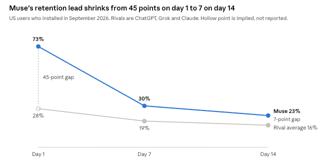

来源：https://medium.com/@tim_62250/muse-101-metas-personal-agent-and-the-future-of-agentic-commerce-a4afbd1f432f
取文：2026-11-06，AIVO Journal 全文转载（https://www.aivojournal.org/muse-101-metas-personal-agent-and-the-future-of-agentic-commerce/）

Muse 101: Meta's Personal Agent and the Future of Agentic Commerce

Muse has made agentic commerce a live operating question for brands

---

### Findings

Muse has made agentic commerce a live operating question for brands. [More than 10 million people](https://www.fool.com/earnings/call-transcripts/2026/10/21/meta-meta-q3-2026-earnings-call-transcript/?ref=aivojournal.org) in the US and Canada set it up in about six weeks, roughly 25% use it on any given day, and Meta says shopping is its most common use case.

Citi and Evercore describe the same bet from opposite ends. On AIVO's arithmetic, Citi's $23 billion transaction forecast for 2030 implies about $460 billion of Muse-facilitated spending at a 5% take rate. Evercore's hurdle for matching what a Meta user already earns implies about $10,000 of spending per user per year.

Personal agents split the commercial outcome into three separate decisions. Access decides eligibility, Choice allocates demand and Execution produces revenue. Today Amazon and several banks restrict Access, a price-led instruction shapes Choice, and we found no published conversion rate for Execution.

Choice is the least measured of the three and the one that matters most to a brand. An agent weighing several eligible products can reach different answers for different customers, so a single brand ranking cannot describe the position. As Meta builds toward agents that deal directly with business agents, brands may also need something that can represent them in that exchange.

### Muse 101

Muse is a personal agent, software that carries out tasks for a user across connected services. Meta [launched it in the US on September 8, 2026](https://thenextweb.com/news/meta-muse-personal-ai-agent-launch?ref=aivojournal.org), and [Canadian availability on iPhone and the web followed on September 18](https://ppc.land/metas-muse-gains-10-million-us-downloads-in-40-days-sensor-tower-finds/?ref=aivojournal.org). People reach it through an app, the web or WhatsApp.

Search competed for attention, and answer engines for inclusion in a response. Personal agents compete for the transaction: an answer engine tells a user what to buy, while Muse can go and buy it. It [keeps working after the app closes, remembers preferences and makes unprompted suggestions](https://thenextweb.com/news/meta-muse-personal-ai-agent-launch?ref=aivojournal.org). It can also draw on [connected email, shopping history and past conversations](https://www.retailgentic.com/p/5-muse-optimization-best-practices?ref=aivojournal.org), which gives it far more context than a search query carries.

The security design is central to the product. Each user gets [an isolated virtual machine, and a separate system called Sentinel](https://thenextweb.com/news/meta-muse-personal-ai-agent-launch?ref=aivojournal.org) splits read access from write access and stops for approval before consequential actions. Meta says Muse cannot see passwords or card details. A confidential version, which [would stop even Meta from seeing user content](https://www.fool.com/earnings/call-transcripts/2026/10/21/meta-meta-q3-2026-earnings-call-transcript/?ref=aivojournal.org), is still to come.

Muse has [a free tier plus plans at $20 and $100 a month](https://thenextweb.com/news/meta-muse-personal-ai-agent-launch?ref=aivojournal.org). The free tier runs on Muse Spark, and [Muse Wonder, Meta's first frontier model, is available on paid plans](https://www.fool.com/earnings/call-transcripts/2026/10/21/meta-meta-q3-2026-earnings-call-transcript/?ref=aivojournal.org). Meta says the product carries no advertising and that [conversations and virtual machine data stay out of its ad systems](https://ppc.land/metas-muse-can-skip-ads-yet-still-shape-instagram-ads-mbi-argues/?ref=aivojournal.org).

A shopping request follows a defined path. Muse [combines the request with what it knows about the user, searches several sources in parallel, then ranks a short list](https://www.retailgentic.com/p/5-muse-optimization-best-practices?ref=aivojournal.org). Those sources are Meta's product catalog, a live browser and, for some categories, Facebook Marketplace. Retailgentic reports that the agent's shopping instructions [explicitly favor low prices within the user's constraints](https://www.retailgentic.com/p/5-muse-optimization-best-practices?ref=aivojournal.org).

Checkout splits by merchant. Shopify products go through the Universal Commerce Protocol, and other merchants go through [guest checkout using Stripe's Link](https://www.retailgentic.com/p/5-muse-optimization-best-practices?ref=aivojournal.org), which issues one-time card numbers. Shopify merchants are [discoverable and purchasable in Muse by default](https://www.americanbanker.com/payments/news/shopify-adds-meta-muse-to-agentic-AI-strategy?ref=aivojournal.org), according to Shopify.

### Where Muse stands now

Demand is real, and Meta is paying heavily to build it. Sensor Tower estimates [10.9 million downloads worldwide and 10.2 million in the US](https://ppc.land/metas-muse-gains-10-million-us-downloads-in-40-days-sensor-tower-finds/?ref=aivojournal.org) through October 17, with 2.5 million US daily users on October 16. Meta reported [more than 10 million people set up, with about 25% active on a given day](https://www.fool.com/earnings/call-transcripts/2026/10/21/meta-meta-q3-2026-earnings-call-transcript/?ref=aivojournal.org). The two sources imply a similar daily audience, which gives the scale some credibility.

Distribution explains much of the pace. Sensor Tower estimates Meta gave Muse [39% of its October ad spend, up from 23% in September](https://ppc.land/metas-muse-gains-10-million-us-downloads-in-40-days-sensor-tower-finds/?ref=aivojournal.org), and Apptopia data shows [95% of Muse users are also Facebook users](https://ppc.land/metas-muse-accounts-for-72-of-ai-agent-requests-human-finds/?ref=aivojournal.org).

The retention curve is the main question over the headline numbers. It fits heavy trial followed by churn, and Sensor Tower itself says advertising may be inflating the gains. Zuckerberg offered the counterpoint on the Q3 call, saying [retention improves the longer early adopters use Muse](https://www.fool.com/earnings/call-transcripts/2026/10/21/meta-meta-q3-2026-earnings-call-transcript/?ref=aivojournal.org). October's cohorts will show which reading holds.

Gener8's Android panel suggests an older audience than earlier AI apps, with [Gen X and Boomers leading adoption](https://www.retailgentic.com/p/part-2-detailed-early-data-on-muse?ref=aivojournal.org). Its reach estimate runs well above Meta's own figure, so this is a directional signal.

Three shopping figures circulate, and they measure different things. Meta calls shopping the most common use case and says [over 25% of weekly actives use Muse for it](https://www.fool.com/earnings/call-transcripts/2026/10/21/meta-meta-q3-2026-earnings-call-transcript/?ref=aivojournal.org), with an average purchase above $200 that includes travel. Gener8 puts [shopping at 8.6% of activity](https://www.retailgentic.com/p/part-2-detailed-early-data-on-muse?ref=aivojournal.org). HUMAN says [84% of Muse's web requests target product and search pages](https://ppc.land/metas-muse-accounts-for-72-of-ai-agent-requests-human-finds/?ref=aivojournal.org). Those are shares of users, activity and web requests, and none of them gives purchase frequency.

Traffic data shows activity and leaves outcomes open. Cequence found that [most sessions browsed and left, and a small share ended in a completed purchase](https://www.webull.com/news/15711883848336384?ref=aivojournal.org).

### What Citi and Evercore are saying

Both houses are bullish on Muse and agree that commerce will carry the economics. Citi sizes the prize from the top down, and Evercore tests it from the bottom up, one user at a time. The full notes are client research, so this section relies on published reports of them.

|  | Citi | Evercore ISI |
| --- | --- | --- |
| Analyst and report | Ron Josey, [54 pages](https://www.retailgentic.com/p/part-2-detailed-early-data-on-muse?ref=aivojournal.org), reported [October 6](https://www.pymnts.com/news/artificial-intelligence/2026/metas-muse-could-become-27-billion-business-citi-says/?ref=aivojournal.org) | Mark Mahaney, [24 pages, dated October 12](https://www.retailgentic.com/p/part-2-detailed-early-data-on-muse?ref=aivojournal.org) |
| Central claim | Personal agents are [emerging as the new front door to the internet](https://www.pymnts.com/news/artificial-intelligence/2026/metas-muse-could-become-27-billion-business-citi-says/?ref=aivojournal.org) | Muse could show [AI returns beyond Meta's existing businesses](https://finance.yahoo.com/technology/ai/articles/meta-muse-could-become-most-130637015.html?ref=aivojournal.org) |
| Headline figure | [More than $27 billion of revenue by 2030](https://www.pymnts.com/news/artificial-intelligence/2026/metas-muse-could-become-27-billion-business-citi-says/?ref=aivojournal.org) | [About $100 of annual cost per user, against $380 of Meta revenue per user](https://www.retailgentic.com/p/part-2-detailed-early-data-on-muse?ref=aivojournal.org) |
| Revenue sources | About $23 billion from transactions and $4.5 billion from subscriptions | Ads, subscriptions and transaction share |

Deutsche Bank shows how unsettled the forecasts remain. Benjamin Black sees [Muse's 2030 revenue anywhere from $2.4 billion to $36 billion](https://www.thedailyupside.com/technology/artificial-intelligence/metas-muse-is-everywhere-and-nowhere-in-latest-earnings-result/?ref=aivojournal.org), with the top of that range at roughly 8% of Meta's annual revenue. Citi's forecast sits toward the upper end.

Meta has since moved toward both theses. In September, Mahaney expected Meta to [build users and engagement before monetizing](https://finance.yahoo.com/technology/ai/articles/meta-muse-could-become-most-130637015.html?ref=aivojournal.org). He put the question directly on the October 21 call, and Zuckerberg said [monetization will come sooner than Meta's usual playbook](https://www.fool.com/earnings/call-transcripts/2026/10/21/meta-meta-q3-2026-earnings-call-transcript/?ref=aivojournal.org). Muse should stay free for most people, with businesses paying a fee on transactions Meta helps facilitate.

AIVO's arithmetic turns these figures into three separate tests. The first is scale. Retailgentic's summary of Citi gives [a $4 trillion market, a 4% share and a 5% take rate](https://www.retailgentic.com/p/part-2-detailed-early-data-on-muse?ref=aivojournal.org), which is $160 billion of spending and $8 billion of revenue. Citi's $23 billion forecast for 2030 is far larger. At the same take rate it needs about $460 billion of spending, or 11.5% of that market, so the model must assume a larger share, a larger market or a higher fee. Public reports do not say which. For scale, Instinct reported [more than $1 billion of annualized volume](https://eu.36kr.com/en/p/4003952149663618?ref=aivojournal.org), about half of it travel.

The second test is unit cost. At a 5% take rate, covering Evercore's $100 of annual cost takes $2,000 of spending, or 10 purchases at $200. If Meta's [promised tenfold efficiency gain](https://www.fool.com/earnings/call-transcripts/2026/10/21/meta-meta-q3-2026-earnings-call-transcript/?ref=aivojournal.org) cut cost per user in line, one such purchase would cover it.

That last step is the optimistic case. Susan Li said [total serving costs will rise](https://www.fool.com/earnings/call-transcripts/2026/10/21/meta-meta-q3-2026-earnings-call-transcript/?ref=aivojournal.org) as users grow, and Zuckerberg expects people to want better models a year from now. Meta has not published a fee, so 5% is an illustration. PYMNTS adds a caution on subscriptions, citing data that [just 3% of households pay for any AI service](https://www.pymnts.com/news/artificial-intelligence/2026/metas-muse-could-become-27-billion-business-citi-says/?ref=aivojournal.org).

The third test is parity with Meta's existing business. Adding [the $380 Meta already earns per user](https://www.retailgentic.com/p/part-2-detailed-early-data-on-muse?ref=aivojournal.org) raises the hurdle to $480, which takes $9,600 of spending, or 48 purchases at $200. That $380 is revenue Meta earns elsewhere, so this shows what a Muse user would need to generate to match it. It does not show where Muse itself breaks even. Zuckerberg sets the same benchmark, saying he [expects Muse to exceed that level over time](https://www.fool.com/earnings/call-transcripts/2026/10/21/meta-meta-q3-2026-earnings-call-transcript/?ref=aivojournal.org).

The reported analysis leaves one variable open: how much of the market Muse can actually enter. A take rate applies only to spending that reaches a checkout, and that depends on who lets the agent in.

### The likely impact on agentic commerce

Muse is pushing agentic commerce through AIVO's Three Gates at consumer scale. Being reachable, being discovered, being recommended and being bought are four different outcomes, and each gate has a different owner.

| Gate | Position today | Who controls it | Commercial result |
| --- | --- | --- | --- |
| Access | [Amazon, Yelp, Delta, JPMorgan and Schwab restrict agents](https://aiweekly.co/alerts/amazon-yelp-delta-join-banks-blocking-third-party-ai-agents?ref=aivojournal.org). Shopify opts merchants in by default | Merchants, platforms and banks | Eligibility |
| Choice | Catalog and browser results are merged, then ranked using price, constraints and user context | Meta's ranking and each user's profile | Demand allocation |
| Execution | Link and Shop Pay handle payment, and the user approves purchases | Payment rails, merchant checkout and the user | Revenue |

### Access: from scraping to permission

The first fight is over identity. Amazon says [Muse does not identify itself and that Meta gave no notice](https://aiweekly.co/alerts/amazon-yelp-delta-join-banks-blocking-third-party-ai-agents?ref=aivojournal.org). Cequence reports that Muse [presents as an ordinary Chrome browser and does not sign its requests](https://www.webull.com/news/15711883848336384?ref=aivojournal.org). Meta's reply is that turning away an agent means [turning away the customer behind it](https://aiweekly.co/alerts/amazon-yelp-delta-join-banks-blocking-third-party-ai-agents?ref=aivojournal.org).

Meta expects this phase to pass. Li said the market should [move toward authenticated APIs, approved partnerships and agent-to-agent communication](https://www.fool.com/earnings/call-transcripts/2026/10/21/meta-meta-q3-2026-earnings-call-transcript/?ref=aivojournal.org). The vehicle is Personal Agent Protocol, [developed by Sierra and Meta with Genesys, Instinct, Rocket, Shopify, Stripe and Walmart](https://thenextweb.com/news/personal-agent-protocol-sierra-meta?ref=aivojournal.org). It lets a business decide whether agents arrive through its website, its APIs or its own agent. Payments remain a future extension, and Stripe and Shopify have also joined Visa's rival Trusted Agent Protocol.

The pattern is already splitting retail. Meta [announced connectors with 10 retailers at Connect](https://www.retailgentic.com/p/5-muse-optimization-best-practices?ref=aivojournal.org), including Walmart, Best Buy, Sephora and Ulta, and later described [integrations with several of them as live](https://aiweekly.co/alerts/amazon-yelp-delta-join-banks-blocking-third-party-ai-agents?ref=aivojournal.org). Amazon stays outside. Every brand sold through both groups now has a mixed position, and many will not have chosen it.

### Choice: where demand is allocated

Choice is the decision the market measures least. Catalog inclusion, agent visits, product page requests and checkout visits all record activity, and none of them records preference. The critical question is which product an agent selects when several meet the customer's requirements, and why.

Early evidence suggests the catalog leads discovery. Retailgentic found that [89% of products in Meta.ai's top three also appeared in Muse](https://www.retailgentic.com/p/5-muse-optimization-best-practices?ref=aivojournal.org).

That test is limited in scope, and Retailgentic's publisher sells into this market. It also stops at the candidate pool. Catalog presence shows eligibility and says little about selection.

AIVO's own early reading points the same way. Its Agent Analyzer found that an agent located and correctly read 80% of a UK natural skincare brand's key buying facts, against 57%, 50% and 40% for three competitors. Given the same buyer's request five times each, ChatGPT, Gemini and Perplexity recommended that brand 4 times in 15. This is one request read on November 2 and is only indicative, but better fact retrieval did not guarantee selection.

Selection also varies by customer. Muse [draws on each user's context and history](https://www.retailgentic.com/p/5-muse-optimization-best-practices?ref=aivojournal.org), so the same product can be chosen for one person and rejected for another with identical product information. The low-price instruction gives a premium brand a harder case to make, and that case will land differently by shopper. Retailgentic adds that [memory makes repeat monitoring hard, with no temporary chat](https://www.retailgentic.com/p/5-muse-optimization-best-practices?ref=aivojournal.org).

A single brand ranking therefore cannot describe a brand's position with agents. Useful measurement has to vary the customer profile, purchase requirement, price sensitivity, competing products and agent architecture, then report how often the brand wins and what reasoning decided it.

The fee model adds a neutrality question. MBI Deep Dives argues that [if every merchant pays, Muse should be largely indifferent to who wins](https://ppc.land/metas-muse-can-skip-ads-yet-still-shape-instagram-ads-mbi-argues/?ref=aivojournal.org), much like a card network. That holds only if fees are uniform and ranking is separate from commercial terms. Meta has not published the size or mechanics of its fee.

Advertising may arrive indirectly. Meta's safety material says Muse's browsing appears as the person's own activity, so [a merchant could use that visit to show an Instagram ad](https://ppc.land/metas-muse-can-skip-ads-yet-still-shape-instagram-ads-mbi-argues/?ref=aivojournal.org). Zuckerberg also said users will be able to [connect Muse to improve their content and ads across Meta](https://www.fool.com/earnings/call-transcripts/2026/10/21/meta-meta-q3-2026-earnings-call-transcript/?ref=aivojournal.org). An agent can stay free of ads and still influence where ad money goes.

### Execution: volume without a conversion rate

The early signals are strong and incomplete. Zuckerberg said Meta had to [work with Stripe to raise credit limits in the first week](https://www.fool.com/earnings/call-transcripts/2026/10/21/meta-meta-q3-2026-earnings-call-transcript/?ref=aivojournal.org). Stripe's John Collison said agentic commerce [started going vertical in September](https://www.retailgentic.com/p/part-2-detailed-early-data-on-muse?ref=aivojournal.org). HUMAN says Muse is [25% more likely than other agents to reach checkout pages](https://ppc.land/metas-muse-accounts-for-72-of-ai-agent-requests-human-finds/?ref=aivojournal.org), though it gives no absolute rate. Reaching checkout is still some way from completing a purchase.

Execution is also a security decision. One travel customer of Cequence [blocks nearly one in five Muse requests while allowing the rest](https://www.webull.com/news/15711883848336384?ref=aivojournal.org). The same report says Muse completed multi-factor logins at financial institutions, so a successful login no longer proves a person is present. A brand can win the Choice gate and still lose the sale to its own bot defenses, or fail to see that an agent was involved at all.

Measurement breaks along with it. HUMAN warns that mixing agent sessions into human data [can distort conversion rates, attribution and fraud signals](https://ppc.land/metas-muse-accounts-for-72-of-ai-agent-requests-human-finds/?ref=aivojournal.org). Brands that cannot separate this traffic will misread what their funnels are telling them.

A completed purchase also leaves a later question open. A brand needs to stay eligible for the next purchase, and we have seen no public data yet on how agents treat repeat selection.

### The two-agent relationship

The largest change sits on the supply side. Zuckerberg describes a Muse network in which buying something means [talking to a business's agent instead of navigating its website](https://www.fool.com/earnings/call-transcripts/2026/10/21/meta-meta-q3-2026-earnings-call-transcript/?ref=aivojournal.org). Li expects [direct communication between personal and business agents](https://www.fool.com/earnings/call-transcripts/2026/10/21/meta-meta-q3-2026-earnings-call-transcript/?ref=aivojournal.org) to become one of the permissioned routes, and Personal Agent Protocol already [lets a business choose its own agent as the point of contact](https://thenextweb.com/news/personal-agent-protocol-sierra-meta?ref=aivojournal.org).

That changes the job of a brand website. Built for human visitors, it becomes an interface for software acting on their behalf. A catalog can state a product's attributes, while a customer's agent may need more. It may ask whether the product suits this person, what its limitations are, whether it works with equipment the customer owns, what evidence supports the claim and whether the purchase can be completed now.

A brand has a clear interest in answering those questions itself. A customer's agent has equal reason to discount promotion, so a brand-side agent will earn influence through accuracy and evidence. It also has no automatic claim on the conversation. A customer's agent may prefer independent sources, a retailer's API or a marketplace's own purchasing systems, so the brand's agent has to be useful to the buyer's agent as well as persuasive. If it is, the next competitive contest could run between the agents representing customers and the agents representing businesses, and the Choice gate could sit inside that exchange.

### Where Muse is going

The next year turns on compute, merchant terms and whether trial becomes habit. Meta says Muse now has product-market fit and is [entering a phase focused on scaling the product, growing revenue and optimizing compute](https://www.fool.com/earnings/call-transcripts/2026/10/21/meta-meta-q3-2026-earnings-call-transcript/?ref=aivojournal.org).

The near-term roadmap is largely set. Zuckerberg said Muse would [reach Meta Glasses starting in November](https://www.fool.com/earnings/call-transcripts/2026/10/21/meta-meta-q3-2026-earnings-call-transcript/?ref=aivojournal.org). He also pointed to the Confidential VM, the Muse Charm device and smaller models that deliver Muse Wonder intelligence more efficiently. The holiday season will give the first large retail test.

Geography depends on efficiency. Zuckerberg named compute intensity as [one of the biggest constraints and the reason Muse has not launched globally](https://www.fool.com/earnings/call-transcripts/2026/10/21/meta-meta-q3-2026-earnings-call-transcript/?ref=aivojournal.org), alongside work on local connectors. Mahaney's view that Muse could reach [100 million users within six to 12 months](https://www.cnbc.com/2026/09/29/meta-launches-muse-for-small-business-zuckerberg-pushes-enterprise-ai.html?ref=aivojournal.org) therefore looks hard to meet from the US and Canada alone. Europe adds a separate hurdle, since [agent-approved payments have no carve-out from strong customer authentication](https://thenextweb.com/news/personal-agent-protocol-sierra-meta?ref=aivojournal.org).

Revenue is the second workstream. Meta expects its new AI businesses to [begin contributing incremental revenue in 2027](https://www.fool.com/earnings/call-transcripts/2026/10/21/meta-meta-q3-2026-earnings-call-transcript/?ref=aivojournal.org) across subscriptions, transactions, advertising and enterprise offerings. It also sees an opening among the [500 million self-identified small businesses](https://www.fool.com/earnings/call-transcripts/2026/10/21/meta-meta-q3-2026-earnings-call-transcript/?ref=aivojournal.org) on its apps.

Competition is arriving quickly. Instinct [raised $1 billion at a $10 billion valuation](https://www.vktr.com/ai-platforms/instinct-raises-1b-at-10b-valuation-to-scale-its-personal-ai-agent/?ref=aivojournal.org) while still in early access, and Citi names [OpenAI's Dots, Google's Gemini and Anthropic's Claude](https://www.pymnts.com/news/artificial-intelligence/2026/metas-muse-could-become-27-billion-business-citi-says/?ref=aivojournal.org) as rivals. Muse's lead rests on distribution, which is powerful and still has to convert into habit.

AIVO sees three plausible paths. In the base case, access becomes permissioned and uneven, and Li's expectation holds that [many experiences stay AI-assisted in the near term](https://www.fool.com/earnings/call-transcripts/2026/10/21/meta-meta-q3-2026-earnings-call-transcript/?ref=aivojournal.org). In the upside case, major holdouts join and Citi's forecast starts to look reachable. In the downside case, retention fades as promotion eases and Muse settles as a research layer, which would still shape what people buy.

Four signals will separate these paths: October cohort retention, the size and rules of Meta's fee, whether Amazon or a major bank accepts a permissioned route, and completed purchase rates over Cyber Week.

### What brands should do now

Brands should treat Muse as a channel with its own gates and take a deliberate position on each one.

Start with Access. Confirm that products reach [Meta's catalog through Commerce Manager](https://www.retailgentic.com/p/5-muse-optimization-best-practices?ref=aivojournal.org), review Shopify settings, and run a real checkout through the agent. Then bring security, ecommerce and marketing together, because a bot rule can set commercial policy by accident.

Give the agent what personal context cannot supply. It already knows a great deal about the shopper and may know little about the product. Publish intended use, compatibility, materials and limitations in forms an agent can read, along with [who the product suits and why people choose it](https://www.retailgentic.com/p/5-muse-optimization-best-practices?ref=aivojournal.org). Against a price-led instruction, those reasons are what a premium brand has to work with.

Measure Choice at the point of decision. Catalog presence shows eligibility and says little about selection. Brands need to test, by category and across shopper contexts, how often an agent picks them and what reasoning it gives. AI Win-Rate™ was built to measure that decision moment.

Separate agent activity in analytics now, before holiday data blends it with human behavior. Then decide who speaks for the brand when a personal agent asks for service, stock or a recommendation.

### The brand's position in an agentic economy

Personal agents change the commercial role of the brand. A brand has to be accessible to the customer's agent, selected when alternatives are evaluated and able to serve that agent through to a completed transaction.

AIVO calls the discipline of measuring and managing whether an AI agent selects a brand and completes the task with it Agentic Brand Control. It complements GEO and AEO, which improve discoverability, by addressing whether an agent selects the brand and completes the task.

AIVO Meridian works on the demand side. It simulates the journeys of personal agents including Muse, Instinct, Dots and Duet, measures whether they select a brand at the decision stage, and supports remediation. AI Win-Rate™ quantifies that head-to-head performance across competing brands.

[AIVO Assist™](https://aivocorp.com/assist?ref=aivojournal.org) works on the supply side and is available now, with typical deployment in one week. It gives a brand's website an expert that a customer's agent can consult before it decides. Assist returns one of three verdicts (fits, fits if, or no suitable option) with the deciding facts and their sources, states only facts the brand has approved, and can link an answer to a click, booking or sale that follows when the link or session is preserved, which shows attribution and not extra revenue. In AIVO's controlled tests, right recommendations rose from 47% to 93% in 335 sessions on realistic test websites where the deciding facts were hard to find, part of 1,512 controlled test sessions, with each recommendation scored against a pass rule agreed before the test ran. On a short, clean page that already stated every fact, Assist made no difference. All of these tests used test agents built and run by AIVO, and unprompted use on client websites and effects on real sales are not yet established. Agents reach Assist through a labeled form on the page, a tool declared to AI browsers (WebMCP), API and MCP connections, and answers published in advance, so it depends on an agent taking one of those routes. AIVO does not claim integration with Muse or Meta's planned agent network. The approach is set out in [a working paper by Paul Sheals and Tim de Rosen](https://zenodo.org/records/23694598?ref=aivojournal.org).

Meridian shows whether the brand wins the decision, and Assist helps the brand make its case in the conversation. In an agentic economy, visibility opens the contest, the decision settles it and execution delivers the value.

AIVO is an AI Brand Intelligence company. GEO gets brands seen by AI; AIVO measures and improves whether AI assistants and agents choose them, with AI Win-Rate™ as the headline measure.

### Evidence note

AIVO has not reviewed the full Citi or Evercore notes, so their content here comes from published reports of them. The implied spending and purchase calculations are AIVO's arithmetic, and the 5% take rate is an illustration. Adoption figures from Sensor Tower, Apptopia and Gener8 are third-party estimates, and Sensor Tower describes its data as directional. Meta's figures are company statements. HUMAN, Cequence and Retailgentic's publisher all sell products in this market. AIVO Assist and Agent Analyzer figures are AIVO's own and have not been independently replicated. Facts are current to November 4, 2026.

### Sources

- [Meta Q3 2026 earnings call transcript](https://www.fool.com/earnings/call-transcripts/2026/10/21/meta-meta-q3-2026-earnings-call-transcript/?ref=aivojournal.org), The Motley Fool
- [Part 2: Detailed Early Data on Muse Adoption](https://www.retailgentic.com/p/part-2-detailed-early-data-on-muse?ref=aivojournal.org), Scot Wingo, Retailgentic
- [5 Muse Optimization Best Practices](https://www.retailgentic.com/p/5-muse-optimization-best-practices?ref=aivojournal.org), Scot Wingo, Retailgentic
- [Meta's Muse Could Become $27 Billion Business, Citi Says](https://www.pymnts.com/news/artificial-intelligence/2026/metas-muse-could-become-27-billion-business-citi-says/?ref=aivojournal.org), PYMNTS
- [Muse Could Become Most Widely Used Consumer AI App Since ChatGPT](https://finance.yahoo.com/technology/ai/articles/meta-muse-could-become-most-130637015.html?ref=aivojournal.org), Yahoo Finance
- [Meta launches Muse for Small Business](https://www.cnbc.com/2026/09/29/meta-launches-muse-for-small-business-zuckerberg-pushes-enterprise-ai.html?ref=aivojournal.org), CNBC
- [Muse gains 10 million US downloads in 40 days](https://ppc.land/metas-muse-gains-10-million-us-downloads-in-40-days-sensor-tower-finds/?ref=aivojournal.org), PPC Land on Sensor Tower
- [Muse accounts for 72% of AI agent requests](https://ppc.land/metas-muse-accounts-for-72-of-ai-agent-requests-human-finds/?ref=aivojournal.org), PPC Land on HUMAN
- [Muse can skip ads yet still shape Instagram ads](https://ppc.land/metas-muse-can-skip-ads-yet-still-shape-instagram-ads-mbi-argues/?ref=aivojournal.org), PPC Land on MBI Deep Dives
- [Muse reached more than half of customers Cequence studied](https://www.webull.com/news/15711883848336384?ref=aivojournal.org), Cequence release via PR Newswire
- [Amazon, Yelp, Delta Join Banks Blocking Third-Party AI Agents](https://aiweekly.co/alerts/amazon-yelp-delta-join-banks-blocking-third-party-ai-agents?ref=aivojournal.org), AI Weekly on The Verge
- [Meta launches Muse](https://thenextweb.com/news/meta-muse-personal-ai-agent-launch?ref=aivojournal.org), The Next Web
- [Sierra announces Personal Agent Protocol](https://thenextweb.com/news/personal-agent-protocol-sierra-meta?ref=aivojournal.org), The Next Web
- [How Shopify and Meta are diving deeper into checkout](https://www.americanbanker.com/payments/news/shopify-adds-meta-muse-to-agentic-AI-strategy?ref=aivojournal.org), American Banker
- [Interview with the founder of Instinct](https://eu.36kr.com/en/p/4003952149663618?ref=aivojournal.org), 36Kr
- [Instinct raises $1B at $10B valuation](https://www.vktr.com/ai-platforms/instinct-raises-1b-at-10b-valuation-to-scale-its-personal-ai-agent/?ref=aivojournal.org), VKTR
- [AIVO Assist working paper](https://zenodo.org/records/23694598?ref=aivojournal.org), Paul Sheals and Tim de Rosen, AIVO Standard
- [Meta's Muse is everywhere and nowhere in latest earnings result](https://www.thedailyupside.com/technology/artificial-intelligence/metas-muse-is-everywhere-and-nowhere-in-latest-earnings-result/?ref=aivojournal.org), The Daily Upside
