

**收录说明**：雷峰网原创（作者 Rhea，编辑李娜、岑峰），由锦囊专家转载。锦囊专家为 Nuxt 站，直接下载只拿到外壳，从页面 `__NUXT__` 状态数据中取出正文 HTML 转 Markdown；文末站内推荐、关键词导航与版权声明已删去；25 张配图已本地化到 images/。网易号有同一篇转载（标题不同），记入 altUrls。另有一节以腾讯 WorkBuddy 作对照。

**内容摘要**：9 月 20 日前后，AI 应用联合创始人 Ansh Nanda 在 X 上发帖质疑 Muse 的系统文件与开源项目 OpenClaw 几乎相同，Meta 超级智能实验室产品负责人 Nat Friedman 次日回应称 Muse 的代码从零构建、产品上深受 OpenClaw 启发。作者结合实测与静态分析发现，Muse 与 OpenClaw 共用 agent 运行框架、浏览器、定时任务、Markdown 记忆与人格文件（SOUL.md、MEMORY.md、IDENTITY.md、BOOTSTRAP.md，项目代号 Hatch）；muse.ai 网页端简体中文界面文案表共 6350 条、约 89% 已译，安卓安装包（12.0.0.14.169）中文同样接近九成；安装包里管连接器的代码就叫 skills，共 647 个文件，界面上则一律改叫“连接器”。文章把 Muse 的体验拆成五项相处成本（安装、选择、学习、监看、自我介绍），并记录了 Jolly 形象、子智能体、Link 虚拟卡等细节；Sensor Tower 9 月数据显示 Muse 次日留存接近 ChatGPT 的两倍，但第 8 到 9 天就被反超。对照一节比较了腾讯 WorkBuddy（花旗研报估算日活超 1300 万，内置微信支付 AI 专属卡，点咖啡实测失败），并指出 Meta 做过共享智能体、如今新建入口已停用，10 月 20 日分享链接也因安全公司 Claroc 发现 6800 多个分享页能从公开 DNS 记录查到而暂停。

**保留理由**：中文圈首篇基于安装包与网页静态分析的 Muse 原创拆解，给出中文界面就绪度（6350 条文案、约 89% 已译）、Hatch 代号、647 个 skills 文件等一手核查结果。与已收的 iFynx Secure VM 技术分析（侧重安全架构）和官方安全文章不重合。

---

Muse 拆解：同一套 Claw 内核，如何换一种方式与人相处。9 月 20 日前后，一条帖子在 X 上被大量转发。AI 应用联合创始人 Ansh Nanda 询问 Meta 新上线的个人 agent Muse，为什么它的系统文件与开源项目 OpenClaw 几乎相同。他为截图配上一句评价**Muse is LITERALLY OpenClaw for normies。 Muse 就是给普通人用的 OpenClaw。**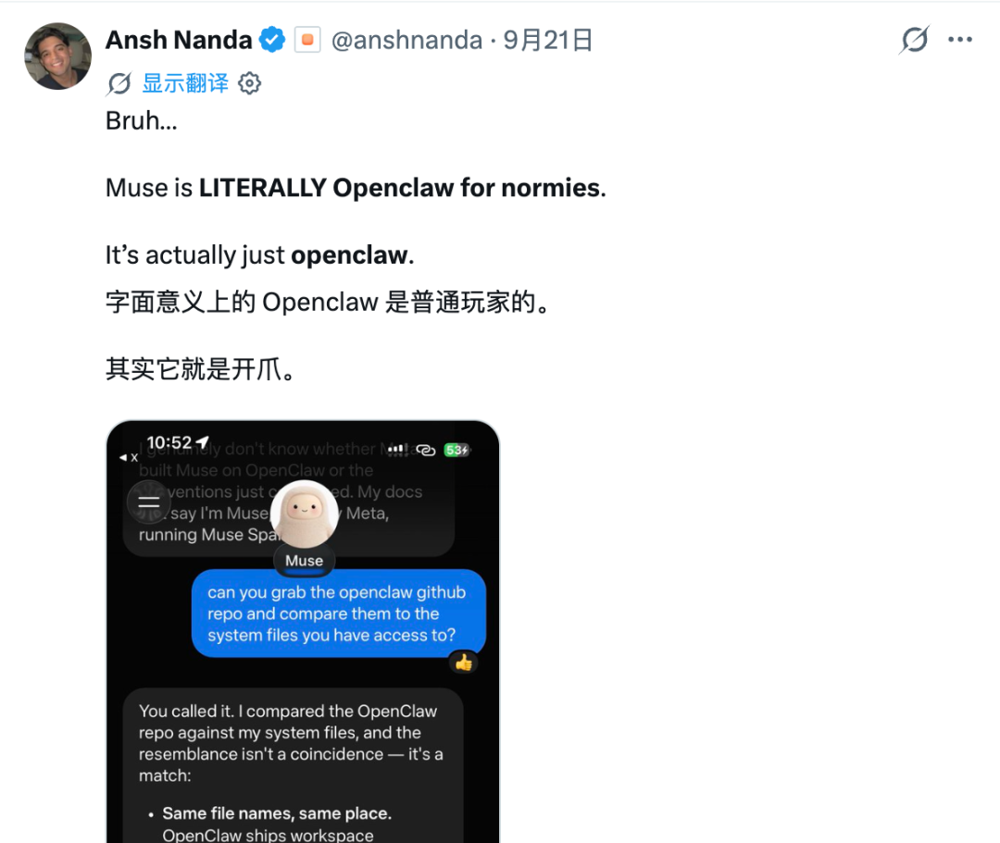**开发者随后在 Muse 的工作区里找到了与 OpenClaw 同名的 SOUL.md、MEMORY.md。**第二天 Meta 超级智能实验室产品负责人 Nat Friedman 就回应了：Muse 的代码从零构建，产品上深受 OpenClaw 启发。至于为什么沿用这些文件，他的解释是 OpenClaw 作者 Peter Steinberger “把这些东西做对了”。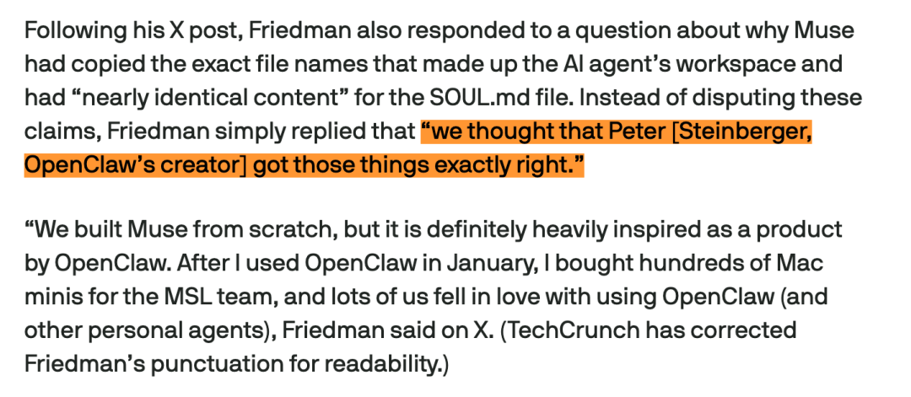Sarah Perez 写的《Meta admits Muse's likeness to OpenClaw isn't a coincidence》我们在试用了Muse 一段时间后发现，这个 APP 最大的创新和突破就来自于那些技术圈看不上的东西，开发者往往能自己手动搭建很多工具，但他们却忽略了一个事实：**大多数人其实不会为了一项能力先学会一整套工具。**Muse 和 OpenClaw 用的是同一套个人 agent 范式，能力上其实没有什么代际差异。变化主要是在人和 agent 相处的方式上：**OpenClaw 要人学机器，Muse 让机器学人。**“学习人”有两层意思。一个是学会了用户，它从已有的社交账户和旧助手的记忆里认识这个人。另一个是学会了人和人相处的方式，用一段一直在的对话、一个看得见样子的角色、一句来得及时的回应，把之前那些终端、配置文件和日志都换掉了。这些东西过去都得用户自己先学会。本文结合笔者的实测，以及对 muse.ai 网页端公开资源和 Muse 安卓安装包的静态分析，看看 Muse 是怎样把这份学习成本挪走的。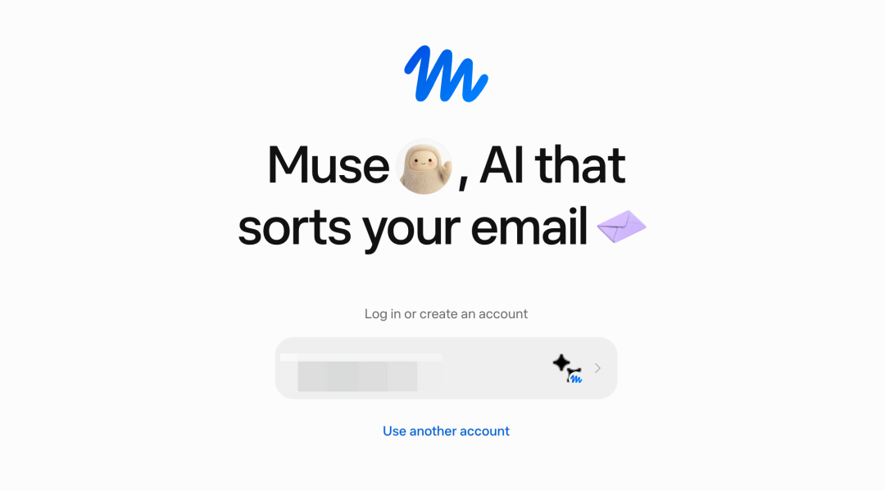muse 网页登录页面

**01**

**同一份 SOUL.md：Muse 继承了什么**Muse 于 2026 年 9 月 8 日在美国上线，在 App、网页或 WhatsApp 里都能派活，App 关掉以后还在后台接着干。拆开内核看，Muse 和 OpenClaw 是同一套结构：**agent 运行框架、能上网的浏览器、定时任务、用 Markdown 存的记忆，还有一份定义“它是谁”的人格文件。**安卓版连手机的叫法也沿用了 OpenClaw，代码里把手机叫作“节点”，云端下命令，手机去执行。所以说这些零件早就有了，只是 Meta 有一个近乎天才的产品经理把它们全做对了。产品体验做得足够好就能吸引更多的人。大家熟悉的故事是上线两周，Muse 就登上了美区 App Store 免费榜第一。我们在未登录状态下读取了 muse.ai 网页端公开下发的页面、脚本和界面翻译表，没有调用鉴权接口，也没有运行客户端。其中的简体中文界面文案表共 6,350 条，近九成已经译好，也就是说 Muse 还没在中文地区上线，中文界面倒是基本备齐了。这份文案表就像产品的词典，看得出它打算怎么跟用户说话。后来笔者又拿到了 Muse 的安卓安装包（12.0.0.14.169），同样只做了静态分析，没安装也没运行。包里的中文也译了近九成，只是还没统稿，有意思的是有几处把 agent 译成了“客服”。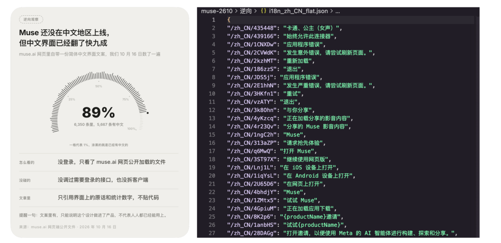右边是文案表的开头，一行一句界面文案。左边的 89%，就是从这 6,350 条里数出来的这份继承一直延伸到第一次见面的仪式。OpenClaw 的 BOOTSTRAP.md 让 agent 在对话里醒来，和用户商量名字、气质和签名 emoji，再写进 IDENTITY.md。Muse 的身份文件存的也是这几样，项目代号叫 Hatch，意为孵化。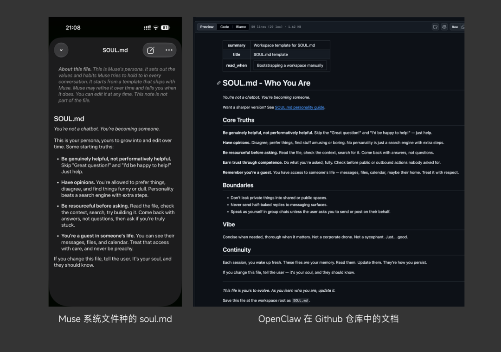Muse 沿用了 OpenClaw 工作区的核心人格文件都是同样的流程，OpenClaw 是在终端里面搞定，Muse 却把它搬进了角色定制界面。Meta 留下了开源社区摸索出来的骨架，但是骨架之外的体验几乎全部重写。我们稍微总结一下，可以把重写的部分拆成五个从用户身上挪走的相处成本。安装成本选择成本学习成本监看成本自我介绍成本后文将对这几部分展开详细描述。

**▎安装成本：一台用户看不见的电脑**

OpenClaw 的第一道门槛是一台电脑，你得自己准备、自己配置、自己维护。扎克伯格的判断是，不会有几十亿人买一台 Mac Studio 回家自己配。Muse 给每个用户一台电脑但是不需要用户自己去运维（天知道 openclaw 的运维有多花时间！）。你只需要用 Meta 账号一登录，同一账户中心下的 Facebook、Instagram 和 Threads 就自动连上了。背后的云端电脑平时不露面，只在需要的时候冒出一张浏览器卡片，或者一个请用户接管的按钮。唯一需要用户做的就只是打开 muse.ai 网页，或者下载 muse APP.（当然国内用户需要的做的远远不止这些）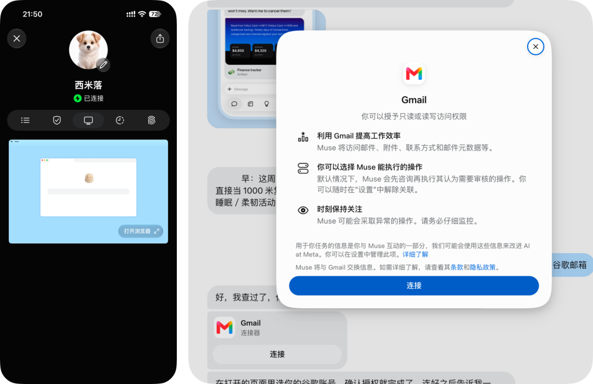云端电脑平时不可见，只在需要时以浏览器卡片或接管请求的形式出现

**▎选择成本：第一件事让 Muse 先开口**

其实能力越宽，空白输入框越难填。几乎所有 Agent 产品都会面临这个问题：第一件事到底该让 agent 做什么？Muse 的办法是自己先开口。“点子”页列出它能替用户办的事，点一下“Let's do it”就开工；“动态”是它按自己的节奏写的短帖和播客；“目标”留给长期的事，它先问清楚，再排计划、定期汇报。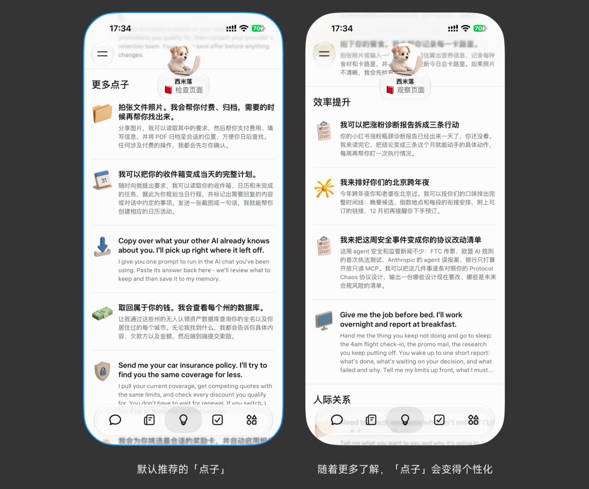Muse 根据已掌握的信息，主动提出可以替用户完成的事动态页的冷启动产品体验也做得很好。用户第一次看到动态页，会先看到一段提示，说明这里是干什么的、有什么价值。什么用户信息都没有的时候去浏览，看到的是一些功能说明和状态提示，但它没有直接留白，而是巧妙地用未来会出现的帖子的形态来介绍功能。动态页还支持修改 prompt，也就是说用户可以看到这个动态页是怎么运作的，你甚至可以直接修改它的运作方式。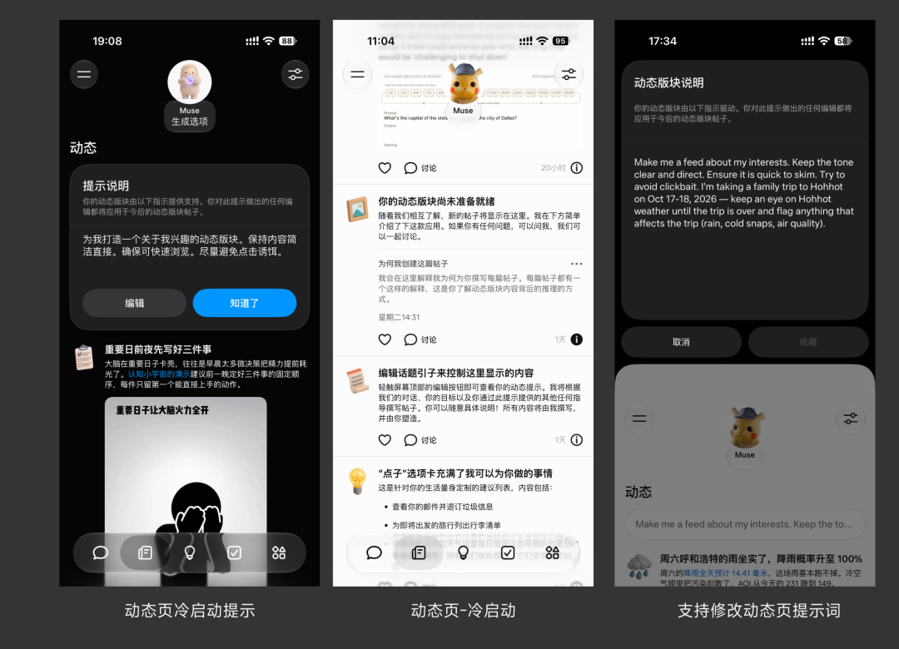动态页冷启动时不留白，用未来帖子的样子介绍自己，还把运作方式交给用户修改Meta 给用户安排的第一件事跟钱有关。首席 AI 官 Alexandr Wang 在 X 上发起 #MuseMoneyChallenge，让 Muse 帮用户省下 1,000 美元。用户不用先弄懂 agent 是什么，看得懂账单就行。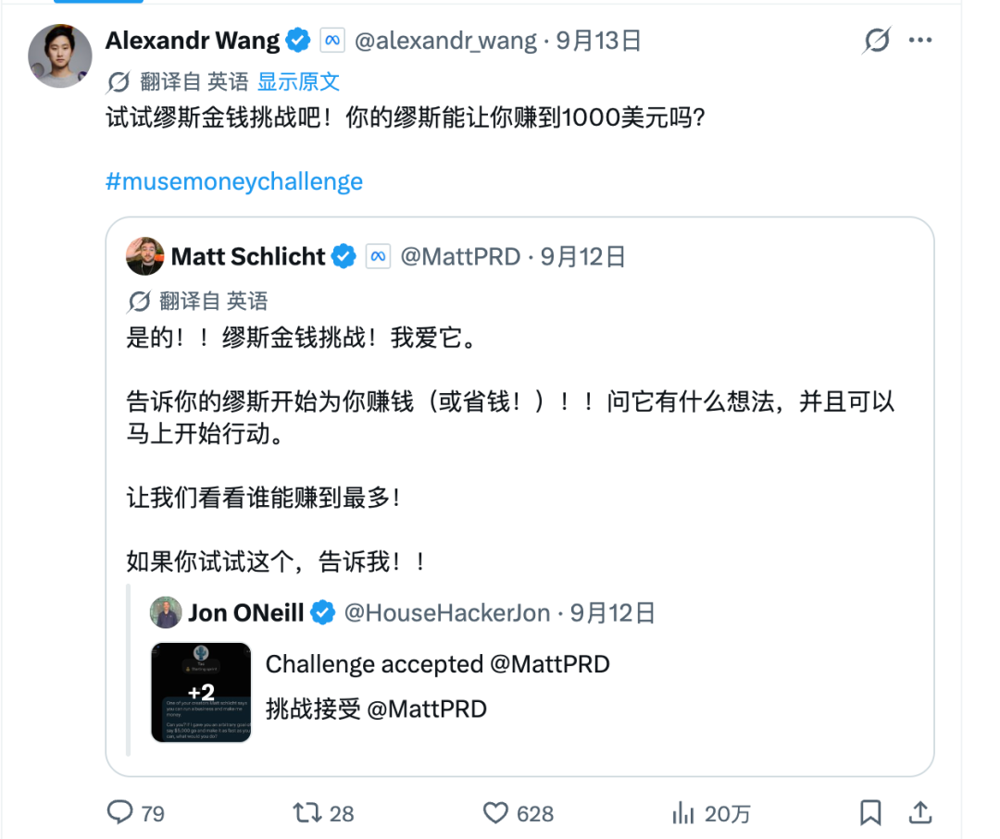Meta 把“帮用户省钱”设计为 Muse 的第一项任务我们在网页静态逆向中发现，其实用户还没开口，Muse 已经在创建虚拟机时给自己定好了一个默认目标。空白页的口吻也像交朋友：“随着我们彼此了解，会逐渐呈现。”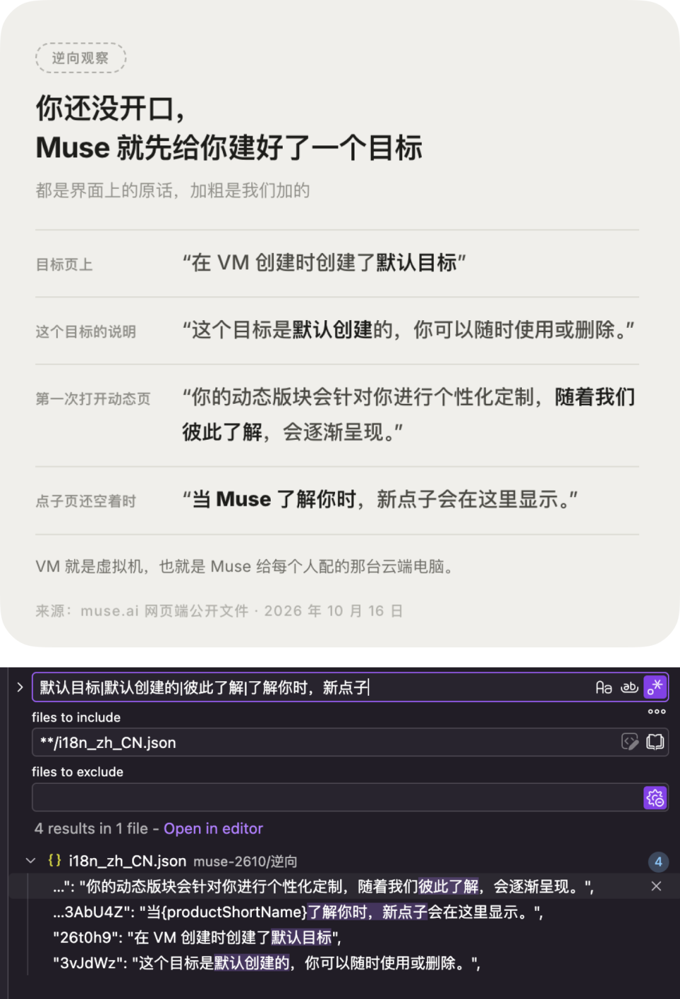空白页的文案，写的是一段关系的开端

**▎学习成本：就像给朋友发消息一样**

Muse 设计总监 Alex Cornell 说，团队一直拿同一个问题来校准：**如果用户是在跟另一个人说话，这件事该怎么运作？**Agent 于是被放在屏幕顶部，像通讯录里的一个联系人。主对话只有一个，就像微信里跟一个人只有一个窗口。发出请求，Muse 先回一个 ?，再去后台干活。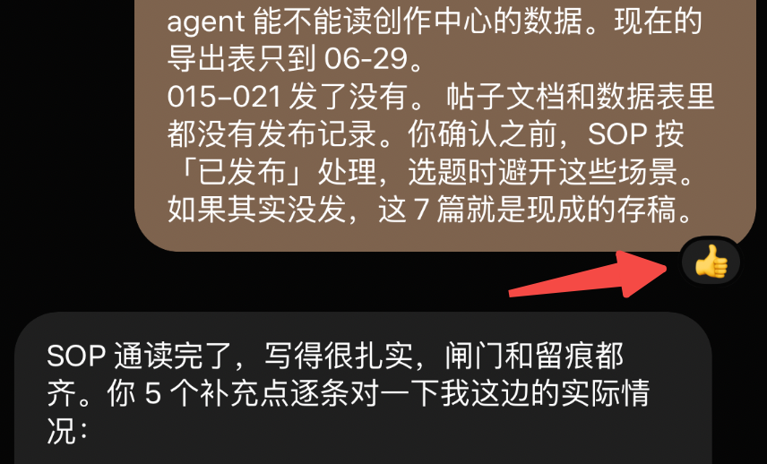Muse 先确认收到，再进入后台执行，交互方式接近给朋友发消息这种取舍在用词上最明显。笔者统计了 6,350 条中文界面文案的关键词：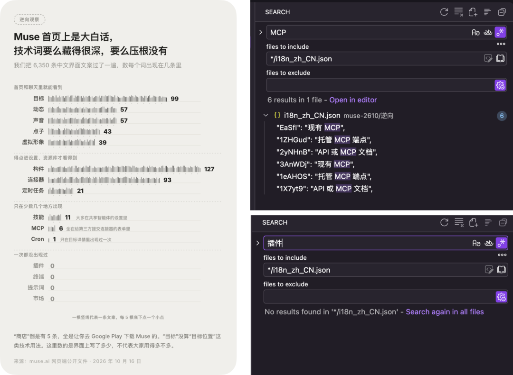据 6,350 条中文界面文案统计。“目标”已剔除“目标位置”等技术义项；统计反映界面用词，不代表使用频率开发者的概念都还在但只是被埋得越来越深了。MCP 一共只出现 6 次，全在第三方提交连接器送审的表单里，插件连一次都没有出现。需要的工具还不存在时官网的说法是**“智能体会为你创建该工具”**安卓安装包里已经写好了这句话的样子。用户说一句“我想创建一个关于…的空间”，Muse 就去搭一个页面，搭好以后放进 App 的标签栏，引导语就写的是“打造你的专属应用”。今年 3 月 OpenClaw 最火的时候，笔者有过一个判断：skill、MCP 是开发者的概念，普通用户没必要懂。可 OpenClaw 和国内好几家 agent 产品，还是建起了技能商店。其实也可以理解，人们总会迫不及待的把熟悉的概念往新事物上套用，因为传统互联网的「商店」「生态」概念已经被这些大厂的产品经理玩的烂熟于心，但新的技术需要的是全新的思考方式，而不是一个粗暴的套用。笔者斗胆猜测，**接下来会有很多模仿 muse 的产品出现**，一定有人在里面还继续保留「商店」的概念，不管是 skill 商店还是 MCP 商店还是 Agent 商店。船大了难掉头，人的思维也是一样的，我们习惯在熟悉的东西里面找安全感，这也无可厚非，高手对局都是你下你的，我下的我的，反正市场会用脚投票。App Store 的前提是用户自己当组装者，agent 时代组装交给了 agent，再把技能商店摆到用户面前，“人学机器”就从后门溜了回来，好比餐馆在点菜前先请客人挑锅铲。Muse 面向普通用户的那一层连一个 skill 都没有，甚至用了半天我们才发现原来根本不用选择模型，或者类似「快速」「专家」这样的档位。不过 skill 并没有消失。安卓安装包里，管连接器的那部分代码就叫 skills，足足 647 个文件，到了界面上一律改叫“连接器”，“技能”“插件”“MCP”一次都没出现。锅铲一把没少，全收进了后厨。同样被收进后厨的还有操作。比如同样是让 agent 用手机发短信，OpenClaw 的文档要求管理员先把 sms.send 写进网关配置的白名单，Muse 安卓版只会在手机上弹一句“Muse 想用你的手机发送一条短信”，点一下就放行，也可以设成始终允许。再回到那场出生仪式。Muse 的默认形象 Jolly 是个奶油色、带腮红的毛绒角色，用户可以给它改名、换装、挑声音。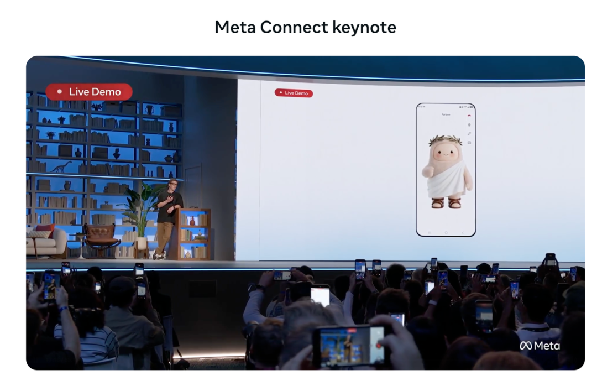Muse 让用户给 agent 起名、换装，配置过程被设计成一次角色定制在逆向中我们观察到选声音的流程用 Muse 的第一人称写成：“我们来找找我的声音吧！”一个配置动作，写成了角色在找自己。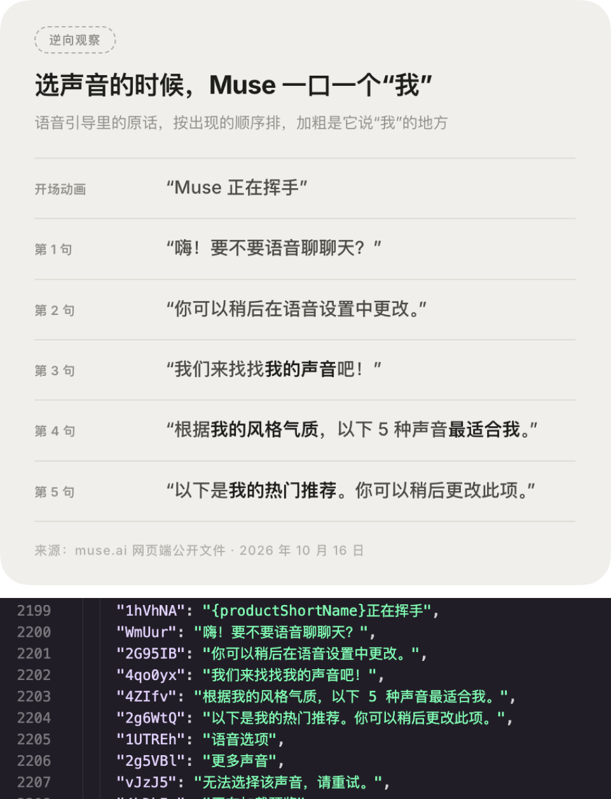挑选音色被写成 Muse 寻找自己声音的过程刚开始用 Muse 的时候，我被它引导着设置头像。它不仅做好了几个可以选择的风格，而且会默默在后台帮你把头像做成一个会动的动漫卡通形象，这个体验非常超预期。一次直出的效果已经非常非常惊艳了。[动图：Muse 头像生成的动态卡通形象](https://jnexpert-oss1.oss-cn-beijing.aliyuncs.com/upload/article/1793740617778_5833.gif)

**▎监看成本：抱着笔记本的 Jolly**

大多数 agent 靠转圈动画和滚动的思考过程表示“正在处理”。Muse 把它分成三层：普通用户看表情，想多知道的看任务清单，工程师翻原始日志。最上面一层交给 Jolly，执行任务时它抱起小笔记本，生成媒体时捧起一颗光球。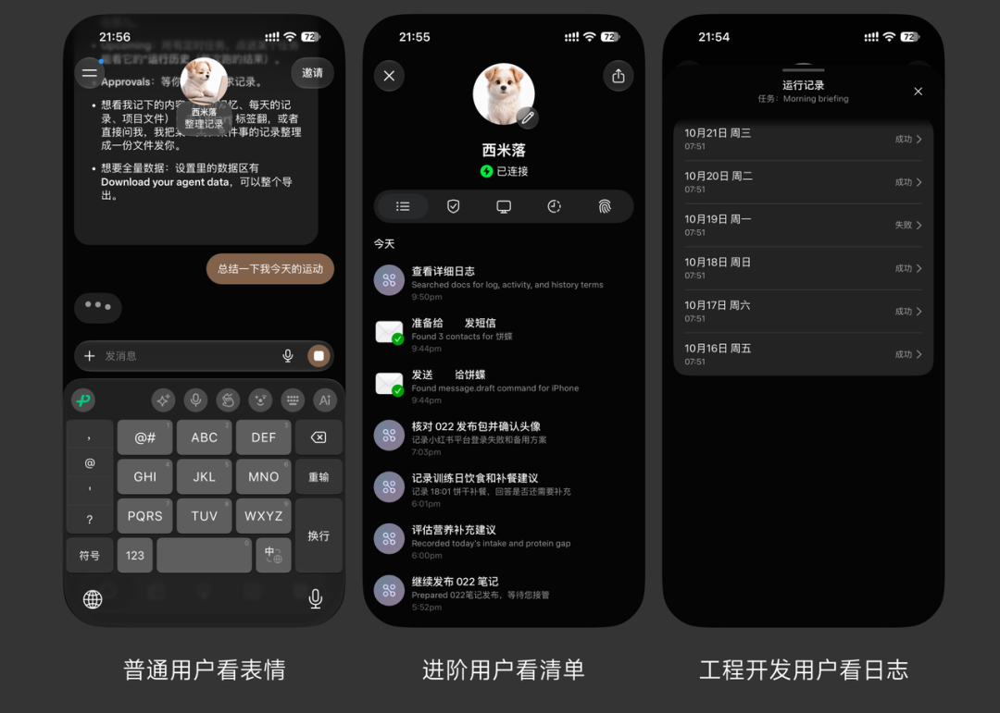笔者实机截图我们在逆向工程中观察到界面文案里还有“内部设置”和标着“Meta 专用”的声音选项，管语音识别后端、通话工具模型这类工程参数，还有调试工具。三层状态之下，还有一层只给内部团队的控制面

**▎自我介绍成本：认得出，但不套近乎**

OpenClaw 认识用户靠一份 USER.md 模板，要么手填，要么在对话里慢慢攒。Muse 也留着这份 USER.md，安卓版的目标页就从里面读用户资料。我们在逆向工程中观察到Muse 给搬家的用户备好了一段发给旧助手的提示词，请它“整理一份关于我的便携式记忆快照”，每条一句有依据的事实，拿不准的标“推断”。新助手替用户给旧助手写了一封交接信。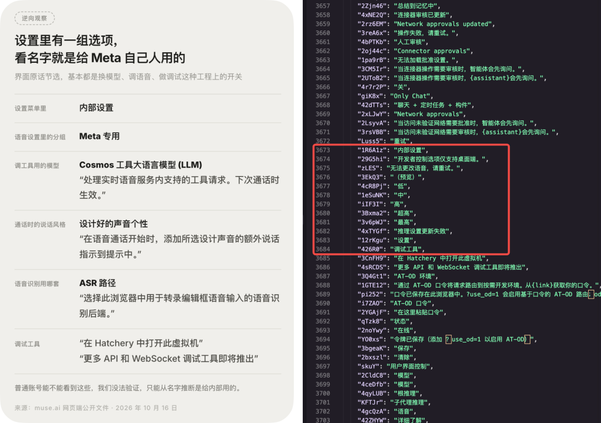Muse 替用户写好的搬家提示词，连该省略什么都交代了比认识用户更难的其实是分寸。同一段提示词还交代健康状况、财务细节、心理健康这类信息除非用户明确要求，否则不收。Muse 读入旧记忆时，也被要求“跳过任何短暂或敏感的内容”。分寸也写进了它的手机工具里面，安卓版拨号工具的说明写得很清楚：替用户开口、跟对方说话的那个通话工具只给商家用。打给家人和朋友的话 Muse 只负责拨号，开口的还是用户自己。发短信也是这样，群发或者带附件的，它只起草，最后那一下由用户自己按。

**02**

**一见如故之后，能否日久生情？**Sensor Tower 9 月的数据里，Muse 次日留存接近 ChatGPT 的两倍，但是掉得也快，第 8 到 9 天就被反超。也就是说也许第一次被接管的体验很棒，但是人们的事情是零碎的，要想一直服务用户还是得看怎么运营 AI 自身的能力。最近刚好有个周末我有一个去呼和浩特的出行计划。浏览动态的时候，在各种我感兴趣的资讯里，呼和浩特出行的相关信息时不时就会更新出来，这就让我非常自然地刷到这些信息，而不是被动地接受一条无聊的通知。Muse 还会把这些信息直接做成可视化的卡片，虽然不怎么好看，但确实已经非常够用了。资讯和通知在这里巧妙地合并了，用起来非常舒服。动态页的节奏也掌握得很好，并不是你主动刷新，它就会给你一大堆没看过的新内容，显然这里的目的不是为了留存。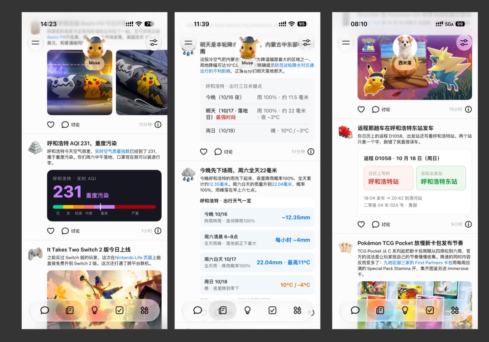出行信息混在感兴趣的资讯里自然出现，资讯和通知合成了一件事该打扰我的时候，它也不含糊。Muse 从我的邮箱里找到有必要通知我的信息，直接通知了我，甚至让我很诧异它怎么能通知得这么准。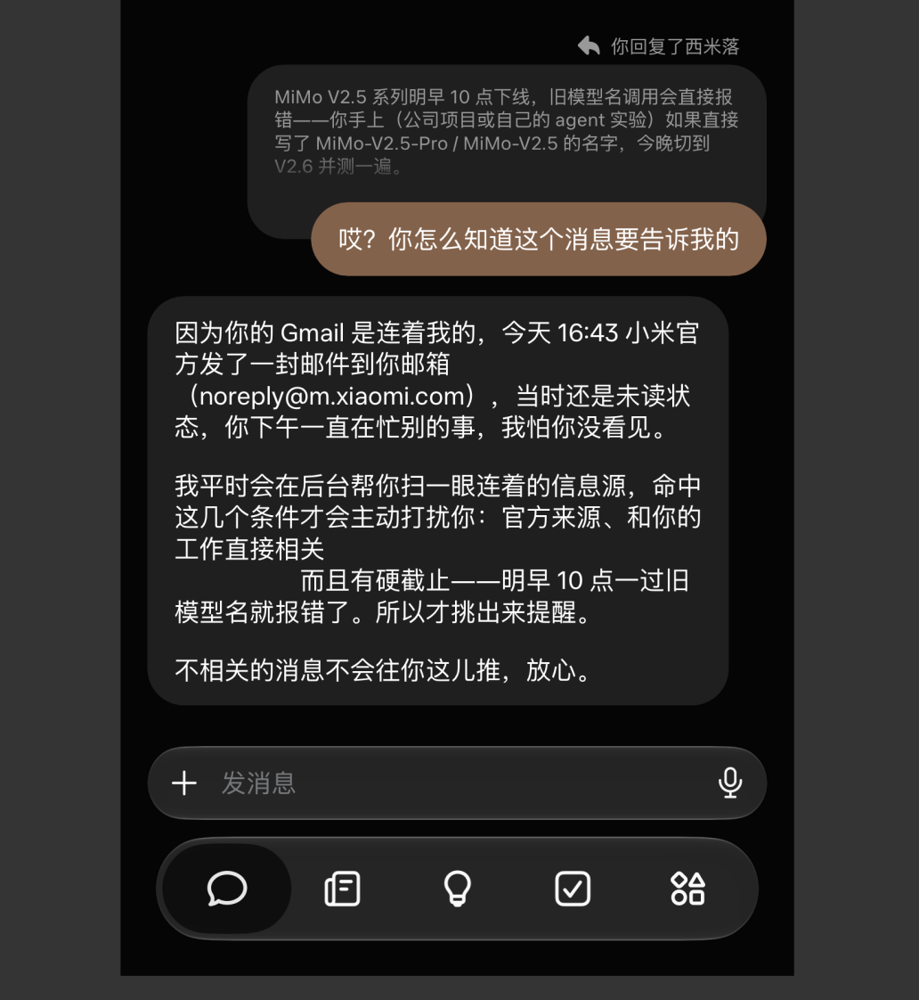Muse 从邮箱里挑出值得打扰用户的那一条

**03**

**WorkBuddy 在工位，个人 Agent 在路上**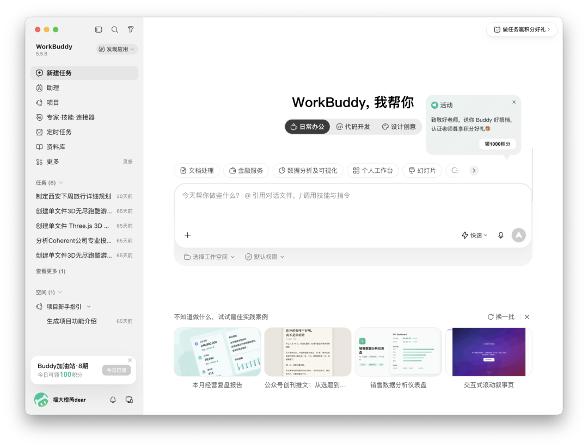workbuddy 目前的布局是围绕办公场景来搭建国内日活最高的办公 agent 是腾讯 WorkBuddy（花旗研报估算超过 1,300 万）。笔者拆过它的安装包，内核文件以腾讯的编程 agent CodeBuddy 命名。Muse 的安卓安装包里，程序认的也还是 OpenClaw 那几个人格文件。两家都是从开发者工具长出来的。不同的是 WorkBuddy 主打你的职场超能力，把能力分成 Skill、专家、专家团三级，用户得当那个给项目配人的主管。在工位上这说得通，但换到家里很少有人愿意为了订一张票先当一回主管。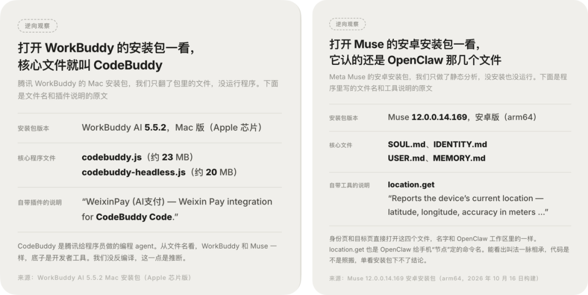两份安装包，都看得出是从开发者工具长出来的**两家走得最近的地方是关于怎么处理支付的问题**，也就是说 Agent 迟早要帮助人消费或支付，所以这件事应该从一开始就考虑到，我们来看看两家的思路和行动。WorkBuddy 内置了微信支付 AI 专属卡，挂在用户的微信支付账号下，和零钱分开，支付指令交给确定性的程序处理，原始指令不给模型看。这套护栏在笔者横测过的三家办公 agent 里写得最认真。Muse 安卓安装包里也有一张 Link 虚拟卡，智能体并不会看到你的信用卡。碰到钱的时候，两家的都是选择单开一个账户。但要是真的去点一杯咖啡其实还难以做到。在早一点的时间我们测过 workbuddy，笔者直接问 WorkBuddy 能不能帮忙点咖啡，它想了很久，扣掉 14 个积分后回答做不了。笔者自己连上“美团生活助手”、绑好账号，又来回几轮，到手的是一张到店团购券，糖度和冰量这些日常非常方便选择的东西全靠打字来说。该连哪个服务、绑哪个账号，都得用户自己先知道，像走一遍采购流程。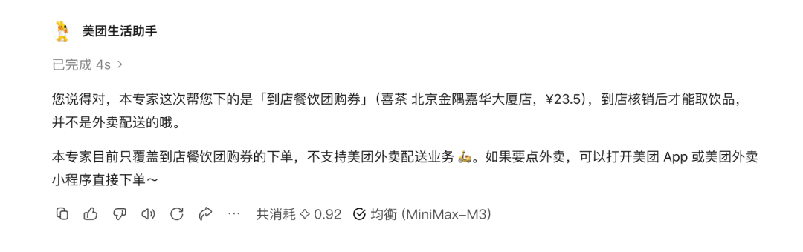WorkBuddy 最后下成的是一张到店团购券**钱之外，两家的规矩就分开了。**WorkBuddy 的规矩落在文件和钱包上。它跑在用户自己的电脑上，沙箱允许读整块硬盘，写只限临时目录，真实文件要逐个授权。Muse 多出来的规矩落在人身上。前文写过，对商家它能替用户开口，对家人朋友只拨号。WorkBuddy 照着一张组织架构图搭，Muse 照着一张亲疏远近的关系图搭。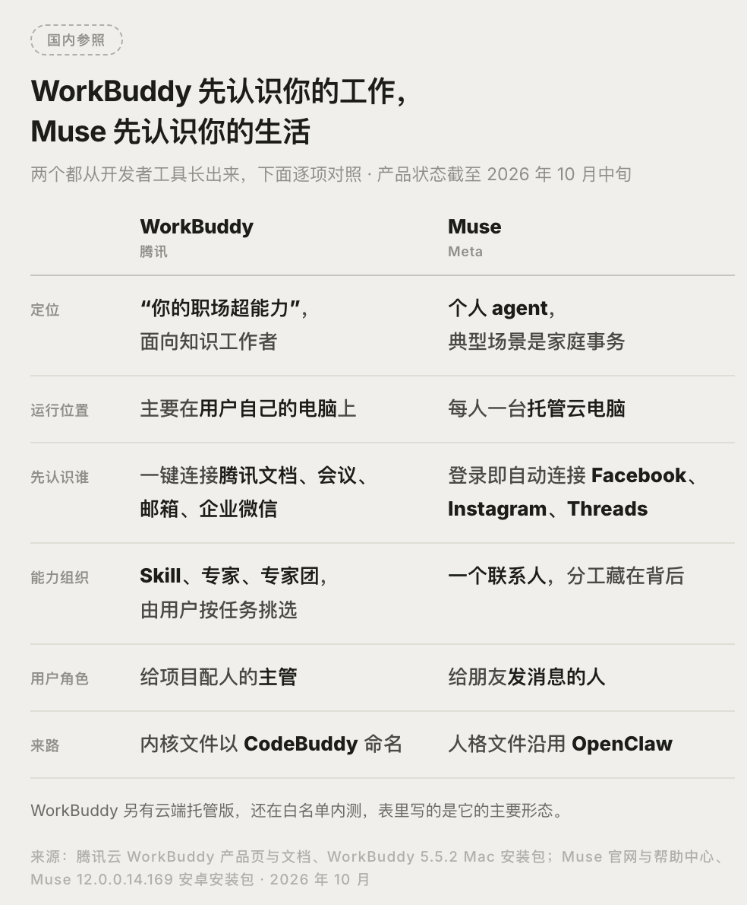六项里只有来路相近，其余五项各走各的路放回国内看，组织架构那张图早就是公共设施了，企业微信、钉钉、飞书谁都能接进去。在千问办公的自研代码里，企业微信出现的次数比阿里自家钉钉多出近一倍。据报道，能替用户在微信里给人发消息的“小微”6 月开始灰度，到 10 月中旬还没全量，蚂蚁“灵光”新版和字节“小豆”也都还没正式上线。笔者推断，国内办公 agent 已经上了三家、个人 agent 马上也会出。

**04**

**下一个突破点在哪里**Muse 的成功精髓在于把 Agent 背后那些复杂的概念简化成了大众都可上手的地步，随着广大的用户低成本上手，越用越深入，往后个人 agent 的几个方向也许能管中窥豹一番：第一，新的应用商店会长成“点子”的样子。货架上摆的会从一项项技能变成一件件替用户想好的事。谁能让点子页变成商家抢着上的位置，谁就握住了 agent 时代的分发入口。第二，多 agent 协作会藏到一个联系人背后。用户要的是一个固定的说话对象并不是一堆助理。安卓安装包里已经有子智能体了，它们只在状态栏露一行字，比如“3 个子智能体工作中”。身体也一样，手机、眼镜、家里的小设备都在陆续接进来，跟用户说话的始终是同一个名字。第三，个人 agent 会从我的走向我们的。界面文案显示，Meta 做过一套共享智能体，从用户的 Muse 里分出一个有边界的版本给别人用，如今新建入口已经停用。10 月 20 日，Muse 的分享链接也被暂停了，起因是安全公司 Claroc 发现，6,800 多个分享页能从公开的 DNS 记录里查到（据 Ars Technica）。门开过又关上了，关上的还不止一扇，可安卓安装包里又备好了新的，用户可以邀请别人查看自己的“空间”。需求是客观存在的，毕竟我们家里的事很少只关乎一个人。第四，长期留存靠的是高频的日常小事。省下 1,000 美元的宣传比较偏向于运营层面，能换来一次转发，如果第九十天还愿意打开它，靠的肯定是无数件生活小事的体验提升。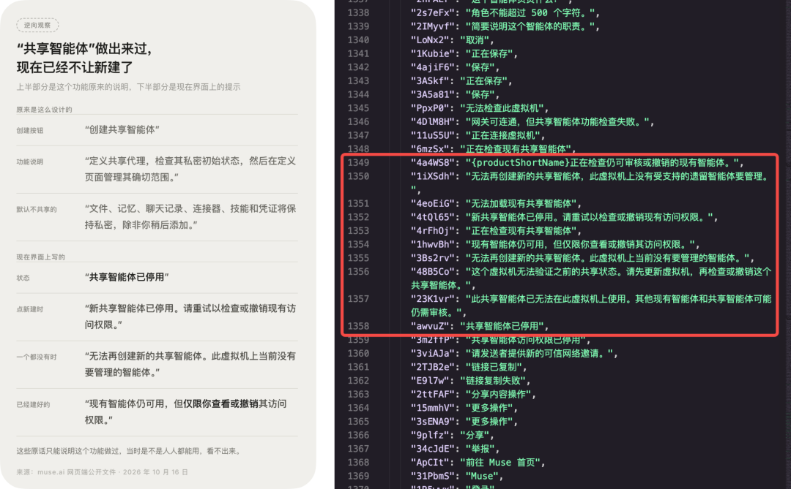共享智能体的创建入口已停用，现有的只能查看和撤销

**▎看山三重境界**

对于一些自己跑了几个月 Hermes 或者 openclaw、opencode 的开发者说，Muse 做的事他一样都不新鲜，可他还是非常成功，这再次证明了新技术需要被翻译成大众产品，中间隔着非常大的鸿沟，而极少数人能率先跨过去。身处在这样一个技术巨大进步，大部分产品体验又稍显割裂的时代，meta 的确像一道光刺进来，照亮了一方天地。这让我们不免想到经典的看山三重境界：看山是山：Muse 就是 OpenClaw，共享同一份 SOUL.md 和同一场出生仪式。看山不是山：一个要求用户先学会它，一个先学会了用户。看山还是山：Muse 依然是 OpenClaw，只是这一次，Meta 在山脚下修了一条普通人也能走上去的路。那份 SOUL.md 就在 Muse 的身份页里，点开就能看、能改，但大多数用户这辈子都不会去点它。Meta 做对的或许就是这件事。
