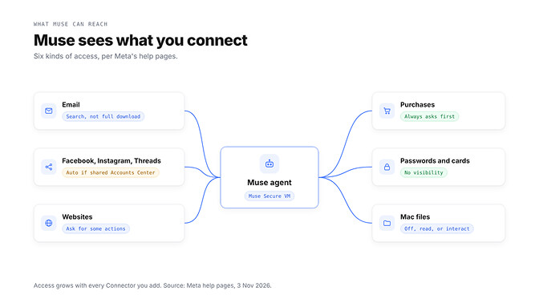
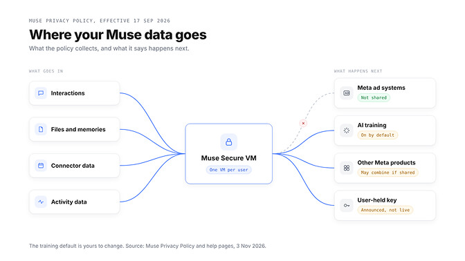
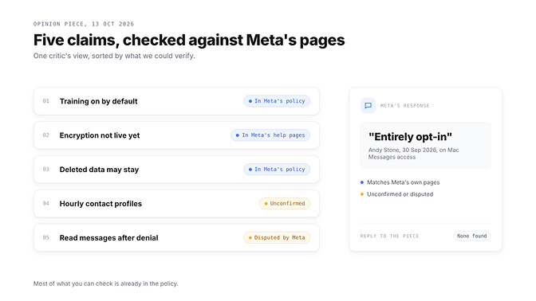
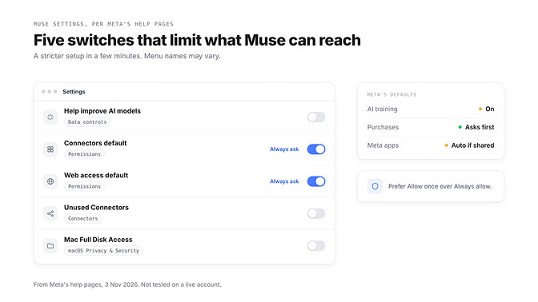
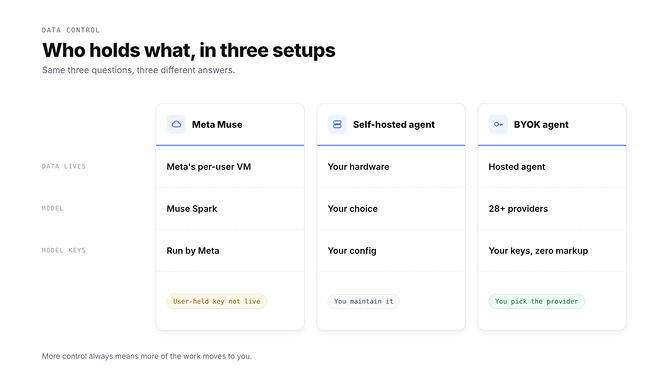



**收录说明**：直接下载后用 extract.py 抽取；5 张信息图已下载到 images/（每张 27–40 KB）。发布方 BetterClaw 为竞品托管智能体厂商（OpenClaw 系），文末有自家产品的推广段落，已保留在原文中；正文分析本身逐项对照 Meta 官方页面（作者称 2026 年 11 月 3 日核对）与 Paul Walsh 的批评逐条核验，并标注未能确认的主张。原文全文存于本目录的 original.md，网站上不显示，已翻译。

**内容摘要**：作者以 Meta 官方页面为据（2026 年 11 月 3 日核查），指出 Muse 于 2026 年 9 月 8 日发布，每位用户配有独立云端虚拟机、购买前需确认、不与 Meta 广告系统共享对话数据，但可访问已连接的服务，且 AI 训练默认开启、用户自持密钥的加密尚未上线。隐私政策于 2026 年 9 月 17 日生效；Facebook、Instagram 与 Threads 在同一 Accounts Center 下自动连接，密码与卡片对 Muse“无可见性”，Mac 全磁盘访问“覆盖全部文件”。训练设置默认开启，关闭后亦覆盖此前交互；删除后 Muse 仍可能记得从已删内容学到的信息；截至 2026 年 11 月 3 日，Confidential VM 仍显示为未来推出。针对 Paul Walsh 2026 年 10 月 13 日的 Substack 文章，作者核查后认为训练默认开启、加密未上线、已删内容仍可能被记住三项与官方页面相符，每小时画像的说法无法确认，读取消息的说法有争议——Meta 发言人 Andy Stone 2026 年 9 月 30 日称 Mac Messages 集成“完全自愿加入”，作者未找到 Meta 对 Walsh 文章的直接回应；文末给出 8 项收紧设置。

**保留理由**：这是已收资料中唯一一篇对照 Meta 官方页面逐项核查 Muse 权限、数据去向与训练默认设置的隐私分析，并逐条检验了 Walsh 批评的成立程度，附可操作的 8 项设置清单。

---

Meta 自己的隐私条款、批评者的主张，以及限制 Muse 可访问范围的设置。

**Meta Muse 安全吗？** 就日常杂务而言，Meta 确实建立了真正的防护栏：每位用户一台隔离的云端机器、购买前需批准、不与 Meta 的广告系统共享。问题在于可触及的范围。Muse 能与你连接的任何东西协作，AI 训练默认开启，而 Meta 宣布的用户自持密钥加密尚未上线。

设想这样一个场景。晚上 11 点，Muse 正订到一半明天的火车票，忽然停下来请求许可。五个按钮：*仅允许一次、允许此任务、允许此站点、始终允许、拒绝。*

你的拇指滑向「始终允许」。时间不早了，而且它这一周都很有用。

那短暂的停顿正是全部问题所在。下文每一项说法都来自 Meta 自己的页面，核对于 2026 年 11 月 3 日；批评者的主张会另行标注。

还在几个智能体之间犹豫？我们的 [OpenAI Dots、Meta Muse 与 Grok Bot 对比](https://www.betterclaw.io/blog/openai-dots-vs-meta-muse-vs-grok-bot) 讲的是各自能做什么。本文讲的是你交出了什么。

## Meta Muse 到底是什么，以及它为何似曾相识

Meta 于 2026 年 9 月 8 日发布 Muse，称其为「安全、私密的个人 AI 智能体」。它会行动，而不只是回答：发送邮件、预订行程、填写表单和购物。

你可以在 Muse 应用里或「直接在 WhatsApp 中」与它对话，关闭应用后它仍会继续工作。

| 项目 | Meta 发布公告的说法 |
| --- | --- |
| 模型 | Muse Spark，Meta「迄今最强的模型」 |
| 运行位置 | Muse Secure VM，每人一台云端机器 |
| 出站检查 | 任何内容都不会到达互联网，「除非 Sentinel 批准」 |
| 可用范围 | 正在美国面向 iOS、Android 和 muse.ai 推出 |

下面这一点 OpenClaw 用户会看出来。2026 年 9 月 21 日，负责 Meta Superintelligence Labs 产品的 Nat Friedman 在 X 上回复称，Meta「从零开始构建了 muse」，但它「作为产品绝对深受 openclaw 启发」。

帮助页面也印证了这一点：你的 Muse 会维护可编辑的 MEMORY.md 与 Soul.md 文件，这些名称同样出现在 OpenClaw 的文档中。

## 连接之后 Muse 能看到什么

Meta 把 Muse 的各类集成称为连接器（Connectors），并称 Muse 与每个连接器之间只交换「所需的数据」。

多数人正是在这里弄错。如果 Facebook、Instagram 和 Threads 与你的 Muse 账户同属一个 Accounts Center（账户中心），它们会被「自动连接」。你不需要点任何东西。

| 访问权限 | Meta 页面上的说法 | 在哪里更改 |
| --- | --- | --- |
| 邮件 | 可以「搜索你的邮件」，除非被要求，否则不会下载整个收件箱 | 设置、连接器 |
| Facebook、Instagram、Threads | 在共享的 Accounts Center 中「自动连接」 | Accounts Center |
| 网站 | 可在共享数据或访问不熟悉的网站前询问 | 设置、权限 |
| 购买 | 在「敏感操作（如……购买）之前」与你确认 | 批准提示 |
| 密码与卡片 | 「无可见性」 | 不是一项设置 |
| Mac 文件 | 全磁盘访问「覆盖你 Mac 上的所有文件」 | Muse 设置、macOS |

许多连接器可以设为只读。而那个五按钮提示很关键：「始终允许」会让 Muse「不再询问」就重复该操作。

另外：「Meta 不审查自定义连接器。」你添加一个，你就是审查者。

> 安全问题其实不在于 Muse，而在于你把它连接到了什么。

## Meta 说它保存什么，又如何使用

Muse 隐私政策于 2026 年 9 月 17 日生效。哪些东西会被收进去？政策列出四类数据：

- 交互信息，包括「关于你或他人的信息」
- 文件与记忆，例如 MEMORY.md
- 来自连接器的邮件与日历事件
- 活动信息，例如「访问过的网站、操作与交易」

Meta 的 Mac 帮助页面补充说，交互信息还可能包括「你屏幕的截图」。接下来是真正重要的部分：这些数据流向哪里。

**广告：不会。** Muse「不会与 Meta 的广告系统共享你的对话或虚拟机中的数据」，即使你的 Accounts Center 包含其他 Meta 产品。

**AI 训练：会，除非你关闭。** 政策说得很直白：「此设置在你首次使用 Muse 时即处于开启状态。」保持开启时，Meta 称会剥离部分标识符；关闭后，该选择也覆盖此前的交互。

在共享的 Accounts Center 中，Meta「可能跨个人资料与设备合并并使用你的信息」，Muse 政策另有规定的情况除外。

删除大体上有效。政策称，Muse 仍可能「记住」它从你已删除的内容中学到的信息。

**加密：尚未提供。** Muse Confidential VM 使用只有你持有的密钥加密，「因此连 Meta 也无法访问」，已宣布将于今年晚些时候推出。截至 2026 年 11 月 3 日，Meta 的帮助页面仍称其将在「未来」推出。

> 「没有任何自动化系统是完美的。」这话出自 Meta 自己的帮助页面，也是其中最有价值的一句话。

## Meta Muse 安全吗？批评者的质疑在这里

最尖锐的批评来自 Paul Walsh，他于 2026 年 10 月 13 日在自己 Substack 上发文，标题为「Meta 的 Muse AI 智能体是伪装成 AI 助手的商业监控网络」。

他依据他人报道提出的主要主张：

- 据媒体报道，按小时生成用户生活中相关人物的画像，包括非用户
- AI 训练默认开启
- 在能够阻止 Meta 自身访问的加密上线之前就发布
- 让 Muse 忘记并不保证原始内容被删除
- 一名记者称，在他拒绝授权后 Muse 仍读取了他的消息

他的结论是：「鉴于 Meta 的历史，做最坏的打算。」请继续往下看：这些主张并不都一样。

其中三项与 Meta 自己的页面相符：训练默认开启、Confidential VM 尚未推出，以及已删除的内容仍可能被 Muse 记住。

每小时画像的说法依据的是关于内部提示词的报道，Meta 的公开页面未涉及这一点。我们无法确认。

读取消息的说法存在争议。Meta 发言人 Andy Stone 于 2026 年 9 月 30 日在 X 上写道，Mac 信息集成「完全自愿加入」：「除非你这样做，否则它无法读取你的信息。」我们没有找到 Meta 对 Walsh 文章的直接回应。

## 开箱即用的 Meta Muse 够安全吗？八项值得更改的设置

这些来自 Meta 的帮助页面，而非实际账户，因此菜单名称可能不同。同样的最小权限习惯适用于任何智能体；我们的 [OpenClaw 安全指南](https://www.betterclaw.io/blog/openclaw-security-2026) 针对自托管部署介绍了这些做法。

先从应用内开始：

1. 关闭 AI 训练：设置、数据控制、「帮助改进我们的 AI 模型」。
2. 在设置、权限下，把连接器与网页访问的默认值设为「始终询问」。
3. 断开你不用的连接器，在有只读选项时选择只读。断开连接不会抹去 Muse 已经学到的内容。
4. 用「仅允许一次」代替「始终允许」，并检查「已允许的网站」。
5. 检查它的记忆：助手图标、身份、记忆。编辑 MEMORY.md，或让 Muse 忘记某个话题。

还有三项在主菜单之外：

6. 不要让 Muse 进入你的主 Accounts Center。Meta 称你可以「用未与现有账户关联的邮箱」注册。
7. 在 Mac 上，使用 Muse 设置中的文件系统访问权限，或在 macOS 的隐私与安全性中移除全磁盘访问权限。
8. 不再用了？在数据控制下下载你的 Muse 数据，然后重置 Muse。Meta 警告重置「无法撤销」。

设置能缩小 Muse 可触及的范围，但不会改变谁在运行模型。

想要一个由你选择模型、由你持有密钥的智能体？BetterClaw 采用 BYOK（自带密钥）运行，零加价。[60 秒内启动你的智能体](https://app.betterclaw.io/sign-in)

## Muse 与自托管或 BYOK 智能体：谁真正持有你的数据？

数据控制归结为三个问题：谁持有数据、哪个模型能看到它、密钥存放在哪里。我们的 [BetterClaw 与 Muse 对比](https://www.betterclaw.io/compare/muse) 讲功能；这张表讲控制权。

| 问题 | Meta Muse | 自托管智能体 | BetterClaw（BYOK） |
| --- | --- | --- | --- |
| 谁持有数据 | Meta，在每位用户各自的云虚拟机中 | 你，在你运行的硬件上 | BetterClaw 托管智能体 |
| 哪个模型能看到它 | Muse Spark，Meta 自有模型 | 你配置的任何模型 | 你从 28 家以上提供商中挑选 |
| 模型密钥存放在哪里 | Meta 运行模型 | 你自己的配置 | 你自己的提供商密钥，零加价 |

自托管给你最大的控制权。但打补丁、备份和安全防护也得你自己做，而且除非模型在本地运行，你的提示词仍会发送到模型提供商。

托管式智能体，包括我们自己的，仍意味着要把智能体的运行环境托付给提供商。我们不会假装不是这样，所以在接入工作邮箱之前，请先阅读任何提供商的安全页面。

BYOK 改变的是模型这一侧。你选择提供商、自己持有该账户，并且可以把密钥带到别处。

那么我们的结论是什么？Muse 不是陷阱，也不是保险库。它是一款能力不俗、防护栏合理的智能体，有一项值得更改的默认设置，还有一项尚未兑现的加密承诺。

> 智能体的私密程度，取决于你为它开了多少扇门。一次开一扇，不再使用的就关上。

🚀 试试 BetterClaw

**想对智能体数据的去向有更多话语权？**

BetterClaw 在你选定的模型提供商上运行你的智能体，使用你自己的密钥，在 28 家以上提供商上零加价。模型账户始终在你名下。Starter 每月 19 美元，Pro 每月 49 美元（按年计费为 39 美元），Business 每月 149 美元，Enterprise 为定制价格。

BetterClaw 已通过 ISO 27001 认证，SOC 2 Type II 审计正在进行；我们的[安全页面](https://www.betterclaw.io/security) 说明了我们如何处理你的数据。首个工作区可享 7 天免费试用。[查看方案与价格](https://www.betterclaw.io/pricing)

## 常见问题

### Meta Muse 是什么？

Meta Muse 是 Meta 于 2026 年 9 月 8 日发布的个人 AI 智能体。它会替你发送邮件、预订行程和购物。Meta 的 Nat Friedman 称它从零构建，但「作为产品绝对深受 openclaw 启发」。

### Meta Muse 安全吗？

Meta 建立了真正的防护栏：每位用户一台隔离的云端机器、购买前需批准、不与广告系统共享。风险随你连接的东西而增加，AI 训练默认开启，用户自持密钥的加密尚未上线。

### Muse 收集哪些数据？

Muse 隐私政策列出你的交互信息、文件与记忆、连接器数据（如邮件），以及活动信息（如访问过的网站）。Meta 的主要隐私政策同样适用。

### Muse 能读取我的 WhatsApp 或 Instagram 消息吗？

在共享的 Accounts Center 中，Instagram 会自动连接，但 Meta 的页面没有说明这是否包括私信。你在 WhatsApp 中发给 Muse 的内容会成为你 Muse 交互信息的一部分。

### 我如何限制 Muse 可访问的范围？

在设置、数据控制下关闭「帮助改进我们的 AI 模型」。在设置、权限下把连接器与网页访问的默认值设为「始终询问」，并避免使用「始终允许」。

### 更私密的替代方案是什么？

使用本地模型的自托管智能体能将数据留在你的机器上，但需要你自己维护。使用自有模型密钥的托管式智能体介于两者之间。我们关于 [Muse 与其他托管式智能体如何比较](https://www.betterclaw.io/blog/betterclaw-vs-muse-vs-instinct-2026) 的指南讨论了这些取舍。

### 只为隐私而自托管值得吗？

只有当你想把数据放在自己控制并愿意维护的硬件上时才值得。你在服务器、更新和安全上投入的时间才是真正的成本。
