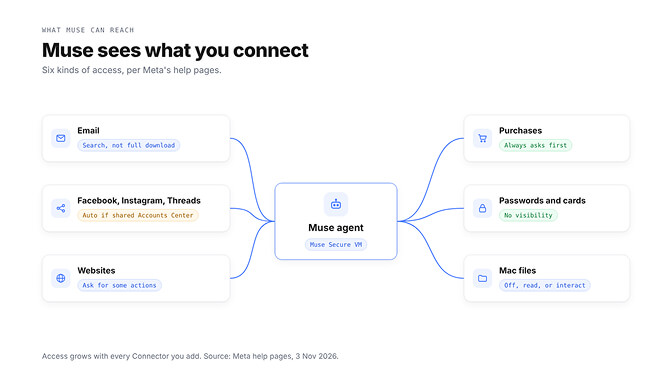
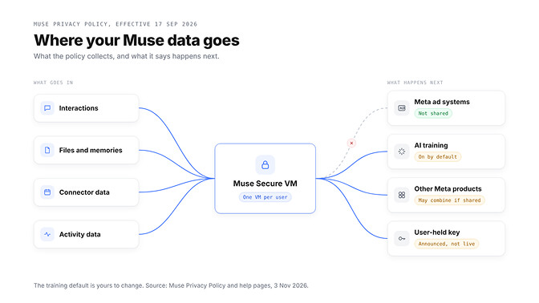
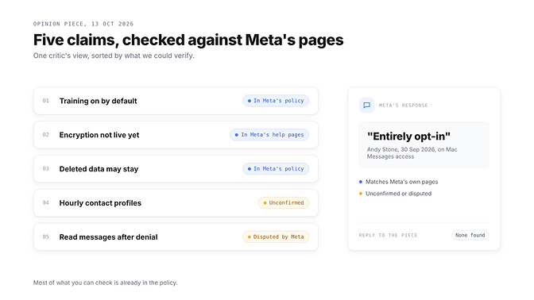
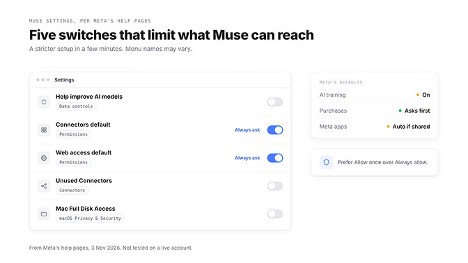
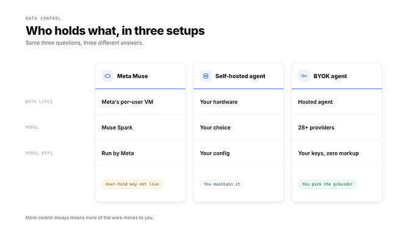

来源：https://www.betterclaw.io/blog/is-meta-muse-safe-privacy
取文：2026-11-07，直接下载后用 extract.py 抽取

Meta's own privacy terms, what critics claim, and the settings that limit what Muse can access.

**Is Meta Muse safe?** For everyday errands, Meta has built real guardrails: an isolated cloud machine per user, approval before purchases, and no sharing with Meta's ad systems. The catch is reach. Muse can work with whatever you connect, AI training is on by default, and the user-held encryption Meta announced is not live yet.

Picture this. It's 11 PM, Muse is halfway through booking tomorrow's train, and it stops to ask permission. Five buttons: *Allow once, Allow for this task, Allow for this site, Always allow, Deny.*

Your thumb drifts toward Always allow. It's late, and it has been helpful all week.

That small pause is the whole question. Every claim below comes from Meta's own pages, checked on 3 November 2026; critics' claims are labelled.

Still choosing between agents? Our comparison of [OpenAI Dots, Meta Muse and Grok Bot](https://www.betterclaw.io/blog/openai-dots-vs-meta-muse-vs-grok-bot) covers what each one does. This one covers what you hand over.

## What Meta Muse actually is, and why it feels familiar

Meta announced Muse on 8 September 2026 as "a secure, private personal AI agent." It acts, not just answers: sending emails, booking travel, filling out forms and buying things.

You talk to it in the Muse app or "directly in WhatsApp", and it keeps working after you close the app.

| What | What Meta's announcement says |
| --- | --- |
| Model | Muse Spark, Meta's "most capable model to date" |
| Where it runs | Muse Secure VM, a cloud machine per person |
| Outbound check | Nothing reaches the internet "unless the Sentinel approves it" |
| Availability | Rolling out in the US on iOS, Android and muse.ai |

Here's the part OpenClaw users will spot. On 21 September 2026, Nat Friedman, who leads product at Meta Superintelligence Labs, replied on X that Meta "built muse from scratch" but that it is "definitely heavily inspired as a product by openclaw."

The help pages show it: your Muse keeps editable MEMORY.md and Soul.md files, names OpenClaw's docs use too.

## What Muse can see once you connect it

Meta calls Muse's integrations Connectors and says Muse exchanges "only the data that's needed" with each one.

This is where most people get it wrong. Facebook, Instagram and Threads are "connected automatically" if they share an Accounts Center with your Muse account. You don't tap anything.

| Access | What Meta's pages say | Where to change it |
| --- | --- | --- |
| Email | Can "search your email", no full inbox download unless asked | Settings, Connectors |
| Facebook, Instagram, Threads | "Connected automatically" in a shared Accounts Center | Accounts Center |
| Websites | Can ask before sharing data or visiting unfamiliar sites | Settings, Permissions |
| Purchases | Checks with you "before sensitive actions such as … purchases" | Approval prompt |
| Passwords and cards | "no visibility" | Not a setting |
| Mac files | Full Disk Access "covers all the files on your Mac" | Muse settings, macOS |

Many Connectors can be read only. And that five-button prompt matters: "Always allow" lets Muse repeat that action "without asking again."

Also: "Meta doesn't review custom connectors." Add one, and you're the reviewer.

> The safety question isn't really about Muse. It's about what you connect to it.

## What Meta says it keeps, and what it does with it

The Muse Privacy Policy took effect on 17 September 2026. What goes in? It lists four kinds of data:

- Interactions, including "information about you or others"
- Files and memories, such as MEMORY.md
- Emails and calendar events from Connectors
- Activity, such as "websites visited, actions and transactions"

Meta's Mac help page adds that interactions can also include "screenshots of your screen." Now the part that matters: where it goes.

**Ads: no.** Muse "doesn't share your conversations or the data in your virtual machine" with Meta's ad systems, even if your Accounts Center includes other Meta products.

**AI training: yes, until you turn it off.** The policy is plain: "This setting is on when you first use Muse." Leave it on and Meta says it strips some identifiers; switch it off and that covers earlier interactions too.

In a shared Accounts Center, Meta "may combine and use your information across profiles and devices", except where the Muse policy says otherwise.

Deleting works, mostly. The policy says Muse may still "remember" information it learned from what you deleted.

**Encryption: not yet.** Muse Confidential VM, encrypted with a key only you hold "so not even Meta can access it", was announced for later this year. As of 3 November 2026, Meta's help pages still describe it as coming "in the future."

> "No automated system is perfect." That's Meta's own help page, and the most useful line in it.

## Is Meta Muse safe? Here's where critics push back

The sharpest criticism came from Paul Walsh, in a post on his own Substack on 13 October 2026. His title: "Meta's Muse AI agent is a commercial surveillance network disguised as an AI assistant."

His main claims, drawing on others' reporting:

- Hourly profiles of people in a user's life, including non-users, per press reports
- AI training on by default
- A launch before the encryption that would block Meta's own access
- Forgetting doesn't guarantee the originals are erased
- A journalist's report that Muse read his messages after he denied access

His conclusion: "Given Meta's history, assume the worst." Stay with me: these claims aren't all alike.

Three match Meta's own pages: the training default, the missing Confidential VM, and deleted things Muse may remember.

The hourly profiles claim rests on reporting about internal prompts, which Meta's public pages don't address. We could not confirm it.

The message-reading claim is disputed. Meta spokesperson Andy Stone wrote on X on 30 September 2026 that the Mac Messages integration is "entirely opt-in": "It can't read your Messages unless you do this." We found no direct Meta response to Walsh's piece.

## Is Meta Muse safe enough out of the box? Eight settings worth changing

These come from Meta's help pages, not a live account, so menu names may differ. The same least-access habits apply to any agent; our [OpenClaw security guide](https://www.betterclaw.io/blog/openclaw-security-2026) covers them for self-hosted setups.

Start inside the app:

1. Turn off AI training: Settings, Data controls, "Help improve our AI models".
2. Set Connectors and Web access defaults to "Always ask" under Settings, Permissions.
3. Disconnect Connectors you don't use, and pick read only where offered. Disconnecting doesn't erase what Muse already learned.
4. Use Allow once instead of "Always allow", and review Allowed websites.
5. Check its memory: assistant icon, Identity, Memory. Edit MEMORY.md or ask Muse to forget a topic.

Then three outside the main menus:

6. Keep Muse out of your main Accounts Center. Meta says you can sign up "with an email that isn't associated with an existing account."
7. On a Mac, use File System Access in Muse's settings, or remove Full Disk Access in macOS Privacy & Security.
8. Done with it? Download your Muse data under Data controls, then Reset Muse. Meta warns a reset "cannot be undone."

Settings shrink what Muse can reach. They don't change who runs the model.

Want an agent where you choose the model and hold the keys? BetterClaw runs on BYOK with zero markup. [Start your agent in 60 seconds](https://app.betterclaw.io/sign-in)

## Muse vs a self-hosted or BYOK agent: who actually holds your data?

Data control comes down to three questions: who holds the data, which model sees it, and where the keys live. Our [BetterClaw vs Muse comparison](https://www.betterclaw.io/compare/muse) covers features; this table covers control.

| Question | Meta Muse | Self-hosted agent | BetterClaw (BYOK) |
| --- | --- | --- | --- |
| Who holds the data | Meta, in a per-user cloud VM | You, on hardware you run | BetterClaw hosts the agent |
| Which model sees it | Muse Spark, Meta's own model | Any model you configure | Your pick across 28+ providers |
| Where model keys live | Meta runs the model | Your own config | Your own provider keys, zero markup |

Self-hosting gives you the most control. You also patch, back up and secure it yourself, and your prompts still reach your model provider unless the model runs locally.

A hosted agent, ours included, still means trusting a provider with the agent's environment. We won't pretend otherwise, so read any provider's security page before you connect a work inbox.

What BYOK changes is the model side. You choose the provider, hold that account yourself, and can take your keys elsewhere.

So, where do we land? Muse isn't a trap, and it isn't a vault. It's a capable agent with sensible guardrails, one default worth changing, and an encryption promise that hasn't shipped yet.

> An agent is only as private as the doors you open for it. Open them one at a time, and close the ones you stop using.

🚀 Try BetterClaw

**Want more say over where your agent's data goes?**

BetterClaw runs your agent on the model provider you pick, with your own keys and zero markup across 28+ providers. The model account stays in your name. Starter is $19 a month, Pro is $49 a month ($39 billed annually), Business is $149 a month, and Enterprise is custom.

BetterClaw is ISO 27001 certified, with a SOC 2 Type II audit in progress; our [security page](https://www.betterclaw.io/security) covers how we handle your data. Your first workspace starts with a 7-day free trial. [See plans and pricing](https://www.betterclaw.io/pricing)

## Frequently Asked Questions

### What is Meta Muse?

Meta Muse is a personal AI agent Meta announced on 8 September 2026. It sends emails, books travel and buys things for you. Meta's Nat Friedman said it was built from scratch but is "definitely heavily inspired as a product by openclaw."

### Is Meta Muse safe?

Meta has built real guardrails: an isolated cloud machine per user, approval before purchases, and no ad-system sharing. Risk grows with what you connect, AI training is on by default, and user-held encryption isn't live yet.

### What data does Muse collect?

The Muse Privacy Policy lists your interactions, files and memories, Connector data such as emails, and activity such as websites visited. Meta's main Privacy Policy also applies.

### Can Muse read my WhatsApp or Instagram messages?

Instagram connects automatically in a shared Accounts Center, but Meta's pages don't say whether that includes direct messages. What you send Muse in WhatsApp becomes part of your Muse interactions.

### How do I limit what Muse can access?

Turn off "Help improve our AI models" under Settings, Data controls. Set Connectors and Web access defaults to "Always ask" under Settings, Permissions, and avoid "Always allow".

### What is a more private alternative?

A self-hosted agent with a local model keeps data on your machine, though you maintain it. A hosted agent with your own model keys sits in between. Our guide to [how Muse compares with other hosted agents](https://www.betterclaw.io/blog/betterclaw-vs-muse-vs-instinct-2026) covers the trade-offs.

### Is self-hosting worth it just for privacy?

Only if you want data on hardware you control and will maintain it. Your time on servers, updates and security is the real cost.
