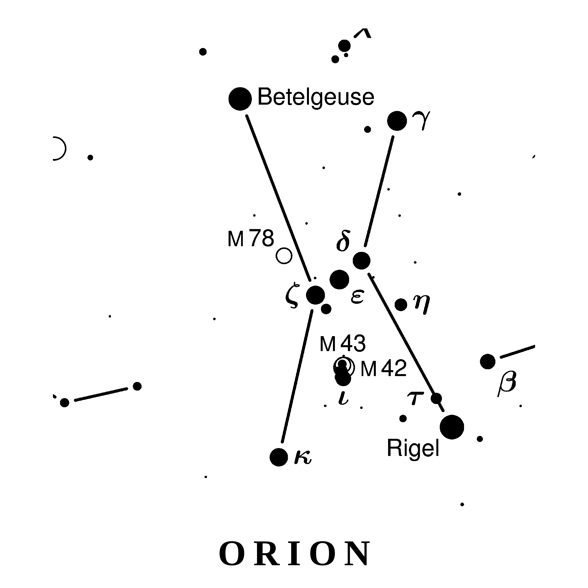



**收录说明**：直接下载后用仓库脚本 extract.py 抽取；删去页首的标签链接与作者行；两张图片已本地化并看图写替代文本（首图为作者的 Muse 形象 Orion，配图为 Orion 制作的猎户座杯垫设计样张）；文中两个 PDF 附件（照片打印比价表、iPhone Duo 核对清单）保留原文链接，未下载。原文全文存于本目录的 original.md，网站上不显示，已翻译。

**内容摘要**：作者 David Faulk 自 2026 年 9 月中旬开始使用 Muse，Muse 于 2026 年 9 月 8 日上线，他约一周后注册，9 月 19 日将其命名为 Orion。他连接了 Craft、Apple Calendar（iCloud）、Outlook、Gmail、Instagram 与 Recall，Muse 由此可跨应用调取信息并按日程在后台工作。两个月里 Orion 帮他记住执照到期日等事项并提前两个月提醒，10 月 8 日清理邮箱时在 Outlook 删除 11 封、Gmail 清理 70 封并完成 8 次退订，还帮他在 Facebook Marketplace、Swappa 与 eBay 上卖出拖车、割草机、iPad mini 等物品。购物比价方面，Orion 为 xTool S1 40W 激光雕刻机找到比次优选择低 300 美元的 Amazon 售价，还制作了 39 张星座杯垫设计与 69 本书的 BookBuddy 导入文件。作者也写了局限：Amazon 会屏蔽其浏览、它不能动钱、Apple Calendar、Craft 与 IMAP 仍只是功能请求。

**保留理由**：提供了一名普通用户连续约两个月真实使用 Muse 的一手长测记录，含具体数字与可核对的任务清单，是已收资料中少有的非媒体、非官方的个人实测证据；其中缺失的三个集成（Apple Calendar、Craft、IMAP）也为后续核对功能上线提供了时间点。

---

9 月中旬，我开始使用 Meta 的个人 AI 智能体 Muse。它于 2026 年 9 月 8 日上线，我大约一周后注册。9 月 19 日，我把我的命名为 Orion，从那以后我们一直一起工作。

如果你还没听说过它：Muse 不是那种只回答问题的聊天机器人。它是一个会做事的智能体。你把它连接到你的应用——电子邮件、日历、Instagram 等等——它就能读取那里的内容、记住你告诉它的事，并按你设定的时间表在后台工作。它运行在云端一台自己的私有计算机上，按理说在做发送邮件或花钱之类的敏感操作之前会征求你的许可。它有 Mac 应用、手机应用、网站，还能通过 WhatsApp 使用。

我在 3 月写过用 AI 写 Excel 公式，2 月写过我在用的 AI 应用。AI 发展得如此之快，而且越来越好。这是那一章的下一部分：我在头两个月里实际让它做了什么。清单还在不断变长，所以我已经不得不更新过一次这份草稿。

#### **连接我的应用**

我做的第一件事是连接我赖以生活的应用：Craft（我保存每日笔记的地方）、iCloud 上的 Apple 日历、用于邮件和日历的 Outlook、Gmail、Instagram，以及我的已保存文章知识库 Recall。把它们连起来费了些功夫——Craft 和 iCloud 要通过浏览器登录——但一旦连上，Orion 就能在一段对话里从所有这些地方调取信息。

有三个我想要但还不存在的集成，我已经把它们作为功能请求提交给了 Muse 团队：作为真正集成的 Apple 日历（而不只是变通办法）、Craft，以及 IMAP 邮件，好让它能读取 Gmail 和 Outlook 之外服务商的邮件。顺便说，为了让 Orion 能读我的邮件，我实际上把原来用的邮件程序换成了 Outlook。

#### **替我记事**

这是我用得最多的部分。我只告诉 Orion 一次，它就记住了：我的 FAA 无人机执照到期日、我的业余无线电呼号（KG7JTV）及其到期日、我的华盛顿州驾照到期日——每个都提前两个月设了提醒。它保存我的疫苗接种记录、体重日志、我为东西付了多少钱，以及像我从 Amazon 买东西这样的偏好。

#### **清理邮件**

10 月 8 日，我让它把两个收件箱都过了一遍，清理营销邮件：在 Outlook 删除 11 封，在 Gmail 清掉 70 封，完成了 8 次退订。有几个发件人需要在浏览器里手动点一下，它把那些链接交给我，而不是假装已经完成了。

#### **提醒与日程**

Orion 现在替我跑每日和每周检查：来自我联系人的生日贺卡提醒（每天早上扫描）、一项每周提醒，以及像 iPhone Duo 预购准备这样的一次性提醒。它还会在 YouTube 上留意新的 Muse 视频，并在 Muse Charm 吊坠一旦可以预购时提醒我一次。

#### **卖东西**

我一直在 Facebook Marketplace、Swappa 和 eBay 上卖东西，而 Orion 一直是那个后台：写商品描述、研究类似物品卖多少钱（这让我把一把钉枪在几轮之后从 175 美元降到 120 美元，并确认我那把海军军官剑的要价是合理的）、留意买家消息、追踪已售出的东西。到目前为止：一辆拖车、一台割灌机、一台 iPad mini、一台在 Swappa 上卖的 iPhone 12 mini，以及我那台在 eBay 上卖掉的 LaserPecker 4 激光雕刻机。我写这篇文章时还有 6 件在售。对任何我想卖的东西，Orion 都会写好完整描述供我批准。我把照片发给它，它就把一切发布到 Marketplace 上。

#### **购物与比价**

在我买 xTool S1 40W 激光雕刻机之前，Orion 比较了各零售商的价格，找到了 Amazon 的促销价，比次优选择低 300 美元。它还做了一份跨 Mpix、Bay Photo 和 Nations Photo Lab 的照片冲印比价，含当前运费，并为 iPhone Duo 整理了一份配件候选清单。

[照片冲印比价表

这是 Orion 为我做的、比较各家照片服务的 PDF

Photo Print Price Comparison.pdf

48 KB](https://www.dav3sworld.blog/content/files/2026/11/Photo-Print-Price-Comparison-1.pdf "下载")

#### **记账**

每天晚上，它会抓取公开的 TSP 份额价格，并把我的账户余额画成一张持续的图表，把每月提款也算进去。它还为我做了一份关于 2027 年社会保障 COLA 的单页说明，显示在 Medicare B 部分保费变化之后我的净涨幅。我给它的硬性规则只有一条：它绝不碰我真正的 TSP 账户，也没有访问权限。

#### **文档与电子表格**

它为我做过电子表格、CSV 文件和比较表：一个用于生日和圣诞节的礼物追踪表、来自我 2015–2022 年阅读清单的 69 本书的 BookBuddy 导入文件（事后核对过——69 本全部导入，没有重复），以及那个照片冲印工作簿。它还研究过横贯大陆铁路纪录片之类的事情，以及我女儿需要什么才能给我孙女办社会保障卡。

激光雕刻机也让它忙个不停。它为我做了一整套 39 款星座杯垫设计，可以直接在石板上雕刻，还为我第一次雕刻做了运行单——按什么顺序烧、起始设置，以及先在一块废料上跑的测试网格。它还把一张全家福变成了激光可以使用的线稿文件。

这是 Orion 为我做的星座杯垫设计样张

新设备到货时，它来写工作表。为 iPhone Duo，它做了一份到货设置表和一份重新核对清单——那些手机迁移不会替你搬的东西，比如 Face ID、Apple Pay 卡片和银行应用登录，按该做的顺序排好。后来新 Apple Watch 到了，它也为此做了一份切换表。而因为完成的文件越堆越多，它为我建了一个按项目分组的「项目文件夹索引」页面——这篇文章就归档在里面。

[iphone-duo-reverification-checklist

这是 Orion 为切换到 iPhone Duo 创建的核对清单

iphone-duo-reverification-checklist.pdf

4 KB](https://www.dav3sworld.blog/content/files/2026/11/iphone-duo-reverification-checklist.pdf "下载")

#### **爱好与项目**

每天中午，它会发来未来一周的逐夜天文摄影预报，标出最好的一两个夜晚。我给了它我家观测点的地平线剖面——树木在哪里挡住天空，精确到度数——它在推荐目标之前会对照这个剖面检查。每天晚上它还会根据当天的活动起草一条 Instagram 帖子，留着等我批准；没有我的同意，什么都不会发出去。

其中一条帖子是我拍的一张星系照片，NGC 7331，里面有一颗我捕捉到的超新星——SN 2026aaiv——以及画面旁那一小群远得多的星系。它还会为我的信息流留意 AI 新闻。

#### **诚实的评估**

将近两个月下来，我最看重的是连续性。以前每段对话都从零开始；现在有了一份记录——我拥有什么、卖掉了什么、什么快到期了、我在关注什么——每个新任务都建立在上一个之上，而不必重新解释一切。

不过它不是魔法。Amazon 会封锁它的浏览，所以在那里查价需要变通办法。它不能动钱，只能提醒我去动。有些退订仍然需要我点一下。而我真正最想要的那三个集成——Apple 日历、Craft、IMAP——仍然只是功能请求，不是功能。

但对于追踪一种复杂的生活并完成那些乏味的部分，它已经值回票价。接下来我会继续汇报——包括那三个集成中任何一个上线的那天。它发现的东西、促使我去做的事，几乎每天都让我惊讶。

最后一件事：你可以自定义 Muse AI 智能体的名字和外观。另外，我已经让 Orion 调整它的日常外观，以反映日历上的任何特殊日期。比如万圣节前后，它每天都换一套不同的服装。本文图片里它穿的绿色马甲，是为了纪念退伍军人的 Operation Green Light（[https://www.naco.org/program/operation-green-light-veterans](https://www.naco.org/program/operation-green-light-veterans?ref=dav3sworld.blog)）。是它提醒了我 Operation Green Light 这件事，而我此前对此一无所知，于是我在退伍军人节前那一周把我们户外的灯换成了绿色。
