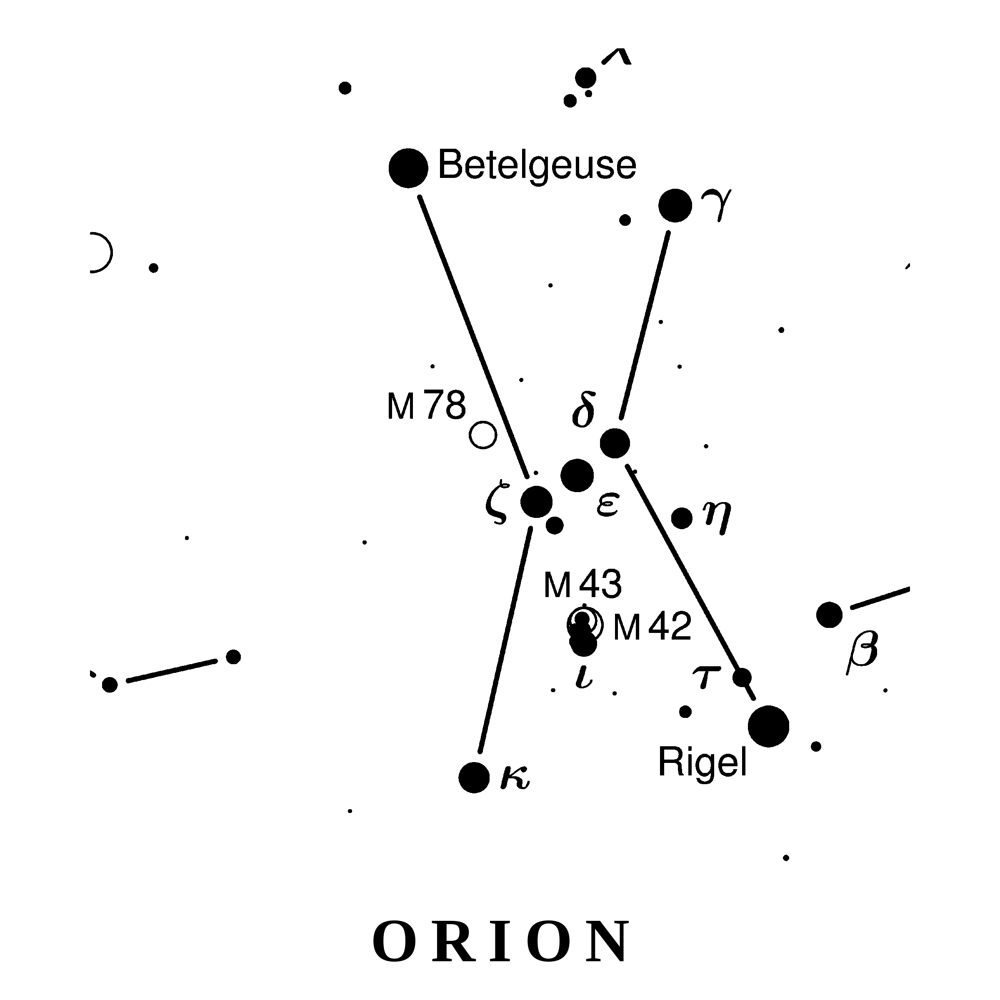

来源：https://www.dav3sworld.blog/2026/11/08/muse-my-ai-assistant/
取文：2026-11-18，直接下载

In mid-September, I started using Muse, Meta's personal AI agent. It launched on September 8, 2026, and I signed up about a week later. On September 19, I named mine Orion, and we've been working together ever since.

If you haven't heard of it: Muse isn't a chatbot that just answers questions. It's an agent that does things. You connect it to your apps — email, calendar, Instagram, and others — and it can read what's there, remember what you tell it, and work in the background on schedules you set. It runs on its own private computer in the cloud, and it's supposed to ask your permission before doing anything sensitive like sending an email or spending money. There's a Mac app, phone apps, a website, and it works through WhatsApp.

I wrote back in March about using AI for an Excel formula, and in February about the AI apps I was using. AI moves so fast and keeps getting better. This is the next chapter of that: what I've actually had it do in the first couple of months. The list keeps growing, so I've already had to update this draft once.

#### **Connecting my apps**

The first thing I did was connect the apps I live in: Craft (where I keep my daily notes), Apple Calendar on iCloud, Outlook for mail and calendar, Gmail, Instagram, and Recall, which is my saved-articles knowledge base. Getting them connected took some doing — Craft and iCloud went through browser sign-ins — but once they're linked, Orion can pull from all of them in one conversation.

Three integrations I want don't exist yet, and I've filed them as feature requests with the Muse team: Apple Calendar as a real integration (not just a workaround), Craft, and IMAP email so it can read mail from providers other than Gmail and Outlook. As a side note, I actually changed from the email program I was using to Outlook so Orion could read my mail.

#### **Remembering things for me**

This is the part I use most. I tell Orion things once, and it remembers them: my FAA drone license expiration, my amateur radio call sign (KG7JTV) and its expiration, my Washington driver's license expiration — with reminders set two months before each one. It keeps my vaccination record, my weight log, what I paid for things, and preferences like the fact that I buy through Amazon.

#### **Email cleanup**

On October 8, I ran it through both inboxes and cleaned out marketing mail: 11 messages deleted in Outlook, 70 trashed in Gmail, and eight unsubscribes completed. A few senders needed a manual click in a browser, and it handed me those links instead of pretending it finished them.

#### **Reminders and schedules**

Orion now runs daily and weekly checks for me: birthday-card reminders from my contacts (scanned every morning), a weekly reminder, and one-time reminders like the iPhone Duo pre-order prep. It also watches YouTube for new Muse videos and pings me once if the Muse Charm pendant ever becomes available for pre-order.

#### **Selling things**

I've been selling belongings on Facebook Marketplace, Swappa, and eBay, and Orion has been the back office: writing listings, researching what similar items go for (which got me to cut a nail gun from $175 to $120 over a couple of rounds, and confirmed an asking price on my Navy officer sword was fair), watching for buyer messages, and tracking what's sold. So far: a trailer, a brush cutter, an iPad mini, an iPhone 12 mini on Swappa, and my LaserPecker 4 laser engraver, which sold on eBay. Six more listings are live as I write this. Orion writes the full description for my approval on any item I want to sell. I send him photos, and he posts it all on Marketplace.

#### **Shopping and price research**

Before I bought the xTool S1 40W laser engraver, Orion compared prices across retailers and found the Amazon sale price, $300 below the next best option. It also built a photo-print price comparison across Mpix, Bay Photo, and Nations Photo Lab with current shipping costs, and put together an accessory shortlist for the iPhone Duo.

[Photo Print Price Comparison

Here is the PDF that Orion made for me comparing various photo services

Photo Print Price Comparison.pdf

48 KB](https://www.dav3sworld.blog/content/files/2026/11/Photo-Print-Price-Comparison-1.pdf "Download")

#### **Money tracking**

Every evening, it pulls public TSP share prices and keeps a running chart of my account balances, factoring in my monthly withdrawal. It also built me a one-pager on the 2027 Social Security COLA showing my net raise after the Medicare Part B premium change. One hard rule I gave it: it never touches my actual TSP account, nor does it have access to it

#### **Documents and spreadsheets**

It's made me spreadsheets, CSV files, and comparisons: a Gift Tracker for birthdays and Christmas, the BookBuddy import files for 69 books from my 2015–2022 reading lists (verified afterward — all 69 landed, no duplicates), and the photo-print workbook. It also researched things like transcontinental-railroad documentaries and what my daughter needs to get my granddaughter's Social Security card.

The laser engraver has kept it busy, too. It built me a full set of 39 constellation coaster designs, ready to engrave on slate, plus a run sheet for my first engraving session — which order to burn them in, starting settings, and a test grid to run on a scrap piece first. It also turned a family photo into line-drawing files the laser can work from.

Here is a sample of the constellation coaster designs that Orion made for me

When new gear arrives, it writes the worksheets. For the iPhone Duo, it made an arrival setup sheet and a re-verification checklist — the things a phone transfer doesn't move for you, like Face ID, Apple Pay cards, and banking app logins, in the order to do them. When a new Apple Watch followed, it made a change-over sheet for that as well. And because the pile of finished files kept growing, it built me a Project Folders Index page that groups everything by project — this post is filed in it.

[iphone-duo-reverification-checklist

Here is the checklist Orion created for changing to the iPhone Duo

iphone-duo-reverification-checklist.pdf

4 KB](https://www.dav3sworld.blog/content/files/2026/11/iphone-duo-reverification-checklist.pdf "Download")

#### **Hobbies and projects**

Every day at noon it sends an astrophotography forecast for the week ahead, night by night, flagging the best one or two nights. I gave it a horizon profile of my observing spot at home — where the trees block the sky, degree by degree — and it checks targets against it before suggesting them. Every evening it also drafts an Instagram post from the day's activity and holds it for my approval; nothing goes up without my say-so.

One of those posts was a galaxy photo of mine, NGC 7331, with a supernova I'd caught in it — SN 2026aaiv — and the little group of much more distant galaxies sitting beside it in the frame. And it keeps an eye on AI news for my feed.

#### **The honest assessment**

Almost two months in, the thing I value most is continuity. Every conversation used to start from zero; now there's a record — what I own, what I've sold, what's expiring, what I'm watching — and each new task builds on the last instead of re-explaining everything.

It's not magic, though. Amazon blocks its browsing, so price checks there need workarounds. It can't move money, only remind me to. Some unsubscribes still need my click. And the three integrations I actually want most — Apple Calendar, Craft, IMAP — are still feature requests, not features.

But for keeping track of a complicated life and doing the tedious parts, it's earned its keep. I'll report back as it goes — including the day any of those three integrations ships. I have been amazed almost daily by what it uncovers or prompts me to do.

One last thing: you can customize your Muse AI agent's name and appearance. Additionally, I have told Orion to adjust his daily appearance to reflect any special dates on the calendar. For example, around Halloween, he had a different costume on each day. The green vest he is wearing in the picture in this article celebrates Operation Green Light for Veterans ([https://www.naco.org/program/operation-green-light-veterans](https://www.naco.org/program/operation-green-light-veterans?ref=dav3sworld.blog)). He alerted me to Operation Green Light, which I knew nothing about, and I changed our outdoor lighting to green for the week leading up to Veterans Day.
