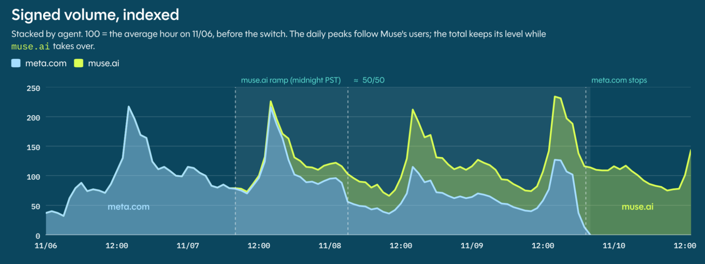
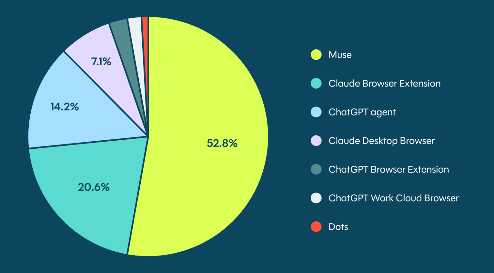



**收录说明**：原站对直接下载返回 403，改由浏览器保存页面 PDF 后转文本；PDF 中 cookie 横幅与正文重叠的一段，据 PDF 内嵌坐标层分离还原，并与页面文本抓取结果核对无误；两张数据图已本地化；删去页首推广、作者简介、文末相关推荐与“预约演示”推广段；文内指向另一篇 DataDome 文章的链接已删去，该篇另收。

**内容摘要**：DataDome 观察到，Muse 在 11 月 7 日（周六，太平洋时间午夜前后）开始把部分请求的 Web Bot Auth 签名从 Meta 的 meta.com 密钥目录切换到自有的 muse.ai 密钥目录，约一天半内新旧签名各占一半，至 11 月 9 日（周一）完成切换，此后只用 muse.ai 签名。切换期间 Muse 的签名流量总量保持平稳，新旧目录重叠约 60 小时；但并非所有请求都带签名，截至 11 月 10 日仍约有一半请求无签名。Web Bot Auth 的机制是：客户端用私钥按 HTTP Message Signatures（RFC 9421）签署每条 HTTP 请求，并在 Signature-Agent 头中指向 `/.well-known/http-message-signatures-directory` 下的公钥目录；与可随意复制的用户代理字符串不同，没有私钥就无法伪造有效签名。文章指出，只信任 meta.com 的验证方自 11 月 9 日起会把 Muse 的请求视为未验证；Meta 此举开创了「一个产品一个签名身份」的模式，而 Muse 是目前使用最广泛的 agentic browser，其签名方式的变化会影响网站收到的很大一部分 AI 智能体流量。

**保留理由**：这篇提供了 Muse 从 meta.com 切换到自有 muse.ai 签名身份的完整时间线与切换期间的流量实测数据，包括约 60 小时的重叠窗口和截至 11 月 10 日约半数请求仍无签名的情况，是关于 Muse 身份标识变化的一手观测记录。

---

在一个周末的时间里，Muse 把它的密码学签名从 Meta 的密钥目录迁移到了自己的目录。这是一个 HTTP 头里的微小改动，却是关于 AI 智能体将如何在网络上表明身份的一个大信号。

## 摘要

- Muse，Meta 的智能体浏览器，现在用它自己的 Web Bot Auth 密钥目录 muse.ai，而不是 Meta 的 meta.com，来签署它的部分请求。

- 交接是渐进的：它大约在 11 月 7 日周六太平洋时间午夜前后开始，约一天半内以接近各半的比例并行，并在 11 月 9 日周一完成。

- 在整个切换过程中，Muse 的已签名流量保持在其水平。

- 如果你验证 Web Bot Auth 签名并且只信任 meta.com，Muse 的请求现在在你看来就是未经验证的。

## 快速回顾：Web Bot Auth 做什么

Web Bot Auth 让一个自动化客户端证明它是谁。智能体用私钥按 HTTP 消息签名（HTTP Message Signatures，RFC 9421）为每个 HTTP 请求签名，并添加一个 Signature-Agent 头，指向一个公钥目录，该目录托管在智能体运营方域名下的 /.well-known/http-message-signatures-directory。任何收到请求的人都可以取回公钥并核查签名。与任何人都能复制的 user-agent 字符串不同，没有智能体的私钥就无法伪造有效签名。这使它成为区分合法 AI 智能体与冒充它的抓取器的最可靠方式之一。

## Muse 现在以 muse.ai 而不是 meta.com 签名

直到上周，Muse 都以 Signature-Agent：「https://www.meta.com」——Meta 的企业密钥目录——来签署它的请求。从 11 月 7 日周六开始，Muse 开始使用托管在 https://muse.ai/.well-known/http-message-signatures-directory 的一个额外密钥目录。到 11 月 9 日周一，Meta 完全切换到只以 Signature-Agent：「https://muse.ai」签名。换句话说，Muse 现在有了自己的签名身份，与它的母公司相区分。不过并非每个 Muse 请求都用 Web Bot Auth 签名，这可能是分阶段推出的缘故。

在整个切换过程中，Muse 的已签名流量总量保持在原有水平：流量从一个签名器转移到另一个。这种重叠给了验证方大约 60 小时来注意新目录，之后旧目录才归于沉寂。

## 为什么签名的产品身份可能成为常态

Meta 正在立下范式。最大的科技公司之一，现在把它的 AI 智能体运行在自己的签名产品身份之下，而不只是企业身份。随着更多公司推出多个智能体，我们可能会看到一种趋势：每个产品一个签名身份，这样网站就能区分助手、爬虫或购物智能体，即使它们来自同一家公司。今天，Muse 是使用最广泛的智能体浏览器。其签名方式的改变，触及网站收到的很大一部分 AI 智能体流量。

签名身份不是静态的。密钥目录会被添加、轮换和退役。一个信任固定智能体域名列表的验证方会悄悄落后：在这里，任何只信任 meta.com 的网站，从 11 月 9 日起开始把 Muse 的请求当作未知。

## DataDome 如何处理这次切换

我们在自己的网络上跟踪了这次交接，并把新的 muse.ai 密钥目录加入了我们的 Web Bot Auth 已验证机器人及智能体列表。那些经过密码学核查的请求进入我们现有的模型。截至 11 月 10 日，Muse 仍有一半请求到达时没有签名。对它们来说，没有签名可验证，只能通过客户端信号推断该智能体。
