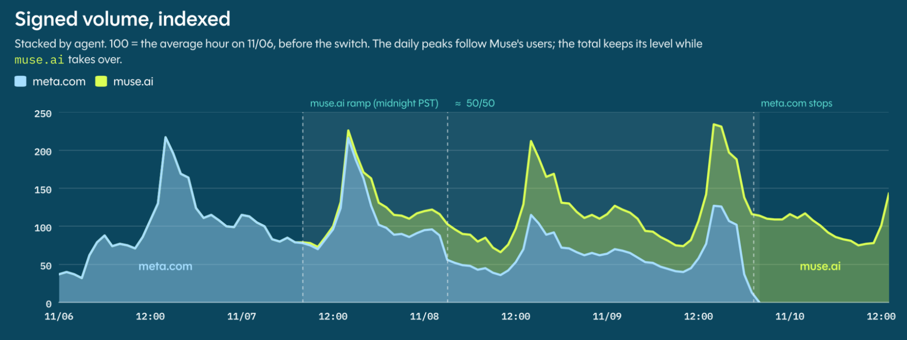
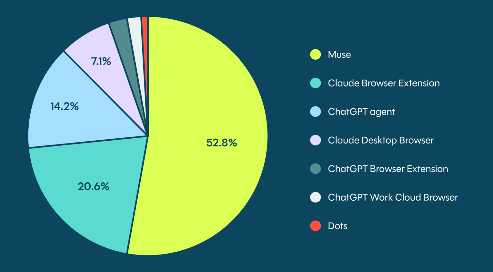

来源：https://datadome.co/threat-research/meta-muse-now-signs-as-muse-ai/
取文：2026-11-19，浏览器保存页面 PDF 后转文本

Over one weekend, Muse moved its cryptographic signatures from Meta’s key directory to its own. It’s a small change in an HTTP header, and a big signal for how AI agents will identify themselves on the web.

## TL;DR

- Muse, Meta’s agentic browser, now signs some of its requests with its own Web Bot Auth key directory, muse.ai, instead of Meta’s meta.com.

- The handover was gradual: it started around midnight PST on Saturday, November 7, ran at roughly 50/50 for a day and a half, and was complete on Monday, November 9.

- Muse’s signed traffic held its level throughout the switch.

- If you verify Web Bot Auth signatures and only trust meta.com, Muse’s requests now look unverified to you.

## A quick refresher: What Web Bot Auth does

Web Bot Auth lets an automated client prove who it is. The agent signs each HTTP request with a private key using HTTP Message Signatures (RFC 9421) and adds a Signature-Agent header pointing to a public key directory, hosted at /.well-known/http-message-signatures-directory on the agent operator’s domain. Anyone receiving the request can fetch the public keys and check the signature. Unlike a user-agent string, which anybody can copy, a valid signature can’t be forged without the agent’s private key. That makes it one of the most reliable ways to tell a legitimate AI agent from a scraper pretending to be one.

## Muse now signs as muse.ai, not meta.com

Until last week, Muse signed its requests with Signature-Agent: “https://www.meta.com”, Meta’s corporate key directory. Starting Saturday, November 7, Muse began to use an additional key directory hosted at https://muse.ai/.well-known/http-message-signatures-directory. By Monday, November 9, Meta completely switched over to signing exclusively from Signature-Agent: “https://muse.ai”. In other words, Muse now has its own signed identity, distinct from its parent company. Not every Muse request is signed with Web Bot Auth, though, likely due to a staged rollout.

Throughout the switch, Muse’s total signed traffic held its level: the volume moved from one signer to the other. The overlap gave verifiers about 60 hours to notice the new directory before the old one went quiet.

## Why signed product identities could become the norm

Meta is setting the pattern. One of the largest technology companies now runs its AI agent under its own signed product identity, not just its corporate one. As more companies ship several agents, we may see a trend: one signed identity per product, so sites can tell the difference between an assistant, a crawler, or a shopping agent, even when they come from the same company. Today, Muse is the most widely used agentic browser. A change in how it signs reaches a large share of the AI agent traffic that sites receive.

Signed identities are not static. Key directories get added, rotated, and retired. A verifier that trusts a fixed list of agent domains will silently fall behind: here, any site trusting only meta.com started treating Muse’s requests as unknown on November 9.

## How DataDome handled the switch

We followed the handover across our network and added the new muse.ai key directory to our list of Web Bot Auth verified bots and agents. The requests that are cryptographically checked feed our existing model. As of November 10, half of Muse’s requests still arrive unsigned. For those, there is no signature to validate, and the agent has to be inferred through client-side signals.
