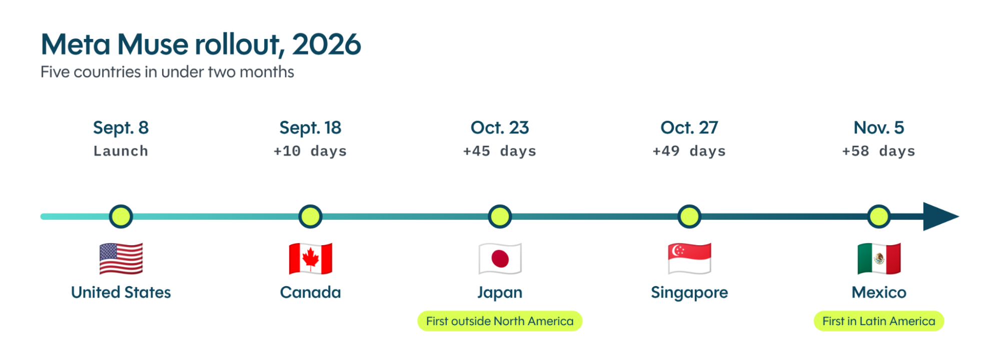
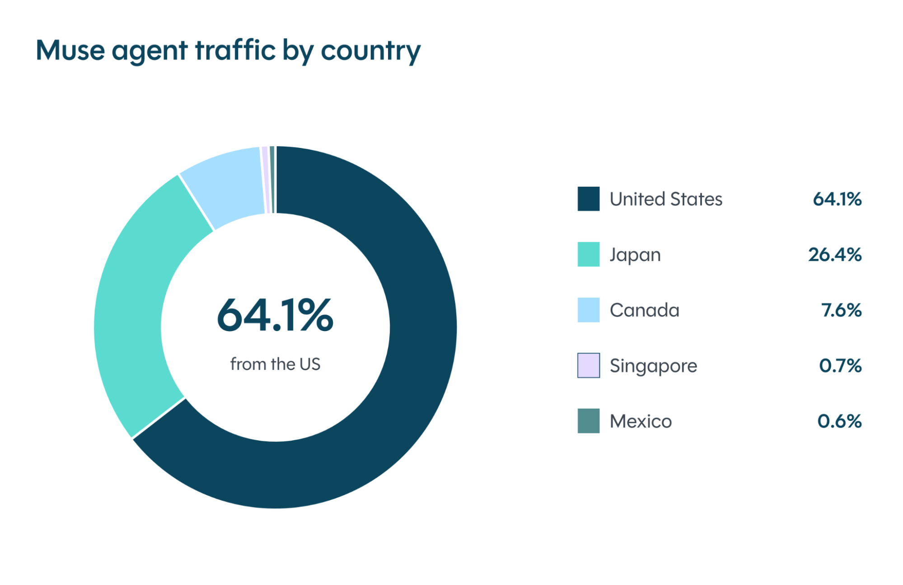
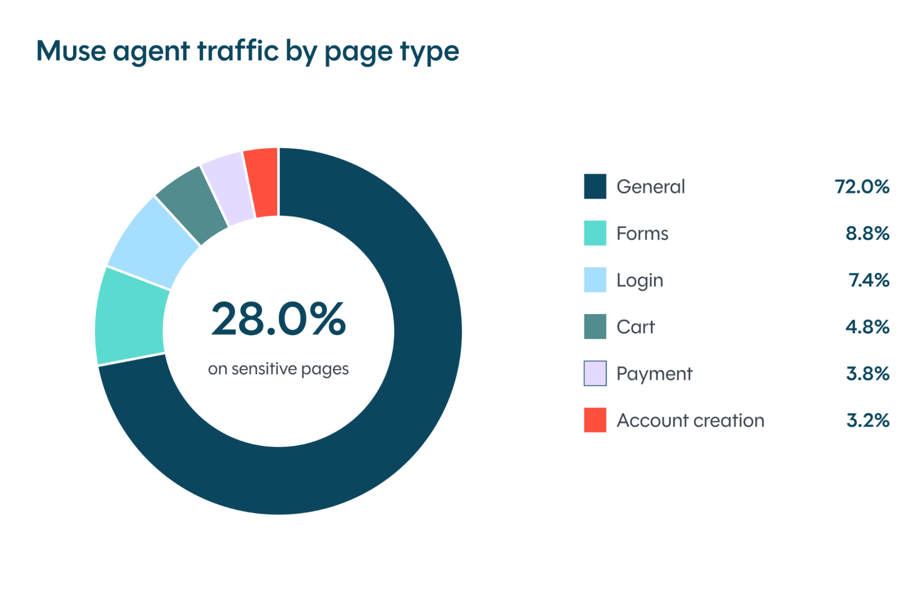



**收录说明**：原站对直接下载返回 403，改由浏览器保存页面 PDF 后转文本；三张数据图已本地化；删去页首推广、作者简介、文末相关推荐与“预约演示”推广段。注意：文中“澳大利亚等地仍未上线”一句写于 11 月 12 日，澳大利亚实际上 11 月 17 日已上线，照录原文。

**内容摘要**：Muse 于 2026 年 9 月 8 日在美国上线（iOS、Android 与网页端），随后在两个月内扩展到五个国家：加拿大 9 月 18 日、日本 10 月 23 日、新加坡 10 月 27 日、墨西哥 11 月 5 日。文中写道，截至 11 月 12 日，Muse 在英国、欧盟、澳大利亚、印度等地仍未上线，Meta 未给出上线日期；扎克伯格在第三季度财报电话会上称 Muse「尚未全球上线」，原因在于其所需的算力，英国与欧盟预计耗时更长，因为 Muse 处理的个人数据比聊天机器人更多。DataDome 两周快照显示，美国仍是最大流量来源，但日本约占全部 Muse 流量的四分之一，为加拿大的三倍多，按人口计已与美国相当；新加坡占 0.7%、墨西哥占 0.6%，两者均在最近几周内上线。敏感端点占 Muse 流量的 28%，其中登录 7.4%、购物车与支付合计 8.6%、新建账户 3.2%；这一比例较上线头 12 天的 8.9%（据其《2026 年第三季度 AI 流量报告》）增长了三倍多。文章最后提到，Muse 以 Web Bot Auth（HTTP Message Signatures，RFC 9421）签署请求标识自身，11 月 7 日那个周末开始从 meta.com 转向自有身份 muse.ai；但仅验证身份仍无法说明该流量的意图。

**保留理由**：这篇提供了 Muse 上线前两个月的分国别流量快照与敏感端点占比的量化数据（日本约占四分之一、敏感端点 28% 及其三项细分），以及五国上线时间线，是关于 Muse 全球扩展与实际使用行为的一手观测记录。

---

订午餐、订桌、在 12 个标签页之间比价：如果你已经不再亲自做这些，你大概已经见过 Muse 了。Meta 的个人 AI 智能体现在替你处理这些任务，而它已在两个月内从仅限美国扩展到五个国家。Muse 不只是回答问题：它代表用户浏览网页、填写表单、登录并结账。在 DataDome 的网络中，超过四分之一的 Muse 请求落在登录、支付或注册这类敏感页面上。企业现在需要有能力区分一个代表真实客户行事的正当智能体，与不受欢迎的自动化。

## 迄今为止 Muse 的推出

Meta 于 2026 年 9 月 8 日在美国的 iOS、Android 和网页端推出 Muse。此后它又新增了四个国家：

Muse 目前在英国、欧盟、澳大利亚、印度以及其他所有地方仍不可用，Meta 也没有提供上线日期。在 Meta 的第三季度财报电话会上，Mark Zuckerberg 说 Muse「尚未全球上线」，并指出原因在于它所需的算力。英国和欧盟预计需要更长时间，因为 Muse 处理的个人数据比聊天机器人更多。

## Muse 的流量来自哪里

在我们客户网站上的两周快照中，大部分 Muse 智能体流量仍来自美国。令人意外的是来自日本的部分有多大。日本比美国晚约六周上线，比加拿大晚五周，却已占全部 Muse 流量的四分之一，是加拿大份额的三倍多。按人口计，日本已经与美国相当，因为那里的采用几乎立即起飞。新加坡占 0.7%，墨西哥占 0.6%，但两者都在最近几周内才上线。如果日本可作参照，它们的份额可能迅速攀升。

## Muse 在网站上做什么

大部分 Muse 流量是普通浏览：阅读页面、比较产品、收集信息。其余 28% 的流量去往会发生某些事情的页面。在这些敏感端点上，Muse 提交表单、为用户登录、填充购物车、付款并创建新账户。这就是 AI 智能体不再只是读者、而开始代表用户行动的地方。自 Muse 在美国上线以来，到达敏感端点的 Muse 流量份额已经增长了两倍多。我们的《2026 年第三季度 AI 流量报告》发现，在 Muse 可用的最初 12 天里，只有 8.9% 的 Muse 流量到达敏感端点。

- 登录（7.4%）意味着智能体持有用户的凭证或会话，因此受委托的登录与撞库（credential stuffing）之间的界线更难看清。

- 购物车与支付（合计 8.6%）意味着智能体正在完成购买，这对欺诈、拒付和限量发售都很重要。

- 创建账户（3.2%）意味着智能体正在开新账户，而虚假账户和促销滥用机器人瞄准的正是同一条流程。

## 为什么 Muse 流量需要基于意图的检测

随着 Meta 继续让 Muse 进入新的国家，这个智能体的流量与风险只会继续增长。这里没有一刀切的规则可用。封禁所有智能体，你就把通过 Muse 购物的真实客户拒之门外。放行所有智能体，你就把登录、支付和注册流程向任何能冒充智能体的人敞开。Muse 通过在请求上签名来标识自身，用的是 Web Bot Auth，即 HTTP Message Signatures（RFC 9421）。这个身份最近变了。Muse 过去以 Meta 自身的名义签名，Signature-Agent 为 meta.com，但在 11 月 7 日那个周末，它开始转向自己的身份 muse.ai。即便如此，一个已验证的身份仍然不能告诉你那段流量想做什么。
