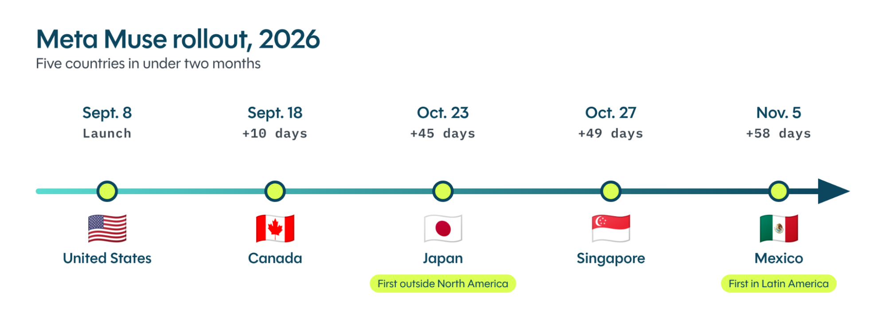
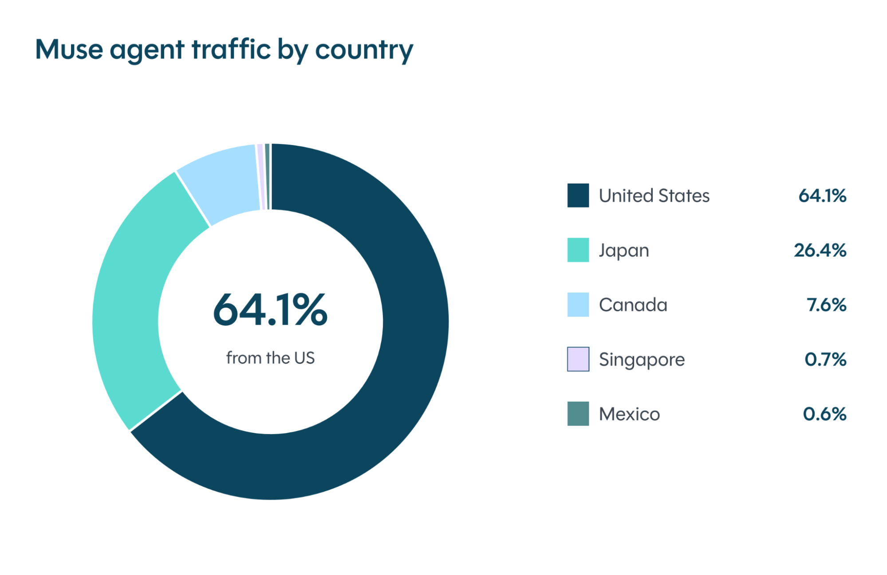
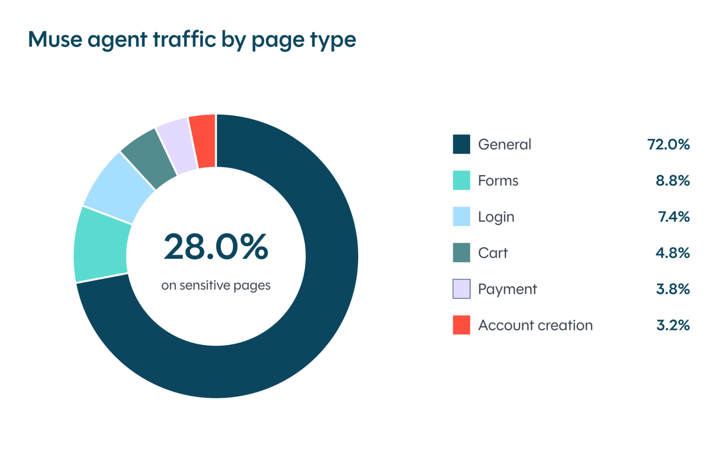

来源：https://datadome.co/threat-research/meta-muse-goes-global/
取文：2026-11-19，浏览器保存页面 PDF 后转文本

Ordering lunch, booking a table, and comparing prices across 12 tabs: if you’ve stopped doing these yourself, you’ve probably met Muse. Meta’s personal AI agent now handles these tasks for you, and it’s gone from US-only to five countries in two months. Muse does more than answer questions: it browses, fills in forms, signs in, and checks out for its users. Across DataDome’s network, more than one in four Muse requests lands on a sensitive page such as a login, payment, or sign-up page. Businesses now need the ability to distinguish a legitimate agent acting for a real customer from unwanted automation.

## The rollout of Muse so far

Meta launched Muse in the United States on September 8, 2026, on iOS, Android, and the web. It has since added four more countries:

Muse is still unavailable in the UK, the EU, Australia, India, and everywhere else, and Meta hasn’t provided launch dates. On Meta’s Q3 earnings call, Mark Zuckerberg said Muse has “not launched globally yet,” pointing to the computing power it requires. The UK and EU are expected to take longer because Muse handles more personal data than a chatbot.

## Where Muse traffic comes from

In a 2-week snapshot across our customers’ websites, most Muse agent traffic still came from the US. The surprise is how much came from Japan. Japan launched about six weeks after the US and five weeks after Canada, yet it already accounts for a quarter of all Muse traffic, more than three times Canada’s share. Relative to population, Japan already matches the US, as adoption there took off almost immediately. Singapore accounts for 0.7% and Mexico for 0.6%, but both launched within the last few weeks. If Japan is any guide, their share could climb quickly.

## What Muse is doing on websites

Most Muse traffic is ordinary browsing: reading pages, comparing products, and gathering information. The remaining 28% of traffic goes to pages where something happens. On these sensitive endpoints, Muse submits forms, signs users in, fills carts, pays, and creates new accounts. This is where an AI agent stops being a reader and starts acting on a user’s behalf. The share of Muse traffic reaching sensitive endpoints has more than tripled since Muse launched in the US. Our Q3 2026 AI Traffic Report found that only 8.9% of Muse traffic reached sensitive endpoints in Muse’s first 12 days of availability.

- Login (7.4%) means agents hold user credentials or sessions, so the line between a delegated sign-in and credential stuffing is harder to see.

- Cart and payment (8.6% combined) means agents are completing purchases, which matters for fraud, chargebacks, and limited-stock drops.

- Account creation (3.2%) means agents are opening new accounts, the same flow that fake-account and promo-abuse bots target.

## Why Muse traffic requires intent-based detection

As Meta continues to make Muse available in new countries, the agent’s volume and risk will only continue to grow. A blanket rule doesn’t work here. Block every agent, and you turn away real customers shopping through Muse. Allow every agent, and you leave login, payment, and sign-up flows open to anyone who can pass as one. Muse identifies itself by signing its requests with Web Bot Auth, which uses HTTP Message Signatures (RFC 9421). That identity changed recently. Muse used to sign as Meta itself, with meta.com as its Signature-Agent, but over the weekend of November 7, it began moving to its own identity, muse.ai. Even so, a verified identity still doesn’t tell you what that traffic is trying to do.
