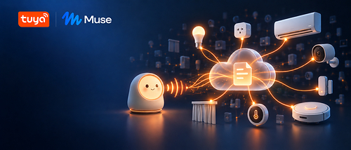



**收录说明**：直接下载 PR Newswire 上的 Tuya 新闻稿全文。删去了页面导航、分享按钮、追踪像素与文末弹窗标题；配图一张已本地化。文中称 Muse 目前仅面向美国与加拿大用户，与 10 月 23 日日本、10 月 27 日新加坡、11 月 5 日墨西哥上线不符，照录原文。本轮核查 GitHub：该 Skill 已于 2026-11-10 以 PR #61（Add Tuya cloud devices skill）合并进 Meta 的 muse-gadget-sdk 仓库（skills/gadget-tuya-cloud-devices/），与个别二手报道所称“仍在审核”不符；新闻稿内链的 Tuya 官方仓库 tuya-openclaw-skills/platforms/muse 为同一 Skill 的另一份副本。原文全文存于本目录的 original.md，网站上不显示，已翻译。

**内容摘要**：2026 年 11 月 12 日，Tuya Smart 宣布发布 Tuya Cloud Devices，这是一个官方开源 Skill，让 Meta 的个人 AI 助手 Muse 能用自然语言查询和控制用户 Tuya 账号下的智能设备，通过 Tuya 云端工作，无需本地设备密钥、同网连接或固件改动。该 Skill 名为 gadget-tuya-cloud-devices，由 Tuya 官方开源 AI Skill tuya-smart-control 改编而来，以遵循 Muse Gadgets 规范的纯 Markdown 文件写成；它只需一个在 tuya.ai 免费申请的 API 密钥（以“sk-”开头），可自动从七个数据中心中选择正确接口，发送指令前先读取设备的标准化 Thing Model 以确认读写权限、取值范围与步长。通过该 Skill，Muse 可执行设备开关与状态查询、家庭与房间管理、条件变化通知（短信、语音电话、邮件或应用推送）、摄像头拍照及最长 60 秒的视频回传，以及基于设备属性变化和上下线事件的实时自动化；安全规则包括多设备匹配时列出房间请用户确认、设备离线时只报告状态不下发指令、发令后 1–2 秒回读确认、事件通知间隔至少 30 分钟，且不开放门锁控制、实时视频、固件升级等操作。新闻稿称 Tuya 平台覆盖 3,000+ 智能硬件品类、服务 200+ 国家和地区，截至 2026 年 6 月 30 日注册 AI 开发者超过 209 万；该 Skill 最初为开源助手 OpenClaw 构建，后适配 Muse 规范，Muse 目前面向美国和加拿大用户。

**保留理由**：这是首个大型智能家居平台为 Muse 发布的 Gadgets Skill，把 Muse 的控制范围从 Meta 官方 Gadgets 开源项目覆盖的自制附加设备、以及 Expedia 等服务类连接器，扩展到了用户家中已有的量产联网设备；它还首次在本资料库中记录了“一个 Skill、一个 API 密钥”加 Thing Model 的云端接入方式及其安全边界细节。

---

Tuya Cloud Devices 让 Muse 用户用自然语言和一个 API 密钥查询并控制其 Tuya 账号下的设备，无需本地设备密钥，也无需改动固件

美国加州圣克拉拉，2026 年 11 月 12 日 /PRNewswire/ -- 全球领先的 AI 云平台服务提供商 Tuya Smart（NYSE: [TUYA](#financial-modal)；HKEX: 2391）宣布发布 Tuya Cloud Devices，这是一个官方开源 Skill，让 Meta 的个人 AI 智能体 Muse 能用自然语言查询和控制智能设备。该 Skill 通过 Tuya 云端工作，因此无需本地设备密钥、同网连接或固件改动。

**AI 智能体现在有了附加设备，但仍无法接入家中已有的设备**

Tuya 发布开源 Skill，让 Meta Muse 控制智能设备

Muse 是 Meta 于 2026 年 9 月发布的个人 AI 智能体。它运行在为每位用户专设的云端虚拟机上，即使应用关闭后，也能继续在后台处理电子邮件和日程安排等任务。Meta 已开源 Muse Gadgets，这是 Muse 的一套硬件接口，开发者可以使用主流的 Wi-Fi MCU 开发板或 Raspberry Pi，配合官方开源 SDK，构建自己的 AI 玩具、桌面机器人、电子墨水显示面板和其他智能设备。

附加设备让智能体能够看、听并展示信息。然而，要控制家中已有的灯、插座、空调、摄像头和传感器，现有的社区方案通常要求用户获取每台设备的本地密钥（local key），并确认其通信协议版本和数据点定义。设备重新配网后，其密钥会失效，整个过程必须重来一遍。这对开发者构成了门槛，对普通用户则更难。

**一个 Skill，一个 API 密钥**

Tuya Cloud Devices（Skill 名称：gadget-tuya-cloud-devices）是一个由 Tuya 官方开源 AI Skill tuya-smart-control 改编而来的官方 Skill。它写成遵循 Muse Gadgets 规范的纯 Markdown 文件，由 Tuya 工程师改编并开源。Muse 提供对话与智能体能力，Tuya 提供设备连接能力。

该 Skill 围绕三项设计原则构建。第一，用一个 API 密钥完成连接：用户可以在 Tuya AI 网站（tuya.ai）免费申请 API 密钥。密钥以「sk-」开头，其后的两个字符标识账号所在的数据中心，因此该 Skill 会从七个数据中心中自动选择正确的 API 接口，无需手动配置。第二，提供云端直连：Muse 通过 Tuya 的云端 API 调用设备，因此不需要本地密钥，设备也不必处于同一局域网；如果某台设备已有针对具体型号或本地控制的 Skill，请求会先路由到那个 Skill。第三，先读取设备再发送指令：每台 Tuya 设备都通过标准化的物模型（Thing Model）描述自身能力，该 Skill 先读取物模型，再根据其读写权限、取值范围和步长来生成指令，这使一个 Skill 能覆盖广泛的产品品类，而无需为每个型号单独适配。

借助 Tuya 设备，Muse 可以处理各种日常请求。用户可以直接说「把客厅的灯调暗一点」来控制设备，或者只用一句「卧室的灯现在开着吗？」来查询状态。Muse 还可以管理家庭和房间，比如列出某个空间里的设备或重命名一个传感器，并回答实际问题，比如今天要不要带伞，或者昨天空调用了多少电。对于更主动的监测，用户可以要求在条件变化时收到通知，提醒仅通过短信、语音电话、电子邮件或应用推送发送给用户本人。Muse 还可以拍摄摄像头快照，例如「在入口处拍一张照片给我看」，返回一张照片或一段最长 60 秒的视频。对于实时自动化，像「门一打开就把走廊的灯打开」这样的请求，会建立一个由设备属性变化和上线/离线事件驱动的自动化。实时事件和由事件触发的通知需要一台始终在线的 Linux 设备来接收事件订阅。这与 Muse Gadgets Linux SDK 很匹配：一旦 Raspberry Pi 连接到 Muse，Muse 就可以在其上部署一个常驻的订阅程序，持续接收设备属性变化和上线/离线事件，然后按照用户已确认的「触发—动作」规则执行自动化。

**安全内建于每一步**

当智能体控制实体设备时，可靠性比智能更重要。Tuya Cloud Devices 在每一步都内建了安全边界。当多台设备与一个请求匹配时，该 Skill 会列出它们所在的房间并请用户确认。当设备离线时，该 Skill 只报告其状态，不下发任何指令。该 Skill 不写入只读属性，所有数值都严格保持在物模型定义的范围和步长之内。发出指令后，该 Skill 会在一到两秒后回读设备状态，只有在核实变更已生效之后，才向用户确认该变更。为避免告警疲劳，由设备事件触发的通知之间至少间隔 30 分钟。

此外，该 Skill 只写入基本数据类型的属性，不开放门锁控制、实时视频、固件升级、网络配置或设备移除等操作；这些请求会被转到 Tuya 应用。API 密钥被视为凭据：它只用于请求头，绝不会在对话中回显。该密钥只能访问用户自己账号下的设备，通知也只发送给用户本人。

**连接 Muse Gadgets 与已在家中的设备**

Muse Gadgets 是一个开源项目，让开发者能用现成硬件快速为 Muse 制作附加设备的原型。然而，长期留在家中的设备是量产的、始终在线的、由平台服务支撑的智能设备。Tuya Cloud Devices 连接了这两个世界。

Tuya 平台覆盖 3,000+ 智能硬件品类，服务 200+ 个国家和地区。截至 2026 年 6 月 30 日，Tuya 的注册 AI 开发者超过 209 万。设备一旦接入 Tuya AI Cloud 平台，其物模型、云服务和账号体系就已就位。有了官方 Skill，智能体无需任何固件改动，就能以统一的方式访问这些设备。

Tuya Cloud Devices 还具有可移植性。它最初为开源智能体 OpenClaw 构建，按 Muse 规范适配后可在 Muse 中使用。随着更多智能体采用 SKILL.md 格式的 Markdown Skill，设备能力可以在不同智能体之间复用。上手方式因用户类型而异。Muse 用户可以从 Tuya 官方 GitHub 仓库获取该 Skill，在 tuya.ai 免费申请 API 密钥，并把两者提供给 Muse，即可用自然语言控制家中的 Tuya 设备；Muse 目前面向美国和加拿大的用户开放。开发者可以访问 GitHub 上开源的 tuya-openclaw-skills 仓库，把同样的设备能力集成进自己的智能体，或者基于 TuyaOpen 和 T5AI 模组构建自己的 AI 硬件。对于品牌和解决方案提供商，接入 Tuya 平台的设备可以通过官方 Skill 触达更多智能体生态，而无需为每个智能体单独集成。

个人 AI 智能体正在从回答问题转向为人把事情办成。除了电子邮件和日程安排，家中的设备也应当是它们能够操作的东西，Tuya Cloud Devices 迈出了这一步。

展望未来，Tuya 将继续在更多设备品类的深度集成、摄像头视觉理解、智能能耗分析和场景自动化模板等方面推进该 Skill，目标是逐步让「一句话控制一切」成为个人 AI 智能体的默认能力。

可用的开发者资源包括 [Muse Gadgets 开源仓库](https://github.com/facebookincubator/muse-gadget-sdk)、[Muse Skill 接入](https://github.com/tuya/tuya-openclaw-skills/tree/master/platforms/muse)、[Tuya 官方 AI Skill 仓库](https://github.com/tuya/tuya-openclaw-skills/tree/master/platforms/muse)和 [tuya.ai 开发者文档](https://tuya.ai/developer/docs)。

**关于 Tuya Inc.**

Tuya Inc.（NYSE: [TUYA](#financial-modal)；HKEX: 2391）是全球领先的 AI 云平台服务提供商，致力于把 AI 带入日常生活。通过其 TuyaOpen 开源开发框架和包括 AI Agent 开发平台在内的通用 AI Agent 引擎，Tuya 整合多模态 AI 能力以降低 AI 开发门槛，高效推进 AI 驱动生活方式的实现，并加速 AI 与物理世界的融合。Tuya 通过其云计算和空间智能能力，为智能设备、商业应用和行业开发者提供创新的物理 AI 解决方案。它还提供完整、开放、中立的全球 AIoT 生态。这一做法培育了一个由品牌、OEM、AI 智能体、系统集成商和独立软件供应商组成的、充满活力的全球开发者社区，他们协作打造体现可持续、安全、高效、敏捷和开放原则的智能解决方案生态。

截至 2026 年 6 月 30 日，Tuya AI 开发者平台拥有来自 200 多个国家和地区的 2,092,000 多名注册 AI 开发者。

**安全港声明**

本新闻稿包含前瞻性陈述。这些陈述是依据美国 1995 年《私人证券诉讼改革法》（U.S. Private Securities Litigation Reform Act of 1995）的「安全港」条款作出的。非历史事实的陈述，包括有关公司信念和预期的陈述，均为前瞻性陈述。前瞻性陈述涉及固有的风险和不确定性，多种因素可能导致实际结果与任何前瞻性陈述中所载内容存在重大差异。在某些情况下，前瞻性陈述可以通过「may」「will」「expect」「anticipate」「target」「aim」「estimate」「intend」「plan」「believe」「potential」「continue」「is/are likely to」等词语或短语，或其他类似表述来识别。有关这些及其他风险、不确定性或因素的更多信息，载于公司向美国证券交易委员会（SEC）提交的文件中。本新闻稿中包含的前瞻性陈述仅截至本新闻稿发布之日作出，除法律要求外，公司不承担为反映后续事件或情况而公开更新任何前瞻性陈述的义务。所有前瞻性陈述的评估都应当以理解其固有的不确定性为前提。

SOURCE Tuya Smart
