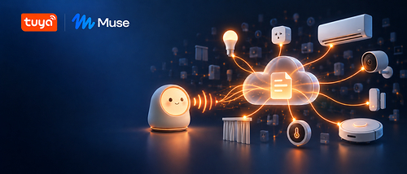

来源：https://www.prnewswire.com/news-releases/tuya-releases-open-source-skill-enabling-meta-muse-to-control-smart-devices-across-3-000-categories-302937689.html
取文：2026-11-12，直接下载

Tuya Cloud Devices lets Muse users query and control the devices in their Tuya account using natural language and a single API key, with no local device keys or firmware changes required

SANTA CLARA, Calif., Nov. 12, 2026 /PRNewswire/ -- Tuya Smart (NYSE: [TUYA](#financial-modal); HKEX: 2391), a global leading AI cloud platform service provider, announced the release of Tuya Cloud Devices, an official open-source Skill that lets Meta's personal AI agent, Muse, query and control smart devices using natural language. The Skill works through Tuya's cloud, so it requires no local device keys, same-network connection, or firmware changes.

**AI Agents Now Have Add-On Devices, but Still Lack Access to the Devices Already in the Home**

Tuya Releases Open-Source Skill Enabling Meta Muse to Control Smart Devices

Muse is a personal AI agent that Meta launched in September 2026. It runs on a cloud-based virtual machine dedicated to each user and can continue handling tasks such as email and scheduling in the background even after the app is closed. Meta has open-sourced Muse Gadgets, a hardware interface for Muse that lets developers use mainstream Wi-Fi MCU development boards or Raspberry Pi, together with the official open-source SDK, to build their own AI toys, desktop robots, e-ink display panels, and other smart devices.

Add-on devices let an agent see, hear, and show information. However, to control the lights, outlets, air conditioners, cameras, and sensors already in the home, existing community solutions typically require users to obtain each device's local key and confirm its communication protocol version and data-point definitions. When a device is re-paired to the network, its key becomes invalid and the entire process must be repeated. This creates a barrier for developers and is even harder for ordinary users.

**One Skill, One API Key**

Tuya Cloud Devices (Skill name: gadget-tuya-cloud-devices) is an official Skill adapted from tuya-smart-control, Tuya's official open-source AI skill. It is written as a plain Markdown file that follows the Muse Gadgets specification, and Tuya engineers adapted and open-sourced it. Muse provides conversational and agent capabilities, while Tuya provides device connectivity.

The Skill is built around three design principles. First, it connects with a single API key: users can apply for a free API key on the Tuya AI website (tuya.ai). The key starts with "sk-", and the two characters that follow identify the data center where the account is located, so the Skill automatically selects the correct API endpoint from seven data centers, with no manual configuration. Second, it offers direct cloud access: Muse calls devices through Tuya's cloud API, so no local key is needed and devices do not have to be on the same local network; if a device already has a model-specific or local-control Skill, the request is routed to that Skill first. Third, it reads the device before sending commands: every Tuya device describes its capabilities through a standardized Thing Model, and the Skill reads the Thing Model before generating commands based on its read/write permissions, value ranges, and increments — allowing one Skill to cover a wide range of product categories without adaptation for each model.

With Tuya devices, Muse can handle a broad range of everyday requests. Users can control devices directly by saying things like "Dim the living room lights a little," or simply check status with a question like "Is the bedroom light on right now?" Muse can also manage homes and rooms — listing the devices in a space or renaming a sensor — and answer practical questions such as whether to bring an umbrella today or how much electricity an air conditioner used yesterday. For more active monitoring, users can ask to be notified when conditions change, with alerts delivered only to the user via SMS, voice call, email, or app push notification. Muse can also capture a camera snapshot — for example, "Take a picture at the entrance and show it to me" — returning a photo or a video up to 60 seconds long. For real-time automation, a request like "Turn on the hallway light as soon as the door opens" sets up an automation driven by device property changes and online/offline events. Real-time events and event-triggered notifications require an always-online Linux device to receive event subscriptions. This pairs well with the Muse Gadgets Linux SDK: once a Raspberry Pi is connected to Muse, Muse can deploy a resident subscription program on it that continuously receives device property changes and online/offline events, then executes automations according to "trigger–action" rules the user has confirmed.

**Safety Built Into Every Step**

When an agent controls physical devices, reliability matters more than intelligence. Tuya Cloud Devices builds safety boundaries into every step. When multiple devices match a request, the Skill lists the rooms they are in and asks the user to confirm. When a device is offline, the Skill reports its status without issuing any commands. The Skill does not write to read-only properties, and all values stay strictly within the ranges and increments defined by the Thing Model. After issuing a command, the Skill reads back the device status one to two seconds later and confirms the change to the user only after verifying that it took effect. To prevent alert fatigue, notifications triggered by device events are sent at least 30 minutes apart.

In addition, the Skill writes only to properties of basic data types and does not expose operations such as door lock control, live video, firmware upgrades, network configuration, or device removal; requests for these are redirected to the Tuya app. The API key is treated as a credential: it is used only in request headers and is never echoed in the conversation. The key can access only devices under the user's own account, and notifications go only to the user.

**Bridging Muse Gadgets and the Devices Already in Homes**

Muse Gadgets is an open-source project that lets developers quickly prototype add-on devices for Muse using off-the-shelf hardware. Devices that stay in homes for the long term, however, are mass-produced, always-online smart devices backed by platform services. Tuya Cloud Devices bridges these two worlds.

The Tuya platform covers 3,000+ smart hardware categories and serves 200+ countries and regions. As of June 30, 2026, Tuya had more than 2.09 million registered AI developers. Once a device is connected to the Tuya AI Cloud platform, its Thing Model, cloud services, and account system are already in place. With the official Skill, agents can access these devices in a unified way without any firmware changes.

Tuya Cloud Devices is also portable. It was originally built for OpenClaw, an open-source agent, and works in Muse after being adapted to the Muse specification. As more agents adopt Markdown skills in the SKILL.md format, device capabilities can be reused across agents. How to get started varies by user type. Muse users can get the Skill from Tuya's official GitHub repository, apply for a free API key at tuya.ai, and provide both to Muse to control the Tuya devices at home using natural language; Muse is currently available to users in the United States and Canada. Developers can access the open-source tuya-openclaw-skills repository on GitHub to integrate the same device capabilities into their own agents, or build their own AI hardware on TuyaOpen and the T5AI modules. And for brands and solution providers, devices connected to the Tuya platform can be reached by more agent ecosystems through the official Skill, without a separate integration for each agent.

Personal AI agents are moving from answering questions to getting things done for people. Beyond email and scheduling, devices at home should be among the things they can operate, and Tuya Cloud Devices takes that step.

Going forward, Tuya will continue to advance the Skill in areas such as deeper integration across more device categories, camera visual understanding, intelligent energy-consumption analysis, and scenario automation templates, with the aim of gradually making "control everything with one sentence" a default capability of personal AI agents.

Available developer resources include [Muse Gadgets open-source repository](https://github.com/facebookincubator/muse-gadget-sdk), [Muse Skill access](https://github.com/tuya/tuya-openclaw-skills/tree/master/platforms/muse), [Tuya official AI skills repository](https://github.com/tuya/tuya-openclaw-skills/tree/master/platforms/muse), and [tuya.ai developer documentation](https://tuya.ai/developer/docs).

**About Tuya Inc.**

Tuya Inc. (NYSE: [TUYA](#financial-modal); HKEX: 2391) is a leading global AI cloud platform service provider dedicated to bringing AI into everyday life. Through its TuyaOpen open-source development framework and universal AI Agent engines, including the AI Agent development platform, Tuya integrates multimodal AI capabilities to lower barriers for AI development, efficiently advancing the realization of AI-driven lifestyles and accelerating AI integration with the physical world. Tuya offers innovative physical AI solutions for smart devices, commercial applications, and industry developers through its cloud computing and spatial intelligence capabilities. It also provides a complete, open, and neutral global AIoT ecosystem. This approach fosters a vibrant global developer community comprising brands, OEMs, AI agents, system integrators, and independent software vendors who collaborate to create smart solution ecosystems embodying the principles of sustainability, security, efficiency, agility, and openness.

As of June 30, 2026, the Tuya AI Developer Platform had over 2,092,000 registered AI developers from more than 200 countries and regions.

**Safe Harbor Statement**

This press release contains forward-looking statements. These statements are made under the "safe harbor" provisions of the U.S. Private Securities Litigation Reform Act of 1995. Statements that are not historical facts, including statements about the Company's beliefs, and expectations, are forward-looking statements. Forward-looking statements involve inherent risks and uncertainties, and a number of factors could cause actual results to differ materially from those contained in any forward-looking statements. In some cases, forward-looking statements can be identified by words or phrases such as "may", "will", "expect", "anticipate", "target", "aim", "estimate", "intend", "plan", "believe", "potential", "continue", "is/are likely to" or other similar expressions. Further information regarding these and other risks, uncertainties or factors is included in the Company's filings with the SEC. The forward-looking statements included in this press release are only made as of the date hereof, and the Company disclaims any obligation to publicly update any forward-looking statements to reflect subsequent events or circumstances, except as required by law. All forward-looking statements should be evaluated with the understanding of their inherent uncertainty.

SOURCE Tuya Smart
