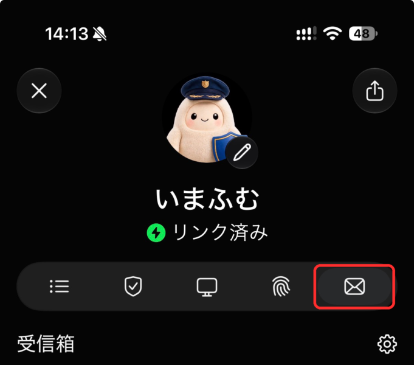
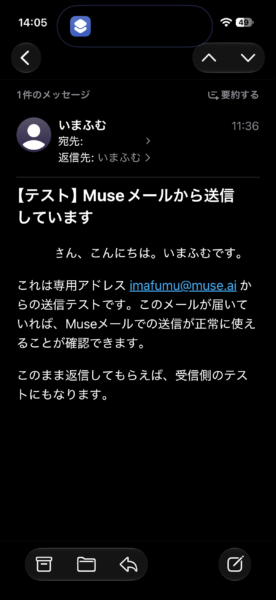
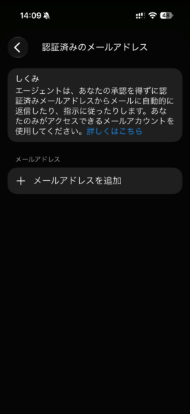



**收录说明**：直接下载全文。删去了文末的招待码推广、联盟广告区块与站内推荐；三张实测截图已本地化，题图为装饰图，未收。页面带有推广内容声明。原文全文存于本目录的 original.md，网站上不显示，已翻译。

**内容摘要**：作者在聊天中向 Muse 提出请求后，取得了专用地址 imafumu@muse.ai（显示名「いまふむ」），并用该地址向自己的 Gmail 发送了测试邮件；Gmail 的回信在 Muse 一侧也能正常接收。地址由 3–32 个字符组成，仅限小写英文字母、数字和连字符，一经确定不可更改（显示名可改），且每人只能拥有一个地址。发送邮件前必须经过审批：收件人、主题和正文会事先展示，用户不点击「承認」就不会发送。通过邮件向 Muse 下达指令前需完成本人认证——在设置中登记自己的邮箱并输入收到的确认码，未经认证的地址发来的邮件不会被当作指令执行。截至 2026 年 11 月 13 日确认时，免费档能否使用该功能仍不明，作者本人是在付费「パワー」档下完成取得与测试的。

**保留理由**：此前已收的 ITmedia 日本可用首报与 allthingsmuse 设置指南只说明了功能上线与设置方法，本篇是第一手实测，补上了地址规则（字符范围与不可更改）、发送前审批、发件人认证的实际验证经过，以及免费档情况在 2026 年 11 月 13 日确认时仍不明的时点信息。

---

Muse 有了专用邮箱地址｜实际测试获取方式与收发邮件

让 AI 拥有自己的专用邮箱地址、连邮件收发都能委托给它的时代到来了。

2026 年 11 月 12 日，ITmedia AI+ 也报道了「AI『Muse』专用邮箱上线，『在日本也能注册』的报告接连出现」，引起了广泛关注。

「AI 真的能收发邮件吗？」

「会不会擅自发出奇怪的邮件？」

「邮件设置到底在哪里？」

先说结论：只要在聊天中提出请求，一转眼就能取得专用地址，发送前的确认功能和本人认证等安全措施也确实在正常发挥作用。

这次，笔者基于实际取得地址并测试收发的体验，从设置步骤到安全性进行通俗易懂的解说。

## 什么是 Muse 邮箱

Muse 邮箱是一项新功能，可以让作为 AI 的 Muse 拥有自己的专用邮箱地址。

它能做的事主要有以下三件。

- **用专用地址收发邮件**：可以使用 Muse 自己的地址（@muse.ai）进行邮件往来
- **通过邮件下达指令**：只要从自己的邮箱给 Muse 发邮件，就能让它执行指令
- **把转发的邮件交给它处理**：把收到的邮件转发给 Muse，请它做摘要或起草回复

不只是打开界面聊天，还可以从平时使用的邮件软件轻松下达指令。

## 如何获取地址

获取地址简单得令人吃惊。不需要到处翻找设置界面，只要在聊天中直接请求 Muse 即可。

打开 Web 版（<https://muse.ai/>）或应用的聊天，试着说「能给我开一个 Muse 邮箱吗？」

1. **向 Muse 搭话**：在聊天中告诉它「我想开通 Muse 邮箱」
2. **确定字符串（handle）**：告诉它你想要的地址名
3. **获取完成**：Muse 一侧进行处理，地址随即发行

笔者这次取得了「imafumu@muse.ai」（显示名「いまふむ」）这个地址。

已取得地址的确认以及各种设置，可以在应用中点击自己的头像打开的界面里进行。按下最右侧的邮件按钮，就会打开收件箱和设置。

### 确定地址时的规则

确定字符串时，有几点需要注意。

- **可用字符**：3〜32 个字符的英文小写字母、数字、连字符
- **不可更改**：邮箱地址（handle）一旦确定，之后就不能更改
- **显示名可以更改**：对方收到的发件人名称（显示名）之后可以自由更改
- **先到先得**：地址字符串可以挑选自己想要的。社交网络上「在日本也能注册」的报告接连出现，所以有想要的字符串的人建议尽早取得

地址字符串无法重新获取，所以请慎重决定，以免后悔。

## 实际发送测试

笔者从取得的地址「imafumu@muse.ai」向自己的 Gmail 发送了测试邮件。

在聊天中请求「给我的 Gmail 发一封测试邮件」后，经过下文所述的批准，发送就完成了。

### 不会擅自发送的「批准」机制

发送邮件时最让人担心的，大概就是「会不会在违背意图的情况下被发送给意外的内容或收件人」。

在 Muse 邮箱中，按下发送按钮之前必定会在界面上要求确认（批准）。

- 收件人的邮箱地址
- 邮件主题
- 正文内容

这些内容会事先呈现，只要用户不给出「批准」，邮件就不会发送。这是一套防止误发的安心设计。

## 收信与「通过邮件下达指令」的用法

Muse 邮箱不仅能发送，也能很好地接收。收到的邮件由 Muse 读取并把握内容。实际上，笔者从自己的 Gmail 回复了测试邮件，Muse 一侧也能正常接收。

更实用的是，只要从自己平时的邮箱地址给 Muse 发邮件，就能在外出时下达指令。

### 本人认证的方法

要通过邮件下达指令，需要事先完成「本人认证」。

1. 打开 Muse 邮箱的设置
2. 输入用于下达指令的自己的邮箱地址
3. 把收到的确认码输入 Muse 邮箱的设置界面

只有从这个已完成认证的地址发来的邮件，才会作为对 Muse 的正式指令被执行。

## 安全方面需要注意的事项

把邮件交给 AI 处理，很多人应该会在安全方面感到不安。

### 冒充邮件不会被执行

即使第三方冒用你的名字给 Muse 发邮件、企图擅自操作，也不必担心。

来自未完成本人认证的地址的邮件，不会被当作指令擅自执行，这是一套安全设计。

当收到可疑发件人或内容可疑的邮件时，Muse 会显示警告提醒注意。

### 把重要邮件交给它时的心理准备

虽说具备安全措施，但邮件中始终潜藏着钓鱼诈骗和恶意附件等危险。

平时就安装安全防护软件、强化账户认证等，保持终端和整个环境的安全很重要。

## 做不到的事与注意事项

这里也整理一下实际使用后了解到的注意事项和限制。

- **每人只有一个地址**：不能添加收件专用、按用途区分等多个地址
- **地址字符串不可更改**：一旦确定的邮箱地址不能更改
- **套餐条件不明**：免费套餐能否使用等详细提供条件，截至 2026 年 11 月 13 日确认时仍不明（笔者是在付费套餐「Power（パワー）」下使用的）

首先，直接问 Muse 自己的环境能否取得，是最快的办法。

## 常见问题

### 免费套餐也能使用 Muse 邮箱吗？

A. 截至 2026 年 11 月 13 日确认时不明。笔者是在付费的「Power」套餐下确认取得与运行的。关于免费套餐的支持情况，请确认今后的官方信息。

### 地址名称之后可以更改吗？

A. 邮箱地址本身的字符串不能更改。一旦确定就无法更改，所以请慎重选择 3〜32 个字符的英文小写字母、数字和连字符。另外，对方看到的「显示名」之后可以更改。

### 任何人发来的邮件都会擅自执行指令吗？

A. 不会执行。只有来自事先完成认证的自己邮箱地址的邮件才会被接受为指令。未经认证的对方发来的指令邮件不会被擅自执行。

### 把邮箱地址公开也没问题吗？

A. 来自未认证对方的指令不会被执行，可疑邮件也会显示警告，但为了避免无用的垃圾邮件和钓鱼攻击，不建议随意公开。

## 总结

总结一下 Muse 邮箱的特点。

- **只要在聊天中请求**：没有麻烦的注册操作，在聊天中就能立刻取得专用地址
- **安心的批准系统**：发送邮件前必定会要求确认，不必担心擅自误发
- **通过本人认证安全地下达指令**：只要从已认证的地址发送邮件，就能远程向 Muse 下达指令
- **注意不可更改与套餐条件**：地址字符串不可更改，免费套餐的支持情况在确认时点仍不明

通过平时使用的邮件这一机制与 AI 交流，比想象中还要方便。

还没用过 Muse 的人，也请趁这个机会试一试。
