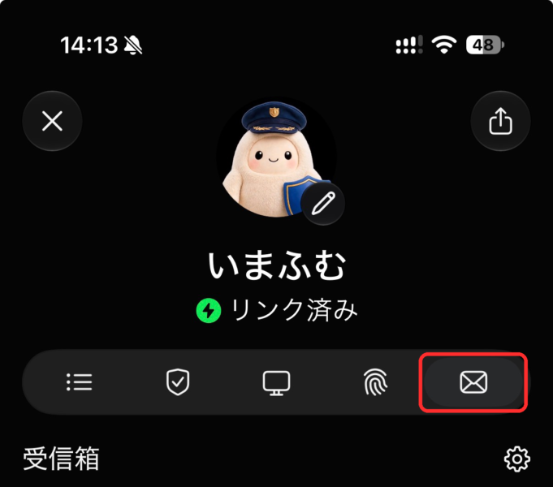
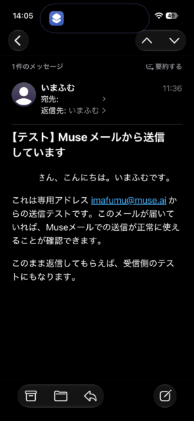
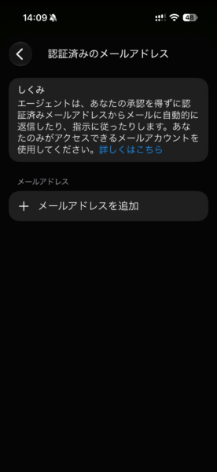

来源：https://imafumu.com/muse-mail/
取文：2026-11-15，直接下载

Museに専用メールアドレスができた｜取り方と送受信を実際に試してみた

AIに自分専用のメールアドレスを持たせて、メールの送受信まで任せられる時代がやってきました。

2026年11月12日、ITmedia AI+でも「AI『Muse』専用メアド開始、『日本で取れた』報告続々」と報じられ、大きな注目を集めています。

「本当にAIがメールを送受信できるの？」

「勝手に変なメールを送られたりしない？」

「メール設定って，どこにあるの？」

結論からいうと、チャットで頼むだけで一瞬で専用アドレスが取得でき、送信前の確認機能や本人認証などの安全対策もしっかり機能していました。

今回は、実際にアドレスを取得して送受信を試した体験をもとに、設定手順から安全性まで分かりやすく解説します。

## Museメールとは

Museメールは、AIであるMuseに自分専用のメールアドレスを持たせられる新機能です。

できることは主に次の3つです。

- **専用アドレスで送受信する**：Muse自身のアドレス（@muse.ai）を使ってメールのやり取りができます
- **メールで指示を出す**：自分のメールからMuse宛てに送るだけで、指示を実行させられます
- **転送したメールを任せる**：届いたメールをMuseに転送して、要約や返信の下書きを頼めます

画面を開いてチャットするだけでなく、普段使っているメールソフトから手軽に指示を出せるようになります。

## アドレスの取り方

アドレスの取得は驚くほど手軽です。設定画面を探し回る必要はなく、チャットでMuseに直接頼むだけで進められます。

Web版（<https://muse.ai/>）やアプリのチャットを開き、「Museメール取れる？」と話しかけてみてください。

1. **Museに話しかける**：チャットで「Museメールを取りたい」と伝えます
2. **文字列（ハンドル）を決める**：希望のアドレス名を伝えます
3. **取得完了**：Muse側で処理が行われ、すぐにアドレスが発行されます

筆者は今回、「imafumu@muse.ai」（表示名「いまふむ」）というアドレスを取得しました。

取得したアドレスの確認や各種設定は、アプリで自分のアバターをタップして開く画面から行えます。一番右にあるメールボタンを押すと、受信箱や設定が開きます。

### アドレスを決めるときのルール

文字列を決めるときには、いくつかの注意点があります。

- **使える文字**：3〜32文字の英小文字、数字、ハイフン
- **変更不可**：メールアドレス（ハンドル）は一度決めると後から変更できません
- **表示名は変更可能**：相手に届く送信者名（表示名）は後からでも自由に変えられます
- **早い者勝ち**：アドレスの文字列は希望のものを選べます。SNSでも「日本で取れた」という報告が続々と出ているので、欲しい文字列がある人は早めに取得しておくのがおすすめです

アドレスの文字列は取り直しができないため、後悔しないよう慎重に決めましょう。

## 実際に送ってみた

取得したアドレス「imafumu@muse.ai」から、筆者のGmail宛てにテストメールを送信してみました。

チャットで「私のGmail宛てにテストメールを送って」と頼むと、後述の承認を経て送信が完了しました。

### 勝手に送られない「承認」の仕組み

メール送信で一番心配なのは、「意図しない内容や宛先に勝手に送られてしまうこと」ではないでしょうか。

Museメールでは、送信ボタンが押される前に必ず画面上で確認（承認）を求められる仕組みになっています。

- 送信先のメールアドレス
- メールの件名
- 本文の内容

これらが事前に提示され、利用者が「承認」を出さない限りメールは送信されません。誤送信を防ぐ安心の設計です。

## 受信と「メールで指示を出す」使い方

Museメールは送信だけでなく、受信にもしっかり対応しています。届いたメールはMuseが読み取り、内容を把握してくれます。実際、筆者のGmailからテストメールに返信してみたところ、Muse側で問題なく受信できました。

さらに実用的なのが、自分の普段のメールアドレスからMuse宛てに送るだけで、外出先から指示を出せる機能です。

### 本人認証のやり方

メールでの指示を有効にするには、あらかじめ「本人認証」を済ませておく必要があります。

1. Museメールの設定を開く
2. 指示を出すために使う自分のメールアドレスを入力する
3. 届いた確認コードをMuseメールの設定画面に入力する

この認証を済ませたアドレスから送られたメールだけが、Museへの正式な指示として実行されます。

## 安全面で気をつけること

AIにメールを任せるにあたり、セキュリティ面が気になる方も多いはずです。

### なりすましメールは実行されない

第三者があなたの名前をかたってMuseにメールを送り、勝手に操作しようとしても心配いりません。

本人認証を行っていないアドレスからのメールは、指示として勝手に実行されない安全設計になっています。

不審な送信元や怪しい内容のメールが届いた際も、Museが警告を表示して注意を促してくれます。

### 大事なメールを任せるときの心構え

安全対策が備わっているとはいえ、メールにはフィッシング詐欺や悪意のある添付ファイルなどの危険が常に潜んでいます。

普段からセキュリティ対策ソフトを導入したり、アカウント認証を強化したりして、端末や環境全体の安全を保つことが大切です。

## できないこと・注意点

実際に触ってみて分かった注意点や制限事項も整理しておきます。

- **アドレスは1人1つだけ**：受信専用や用途別など、複数のアドレスを追加することはできません
- **アドレスの文字列は変更不可**：一度決めたメールアドレスは変更できません
- **プラン条件は不明**：無料プランで使えるかどうかなどの詳しい提供条件は、2026年11月13日の確認時点では不明です（筆者は有料プラン「パワー」で利用中）

まずは自分の環境で取得できるか、Museに聞いてみるのが早いです。

## FAQ

### 無料プランでもMuseメールは使えますか？

A. 2026年11月13日の確認時点では不明です。筆者は有料の「パワー」プランで取得・動作を確認しました。無料プランでの対応状況については、今後の公式情報を確認してください。

### アドレスの名前は後から変更できますか？

A. メールアドレス自体の文字列は変更できません。一度決めると変更できないため、3〜32文字の英小文字・数字・ハイフンを慎重に選びましょう。なお、相手側に表示される「表示名」は後から変更可能です。

### 誰からのメールでも勝手に指示を実行してしまいますか？

A. いいえ、実行されません。事前に認証を完了させた自分のメールアドレスからのメールのみが指示として受け付けられます。認証されていない相手からの指示メールが勝手に実行されることはありません。

### メールアドレスを一般公開しても大丈夫ですか？

A. 認証のない相手からの指示は実行されず、怪しいメールには警告が出ますが、無用なスパムやフィッシング攻撃を避けるためにも、むやみに一般公開するのはおすすめしません。

## まとめ

Museメールの特徴をまとめます。

- **チャットで頼むだけ**：面倒な登録作業はなく、チャット上ですぐに専用アドレスが取得できる
- **安心の承認システム**：メール送信前に必ず確認が入るため、勝手に誤送信される心配がない
- **本人認証で安全に指示**：認証済みアドレスからメールを送るだけで、遠隔からMuseに指示が出せる
- **変更不可とプラン条件に注意**：アドレス文字列は変更できず、無料プランの対応状況は確認時点では不明

普段使っているメールという仕組みを通じてAIとやり取りできるのは、想像以上に便利です。

まだMuseを使ったことがない方も、ぜひこの機会に試してみてください。
