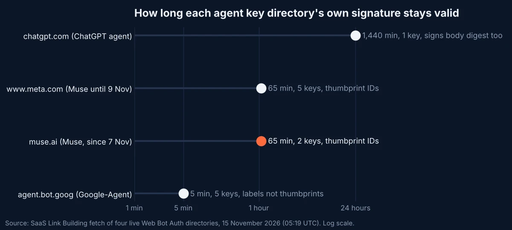



**收录说明**：直接下载全文；删去文末 About、联系方式与“更多文章”等推广区块；四家密钥目录签名有效期点图已本地化。发布方 SaaS Link Building 是 SEO/外链机构，作者为该机构联合创始人兼 CTO；文中核查方法与时间戳均有写明，请求量数字引自 HUMAN 与 DataDome。本轮未能从本机独立复核 muse.ai 密钥目录（直接下载失败、浏览器受限），meta.com 一侧核对确为 5 把密钥，与文中一致。页面 <title> 为 How to Verify Meta Muse's Web Bot Auth Signatures，正文标题以显示的 H1 为准。

**内容摘要**：根据 HUMAN 10 月份的智能体流量报告（11 月 9 日发布），Muse 在 HUMAN 保护的网站上占 AI 智能体请求的 59%，较 9 月上升 19 个百分点，流量环比接近翻两番，请求量为 ChatGPT Agent 的 3.7 倍；Meta 与 OpenAI 合计约占智能体请求的 90%，85.2% 的智能体请求流向产品页与搜索页。11 月 7 日至 9 日期间，Muse 把请求签名的签名身份从 www.meta.com 的密钥目录迁移到新的 muse.ai 目录，两把签名器并行约一天半（约 60 小时过渡期），此后只以 https://muse.ai 签名；作者于 11 月 15 日实取四个智能体密钥目录并做 Ed25519 验证，发现 muse.ai 的 2 把密钥与 www.meta.com 的 5 把无一相同，四个目录的响应签名全部验证通过。DataDome 于 11 月 10 日报告称，约一半 Muse 请求未带签名，可能是分阶段推出的结果；Meta 9 月 8 日的安全文章称 Muse 浏览时“将呈现为用户本人的活动”，Cequence 10 月称 Muse 以标准 Chrome 浏览器经消费级 VPN 呈现、靠行为而非身份信号被识别，且文中引用的来源均未给出可供 robots.txt 匹配的 user-agent 标识。对比还发现：chatgpt.com 单把密钥的有效期为每次取文时刻起正好七天滚动过期、响应标为 no-store；agent.bot.goog 的 5 把密钥用六字符标签而非 JWK SHA-256 thumbprint；openai.com、claude.ai、www.anthropic.com、www.perplexity.ai、x.ai、grok.com 均未找到密钥目录。方法论一节写明：作者于 2026 年 11 月 15 日 05:19 UTC 通过 HTTPS 请求各站点的 /.well-known/http-message-signatures-directory，对返回 JSON 密钥集的四个目录计数密钥、计算 thumbprint 并比对 kid、跨目录比对公钥、记录 Cache-Control，并以 Ed25519 验证全部九个目录响应签名；作者未观测真实请求，请求量数字引自 HUMAN 与 DataDome。

**保留理由**：这篇是已收资料里没有的独立实测：作者 11 月 15 日实取四个智能体密钥目录并完成 Ed25519 验证，给出 muse.ai 与 www.meta.com 密钥零重合、chatgpt.com 七天滚动过期、Google 六字符标签等可直接复核的原始数据，并附 RFC 9421 验签示例；同时记录了 Muse 仍有一半请求未签名、无法用 robots.txt 封禁的现状。

---

Meta 的 Muse 发出了 59% 的 AI 智能体请求；它的新签名密钥与 Meta 的 5 把没有一把相同

10 月，Meta 的 Muse 在受 HUMAN 保护的网站上发出了 59% 的 AI 智能体请求，随后在 11 月 7 日至 9 日之间把它的 Web Bot Auth 签名迁移到 muse.ai。我们对线上密钥目录的检查发现，Muse 的两把密钥与 Meta 的五把没有一把相同，因此那些固定（pin）了 meta.com 密钥的验证方现在会拒绝它。

哈伊马角，阿联酋，2026 年 11 月 15 日。

据机器人安全公司 HUMAN 11 月 9 日发布的[智能体流量月报](https://www.humansecurity.com/learn/blog/october-2026-agentic-traffic/)，Meta 的 Muse 在 10 月占该公司所保护网站上全部 AI 智能体请求的 59%。两天前，Muse 开始把它附加在请求上的密码学签名，从 Meta 的企业密钥目录迁移到 muse.ai 上的新目录，这一切换被机器人管理公司 [DataDome 记录](https://datadome.co/threat-research/meta-muse-now-signs-as-muse-ai/)为在 11 月 9 日完成。我们在 11 月 15 日取回了线上目录：Muse 现在公布的两把密钥，与仍列在 www.meta.com 的五把没有一把重合，因此任何固定了 Meta 密钥的验证方根本无法验证 Muse。

这篇解释文章覆盖改了什么、Web Bot Auth 如何工作，以及如何自己核查一个已签名的智能体请求，并附一个用我们拉取的目录搭建的完整示例。

## 改了什么

- **Muse 现在是按请求量计最大的智能体。** HUMAN 说 Muse 的份额较 9 月上升 19 个百分点，其流量环比接近翻两番，发出的请求量是 ChatGPT Agent 的 3.7 倍。Meta 与 OpenAI 合计约占智能体请求的 90%，而全部智能体请求中有 85.2% 流向了产品页与搜索页。
- **Muse 更换了签名身份。** 直到 11 月 7 日，已签名的 Muse 请求都携带 `Signature-Agent: "https://www.meta.com"`。DataDome 说两个签名器并行运行了约一天半，给验证方大约 60 小时来接收新目录，此后 Muse 只以 `https://muse.ai` 签名。
- **Muse 有一半仍未签名。** DataDome 在 11 月 10 日报告称，其网络上约一半的 Muse 请求到达时没有签名，它把这一点归因于可能是分阶段推出。

未签名的 Muse 流量很难发现。Meta 自己 9 月 8 日发布的[关于 Muse 的安全文章](https://muse.ai/blog/security-and-safety-for-ai-agents-our-approach-with-muse)说，Muse 浏览时「将呈现为你本人的活动」。API 安全公司 Cequence 在 10 月[告诉 SecurityBrief](https://securitybrief.news/story/meta-s-muse-ai-agent-seen-in-half-of-customer-traffic)，Muse 以经由消费级 VPN 路由的标准 Chrome 浏览器的形式呈现，它是靠行为而不是任何身份信号被检测到的。这些来源都没有给出可被 robots.txt 匹配的 user-agent 标识，这正是签名重要的原因。

## Web Bot Auth 如何工作

Web Bot Auth 是一份 IETF 草案，让智能体用私钥为每个 HTTP 请求签名，依据的是 HTTP 消息签名标准（[RFC 9421](https://www.rfc-editor.org/rfc/rfc9421)）。网站用运营方在自己域名上的 `/.well-known/http-message-signatures-directory` 公布的公钥来核查签名。[该草案的最新修订版](https://datatracker.ietf.org/doc/html/draft-ietf-webbotauth-httpsig-protocol)于 10 月 29 日发布，作者来自 Cloudflare 和 Google，为一个已签名请求定下这些规则：

- `Signature-Agent` 头指名运营方，该 URL 就是智能体的身份。
- `keyid` 必须是密钥的 JWK SHA-256 thumbprint（指纹），`tag` 必须是 `web-bot-auth`。
- `expires` 不应晚于 `created` 之后 24 小时。
- 在该 well-known 地址提供的目录，必须用同一个 thumbprint 标注每一把密钥。

因为身份是一个域名而不是一个 IP 段，新域名就是新身份。这正是 Muse 迁移时让网站措手不及的地方：请求仍然来自 Muse，但它现在指向一个网站从未信任过的目录和密钥。这与[针对 Google 爬虫的反向 DNS 核查](https://saaslinkbuilding.com/blog/googlebot-impersonation-dns-verification-test/)是不同的模型，后者的身份跟随 IP 地址的所有者。

## 我们在四个线上密钥目录中发现了什么

我们向 HUMAN 10 月前十名中那些智能体的运营方，在其主域名上请求了该 well-known 目录，然后用 Ed25519 验证了每个目录自身已签名的响应。四个返回了目录。



各目录已签名响应的有效期（created 到 expires）。来源：SaaS Link Building 于 2026 年 11 月 15 日对 muse.ai、www.meta.com、chatgpt.com 和 agent.bot.goog 线上目录的取文。

| 目录 | 密钥数 | 密钥 ID 为 thumbprint | 响应签名已验证 | Cache-Control |
| --- | --- | --- | --- | --- |
| muse.ai | 2 | 2 / 2 | 2 / 2 | max-age=3600 |
| www.meta.com | 5 | 5 / 5 | 5 / 5 | max-age=3600 |
| chatgpt.com | 1 | 1 / 1 | 1 / 1 | no-store |
| agent.bot.goog | 5 | 0 / 5 | 1 / 1 | max-age=3600 |

*来源：SaaS Link Building 取文与 Ed25519 验证，2026 年 11 月 15 日 05:19 UTC。*

有三个细节值得注意：

- **Muse 与 Meta 之间没有共享密钥。** muse.ai 的两把密钥都不在 www.meta.com 的五把之中。一个把 Meta 公钥复制进允许列表、而不是跟随 `Signature-Agent` URL 的验证方，现在会拒绝每一个已签名的 Muse 请求。
- **ChatGPT 的密钥带有滚动过期。** chatgpt.com 那把唯一的密钥列出有效期起点为 2025 年 1 月 1 日，过期时间恰好是每次取文时刻之后七天：几分钟后的第二次请求返回了更晚的过期时间，同样是七天之后。响应标为 `no-store`。它的目录签名还覆盖了正文的 `content-digest`，其他三个目录则没有。
- **Google 对密钥的标注方式不同。** agent.bot.goog 上的五把密钥——[Google 的 Web Bot Auth 文档](https://developers.google.com/crawling/docs/crawlers-fetchers/web-bot-auth)把该身份指为已签名 Google-Agent 请求的身份——使用六字符标签而非 thumbprint。如果你把 `keyid` 与 `kid` 匹配，这仍然可行，但一个靠计算 thumbprint 来识别密钥的验证方，按 ID 是找不到它们的。

我们在 openai.com、claude.ai、www.anthropic.com、www.perplexity.ai、x.ai 或 grok.com 上没有找到目录。这并不意味着那些智能体从不签名；运营方可以在其 `Signature-Agent` 头所指的任何主机上公布目录。

## 完整示例：验证一个签名

我们取回的每个目录响应本身都是已签名的，这使它成为安全的练习场所。muse.ai 的响应携带了这段 `Signature-Input`（nonce 已缩短）：

```
sig1=("@authority";req);alg="ed25519";keyid="lY6gMMQSDCJr0sogJPKZiBjW7oy0wA7OEjYboFIcN4U";nonce="VbwsDd...";tag="http-message-signatures-directory";created=1794719980;expires=1794723880
```

要核查它，按 RFC 9421 的定义精确重建签名基串，每个被覆盖的组件一行，然后是参数：

```
"@authority";req: muse.ai
"@signature-params": ("@authority";req);alg="ed25519";keyid="lY6g...";nonce="...";tag="http-message-signatures-directory";created=1794719980;expires=1794723880
```

然后用匹配的公钥验证字节：

```
from cryptography.hazmat.primitives.asymmetric.ed25519 import Ed25519PublicKey
import base64
def b64u(s): return base64.urlsafe_b64decode(s + "=" * (-len(s) % 4))
key = Ed25519PublicKey.from_public_bytes(b64u(jwk["x"]))  # jwk where kid == keyid
key.verify(base64.b64decode(signature_value), signature_base.encode())  # raises if invalid
```

一个真实的 Muse 请求以同样的方式工作，有三点不同：基串覆盖该请求 `Signature-Input` 中列出的组件（草案要求至少包含 `@authority` 或 `@target-uri` 之一），`tag` 应当读作 `web-bot-auth`，密钥来自 `Signature-Agent` 头所指的目录。`created` 与 `expires` 的值是 Unix 秒；上面 muse.ai 的目录签名为期 3,900 秒，即 65 分钟。

## 该怎么做

1. **信任域名，而不是密钥清单。** 如果你的 CDN 或 WAF 会验证 Web Bot Auth，确认它能识别 `https://muse.ai`。如果你在内部自行验证，就在每个请求上从 `Signature-Agent` URL 解析密钥，并遵守该目录的 Cache-Control，而不是把密钥写死。
2. **把签名有效期与缓存时长分开核查。** Google 的文档也提出同样的观点：签名的有效窗口不是目录的 Cache-Control 头。即使密钥仍在缓存中，也要拒绝 `expires` 已过的请求。
3. **把已签名与未签名的智能体流量分开记录。** 随每个请求保存 `Signature-Agent` 值和验证结果。Muse 有一半未签名，已签名请求只是其真实流量的下限，而不是总量，同样的区分也适用于[在服务器日志中追踪 Google-Agent 会话](https://saaslinkbuilding.com/blog/ai-agent-sessions-google-agent-logs/)。
4. **为未签名的智能体保留后备方案。** Google 说它并非为每一个 Google-Agent 请求签名，并要求网站保留 IP、反向 DNS 和 user-agent 检查。对未签名的 Muse，本文引用的安全公司把行为检测描述为它们识别它的方式。
5. **按页面类型决定策略。** HUMAN 的数据显示智能体主要访问产品页和搜索页。在那里封禁它们，可能剥夺购物助手推荐你的能力；对结账或账户操作做速率限制则是更窄的控制。

## 方法论

2026 年 11 月 15 日 05:19 UTC，我们通过 HTTPS 从 muse.ai、www.meta.com（meta.com 会重定向到那里）、chatgpt.com、agent.bot.goog、openai.com、claude.ai、www.anthropic.com、www.perplexity.ai、x.ai、grok.com 和 google.com 请求了 `/.well-known/http-message-signatures-directory`。对返回 JSON 密钥集的四个目录，我们计数密钥，计算每把 Ed25519 密钥的 JWK SHA-256 thumbprint 并与已公布的 `kid` 比对，跨目录比对公钥，记录 Cache-Control，并用 Ed25519 对每个目录响应签名做验证，签名基串按 RFC 9421 从 `Signature-Input` 头、所请求的主机以及（对 chatgpt.com）`content-digest` 头构建。九个响应签名全部验证通过。我们在大约三分钟后又取了一次 chatgpt.com，以检查它的密钥过期时间是否移动。我们没有观测实时智能体请求，因此请求层面的数字来自所引用的 HUMAN 和 DataDome。

## 结论

按 HUMAN 的说法，Muse 在两个月内超过了 Perplexity 的 Comet，成为其网络上的头号智能体，并在途中以 60 小时的交接更换了密码学身份。这些目录显示，运营方在实现同一份草案时方式明显不同，从五分钟到 24 小时的签名窗口，从 thumbprint ID 到短标签。想把智能体与人区别对待的网站，将需要一种跟随 `Signature-Agent` URL、能容忍轮换、并且仍为那一半不带任何签名的 Muse 流量留有方案的验证方式。

## 问答

Meta 的 Muse 在 AI 智能体流量中占多大份额？

HUMAN Security 2026 年 10 月的智能体流量报告于 11 月 9 日发布，把 Muse 定在 HUMAN 保护网站上智能体请求的 59%，较 9 月上升 19 个百分点，请求量是 ChatGPT Agent 的 3.7 倍。

Muse 现在用哪个 Signature-Agent 值？

DataDome 报告说，Muse 在 11 月 7 日切换开始之前以 Signature-Agent「https://www.meta.com」签名，两个签名器并行约一天半，从 11 月 9 日起只以「https://muse.ai」签名，密钥位于 https://muse.ai/.well-known/http-message-signatures-directory。

Muse 的所有请求都签名了吗？

不是。DataDome 在 11 月 10 日报告称，其网络上约一半的 Muse 请求到达时未签名。Cequence 在 10 月说，Muse 以标准 Chrome 浏览器的形式呈现，是靠行为被检测到的。

Google 会用 Web Bot Auth 为 Google-Agent 请求签名吗？

部分会。Google 的文档说，Google-Agent 请求的一个子集以 https://agent.bot.goog 签名并认证，标签为 g，网站应保留 IP、反向 DNS 和 user-agent 检查作为后备。

robots.txt 能封禁 Muse 吗？

不能按名字封。Meta 说 Muse 的浏览呈现为用户本人的活动，而本文引用的报告都没有给出 Muse 的 user-agent 标识，因此访问控制落在签名验证和机器人管理上，而不是 robots.txt。
