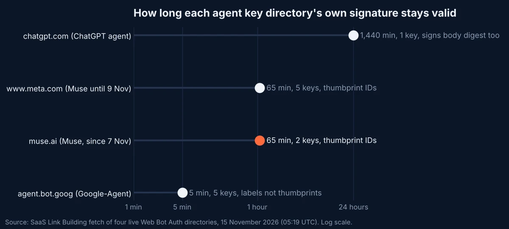

来源：https://saaslinkbuilding.com/blog/meta-muse-web-bot-auth-verification/
取文：2026-11-19，直接下载

# Meta's Muse Sends 59% of AI Agent Requests; Its New Signing Keys Share 0 of Meta's 5

Meta's Muse made 59% of AI agent requests on HUMAN-protected sites in October, then moved its Web Bot Auth signatures to muse.ai between 7 and 9 November. Our check of the live key directories found Muse's two keys share none of Meta's five, so verifiers that pinned meta.com keys now reject it.


Ras Al Khaimah, United Arab Emirates, 15 November 2026.

Meta's Muse agent made 59% of all AI agent requests on sites protected by bot security firm HUMAN in October, according to the company's [monthly agentic traffic report](https://www.humansecurity.com/learn/blog/october-2026-agentic-traffic/) published on 9 November. Two days earlier, Muse began moving the cryptographic signatures it attaches to requests from Meta's corporate key directory to a new one at muse.ai, a switch bot management company [DataDome documented](https://datadome.co/threat-research/meta-muse-now-signs-as-muse-ai/) as complete on 9 November. We fetched the live directories on 15 November: the two keys Muse now publishes share none of the five keys still listed at www.meta.com, so any verifier that pinned Meta's keys cannot verify Muse at all.

This explainer covers what changed, how Web Bot Auth works, and how to check a signed agent request yourself, with a worked example built from the directories we pulled.

## What changed

- **Muse is now the largest agent by requests.** HUMAN says Muse's share rose 19 percentage points from September, its traffic nearly quadrupled month on month, and it sent 3.7 times as many requests as ChatGPT Agent. Meta and OpenAI together made about 90% of agent requests, and 85.2% of all agent requests went to product and search pages.
- **Muse changed its signing identity.** Until 7 November, signed Muse requests carried `Signature-Agent: "https://www.meta.com"`. DataDome says the two signers ran at about 50/50 for a day and a half, giving verifiers roughly 60 hours to pick up the new directory before Muse signed only as `https://muse.ai`.
- **Half of Muse is still unsigned.** DataDome reported on 10 November that about half of Muse's requests on its network arrived without a signature, which it attributes to a likely staged rollout.

Unsigned Muse traffic is hard to spot. Meta's own [security post on Muse](https://muse.ai/blog/security-and-safety-for-ai-agents-our-approach-with-muse), published on 8 September, says that when Muse browses, "it will appear as your activity". API security firm Cequence [told SecurityBrief](https://securitybrief.news/story/meta-s-muse-ai-agent-seen-in-half-of-customer-traffic) in October that Muse presented itself as a standard Chrome browser routed through a consumer VPN, and that it was detected through behaviour rather than any identity signal. None of these sources names a user-agent token that robots.txt could match, which is why the signature matters.

## How Web Bot Auth works

Web Bot Auth is an IETF draft that lets an agent sign each HTTP request with a private key, using the HTTP Message Signatures standard ([RFC 9421](https://www.rfc-editor.org/rfc/rfc9421)). The site checks the signature against a public key the operator publishes at `/.well-known/http-message-signatures-directory` on its own domain. The [latest revision of the draft](https://datatracker.ietf.org/doc/html/draft-ietf-webbotauth-httpsig-protocol), published on 29 October with authors from Cloudflare and Google, sets these rules for a signed request:

- The `Signature-Agent` header names the operator, and that URL is the agent's identity.
- `keyid` must be the key's JWK SHA-256 thumbprint, and `tag` must be `web-bot-auth`.
- `expires` should be no more than 24 hours after `created`.
- A directory served at the well-known address must label each key with that same thumbprint.

Because the identity is a domain rather than an IP range, a new domain is a new identity. That is what caught out sites when Muse moved: the request still came from Muse, but it now pointed at a directory, and keys, the site had never trusted. It is a different model from [reverse DNS checks for Google's crawlers](https://saaslinkbuilding.com/blog/googlebot-impersonation-dns-verification-test/), where identity follows whoever owns the IP address.

## What we found in four live key directories

We requested the well-known directory from the operators of the agents in HUMAN's October top 10 at their main domains, then verified each directory's own signed response with Ed25519. Four answered with a directory.



Lifetime of each directory's signed response (created to expires). Source: SaaS Link Building fetch of the live directories at muse.ai, www.meta.com, chatgpt.com and agent.bot.goog, 15 November 2026.

| Directory | Keys | Key IDs are thumbprints | Response signatures verified | Cache-Control |
| --- | --- | --- | --- | --- |
| muse.ai | 2 | 2 of 2 | 2 of 2 | max-age=3600 |
| www.meta.com | 5 | 5 of 5 | 5 of 5 | max-age=3600 |
| chatgpt.com | 1 | 1 of 1 | 1 of 1 | no-store |
| agent.bot.goog | 5 | 0 of 5 | 1 of 1 | max-age=3600 |

*Source: SaaS Link Building fetch and Ed25519 verification, 15 November 2026, 05:19 UTC.*

Three details stand out:

- **No shared keys between Muse and Meta.** None of the two muse.ai keys appears among the five www.meta.com keys. A verifier that copied Meta's public keys into an allowlist, instead of following the `Signature-Agent` URL, now rejects every signed Muse request.
- **ChatGPT's key carries a rolling expiry.** The single chatgpt.com key lists a validity start of 1 January 2025 and an expiry exactly seven days after the moment of each fetch: a second request a few minutes later returned a later expiry, again seven days out. The response is marked `no-store`. Its directory signature also covers a `content-digest` of the body, which the other three do not.
- **Google labels its keys differently.** The five keys at agent.bot.goog, which [Google's Web Bot Auth documentation](https://developers.google.com/crawling/docs/crawlers-fetchers/web-bot-auth) names as the identity for signed Google-Agent requests, use six-character labels rather than thumbprints. That still works if you match `keyid` to `kid`, but a verifier that identifies keys by computed thumbprint will not find them by ID.

We found no directory at openai.com, claude.ai, www.anthropic.com, www.perplexity.ai, x.ai or grok.com. That does not mean those agents never sign; an operator can publish its directory on any host its `Signature-Agent` header names.

## Worked example: verifying a signature

Every directory response we fetched is itself signed, which makes it a safe place to practise. The muse.ai response carried this `Signature-Input` (nonce shortened):

```
sig1=("@authority";req);alg="ed25519";keyid="lY6gMMQSDCJr0sogJPKZiBjW7oy0wA7OEjYboFIcN4U";nonce="VbwsDd...";tag="http-message-signatures-directory";created=1794719980;expires=1794723880
```

To check it, rebuild the signature base exactly as RFC 9421 defines it, one line per covered component, then the parameters:

```
"@authority";req: muse.ai
"@signature-params": ("@authority";req);alg="ed25519";keyid="lY6g...";nonce="...";tag="http-message-signatures-directory";created=1794719980;expires=1794723880
```

Then verify the bytes against the matching public key:

```
from cryptography.hazmat.primitives.asymmetric.ed25519 import Ed25519PublicKey
import base64
def b64u(s): return base64.urlsafe_b64decode(s + "=" * (-len(s) % 4))
key = Ed25519PublicKey.from_public_bytes(b64u(jwk["x"]))  # jwk where kid == keyid
key.verify(base64.b64decode(signature_value), signature_base.encode())  # raises if invalid
```

A real Muse request works the same way, with three differences: the base covers the components listed in that request's `Signature-Input` (the draft requires at least one of `@authority` or `@target-uri`), the `tag` should read `web-bot-auth`, and the key comes from the directory the `Signature-Agent` header points to. The `created` and `expires` values are Unix seconds; the muse.ai directory signature above was valid for 3,900 seconds, or 65 minutes.

## What to do

1. **Trust domains, not key lists.** If your CDN or WAF verifies Web Bot Auth, confirm it recognises `https://muse.ai`. If you verify in-house, resolve keys from the `Signature-Agent` URL on each request and honour the directory's Cache-Control rather than hard-coding keys.
2. **Check signature expiry separately from cache age.** Google's documentation makes the same point: a signature's validity window is not the directory's Cache-Control header. Reject requests whose `expires` has passed even if the key is still cached.
3. **Log signed and unsigned agent traffic apart.** Store the `Signature-Agent` value and verification result with each request. With half of Muse unsigned, signed requests are a floor for its real volume, not the total, and the same split applies when [tracing Google-Agent sessions in server logs](https://saaslinkbuilding.com/blog/ai-agent-sessions-google-agent-logs/).
4. **Keep a fallback for unsigned agents.** Google says it does not sign every Google-Agent request and asks sites to keep IP, reverse DNS and user-agent checks. For unsigned Muse, the security firms cited here describe behavioural detection as the way they identified it.
5. **Decide policy by page type.** HUMAN's data shows agents mostly hit product and search pages. Blocking them there can remove a shopping assistant's ability to recommend you; rate-limiting checkout or account actions is a narrower control.

## Methodology

On 15 November 2026 at 05:19 UTC we requested `/.well-known/http-message-signatures-directory` over HTTPS from muse.ai, www.meta.com (meta.com redirects there), chatgpt.com, agent.bot.goog, openai.com, claude.ai, www.anthropic.com, www.perplexity.ai, x.ai, grok.com and google.com. For the four that returned a JSON key set, we counted keys, computed each Ed25519 key's JWK SHA-256 thumbprint and compared it with the published `kid`, compared public keys across directories, recorded Cache-Control, and verified every directory response signature with Ed25519 over an RFC 9421 signature base built from the `Signature-Input` header, the requested host and, for chatgpt.com, the `content-digest` header. All nine response signatures verified. We fetched chatgpt.com a second time about three minutes later to check whether its key expiry moved. We did not observe live agent requests, so request-level figures come from HUMAN and DataDome as cited.

## Conclusion

By HUMAN's account, Muse overtook Perplexity's Comet as the top agent on its network within two months, and it changed its cryptographic identity along the way with a 60-hour handover. The directories show that operators are implementing the same draft in visibly different ways, from five-minute to 24-hour signature windows and from thumbprint IDs to short labels. Sites that want to treat agents differently from people will need verification that follows the `Signature-Agent` URL, tolerates rotation, and still has a plan for the half of Muse traffic that carries no signature at all.

## Questions and answers

What share of AI agent traffic does Meta's Muse account for?

HUMAN Security's October 2026 agentic traffic report, published on 9 November, puts Muse at 59% of agent requests on HUMAN-protected sites, up 19 percentage points from September, and 3.7 times the requests of ChatGPT Agent.

Which Signature-Agent value does Muse use now?

DataDome reports that Muse signed with Signature-Agent "https://www.meta.com" until the switch began on 7 November, ran both signers for about a day and a half, and from 9 November signs only as "https://muse.ai", with keys at https://muse.ai/.well-known/http-message-signatures-directory.

Are all Muse requests signed?

No. DataDome reported on 10 November that about half of Muse's requests on its network arrived unsigned. Cequence said in October that Muse presented itself as a standard Chrome browser and was detected through behaviour.

Does Google sign Google-Agent requests with Web Bot Auth?

Some of them. Google's documentation says a subset of Google-Agent requests are signed and authenticated as https://agent.bot.goog, labelled g, and that sites should keep IP, reverse DNS and user-agent checks as a fallback.

Can robots.txt block Muse?

Not by name. Meta says Muse's browsing appears as the user's own activity, and none of the reports cited here names a user-agent token for Muse, so access control falls to signature verification and bot management rather than robots.txt.
