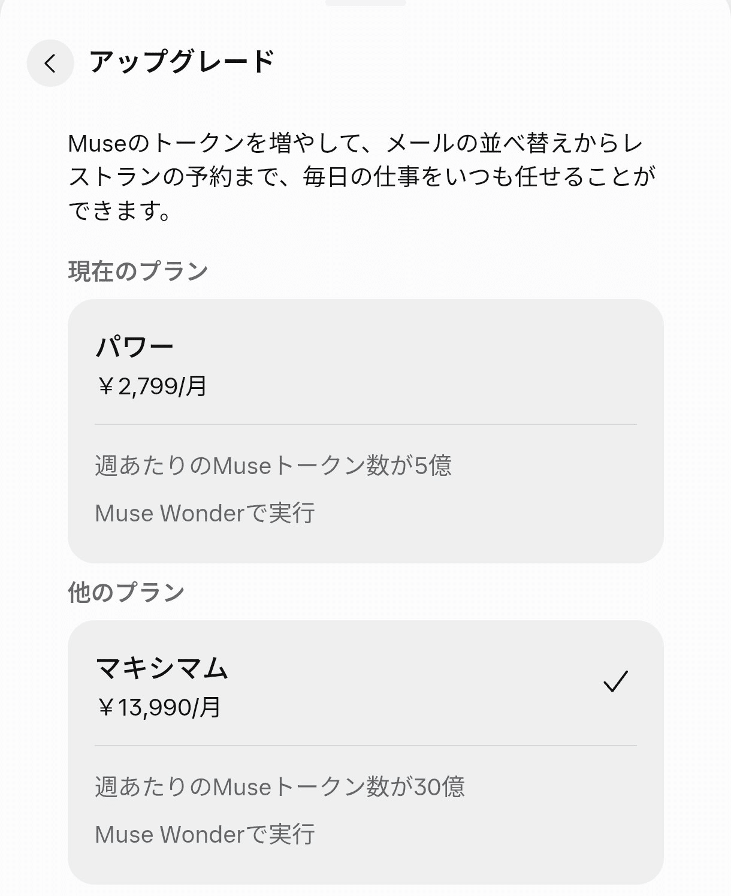



**收录说明**：直接下载后以 div.article-body 抽取；已删去文末作者推广区块（杂志、X、个人门户链接），出典清单保留；升级画面截图已本地化到 images/，原图无替代文本，图注按图面文字转录；头图为装饰图，未收。原文全文存于本目录的 original.md，网站上不显示，已翻译。另注：文中“有料プランは Muse Wonder で実行”一说为作者对应用内升级画面的实地核对（截图为证），与仓库待 Sky 决定的 Wonder 切换事实为同一问题——2026 年 11 月 6 日官方研究博客的说法是向 Muse 推送以 Wonder 训练的特化模型，而非 Wonder 本身；此处照录作者的核对结果，不作定论。

**内容摘要**：作者对照 Meta 官方帮助与应用内实际升级画面（2026 年 11 月 19 日确认），整理免费、Power、Maximum 三档：免费档用量上限数值官方未公布；Power 月 2,799 日元（官方帮助为 20 美元），每周 5 亿 Muse tokens；Maximum 月 13,990 日元（100 美元），每周 30 亿 tokens；升级画面在两档付费下均写明“Muse Wonderで実行”。Power 与 Maximum 的模型相同，差别只在用量（价格约 5 倍、用量 6 倍）。电话代打为 2026 年 11 月 13 日起美国付费用户专属，日本暂无；订阅按月自动续费、可随时取消，帮助中未见退款说明。

**保留理由**：这是已收资料中唯一一篇凭应用内升级画面截图实地核对档位与模型对应关系的记录，也是唯一一份日本定价（2,799／13,990 日元）的收集；其截图为仓库待决的 Wonder 切换问题提供了一手旁证。

---

基础篇系列第二篇，谈价格。本文根据 Meta 官方帮助、官方公告，以及实际的升级界面，整理了「Muse 免费能用到什么程度，付费后会发生什么变化」。

先说结论：免费与付费的差别主要有两点。一是「一周可用的量」，二是「运行的模型」——付费套餐由最顶级的 Muse Wonder 执行。套餐分为免费、Power、Maximum 三档。另一方面，免费套餐的上限数值官方没有公布。本文信息截至 2026 年 11 月 19 日。

## 1. 三种套餐：免费、Power、Maximum

- 免费：带使用限制，可免费使用。但具体上限数值未写在官方帮助中
- Power：每月 2,799 日元（官方帮助为 20 美元）。每周最多可使用 5 亿个 Muse token
- Maximum：每月 13,990 日元（官方帮助为 100 美元）。每周最多可使用 30 亿个 Muse token

补充一下价格：官方帮助中只列出美元标价，但实际升级界面以日元显示（2026 年 11 月 19 日确认）。在日本上线的公告中也说明「也准备了订阅套餐」，日本同样提供付费套餐本身。金额可能因账户或商店条件而变化，请在订阅前确认自己界面上的显示。

## 2. 官方写明的差别是「使用量」与「模型」

- 使用量：官方帮助作为各套餐差异明确写出的，是一周的使用上限
- 模型：升级界面在 Power 和 Maximum 两档都显示「由 Muse Wonder 执行」。付费套餐以最顶级模型运行
- 功能差异的记载：官方帮助中没有按套餐解锁功能的清单。与其说「付费后功能增加」，实际情况是「可用量增加，头脑换成更高级的模型」
- Power 与 Maximum 的差别：模型同为 Wonder，差别只在用量。价格约为 5 倍（2,799 日元→13,990 日元），用量为 6 倍（每周 5 亿→每周 30 亿 token）

模型改变后有什么不同，会在第 4 节分开说明。

## 3. 达到上限后会怎样

达到免费上限后还想继续使用时，官方帮助给出两个选项。

- 升级：加入付费套餐后，一周的使用上限会提高
- 等待：也可以等到免费使用上限更新

加入后的处理方式也能在帮助中确认。

- 自动续费：只要不取消，每月自动续费，账单在每月与首次购买日相同的日期扣款
- 解约：随时可以确认订阅、更新支付方式或取消
- 退款：官方帮助中未能确认关于退款的说明

## 4. 模型会变：免费是 Spark，付费是 Wonder

运行 Muse 的模型，在 2026 年 9 月发布时是 Muse Spark。随后在 2026 年 10 月 12 日，Meta 发布了最顶级的模型群 Muse Wonder 和 Muse Wonder Full。Wonder 具备跨对话持续记住重要事项的「主动记忆（Active Memory）」，以及面对困难工作也能坚韧地重新调整并推进的「主动专注（Active Focus）」。

在该发布时点，Wonder 向 Muse 本体的部署被表述为「从订阅者开始依次进行」。而在当前的升级界面中，Power 和 Maximum 两档都明确写着「由 Muse Wonder 执行」。也就是说，在付费套餐中，负责思考的头脑本身会换成最顶级模型。

在简短交流中可能不易感受到差别，但在步骤繁多的长任务，或在后台并行推进的工作中，模型差异更容易显现。结合用量差异来理解，「能用很多」和「头脑被替换」就是付费的两项内容。

## 5. 部分功能另有条件（面向日本读者的注意）

还有一点容易混淆。某些功能会在套餐的一般说明之外，另行规定提供条件。

- 电话外呼：Muse 代为打电话的功能于 2026 年 11 月 13 日由官方宣布开始向「美国付费会员」提供。日本尚未提供，在日本付费也无法使用
- 权益因人而异：官方帮助开头明确写道，权益与是否提供因地区和账户而异，实际可用的权益会在加入前的界面中显示

「付费后能做什么」的清单会因国家而不同。不要直接把海外的公告当成自己的情况，这一点很重要。

## 6. 到底该不该付费的判断标准

判断的轴很简单，就是「是否已经触到免费上限」。

- 继续免费：如果用法中从不会看到上限提示，免费就足够了。Meta 自己也宣布「多数人所需的范围是免费的」
- 考虑 Power：如果几乎每周都达到上限、工作因此停摆，每月 2,799 日元的 Power 是第一个候选。由 Wonder 执行也是从这一档开始
- 考虑 Maximum：如果是连 Power 都会触顶的长时间、大量工作，则为每月 13,990 日元

加入条件为年满 18 岁（或所在国家的成年年龄），并需使用 Meta 账户登录。此外还说明，Muse 与订阅服务正在试验运营中，提供地区有限，可能尚无法使用。订阅前请务必确认自己界面上显示的价格与权益。

下次，基础篇系列第三篇将整理 Muse 与其他 AI（ChatGPT／Claude／Gemini）的区别。

---

出处（2026 年 11 月 19 日确认）

- Meta 官方帮助〈关于 Muse 订阅〉https://www.meta.com/ja-jp/help/subscriptions/1021145227643680/
- Muse 应用的升级界面（确认了日元价格与「由 Muse Wonder 执行」的显示）
- Meta 日本官方〈Meta 在日本开始提供个人 AI 代理「Muse」〉（2026 年 10 月 23 日）https://about.fb.com/ja/news/2026/10/muse-personal-ai-agent-launches-in-japan/
- Meta 官方〈Introducing Muse〉（2026 年 9 月 8 日）https://about.fb.com/news/2026/09/introducing-muse-personal-ai-agent/
- Meta 官方〈Introducing Muse Wonder and Muse Wonder Full〉（2026 年 10 月 12 日）https://about.fb.com/news/2026/10/introducing-muse-wonder-models/
- 官方 X @Muse 关于电话外呼功能的公告（2026 年 11 月 13 日）
