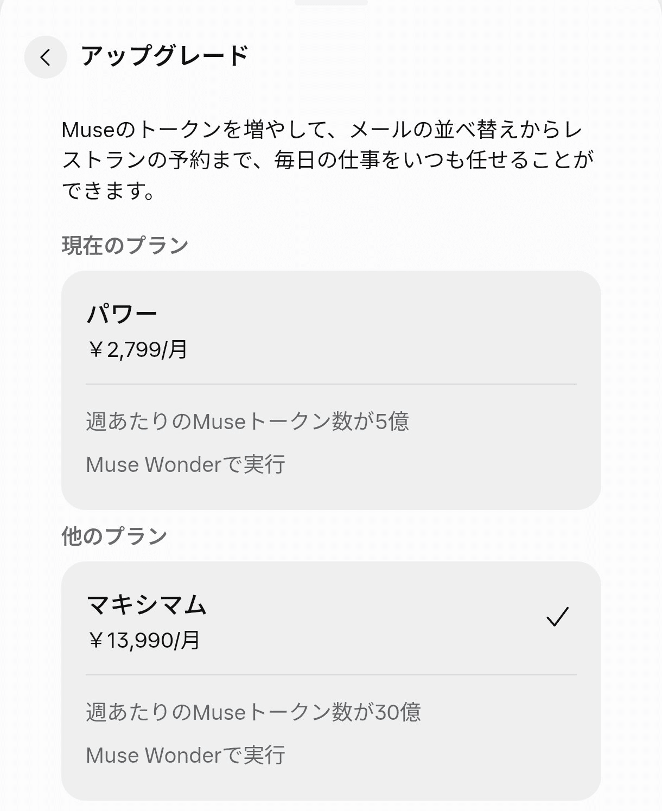

来源：https://muse.emma-muse.com/articles/muse-free-vs-paid
取文：2026-11-22，直接下载

基本編シリーズ第2弾は、料金の話です。「Museは無料でどこまで使えて、課金すると何が変わるのか」を、Metaの公式ヘルプと公式発表、そして実際のアップグレード画面で確認して整理しました。

結論を先に言うと、無料と有料の差は大きく2つです。1つは「1週間に使える量」、もう1つは「動いているモデル」で、有料プランは最上位の Muse Wonder で実行されます。プランは無料・パワー・マキシマムの3つです。一方で、無料プランの上限の数値は公式には出ていません。この記事は2026年11月19日時点の情報です。

## 1. プランは3つ：無料・パワー・マキシマム

- 無料：使用制限付きで無料で使えます。ただし上限の具体的な数値は、公式ヘルプに書かれていません
- パワー：月額2,799円（公式ヘルプでは20ドル）。毎週5億Museトークンまで使えます
- マキシマム：月額13,990円（公式ヘルプでは100ドル）。毎週30億Museトークンまで使えます

価格について補足すると、公式ヘルプに載っているのはドル表記だけですが、実際のアップグレード画面では日本円で表示されます（2026年11月19日に確認）。日本の提供開始の発表でも「サブスクリプションプランもご用意しています」と案内されていて、日本でも有料プラン自体が用意されています。金額はアカウントやストアの条件で変わる可能性があるので、申し込む前に自分の画面の表示を確認してください。

## 2. 公式に書かれている差は「利用量」と「モデル」

- 利用量：公式ヘルプがプランごとの違いとして明記しているのは、1週間の利用上限です
- モデル：アップグレード画面では、パワーとマキシマムの両方に「Muse Wonderで実行」と表示されています。有料プランは最上位モデルで動きます
- 機能差の記載：プランによって解放される機能の一覧は、公式ヘルプにはありません。「課金すると機能が増える」というより、「使える量が増えて、頭脳が上位モデルになる」のが実態です
- パワーとマキシマムの差：モデルは同じWonderで、差は利用量だけです。価格は約5倍（2,799円→13,990円）で、利用量は6倍（週5億→週30億トークン）になります

モデルが変わると何が違うのかは、4で分けて説明します。

## 3. 上限に達するとどうなるか

無料の上限に達して、さらに使いたい場合の選択肢は、公式ヘルプでは2つです。

- アップグレード：有料プランに加入すると、1週間の利用上限が引き上げられます
- 待つ：無料の利用上限が更新されるまで待つ方法もあります

加入した後の扱いも、ヘルプで確認できました。

- 自動更新：キャンセルしない限り毎月自動で更新され、請求は毎月、最初の購入日と同じ日に行われます
- 解約：サブスクリプションの確認や支払い方法の更新、キャンセルはいつでもできます
- 返金：返金についての記述は、公式ヘルプでは確認できませんでした

## 4. モデルが変わる：無料はSpark、有料はWonder

Museを動かしているモデルは、2026年9月の発表時点では Muse Spark です。そして2026年10月12日、Metaは最上位のモデル群 Muse Wonder と Muse Wonder Full を発表しました。Wonderには、大切なことを会話をまたいで覚え続ける「Active Memory」と、難しい作業でも粘り強く立て直して進める「Active Focus」が備わっています。

この発表の時点では、WonderのMuse本体への展開は「加入者から順次」と表明されていました。そして現在のアップグレード画面では、パワーとマキシマムの両方に「Muse Wonderで実行」と明記されています。つまり有料プランでは、担当する頭脳そのものが最上位モデルに替わります。

短いやり取りでは差を感じにくくても、手順の多い長い作業や、裏側で並行して進む作業では、モデルの差が出やすいところです。利用量の差と合わせて、「たくさん使える」と「頭脳が替わる」が課金の2つの中身だと捉えると分かりやすいです。

## 5. 機能ごとの条件は別にある（日本の読者向けの注意）

もう1つ、混同しやすい点があります。機能によっては、プランの一般的な説明とは別に、提供条件が決まっているものがあります。

- 電話発信：Museが代わりに電話をかける機能は、2026年11月13日に「米国の有料会員向け」に提供開始と公式発表されました。日本では提供されておらず、日本で課金しても使えません
- 特典は人によって違う：公式ヘルプの冒頭には、特典と提供可否は地域とアカウントによって異なり、実際に使える特典は加入前の画面で表示される、と明記されています

「有料にするとできること」の一覧は、国によって姿が変わります。海外の発表をそのまま自分の話として受け取らないことが大切です。

## 6. 結局、課金すべきかの目安

判断の軸はシンプルで、「無料の上限に当たっているかどうか」です。

- 無料のまま：上限の表示を見ることがない使い方なら、無料で足りています。Meta自身も「多くの人が必要とする範囲は無料」と発表しています
- パワーを検討：毎週のように上限に達して作業が止まるなら、月2,799円のパワーが最初の候補です。Wonderで実行されるようになるのもここからです
- マキシマムを検討：パワーでも上限に達するような、長時間・大量の作業を任せる使い方なら月13,990円です

加入の条件として、18歳以上（または所在国の成人年齢）であることと、Metaアカウントでのログインが必要です。また、Museとサブスクリプションは試験運用中で、提供地域が限られていて、まだ利用できない場合があるとも案内されています。申し込む前に、自分の画面に表示される価格と特典を必ず確認してください。

次回、基本編シリーズ第3弾では、Museと他のAI（ChatGPT／Claude／Gemini）の違いを整理します。

---

出典（2026年11月19日確認）

- Meta公式ヘルプ「Museサブスクリプションについて」https://www.meta.com/ja-jp/help/subscriptions/1021145227643680/
- Museアプリのアップグレード画面（円価格と「Muse Wonderで実行」の表示を確認）
- Meta日本公式「Meta、パーソナルAIエージェント『Muse』を日本で提供開始」（2026年10月23日）https://about.fb.com/ja/news/2026/10/muse-personal-ai-agent-launches-in-japan/
- Meta公式「Introducing Muse」（2026年9月8日）https://about.fb.com/news/2026/09/introducing-muse-personal-ai-agent/
- Meta公式「Introducing Muse Wonder and Muse Wonder Full」（2026年10月12日）https://about.fb.com/news/2026/10/introducing-muse-wonder-models/
- 公式X @Muse の電話発信機能の発表（2026年11月13日）
