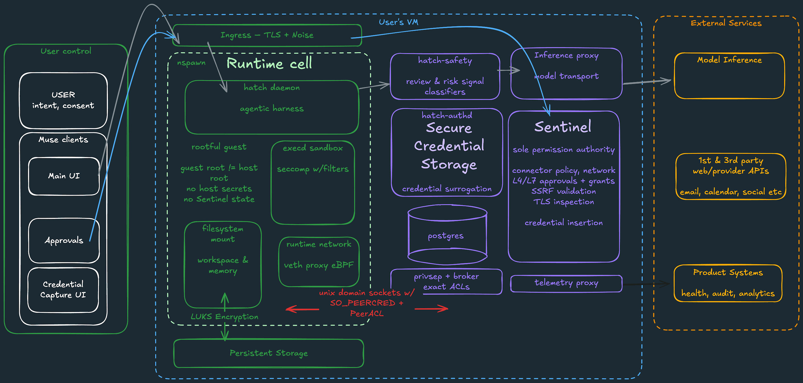
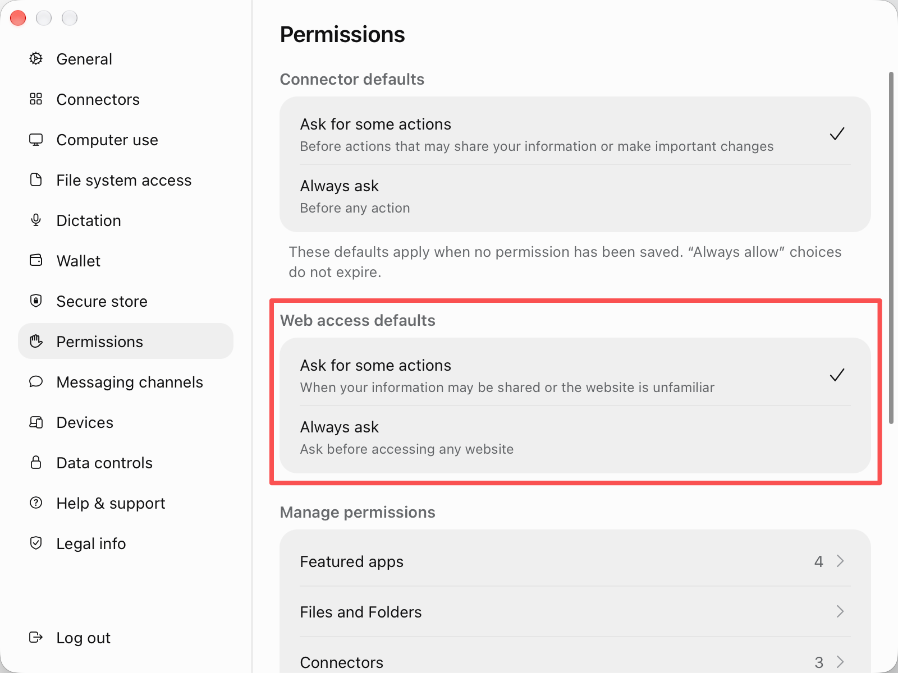
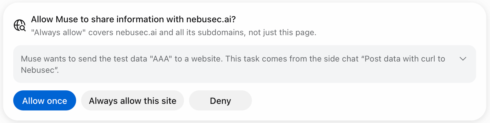



**收录说明**：直接下载；三张配图（请求路由架构图、审批提示截图、权限设置截图）已本地化；文中的代码块与命令输出照录。本篇为同站《Hacking Muse: Stealing Private Chats Through Browser Use》一文的技术详解，本轮另收。

**内容摘要**：技术详解：每位用户的智能体运行在 2 vCPU、8 GiB 的 Cloud Hypervisor 虚拟机内的 systemd-nspawn 容器中，容器内 UID/GID 0 映射到虚拟机中的 131072；hatch-safety、Sentinel 与 hatch-authd 三项服务运行在容器之外，凭据以替代令牌形式交给智能体、由 Sentinel 在出站时换成真实凭据。Muse 有四种浏览器后端，研究针对的是容器内随智能体运行的 Chromium：10 月初仍为 152 版，存在多个可用的公开 V8 漏洞，且 PDF 导出进程关闭了 IPC 沙箱，单个渲染器漏洞即可在容器内执行代码。Sentinel 按读/写分类出站请求，无正文的 GET、HEAD、OPTIONS 可静默放行，并以解码筛查、熵阈值、模型审查与流量预算检查内容，研究者在其规则内完成了无提示外传。内核为定制的 Ubuntu Linux 7.0，若干加固选项被关闭，自动漏洞利用生成框架的成功率超过 99.9%；逃逸后可达持久存储、凭据库与 Sentinel，虚拟机本身还有独立的公网 IPv6 地址可直接出网；未突破 Cloud Hypervisor 到宿主机。

**保留理由**：对 Muse 运行环境迄今最深入的独立架构剖析，披露了容器内外服务划分、四种浏览器后端、Sentinel 策略细节与内核配置等官方未公开的实现细节，与已收官方安全文章、iFynx 解析互为对照。

---

我们分析了几个 AI 助手的执行环境。本系列的第一篇文章介绍我们对 [Meta 的 Muse](https://muse.ai) 的研究：架构研究、我们如何获得 0.5 次点击的远程代码执行（RCE）并泄露用户数据，以及我们如何逃出容器，揭示 Muse 的 Sentinel 守卫究竟如何运作。

## Muse 的高层安全设计

OpenAI 和 Anthropic 把云端托管的 ChatGPT 与本地运行的 Codex 和 Claude 智能体拆分为不同的产品。Muse 走的是另一条路：网页聊天就是同一个智能体，运行在云端虚拟机中，这给了它更多自由，也更能支持长时间运行的任务。

如果智能体已经能聊天，为什么还要为网站单独构建一个聊天服务？Muse 网站、移动应用和 WhatsApp 助手都连接到用户虚拟机中的同一个智能体。记忆和对话历史存放在该虚拟机专用的持久存储上。Meta 为每位用户配置一台 2 vCPU、8 GiB 的 Cloud Hypervisor 虚拟机，在其中启动一个 `systemd-nspawn` 容器，并在该容器中运行一个类似 Codex 的 Muse 智能体。

那么 Muse 如何控制不可信输入带来的风险？智能体在运行时容器内以 root 运行，但这并不会让它在用户虚拟机中获得 root 权限。runtime-cell 代码把容器的用户命名空间范围固定为 131072–196607，因此容器内的 UID 和 GID 0 映射到虚拟机中的 131072。同一个基数也出现在 rootfs 所有权、连接器套接字所有权，以及整个虚拟机配置中的对端检查里。

若干安全服务运行在容器之外：

- `hatch-safety` 审查模型输入和输出，并向守护进程返回允许或拒绝的闸门结果。
- `Sentinel` 审计来自运行时容器的出站流量。
- `hatch-authd` 居间处理连接器凭据。智能体收到的是替代令牌，Sentinel 在出站请求中把它们换成限定于具体连接器的真实凭据。（随附的推理单元和 Stefi 代理单元走一条单独的路径：各自通过 systemd 的 `LoadCredential=` 机制加载自己的平台密钥。）

这种隔离旨在让真实凭据处于智能体触及不到的地方，并把出站策略放在运行时容器之外。如果 Muse 下载并运行不可信代码——例如通过供应链攻击被攻陷的依赖——Sentinel 仍应拦截该代码发出的出站请求，并应用相同的允许、拒绝和审批规则。

Muse 的执行环境结构如下：

```
Linux hypervisor host

└─ KVM

└─ Cloud Hypervisor

└─ Per-user Ubuntu VM

└─ systemd-nspawn runtime container

└─ Muse agent
```

## Muse 及其浏览器

攻击者能从什么地方进入一个运行在云端的智能体？浏览器是一条显而易见的路径。那么让我们看看 Muse 如何使用浏览器——或者更准确地说，多个浏览器——以及智能体上网浏览时会发生什么。

大多数 Muse 请求通过 Noise 协议传输到用户虚拟机中的入口服务。入口服务通过 Unix 套接字把请求转发给运行时容器内的 `hatch` 守护进程。



与浏览器相关的请求走同一条入口路径。[Meta 的公开架构](https://muse.ai/blog/security-and-safety-for-ai-agents-our-approach-with-muse)描述了用于交互式网页任务的代理浏览器。实际上还有另外三条路径，包括一个在运行时容器内与智能体并排运行的 Chromium 副本，Muse 根据任务在四种后端之间选择：

| 浏览器位置 | 调用方式 | 典型任务 | Chromium 版本 | 出站强制执行 |
| --- | --- | --- | --- | --- |
| 远程取页服务 | 容器内工具（如 `browser_open`、`browser_search`）调用 `browser-service` | 获取页面内容和搜索结果 | 未知；该服务可能并非由浏览器支撑 | 远程服务策略 |
| 按需浏览器虚拟机 | `browser.browse` 调用用户虚拟机中的 `browser-broker`；代理配置一台浏览器虚拟机并转发请求 | 登录流程、表单和预订 | `155.0.8059.80` | 浏览器虚拟机策略 |
| 本地浏览器容器 `htch-browser` | `browser-broker` 在用户虚拟机中启动一个单独的 `systemd-nspawn` 容器 | Muse 发起的后台页面检查 | `155.0.8059.80` | 直接 IPv4 伪装；拒绝内部和保留的 IPv4 网段；拒绝 IPv6 |
| 随附的 `/opt/meta-chromium/chrome` | 智能体直接或通过 Playwright 启动 Chromium | 审阅页面截图、生成文件缩略图、导出 PDF | `155.0.8059.80` | 运行时容器经 Sentinel 的路径 |

我们重点关注的是随附的 Chromium 副本，它运行在运行时容器内、与智能体并排。

两个本地后端使用了不同的网络边界。`htch-browser` 单元通过一条专用伪装（masquerade）规则配置直接 IPv4 出站，拒绝内部和保留的 IPv4 网段，并禁用 IPv6。随附的 Chromium 继承运行时容器的 Sentinel 路径，包括请求分类、内容检查、流量预算和审批规则。因此浏览器漏洞利用会继承它所攻陷后端的出站策略，而对随附的 Chromium 来说，这仍在 Sentinel 控制之下。

Muse 会不时更新其随附的浏览器，但我们的快照显示它落后于 Chrome 的发布节奏。10 月初，容器中仍带着 Chromium `152.0.7977.82`。M152 在 8 月进入稳定版，而这个补丁版本于 9 月 3 日发布。稍后的快照中已是 `155.0.8059.80`。

这样的更新节奏留下了实际的 n 天窗口。在那个构建中仍可使用的公开 V8 漏洞包括 NebuSec 报告的 [`559932543`](https://issues.chromium.org/issues/559932543)，以及 [`560233248`](https://issues.chromium.org/issues/560233248) 和 [`550360762`](https://issues.chromium.org/issues/550360762)。当时我们估计，有五个以上的公开 V8 漏洞无需额外标志即可利用。我们使用了 [`554034656`](https://issues.chromium.org/issues/554034656)，这是一个逃出 V8 沙箱的解析器漏洞，把 V8 内的内存破坏变成了任意代码执行。

用于 PDF 导出的 Chromium 进程关闭了其 IPC 沙箱。当用户要求 Muse 保存一个由攻击者控制的页面时，单个渲染器漏洞——价值约 500 美元——就足以以智能体的权限在运行时容器内执行任意 shell 命令。

## Sentinel 在注视着你

我们最初尝试把命令输出发送到外部服务器时，出现了审批提示。Muse 用户会认出这个对话框：



即使对以 root 在容器内运行的程序，提示仍然出现。为什么 root 也需要获得使用网络的权限？

回忆一下多层沙箱：审批决定来自运行时容器之外。Muse 把特权操作委托给用户虚拟机中的服务；Gmail、Notion 和 Facebook 等连接器也采用同样的拆分。容器侧的 CLI 并不自行执行操作。运行时容器内的客户端通过 `/run/hatch/privsep/foo.sock` 这样的套接字发送请求，由用户虚拟机中的服务执行该操作。

连接器彼此之间也被拆分。Notion 套接字使用 systemd 的 `Accept=yes` 模式，在专用的 `hatch-w-notion-cli` 账户下为每个连接启动一个工作进程。其 unit 提供了临时 home、只读的系统树、遮蔽的 `/proc`，以及拒绝 `mount`、`setns` 和 `unshare` 的系统调用过滤器。在审查过的凭据读取路径上，authd 从工作进程的 cgroup 推导出其凭据范围，并且只接受 `notion` 文档。套接字权限允许映射后的运行时守护进程身份接入，而 systemd 仍在专用工作进程账户下处理每个连接。

网络也使用同样的隔离。运行时容器唯一的外部接口是 `host0`，其默认路由和 DNS 解析器都指向 `198.19.0.1`：

```
root@htch-runtime:~# ip route

default via 198.19.0.1 dev host0

198.19.0.0/30 dev host0 proto kernel scope link src 198.19.0.2

root@htch-runtime:~# cat /etc/resolv.conf

# ...

nameserver 198.19.0.1

root@htch-runtime:~# cat /etc/hosts

# ...

198.19.0.1 hatch-egress-proxy
```

`198.19.0.1` 上的服务是 Sentinel（`hatch-sentinel`）。它在 53 端口应答 DNS，在 3128 端口接受代理流量。Sentinel 的 DNS 服务器不返回目标的真实 IP 地址，而是从 `198.18.0.0/16` 中分配一个假地址。Sentinel 记录地址到域名的映射，并在连接到达代理时用它还原原始域名。

容器的显式代理设置指向同一地址和同一代理端口：

```
root@htch-runtime:~# cat /opt/hatch/runtime-cell/guest.env

# ...

HTTP_PROXY=http://hatch-egress-proxy:3128

HTTPS_PROXY=http://hatch-egress-proxy:3128

ALL_PROXY=http://hatch-egress-proxy:3128

SSL_CERT_FILE=/run/hatch/egress-tls/ca-bundle.pem
```

这些变量只对配合的客户端有效，但任意代码可以忽略它们，直接调用 `connect()`。Sentinel 通过挂载到容器 cgroup 上的 eBPF 程序覆盖这条路径。该程序把外部目标改写为 `198.19.0.1:3128`，因此连接仍终止于 Sentinel。既然内核反正都会重定向套接字，取消设置 `HTTP_PROXY` 几乎不起作用。

于是我们有了远程代码执行，也能篡改聊天历史，但由于 Sentinel 监视着几乎所有出站流量，我们无法把一切都发送出去。是时候证明 Sentinel 并不安全了。

## 理解并绕过 Sentinel 的策略

要在不提示用户的情况下发送数据，我们需要理解为什么有些请求未经批准就能通过。

Sentinel 首先把请求归属到发起它的进程，然后评估内置的 Rego 策略。命中拒绝规则会在不询问用户的情况下拒绝请求。其余请求被分为读和写。只有不带正文的 `GET`、`HEAD` 和 `OPTIONS` 请求才算读取。写入需要审批，除非有允许规则覆盖；而在 Muse 默认的**部分操作需要询问**设置下，读取可以静默离开。



进程归属信息还会输入到 execd 的污点门控。execd 把文件和进程状态跟踪为 `clean`、`tainted`、`untracked` 或 `distrusted`；只有在查询成功且 PID 与进程启动时间匹配后，Sentinel 才接受 `clean`。当某条规则要求来源为 clean 时，查询失败、结果非 clean 或进程身份不匹配，都会移除一条通往静默批准的路径。随后 Sentinel 继续执行常规的允许、拒绝和提示规则。

HTTP 方法只是该决策的一个输入。Sentinel 还会检查请求内容和累计流量：

- **敏感数据筛查。** Sentinel 会尝试对每个 URL 组件做十六进制和 Base64 解码，然后在解码后的文本中扫描电子邮件地址、以 `+` 开头的国际电话号码，以及附加在 `otp` 或 `verification_code` 上的六到八位数值。一个短的 Base64 编码电子邮件地址触发了审查，而明文 `alice@example.com` 被放行。
- **熵阈值。** Sentinel 把每个无法解码的数据块归入四个字符集类别之一，计算该数据块的香农熵，并应用该类别的阈值。
- **模型审查。** 可疑请求会发送给 `policyguard-nvfp4`，它返回 `veto` 或 `no_finding`。
- **出站预算。** 在 60 分钟的滚动窗口内，从单一来源到单一域名的累计流量超过 2 MiB 即触发审查。在所有来源合计的情况下，同一域名在该窗口内的阈值为 5 MiB。

在这些规则范围内，我们利用浏览器链路把用户的对话历史和已保存的记忆发送到我们的服务器，且没有触发审批提示。我们还可以向对话历史中注入条目，并修改已保存的记忆。

## 再进一步，抵达内核

我们的代码仍运行在运行时容器内。容器 root 可以调用选定的虚拟机侧 Unix 套接字，但这些接口把服务身份、凭据范围和权限都保持在容器之外。如果我们能利用容器与每用户虚拟机共享的内核中的漏洞，就能获得虚拟机 root，并打破这些接口上的所有限制。

并非每一个本地提权漏洞都能逃出容器。仅数据的写时复制漏洞在这里通常没有用，因为容器可能没有暴露用户虚拟机的 libc、setuid 二进制文件或其他依赖，所以即使我们能写入任意文件，宿主机也可能永远不会执行它。内核内存破坏提供了更实际的方式，可同时实现提权和容器逃逸。

在 10 月 2 日的测试中，虚拟机运行的是 Hatch 定制的 Ubuntu 内核：

```
Linux version 7.0.0-39-generic (hatch@hatch) (gcc (Ubuntu 13.3.0-6ubuntu2~24.04.1) 13.3.0, GNU ld (GNU Binutils for Ubuntu) 2.42) #1 SMP PREEMPT_DYNAMIC Thu Sep 24 08:42:15 UTC 2026
```

与标准 Ubuntu 构建相比，Hatch 内核被大幅裁剪。大量硬件驱动、文件系统和外围协议被移除，`KALLSYMS_ALL` 和 `/proc/kcore` 等接口被禁用。

然而奇怪的是，Hatch 在内核配置中启用了 `CONFIG_IO_URING`，只是又把 `io_uring` 屏蔽掉，正如 Meta 的[公开安全架构](https://muse.ai/blog/security-and-safety-for-ai-agents-our-approach-with-muse)所述。

包括 `RANDOMIZE_MEMORY`、`HARDENED_USERCOPY` 和 `INIT_ON_ALLOC_DEFAULT_ON` 在内的若干安全加固选项也被禁用。

这对漏洞利用是好消息，因为一些烦人（但可绕过）的保护被关闭了。坏消息是：我们没有可供检查的目标内核镜像。我们不能依赖从该镜像准备好的结构体字段和函数偏移，漏洞利用必须在不对 CPU 或内存配置做固定假设的情况下工作。

结果这并不成问题，因为 Linux 7.0 落在多个 CVE 已公布的影响范围内。我们使用 NebuSec 的自动漏洞利用生成框架，生成了满足这些约束的通用漏洞利用。在我们的测试运行中，它们成功率超过 99.9%。这些利用避开针对特定 CPU 的技术。它们获得任意内核读写，利用物理内存访问定位内核镜像、解析其符号表，并找到提权所需的数据偏移。不需要预先计算目标偏移。

我们将在后续文章中描述我们用于发现、评估、利用和修复内核漏洞的流水线。**我们的 170 多个补丁已被合并进 Linux 主线，我们会持续监控新的漏洞并评估其可利用性，帮助维护者安排补丁审查的优先级。**

## Muse 容器之外

在内核逃逸之后，我们获得了用户虚拟机中的 root。我们可以访问未挂载到运行时容器中的持久存储、安全凭据存储（Secure Credential Storage）以及 Sentinel 本身。此前在容器内拿不到的目标内核镜像，现在位于 `/boot` 下。

不过，Cloud Hypervisor 仍横亘在被攻陷的用户虚拟机与其他租户之间。跨越这一边界需要在宿主机内核或虚拟机监视器中有一个访客到宿主的（guest-to-host）漏洞，或存在一个脆弱的内部服务。

虚拟机把持久状态与产品文件分开。Home 和服务状态来自一个 100 GiB 的 LUKS2/Btrfs 卷，该卷在虚拟机中已解锁并挂载。`/opt/hatch` 来自一个只读、由 dm-verity 支持的 squashfs 镜像，而运行时容器单独挂载持久化的 `/home/hatch`。虚拟机 root 能访问到容器视野之外的已挂载持久状态。

那个强制我们的容器连接经过 Sentinel 的 cgroup 钩子，并不覆盖直接运行在用户虚拟机中的进程。这些进程可以在不经过 Sentinel 的情况下发送出站流量。虚拟机甚至有自己的公网 IPv6 地址：

```
1: lo: <LOOPBACK,UP,LOWER_UP> ...

2: ens4: <BROADCAST,MULTICAST,UP,LOWER_UP> mtu 1500 qdisc pfifo_fast state UP group default qlen 1000

link/ether RE:DA:CT:ED:13:17 brd ff:ff:ff:ff:ff:ff

altname enp0s4

inet 10.0.0.2/24 metric 1024 brd 10.0.0.255 scope global dynamic ens4

valid_lft 1911sec preferred_lft 1911sec

inet6 2401:db00:c000:0:5c8a:fff:reda:cted/64 scope global dynamic mngtmpaddr noprefixroute

valid_lft 86382sec preferred_lft 14382sec

inet6 fe80::5c8a:fff:reda:cted/64 scope link

valid_lft forever preferred_lft forever

3: ve-htch-runtime@if2: <BROADCAST,MULTICAST,UP,LOWER_UP> mtu 1500 qdisc noqueue state UP group default qlen 1000

link/ether RE:DA:CT:ED:13:17 brd ff:ff:ff:ff:ff:ff link-netnsid 0

inet 198.19.0.1/30 scope global ve-htch-runtime

valid_lft forever preferred_lft forever

inet6 fd8b:4f84:7d32:99::1/64 scope global

valid_lft forever preferred_lft forever

inet6 fe80::d8c1:reda:cted:1337/64 scope link

valid_lft forever preferred_lft forever

# ip route

default via 10.0.0.1 dev ens4 proto dhcp src 10.0.0.2 metric 1024

8.8.8.8 via 10.0.0.1 dev ens4 proto dhcp src 10.0.0.2 metric 1024

10.0.0.0/24 dev ens4 proto kernel scope link src 10.0.0.2 metric 1024

10.0.0.1 dev ens4 proto dhcp scope link src 10.0.0.2 metric 1024

198.19.0.0/30 dev ve-htch-runtime proto kernel scope link src 198.19.0.1
```

## 结语

最终，一个导出恶意网页的单一请求，让我们在运行时容器中获得了命令执行、一条不会提示用户的回传通道，以及容器外同一用户的数据和凭据的访问权。我们已向 Muse 团队报告了这些发现。现在该重新开始，探索其他智能体厂商有趣的隔离设计了。

---

截至本文发布时，Muse 团队已了解此处描述的每一项发现，并修复了本文描述的所有漏洞利用。
