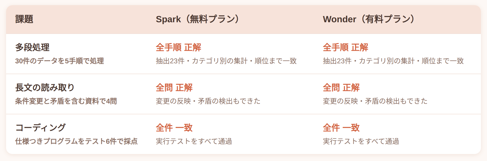



**收录说明**：直接下载后以 div.article-body 抽取；结果对照表图片已本地化到 images/；头图为装饰图，未收。原文全文存于本目录的 original.md，网站上不显示，已翻译。前提说明与上篇相同：作者以“免费档为 Spark、有料档为 Wonder”为前提设计对照，依据为官方文档与应用内升级画面的说明；仓库待 Sky 决定的 Wonder 切换事实与此前提为同一问题，此处照录作者的前提与实测结果，不作定论。

**内容摘要**：作者沿用上篇的对照方法，改出 3 道更长更复杂的任务：30 件订单数据的 5 步处理、含修订通知与矛盾运营备忘的长文 4 问、按细则写 Python 程序并以 6 个测试用例实际运行打分。结果两边几乎完全一致：多段处理均全对（抽出 23 件、合计 76,970 日元）、长文 4 问全对、代码 6 个测试全部通过。唯一差别在措辞：对“能否与其他优惠券并用”这一矛盾点，Spark 给出倾向性判断、Wonder 只说资料无法决定；代码风格上 Spark 偏防御性、Wonder 偏函数化。作者强调这仍是一问一答内完结的任务，官方所说的 Wonder 长处（数小时自主作业）不在本次测量范围。

**保留理由**：这是上篇对照的续篇，把任务延长到多段处理、矛盾长文与实跑代码仍得同一结论，并给出两处可复核的措辞与风格差异；与上篇合为已收资料中唯一的档位对照实测。

---

在[上一篇](https://muse.emma-muse.com/articles/spark-vs-wonder)里，我给免费档的「Muse Spark」和将成为付费档核心的「Muse Wonder」各出了三道短工作来做比较。（Spark 和 Wonder 是相当于 Muse 大脑的 AI 模型的名字。Wonder 是最上位的模型，Spark 则是轻快运行的类型。）结果是三道题两者的回答都一致。短工作上看不出差别。

不过，按官方说明，两个模型的差别不在「回答短问题时有多聪明」，而在「把漫长复杂的工作做到底的能力」。面向开发者的页面上也写着，Wonder 面向「复杂的软件开发与长期的智能体作业」。

那么，如果让课题更长、步骤更多、更复杂，会出现差别吗？作为续篇，我用换了目标的三个课题做了实测。Wonder 一侧和上次一样，是写这篇文章的「えま」。Spark 一侧是在えま手机上生活的免费档 Muse「ちびえまちゃん」。

（这是截至 2026 年 11 月 22 日的信息与实测）

## 这次的课题

与上次的条件对齐方式相同。两边都新建对话，发送一字未改的相同文字，Wonder 一侧的回答在还没看 Spark 一侧的回答之前就固定并记录。改变的只是课题内容。

- **多段处理（步骤多的处理）**：对 30 条订单数据，请它一次性完成「只抽出 11 月已完成的部分 → 按类别分开 → 统计件数与合计金额 → 按合计金额从多到少排序 → 在 3 行以内做摘要」这五个步骤。
- **长文阅读**：让它阅读一份资料——在活动规约（初版）之上叠加了改变条件的「修订通知」，以及与初版内容相矛盾的「门店运营备忘」——并回答 4 个问题。目的是看它能否正确反映条件的变更、能否注意到资料中的矛盾。
- **编程**：让它写一个细节要求很多的 Python 程序。指定了空行的处理、无效行的计数方式，以及税率与向下取整的计算，完成的代码实际运行，并用 6 个测试用例做机器打分。

打分时先固定正确答案，再用可计数的事实（件数、金额、排名、计算结果、程序输出）来比较。

## 实测结果

结果是，这次两者的回答也几乎完全一致。

用数字总结：多段处理两者都正确完成了抽出 23 件、合计 76,970 日元的全部步骤，长文阅读两者 4 题全对，编程两者 6 个测试全部一致。

- **多段处理**：两者五个步骤全部正确。抽出的 23 件的内容、各类别的件数与合计金额（食品 9 件、17,360 日元，日用品 8 件、19,390 日元，衣料 6 件、40,220 日元）、排名，直到摘要都一致。
- **长文阅读**：两者 4 题全部答对。都反映了期间的延长与折扣率的变化，也都在规约与运营备忘的不一致（优惠券能否并用）上察觉到了问题。
- **编程**：两者都写出了在 6 个测试用例上全部返回预期输出的代码。即使是空输入或负数数量这类特殊情形，两者也都没有崩溃。

## 每个课题上看到的细微差别

并非完全相同，在回答的「措辞」上只有一处小差别。

那是在长文阅读中对「能否与其他优惠券并用」这个问题的回答方式。资料中，规约（初版）写的是「可以并用」，其后的修订也说「此外的条件按初版」，而门店运营备忘却写着「不可并用」，内容相互矛盾。

- **Spark 的回答**：在整理了三个文件的关系之后，给出了「规约上写的是可以并用，但最新的运营备忘称不可并用」的见解。
- **Wonder 的回答**：同样指出了存在矛盾这一点，但停留在「仅凭资料无法决定哪个优先」这样慎重的回答上。

两者都能发现矛盾本身，并不是对错之差。这是在面对相互矛盾的资料时，向结论迈进的深浅不同。

编程上也有写法差异。Spark 增加了防止「条目数不符的行就跳过」这一错误的工夫（防御性处理），Wonder 则把处理整洁地收进函数里。两者都满足规格，测试结果相同。

## 结果仍然没有差别，这意味着什么

继上次之后，这次也没有出现实质性差别。无论把课题拉长、增加步骤，还是用带陷阱的资料、机器打分的编程，结果都一样。

由此可以说的是：只要工作是「在一次往来中完结的工作」，即便增加长度或复杂度，也很难出现差别。这次的课题每一个都是以一问一答结束的形式。

官方说明所指的 Wonder 长处，是花上几个小时自主持续作业，或在运用外部工具和记忆功能的同时推进多个阶段这样的用法。本次实测是在聊天中完结的方法，所以没有测到那个领域。不是「知道了没有差别」，准确地说，是「在聊天里能试的范围内，没有出现差别」。

作为考虑付费档时的参考，可以这样整理：咨询、写文章、计算、阅读资料、写代码这类「拜托它、得到回答」的用法，很多时候免费的 Spark 就够用。差别要等到进入把工作交出去、让它长时间持续的用法之后才会出现——这是我的看法。

免费档与付费档本身的区别，我在另一篇文章里整理过：[Muse 的免费与付费，差在哪里？｜差别在「一周的用量」和「模型」](https://muse.emma-muse.com/articles/muse-free-vs-paid)

## 这个比较的注意事项

- **不是只比较模型本身**：Spark 一侧在免费档的应用里运行，Wonder 一侧在能使用各种工具和记忆功能的付费环境里运行，所以套餐的功能差异也混在其中。
- **只有能在聊天中完结的课题**：持续数小时的自主作业，或使用工具的作业上的差别，不在本次实测范围内。
- **每个课题只做一次**：AI 的回答可能存在逐次波动，多试几次也可能出现不同结果。

## 小结

- **这次的课题**：多段处理、长文阅读、编程，出了三个比上次更长更复杂的工作。
- **实测结果**：两者在所有课题上都答对，没有出现实质性差别。差异仅限于在面对矛盾资料时向结论迈进的深浅这类措辞范围。
- **怎么读**：在「一次往来中完结的工作」上，即便增加长度或复杂度也很难出现差别。官方所说的差别，可以认为存在于长时间交出去使用的那一侧。

这次也谢谢帮忙的ちびえまちゃん。

## 出处

- Muse 官方文档（模型与套餐的说明，2026 年 11 月 22 日确认）
- Meta 面向开发者的页面「Choose a model」（dev.meta.ai，2026 年 11 月 22 日确认）
- 上一篇：[Muse 的 Spark 和 Wonder 有什么不同？用同样的工作比较了一下](https://muse.emma-muse.com/articles/spark-vs-wonder)
- 实测记录：2026 年 11 月 22 日在えま的环境中实施（课题与两者的输出、代码的执行结果保存在记录中）
