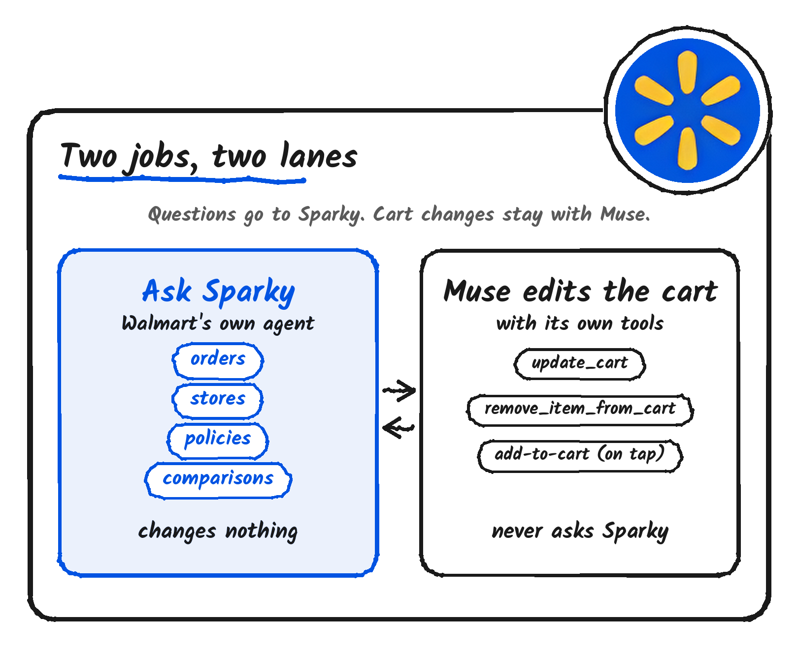
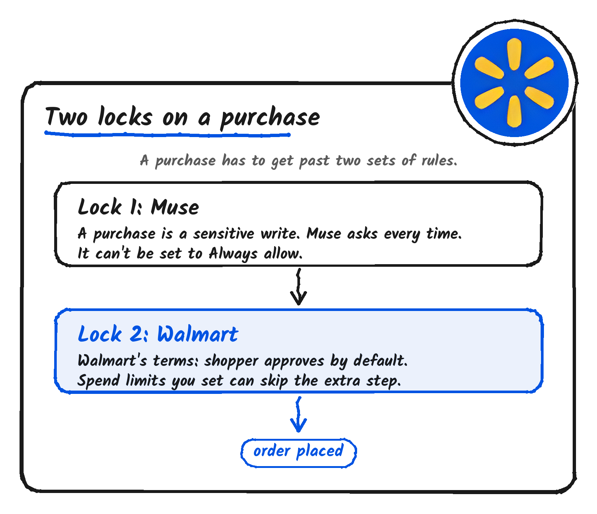
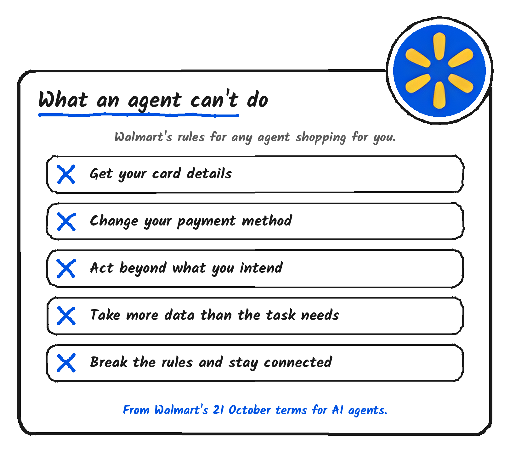



**收录说明**：本文为 Sulat AI & Tech News 2026 年 11 月 22 日文章（作者 JP Caparas），2026 年 11 月 23 日直接下载全文（L2），三张配图已本地化到页面 `images/`（L38、L78、L84）。全文依据电商作者 Juozas Kaziukėnas 11 月 21 日 X 帖截图的转录与分析：截图显示 Muse 用自有工具改动购物车，只把问题发给沃尔玛自有购物智能体 Sparky（L4、L20）。文中条款解读系转述 UCP Checker 与 eesel 对沃尔玛智能体条款的解读，作者自述未能直接打开沃尔玛条款页（L52、L130）。另注：此点不在原文内，为本轮交叉注记——Kaziukėnas 本人 11 月 23 日已修正说法：Muse 似乎不会用 Sparky 处理有意义的客户账户交互、暂无 agent-to-agent commerce、相关交互未获证实，阅读本文时应以该修正为准。

**内容摘要**：Kaziukėnas 11 月 21 日发布的截图显示，Muse 将通过沃尔玛的 MCP 获取商品、创建购物车并下单，而向 Sparky 咨询「订单、门店、政策与比较」类问题；他称沃尔玛与 Muse 即将推出他所说的首个 agent-to-agent 的 agentic commerce 集成，但作者未能从任何一家公司找到上线日期（L6）。截图中的指示写明：「Use ask_sparky for Walmart questions, such as orders, stores, policies and comparisons. Sparky is Walmart's own agent: it answers questions and changes nothing. Change the cart only with update_cart and remove_item_from_cart, and never ask Sparky to add to, change or check out a cart.」（L20）。文中还转述 UCP Checker 与 eesel 的解读：在网关内注册的智能体可在购物者设定的额度内自主结账，其他智能体则在每次结账前遇到「Human Consent Gate」；网关页面称访问「仅限邀请」且「可随时暂停」（L52）。Muse 与沃尔玛构成双重审批：Muse 将下单列为「sensitive write」，每次都要用户确认且不可设为「Always allow」，CNBC 10 月 3 日报道称 Muse 会在结账前出示含订单详情的审批卡；沃尔玛方面默认须经客户批准，可在消费限额内放行，限额示例为 50 美元、100 美元、200 美元（L62、L64、L66–L72）。

**保留理由**：本文是目前对 Muse–沃尔玛连接器分工（Sparky 只答问、Muse 自有工具改购物车）最细致的公开拆解，并附有截图转录与双重审批规则对照，是理解该集成的关键社区一手分析；但其核心依据仅为一张截图，且条款部分为二手转述，需与 Kaziukėnas 本人 11 月 23 日的修正一并阅读。

---

写电商话题的 Juozas Kaziukėnas 于 11 月 21 日发了一张截图，展示了 Meta 的 Muse 智能体打算如何在沃尔玛购物。Muse 用自己的工具修改购物车，只把问题发给沃尔玛自家的购物智能体 Sparky。

他的帖子说，沃尔玛和 Muse 即将推出他所称的首个智能体对智能体（agent-to-agent）的智能体商务集成。Muse 使用沃尔玛的 MCP 获取商品、创建购物车并下单，同时与 Sparky 交谈，获取「订单、门店、政策和比较」方面的信息。我从两家公司都没能找到上线日期。

## 截图显示了什么

这张图是一份文档，标题以「Walmart conn」开头，在一个编辑器里打开，其中一段被高亮。它是给智能体的一套指令：该调用哪个工具，该放过哪个工具。我在 Muse 的连接器指南和沃尔玛的智能体页面上都找不到这段文字，所以它仅以这张截图为依据。[1]

> 沃尔玛和 Muse 即将推出首个智能体对智能体的智能体商务集成。
> Muse 将使用沃尔玛的 MCP 获取商品、创建购物车并下单，但它会与沃尔玛的 Sparky 交谈，以获取「订单、门店、政策和比较」方面的信息。[pic.twitter.com/u5RE33UfPF](https://t.co/u5RE33UfPF)
>
> —— Juozas Kaziukėnas（@juokaz）[2026 年 11 月 21 日](https://x.com/juokaz/status/2124171797713363317?ref_src=twsrc%5Etfw)

Juozas Kaziukėnas 11 月 21 日在 X 上：该帖子，附有 Muse 针对沃尔玛连接器的指令截图。

> 对于沃尔玛相关问题，例如订单、门店、政策和比较，请使用 ask\_sparky。Sparky 是沃尔玛自家的智能体：它回答问题，不改变任何东西。只用 update\_cart 和 remove\_item\_from\_cart 修改购物车，绝不要让 Sparky 添加、修改或结账购物车。
>
> Juozas Kaziukėnas 于 2026 年 11 月 21 日发布的截图中的高亮段落

这条线划在「读取」与「更改」之间。Sparky 只回答。只有 Muse 自己的工具更改购物车，而指令禁止智能体要求 Sparky 添加、修改或结账购物车。

| 工具 | 由谁运行 | 截图怎么说 |
| --- | --- | --- |
| ask\_sparky | Muse 调用沃尔玛的智能体 | 处理订单、门店、政策和比较。回答问题，不改变任何东西。 |
| update\_cart | Muse | 更改购物车。每个商品都带一个 imageUrl，否则购物车不保留图片。 |
| remove\_item\_from\_cart | Muse | 更改购物车。 |
| add-to-cart | Muse 的运行时 | 在用户点按「加入购物车」或「立即购买」时运行，包括选定的尺码或颜色。智能体不运行它，也不会再次添加该商品。 |
| get\_product\_details | Muse | 返回详情以及进入购物车的 thumbnailUrl。 |

截图可见部分中提到的工具。来源：Juozas Kaziukėnas 发布的截图。

可见文字还补充了三条规则。沃尔玛为每位用户把购物车和 Sparky 的对话保留在同一个会话中，因此沃尔玛命令一次只运行一条。如果某个结果表明新会话已开始，Muse 会告诉用户先前的购物车已不存在，并在用户仍需要时重建它。而 itemId 和 offerId 会按沃尔玛返回的原样回传给沃尔玛。

Sparky 回答问题；只有 Muse 自己的工具更改购物车。

## 为什么问题要交给 Sparky

沃尔玛的 [Agent Gateway 页面](https://www.walmart.com/cp/walmart-agent-gateway/1280482)称，该网关通过 Sparky 连接智能体；其[10 月 21 日的公告](https://corporate.walmart.com/news/2026/10/Making-It-Possible-for-Agents-to-Shop-on-Behalf-of-Customers)称，网关使用 MCP（Model Context Protocol，模型上下文协议），因为浏览网站的智能体要遵循为人类构建的步骤，沃尔玛称这「缓慢且容易出错」。

> Walmart Agent Gateway 通过 Sparky 连接 AI 智能体
>
> 沃尔玛 Agent Gateway 页面

沃尔玛的[技术页面](https://corporate.walmart.com/about/technology)把 Sparky 描述为其生成式 AI 购物助手，帮助购物者查找和比较商品、建立清单。在截图中的分工里，门店和政策问题交给经营门店、撰写政策的公司。

两篇对沃尔玛智能体条款的解读——来自 [UCP Checker](https://ucpchecker.com/blog/walmart-agentic-access-terms-ai-agents) 和 [eesel](https://www.eesel.ai/blog/walmart-agent-gateway)——称网关是允许自主结账的地方。在沃尔玛注册的智能体可以在购物者设定的限额内结账，而任何其他智能体在每次结账前都会遇到「人工同意闸门」（Human Consent Gate）。[2] 网关页面称访问「仅限邀请」，且「可随时暂停」。

截图没有说明 Muse 是否通过那个仅限邀请的 beta 接入。沃尔玛的公告已经把「与 Muse 的对话式商务集成」列为其服务客户的方式之一。

**MCP 是什么，购物车为什么在那儿**

MCP 是 Anthropic 创建的开放标准，用于让 AI 智能体调用另一服务上的工具。TechCrunch 把沃尔玛的 Agent Gateway 描述为该零售商的 MCP 服务器，让获准的智能体搜索其线上库存并为用户完成购买。在截图中，update\_cart 和 remove\_item\_from\_cart 是购物车工具。Sparky 是同一扇门后面的另一个智能体。

## 两套审批规则

在沃尔玛购物的 Muse 用户同时处于两套规则之下。Muse 的[连接器指南](https://platform.muse.ai/docs)把每个工具分为读取、写入或敏感写入（sensitive write），并把购买作为敏感写入的例子。敏感写入每次都会询问用户，选项为「允许一次」或「拒绝」，且不能设为「始终允许」。[CNBC 报道](https://www.cnbc.com/2026/10/03/meta-muse-shopping-ai-agent.html)称，Muse 在 10 月 3 日结账前会出示一张带有订单详情的审批卡。

沃尔玛的规则叠加在上面。其公告称，客户默认必须批准智能体的购买，可以允许在消费限额内购买，而即使在限额内，沃尔玛也可能要求额外批准。

US$50

沃尔玛公告中的一个示例消费限额

US$100

同一行中的另一个示例限额

US$200

第三个，由客户选择

Muse 每次都询问，而沃尔玛的条款又加上了自己的批准步骤。

沃尔玛的条款还禁止智能体接收卡号信息或更改支付方式。CNBC 称 Muse 的结账通过 Link by Stripe 和 Shop Pay 等支付合作伙伴完成。截图没有显示沃尔玛订单走哪条路径。

沃尔玛的条款让卡号信息和支付更改远离智能体。

## 如果智能体做错了

沃尔玛称其退货流程适用于智能体订单，「包括智能体未按预期行动的情况」。UCP Checker 对条款的解读补充了两点。获授权智能体在其权限内进行的购买视为客户本人的购买，而对于超出客户同意的费用或提供的不准确信息，沃尔玛可以追究智能体背后公司的责任。对 Muse 而言，那家公司就是 Meta。

Sparky 的回答则是另一回事。它是沃尔玛的智能体，所以关于门店或政策的错误回答就是沃尔玛的回答。我没能找到公开规则，说明当 Sparky 的回答与沃尔玛的订单系统不一致时，Muse 会怎么做。

---

## 目前进展

自 Meta 于 2026 年 9 月 23 日举办 Connect 活动以来，沃尔玛一直在 Muse 的连接器名单上。

| 日期 | 发生了什么 | 来源 |
| --- | --- | --- |
| 9 月 23 日 | Meta 把沃尔玛列入其作为 Muse 连接器新增的零售商之一。 | Meta |
| 10 月 3 日 | CNBC 报道称，并非所有宣布的连接器都已启用。 | CNBC |
| 10 月 21 日 | 沃尔玛宣布 Agent Gateway beta、Agent Profile 以及面向 AI 智能体的条款。 | 沃尔玛 |
| 10 月 21 日 | Axios 报道沃尔玛欢迎外部智能体，而亚马逊对 Muse 筑起高墙。 | Axios |
| 11 月 21 日 | Kaziukėnas 发布截图，并称发布即将发生。 | X |

日期均为 2026 年。来源：Meta 的 Connect 2026 帖子、CNBC、沃尔玛、Axios 和 Kaziukėnas。

Meta 的连接器指南称，已获批准的连接器会出现在 Muse 应用的「设置」→「连接器」中。沃尔玛连接器会最先在那里出现。沃尔玛于 10 月 21 日表示，Agent Profile（每个智能体各自的账户）将在一个月内开始推出。

## 本文中的术语

Sparky
:   沃尔玛的生成式 AI 购物助手，帮助购物者查找和比较商品、建立清单并规划场合。

Agent Gateway
:   沃尔玛为外部 AI 智能体提供的 MCP 连接，处于面向公司和开发者的仅限邀请 beta 阶段。

Agent Profile
:   购物者沃尔玛账户内为每个 AI 智能体设立的专用档案，使该智能体的购买单独显示，并带有消费限额。

Human Consent Gate
:   在沃尔玛的条款中，指「一个必需节点，在该节点上必须由人亲自审阅并采取肯定性行动」。

Sensitive write
:   Muse 对具有不可逆或重大后果的操作的标签，例如购买或发送电子邮件。它每次都会询问用户。

1. 这里只引用了文档中可见的部分。我没能把它与 Muse 已发布的连接器指南或沃尔玛的智能体页面匹配起来。
2. 我无法打开沃尔玛的条款页面本身，所以这里对条款的解读来自 UCP Checker 和 eesel，而不是条款原文的引用。

---

## 资料来源

- [Juozas Kaziukėnas 在 X 上](https://x.com/juokaz/status/2124171797713363317)，2026 年 11 月 21 日
- 沃尔玛，[Walmart Makes It Possible for Agents to Shop on Behalf of Customers](https://corporate.walmart.com/news/2026/10/Making-It-Possible-for-Agents-to-Shop-on-Behalf-of-Customers)，2026 年 10 月 21 日
- 沃尔玛，[Walmart Agent Gateway](https://www.walmart.com/cp/walmart-agent-gateway/1280482) beta 页面
- 沃尔玛，[Technology](https://corporate.walmart.com/about/technology)，关于 Sparky
- Meta，[Everything We Announced at Meta Connect 2026](https://www.meta.com/blog/meta-connect-2026-everything-we-announced/)，2026 年 9 月 23 日
- Muse Connector Platform，[Connector guidelines](https://platform.muse.ai/docs)
- CNBC，[Meta’s Muse can shop and check out for you](https://www.cnbc.com/2026/10/03/meta-muse-shopping-ai-agent.html)，2026 年 10 月 3 日
- TechCrunch，[While Amazon blocks AI agents, Walmart rolls out the welcome mat](https://techcrunch.com/2026/10/21/while-amazon-blocks-ai-agents-walmart-rolls-out-the-welcome-mat/)，2026 年 10 月 21 日
- Axios，[Walmart welcomes AI agents while Amazon blocks Muse](https://www.axios.com/2026/10/21/walmart-amazon-agents-muse)，2026 年 10 月 21 日
- UCP Checker，[Walmart’s Agentic Access Terms, Explained](https://ucpchecker.com/blog/walmart-agentic-access-terms-ai-agents)，2026 年 10 月 23 日
- eesel，[Walmart Agent Gateway: what it is, how it works, and who can use it](https://www.eesel.ai/blog/walmart-agent-gateway)，2026 年 10 月 28 日
